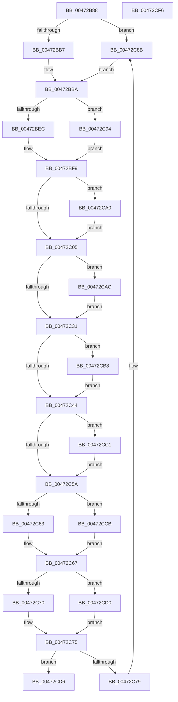

# XmGetStringAddressRange

- RVA: `0x00472B88`–`0x00472CF7` (길이 `367` bytes)
- VA: `0x0000000140472B88`
- 실행 섹션: `.text`
- PDB 이름 있음: `예`; PDB Function 태그: `아니요`
- unwind 정보 RVA: `0x00075C18`
- 디코드: `107`개 명령, `367/367` bytes 표시
- 미해석 바이트: `0` (있으면 어셈블리에 `.byte`로 보존)

> 이 문서는 커널 이미지의 기계어와 PDB 기호를 분석해 생성했습니다. 4번과 5번은 함수 원형과 자료형을 바이너리 사용 방식에서 추정한 C 해석이며 원본 소스 복구 결과는 아닙니다.

## 1. Dependencies

- 직접 호출 지점: **3**; 고유 호출 대상: **2**
- 직접 호출자로 확인된 함수: **1**
- RIP 상대 이미지 참조: **0**

### Outgoing calls
- `0x00472C0C` → [x86BiosTranslateAddress](x86BiosTranslateAddress_function_004736C0.md) (function, `0x004736C0`)
- `0x00472C38` → [x86BiosTranslateAddress](x86BiosTranslateAddress_function_004736C0.md) (function, `0x004736C0`)
- `0x00472C85` → [longjmp](../4F/longjmp_function_004FD5F0.md) (function, `0x004FD5F0`)

### Direct callers
- [XmStosOp](XmStosOp_function_00472950.md) at `0x004729C8`

### Static image references
- 디코드된 RIP-relative 메모리 참조가 없습니다.

## 2. Other-region calls and transfers

- 다른 실행 섹션으로 향하는 call: **0**
- 별도 외부 분기/꼬리 이동을 확인하지 못했습니다.

## 3. Assembly (complete function range)

```asm
00472B88  48 89 5C 24 08                  mov qword ptr [rsp + 8], rbx
00472B8D  48 89 6C 24 10                  mov qword ptr [rsp + 0x10], rbp
00472B92  48 89 74 24 18                  mov qword ptr [rsp + 0x18], rsi
00472B97  57                              push rdi
00472B98  41 54                           push r12
00472B9A  41 55                           push r13
00472B9C  41 56                           push r14
00472B9E  41 57                           push r15
00472BA0  48 83 EC 20                     sub rsp, 0x20
00472BA4  80 B9 89 00 00 00 00            cmp byte ptr [rcx + 0x89], 0
00472BAB  4D 8B F1                        mov r14, r9
00472BAE  48 8B D9                        mov rbx, rcx
00472BB1  0F 84 D4 00 00 00               je 0x140472c8b
00472BB7  8B 71 34                        mov esi, dword ptr [rcx + 0x34]
00472BBA  44 0F B7 51 38                  movzx r10d, word ptr [rcx + 0x38]
00472BBF  4C 8D 6B 10                     lea r13, [rbx + 0x10]
00472BC3  44 8B 43 78                     mov r8d, dword ptr [rbx + 0x78]
00472BC7  41 8B CA                        mov ecx, r10d
00472BCA  C1 E1 04                        shl ecx, 4
00472BCD  0F B7 EE                        movzx ebp, si
00472BD0  03 CD                           add ecx, ebp
00472BD2  33 D2                           xor edx, edx
00472BD4  81 E1 FF 0F 00 00               and ecx, 0xfff
00472BDA  41 F7 45 00 00 04 00 00         test dword ptr [r13], 0x400
00472BE2  45 8D 48 01                     lea r9d, [r8 + 1]
00472BE6  0F 85 A8 00 00 00               jne 0x140472c94
00472BEC  44 2B C1                        sub r8d, ecx
00472BEF  41 8D 80 00 10 00 00            lea eax, [r8 + 0x1000]
00472BF6  41 F7 F1                        div r9d
00472BF9  4D 8B FD                        mov r15, r13
00472BFC  41 39 06                        cmp dword ptr [r14], eax
00472BFF  0F 87 9B 00 00 00               ja 0x140472ca0
00472C05  0F B7 D5                        movzx edx, bp
00472C08  41 0F B7 CA                     movzx ecx, r10w
00472C0C  E8 AF 0A 00 00                  call 0x1404736c0
00472C11  41 8B 4D 00                     mov ecx, dword ptr [r13]
00472C15  4C 8B E0                        mov r12, rax
00472C18  8B 43 78                        mov eax, dword ptr [rbx + 0x78]
00472C1B  41 BD 00 04 00 00               mov r13d, 0x400
00472C21  41 8B 16                        mov edx, dword ptr [r14]
00472C24  FF CA                           dec edx
00472C26  8D 78 01                        lea edi, [rax + 1]
00472C29  0F AF FA                        imul edi, edx
00472C2C  41 85 CD                        test r13d, ecx
00472C2F  75 7B                           jne 0x140472cac
00472C31  0F B7 4B 38                     movzx ecx, word ptr [rbx + 0x38]
00472C35  8D 14 2F                        lea edx, [rdi + rbp]
00472C38  E8 83 0A 00 00                  call 0x1404736c0
00472C3D  41 2B C4                        sub eax, r12d
00472C40  3B C7                           cmp eax, edi
00472C42  75 74                           jne 0x140472cb8
00472C44  44 8B 43 78                     mov r8d, dword ptr [rbx + 0x78]
00472C48  41 8B 06                        mov eax, dword ptr [r14]
00472C4B  45 8B 0F                        mov r9d, dword ptr [r15]
00472C4E  41 8D 50 01                     lea edx, [r8 + 1]
00472C52  0F AF D0                        imul edx, eax
00472C55  45 23 CD                        and r9d, r13d
00472C58  75 67                           jne 0x140472cc1
00472C5A  80 BB 89 00 00 00 00            cmp byte ptr [rbx + 0x89], 0
00472C61  75 68                           jne 0x140472ccb
00472C63  66 01 53 34                     add word ptr [rbx + 0x34], dx
00472C67  0F B7 4B 44                     movzx ecx, word ptr [rbx + 0x44]
00472C6B  45 85 C9                        test r9d, r9d
00472C6E  75 60                           jne 0x140472cd0
00472C70  8D 42 FF                        lea eax, [rdx - 1]
00472C73  03 C6                           add eax, esi
00472C75  3B C1                           cmp eax, ecx
00472C77  76 5D                           jbe 0x140472cd6
00472C79  48 8D 8B A0 00 00 00            lea rcx, [rbx + 0xa0]
00472C80  BA 0E 00 00 00                  mov edx, 0xe
00472C85  E8 66 A9 08 00                  call 0x1404fd5f0
00472C8A  CC                              int3
00472C8B  0F B7 71 34                     movzx esi, word ptr [rcx + 0x34]
00472C8F  E9 26 FF FF FF                  jmp 0x140472bba
00472C94  8B C1                           mov eax, ecx
00472C96  41 F7 F1                        div r9d
00472C99  FF C0                           inc eax
00472C9B  E9 59 FF FF FF                  jmp 0x140472bf9
00472CA0  41 89 06                        mov dword ptr [r14], eax
00472CA3  4C 8D 7B 10                     lea r15, [rbx + 0x10]
00472CA7  E9 59 FF FF FF                  jmp 0x140472c05
00472CAC  8B F8                           mov edi, eax
00472CAE  F7 D7                           not edi
00472CB0  0F AF FA                        imul edi, edx
00472CB3  E9 79 FF FF FF                  jmp 0x140472c31
00472CB8  41 C7 06 01 00 00 00            mov dword ptr [r14], 1
00472CBF  EB 83                           jmp 0x140472c44
00472CC1  41 8B D0                        mov edx, r8d
00472CC4  F7 D2                           not edx
00472CC6  0F AF D0                        imul edx, eax
00472CC9  EB 8F                           jmp 0x140472c5a
00472CCB  01 53 34                        add dword ptr [rbx + 0x34], edx
00472CCE  EB 97                           jmp 0x140472c67
00472CD0  41 8D 04 30                     lea eax, [r8 + rsi]
00472CD4  EB 9F                           jmp 0x140472c75
00472CD6  48 8B 5C 24 50                  mov rbx, qword ptr [rsp + 0x50]
00472CDB  49 8B C4                        mov rax, r12
00472CDE  48 8B 6C 24 58                  mov rbp, qword ptr [rsp + 0x58]
00472CE3  48 8B 74 24 60                  mov rsi, qword ptr [rsp + 0x60]
00472CE8  48 83 C4 20                     add rsp, 0x20
00472CEC  41 5F                           pop r15
00472CEE  41 5E                           pop r14
00472CF0  41 5D                           pop r13
00472CF2  41 5C                           pop r12
00472CF4  5F                              pop rdi
00472CF5  C3                              ret
00472CF6  CC                              int3
```

## 4. C-style interpretation (structured pseudocode)

```c
__int64 __fastcall XmGetStringAddressRange(__int64 a1, int a2, __int64 a3, __int64 a4)
{
    __int64 result;
    __int64 v_rdi;
    __int64 v_rsp;
    unsigned __int64 v_stack_p10;
    unsigned __int64 v_stack_p18;
    unsigned __int64 v_stack_p8;

    v_stack_p8 = v_rbx;
    v_stack_p10 = v_rbp;
    v_stack_p18 = v_rsi;
    v_rsp = (v_rsp) - (32);
    if ((*(unsigned __int8 *)(a1 + 137)) == 0) goto loc_00472C8B;
loc_00472BBA:
    a1 = (unsigned int)(((unsigned int)((unsigned int)(*(unsigned __int16 *)(a1 + 56)))) << (4));
    a1 = (unsigned int)((a1) + ((unsigned int)((unsigned __int16)((unsigned int)(*(unsigned int *)(a1 + 52))))));
    a2 = 0;
    a1 = (unsigned int)((a1) & (0xFFFULL));
    if (((*(unsigned int *)(a1 + 16)) & (0x400ULL)) != 0) goto loc_00472C94;
    a3 = (unsigned int)(((unsigned int)(*(unsigned int *)(a1 + 120))) - ((unsigned int)(a1)));
loc_00472BF9:
    if ((*(unsigned int *)(a4)) > ((unsigned int)(a3 + 4096))) goto loc_00472CA0;
loc_00472C05:
    result = x86BiosTranslateAddress((unsigned __int16)(*(unsigned __int16 *)(a1 + 56)), (unsigned __int16)((unsigned __int16)((unsigned int)(*(unsigned int *)(a1 + 52)))), a3, (unsigned int)(*(unsigned int *)(a1 + 120)) + 1);
    a2 = (unsigned int)(((unsigned int)(*(unsigned int *)(a4))) - 1);
    v_rdi = (unsigned int)(((unsigned int)(*(unsigned int *)(a1 + 120)) + 1) * (a2));
    if ((((unsigned int)((unsigned int)(0x400ULL))) & ((unsigned int)((unsigned int)(*(unsigned int *)(a1 + 16))))) != 0) goto loc_00472CAC;
loc_00472C31:
    result = x86BiosTranslateAddress(*(unsigned __int16 *)(a1 + 56), v_rdi + (unsigned __int16)((unsigned int)(*(unsigned int *)(a1 + 52))) * 1, a3, (unsigned int)(*(unsigned int *)(a1 + 120)) + 1);
    result = (unsigned int)((result) - ((unsigned int)(result)));
    if (((unsigned int)(result)) != ((unsigned int)(v_rdi))) goto loc_00472CB8;
loc_00472C44:
    a2 = (unsigned int)(((unsigned int)(*(unsigned int *)(a1 + 120)) + 1) * ((unsigned int)((unsigned int)(*(unsigned int *)(a4)))));
    a4 = (unsigned int)(((unsigned int)(*(unsigned int *)(a1 + 16))) & ((unsigned int)((unsigned int)(0x400ULL))));
    if (condition_is_not_equal) goto loc_00472CC1;
loc_00472C5A:
    if ((*(unsigned __int8 *)(a1 + 137)) != 0) goto loc_00472CCB;
loc_00472C67:
    if ((unsigned int)(a4) != 0) goto loc_00472CD0;
    result = (unsigned int)((a2 - 1) + ((unsigned int)((unsigned int)(*(unsigned int *)(a1 + 52)))));
loc_00472C75:
    if (((unsigned int)(result)) <= ((unsigned int)(*(unsigned __int16 *)(a1 + 68)))) goto loc_00472CD6;
    result = longjmp(a1 + 160, 14, (unsigned int)(*(unsigned int *)(a1 + 120)), a4);
loc_00472C8B:
    goto loc_00472BBA;
loc_00472C94:
    result = (unsigned int)(((unsigned int)((unsigned int)(a1 + 160))) + 1);
    goto loc_00472BF9;
loc_00472CA0:
    *(unsigned int *)(a4) = (unsigned int)(result);
    goto loc_00472C05;
loc_00472CAC:
    v_rdi = (unsigned int)(~((unsigned int)((unsigned int)(result))));
    v_rdi = (unsigned int)((v_rdi) * (14));
    goto loc_00472C31;
loc_00472CB8:
    *(unsigned int *)(a4) = 1;
    goto loc_00472C44;
loc_00472CC1:
    a2 = (unsigned int)(~((unsigned int)((unsigned int)((unsigned int)(*(unsigned int *)(a1 + 120))))));
    a2 = (unsigned int)((a2) * ((unsigned int)(result)));
    goto loc_00472C5A;
loc_00472CCB:
    goto loc_00472C67;
loc_00472CD0:
    goto loc_00472C75;
loc_00472CD6:
    v_rsp = (v_rsp) + (32);
    return result;
}
```

## 5. (Beta) C Style

```c
int64_t XmGetStringAddressRange(void *Arg1, int32_t Arg2, int64_t Arg3, void *Arg4)
{
    uint8_t *arg1 = (uint8_t *)Arg1;
    uint8_t *arg4 = (uint8_t *)Arg4;

    int64_t result;
    int64_t local_rdi;
    int64_t local_rsp;
    uint64_t v_stack_p10;
    uint64_t v_stack_p18;
    uint64_t v_stack_p8;

    v_stack_p8 = local_rbx;
    v_stack_p10 = local_rbp;
    v_stack_p18 = local_rsi;
    local_rsp = (local_rsp) - (32);
    if ((*(uint8_t *)(arg1 + 0x89)) == 0) goto loc_00472C8B;
loc_00472BBA:
    Arg1 = (uint32_t)(((uint32_t)((uint32_t)(*(uint16_t *)(arg1 + 0x38)))) << (4));
    Arg1 = (uint32_t)((Arg1) + ((uint32_t)((uint16_t)((uint32_t)(*(uint32_t *)(arg1 + 0x34))))));
    Arg2 = 0;
    Arg1 = (uint32_t)((Arg1) & (0xFFFULL));
    if (((*(uint32_t *)(arg1 + 0x10)) & (0x400ULL)) != 0) goto loc_00472C94;
    Arg3 = (uint32_t)(((uint32_t)(*(uint32_t *)(arg1 + 0x78))) - ((uint32_t)(Arg1)));
loc_00472BF9:
    if ((*(uint32_t *)(arg4)) > ((uint32_t)(Arg3 + 4096))) goto loc_00472CA0;
loc_00472C05:
    result = x86BiosTranslateAddress((uint16_t)(*(uint16_t *)(arg1 + 0x38)), (uint16_t)((uint16_t)((uint32_t)(*(uint32_t *)(arg1 + 0x34)))), Arg3, (uint32_t)(*(uint32_t *)(arg1 + 0x78)) + 1);
    Arg2 = (uint32_t)(((uint32_t)(*(uint32_t *)(arg4))) - 1);
    local_rdi = (uint32_t)(((uint32_t)(*(uint32_t *)(arg1 + 0x78)) + 1) * (Arg2));
    if ((((uint32_t)((uint32_t)(0x400ULL))) & ((uint32_t)((uint32_t)(*(uint32_t *)(arg1 + 0x10))))) != 0) goto loc_00472CAC;
loc_00472C31:
    result = x86BiosTranslateAddress(*(uint16_t *)(arg1 + 0x38), local_rdi + (uint16_t)((uint32_t)(*(uint32_t *)(arg1 + 0x34))) * 1, Arg3, (uint32_t)(*(uint32_t *)(arg1 + 0x78)) + 1);
    result = (uint32_t)((result) - ((uint32_t)(result)));
    if (((uint32_t)(result)) != ((uint32_t)(local_rdi))) goto loc_00472CB8;
loc_00472C44:
    Arg2 = (uint32_t)(((uint32_t)(*(uint32_t *)(arg1 + 0x78)) + 1) * ((uint32_t)((uint32_t)(*(uint32_t *)(arg4)))));
    Arg4 = (uint32_t)(((uint32_t)(*(uint32_t *)(arg1 + 0x10))) & ((uint32_t)((uint32_t)(0x400ULL))));
    if (condition_is_not_equal) goto loc_00472CC1;
loc_00472C5A:
    if ((*(uint8_t *)(arg1 + 0x89)) != 0) goto loc_00472CCB;
loc_00472C67:
    if ((uint32_t)(Arg4) != 0) goto loc_00472CD0;
    result = (uint32_t)((Arg2 - 1) + ((uint32_t)((uint32_t)(*(uint32_t *)(arg1 + 0x34)))));
loc_00472C75:
    if (((uint32_t)(result)) <= ((uint32_t)(*(uint16_t *)(arg1 + 0x44)))) goto loc_00472CD6;
    result = longjmp(Arg1 + 160, 14, (uint32_t)(*(uint32_t *)(arg1 + 0x78)), Arg4);
loc_00472C8B:
    goto loc_00472BBA;
loc_00472C94:
    result = (uint32_t)(((uint32_t)((uint32_t)(Arg1 + 160))) + 1);
    goto loc_00472BF9;
loc_00472CA0:
    *(uint32_t *)(arg4) = (uint32_t)(result);
    goto loc_00472C05;
loc_00472CAC:
    local_rdi = (uint32_t)(~((uint32_t)((uint32_t)(result))));
    local_rdi = (uint32_t)((local_rdi) * (14));
    goto loc_00472C31;
loc_00472CB8:
    *(uint32_t *)(arg4) = 1;
    goto loc_00472C44;
loc_00472CC1:
    Arg2 = (uint32_t)(~((uint32_t)((uint32_t)((uint32_t)(*(uint32_t *)(arg1 + 0x78))))));
    Arg2 = (uint32_t)((Arg2) * ((uint32_t)(result)));
    goto loc_00472C5A;
loc_00472CCB:
    goto loc_00472C67;
loc_00472CD0:
    goto loc_00472C75;
loc_00472CD6:
    local_rsp = (local_rsp) + (32);
    return result;
}
```

### 관측된 메모리 오프셋

구조체 형식이 확인되지 않은 접근은 인자 기준의 오프셋으로만 기록했습니다.

| 기준 인자 | 오프셋 표현 | 폭 (bit) | 접근 |
|---|---:|---:|---|
| `Arg1` | `+ 0x0` | `32` | `R` |
| `Arg1` | `+ 0x10` | `64` | `R` |
| `Arg1` | `+ 0x34` | `16` | `R/W` |
| `Arg1` | `+ 0x34` | `32` | `R` |
| `Arg1` | `+ 0x34` | `32` | `R/W` |
| `Arg1` | `+ 0x38` | `16` | `R` |
| `Arg1` | `+ 0x44` | `16` | `R` |
| `Arg1` | `+ 0x78` | `32` | `R` |
| `Arg1` | `+ 0x89` | `8` | `R` |
| `Arg1` | `+ 0xA0` | `64` | `R` |
| `Arg4` | `+ 0x0` | `32` | `R` |
| `Arg4` | `+ 0x0` | `32` | `W` |

## 6. Execution-region graph

[열기: 2D/3D 그래프와 함수 탐색 컨트롤 패널](../../../control-panel.html?section=text&rva=0x00472B88&view=graph)

- 2D 그래프는 위에서 아래로 흐르고, 3D 그래프는 빈 공간을 드래그해 회전합니다. Shift+드래그는 이동, 휠은 확대·축소, 함수 노드 선택은 대상 보고서 이동입니다.

### Static fallback


