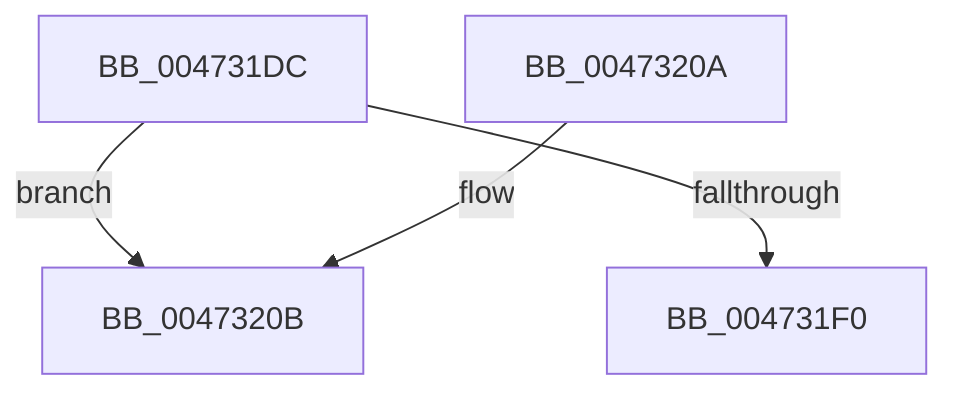

# XmGetWordImmediate

- RVA: `0x004731DC`–`0x0047321D` (길이 `65` bytes)
- VA: `0x00000001404731DC`
- 실행 섹션: `.text`
- PDB 이름 있음: `예`; PDB Function 태그: `아니요`
- unwind 정보 RVA: `0x0007A1AC`
- 디코드: `18`개 명령, `65/65` bytes 표시
- 미해석 바이트: `0` (있으면 어셈블리에 `.byte`로 보존)

> 이 문서는 커널 이미지의 기계어와 PDB 기호를 분석해 생성했습니다. 4번과 5번은 함수 원형과 자료형을 바이너리 사용 방식에서 추정한 C 해석이며 원본 소스 복구 결과는 아닙니다.

## 1. Dependencies

- 직접 호출 지점: **2**; 고유 호출 대상: **2**
- 직접 호출자로 확인된 함수: **10**
- RIP 상대 이미지 참조: **0**

### Outgoing calls
- `0x004731FD` → [x86BiosTranslateAddress](x86BiosTranslateAddress_function_004736C0.md) (function, `0x004736C0`)
- `0x00473217` → [longjmp](../4F/longjmp_function_004FD5F0.md) (function, `0x004FD5F0`)

### Direct callers
- [XmMoveRegImmediate](XmMoveRegImmediate_function_00473000.md) at `0x00473065`
- [XmEvaluateAddressSpecifier](XmEvaluateAddressSpecifier_function_00473224.md) at `0x0047338A`
- [XmGetImmediateSourceValue](XmGetImmediateSourceValue_function_0047340C.md) at `0x0047342E`
- [XmAccumImmediate](XmAccumImmediate_function_00473460.md) at `0x004734A5`
- [XmImmediateEnter](../57/XmImmediateEnter_function_005765A0.md) at `0x005765A9`
- [XmImmediateJump](../57/XmImmediateJump_function_005765F0.md) at `0x00576609`
- [XmImmediateJump](../57/XmImmediateJump_function_005765F0.md) at `0x00576617`
- [XmLongJump](../57/XmLongJump_function_00576790.md) at `0x005767AE`
- [XmSegmentOffset](../57/XmSegmentOffset_function_00576A60.md) at `0x00576A81`
- [XmRetOp](../57/XmRetOp_function_00577C50.md) at `0x00577C64`
- [sub_006F3DB6](../6F/Unknown_function_006F3DB6.md) at `0x006F3F99`
- [sub_006F3DB6](../6F/Unknown_function_006F3DB6.md) at `0x006F3FF0`
- [sub_006F3DB6](../6F/Unknown_function_006F3DB6.md) at `0x006F40C9`
- [sub_006F3DB6](../6F/Unknown_function_006F3DB6.md) at `0x006F40D7`
- [sub_006F3DB6](../6F/Unknown_function_006F3DB6.md) at `0x006F40E4`
- [sub_006F3DB6](../6F/Unknown_function_006F3DB6.md) at `0x006F40F2`
- [sub_006F3DB6](../6F/Unknown_function_006F3DB6.md) at `0x006F4100`
- [sub_006F3DB6](../6F/Unknown_function_006F3DB6.md) at `0x006F4111`

### Static image references
- 디코드된 RIP-relative 메모리 참조가 없습니다.

## 2. Other-region calls and transfers

- 다른 실행 섹션으로 향하는 call: **0**
- 별도 외부 분기/꼬리 이동을 확인하지 못했습니다.

## 3. Assembly (complete function range)

```asm
004731DC  48 83 EC 28                     sub rsp, 0x28
004731E0  44 8B 41 14                     mov r8d, dword ptr [rcx + 0x14]
004731E4  0F B7 51 46                     movzx edx, word ptr [rcx + 0x46]
004731E8  41 8D 40 01                     lea eax, [r8 + 1]
004731EC  3B C2                           cmp eax, edx
004731EE  77 1B                           ja 0x14047320b
004731F0  66 83 41 14 02                  add word ptr [rcx + 0x14], 2
004731F5  41 0F B7 D0                     movzx edx, r8w
004731F9  0F B7 49 3A                     movzx ecx, word ptr [rcx + 0x3a]
004731FD  E8 BE 04 00 00                  call 0x1404736c0
00473202  0F B7 00                        movzx eax, word ptr [rax]
00473205  48 83 C4 28                     add rsp, 0x28
00473209  C3                              ret
0047320A  CC                              int3
0047320B  48 81 C1 A0 00 00 00            add rcx, 0xa0
00473212  BA 0E 00 00 00                  mov edx, 0xe
00473217  E8 D4 A3 08 00                  call 0x1404fd5f0
0047321C  CC                              int3
```

## 4. C-style interpretation (structured pseudocode)

```c
__int64 __fastcall XmGetWordImmediate(__int64 a1)
{
    __int64 result;
    __int64 v_rsp;

    v_rsp = (v_rsp) - (40);
    if (((unsigned int)((unsigned int)(*(unsigned int *)(a1 + 20)) + 1)) > ((unsigned int)(*(unsigned __int16 *)(a1 + 70)))) goto loc_0047320B;
    result = x86BiosTranslateAddress(*(unsigned __int16 *)(a1 + 58), (unsigned __int16)((unsigned int)(*(unsigned int *)(a1 + 20))), (unsigned int)(*(unsigned int *)(a1 + 20)), a4);
    v_rsp = (v_rsp) + (40);
    return *(unsigned __int16 *)(result);
loc_0047320B:
    a1 = (*(unsigned __int16 *)(a1 + 58)) + (160);
    result = longjmp(a1, 14, (unsigned int)(*(unsigned int *)(a1 + 20)), a4);
    return result;
}
```

## 5. (Beta) C Style

```c
int64_t XmGetWordImmediate(void *Arg1)
{
    uint8_t *arg1 = (uint8_t *)Arg1;

    int64_t result;
    int64_t local_rsp;

    local_rsp = (local_rsp) - (40);
    if (((uint32_t)((uint32_t)(*(uint32_t *)(arg1 + 0x14)) + 1)) > ((uint32_t)(*(uint16_t *)(arg1 + 0x46)))) goto loc_0047320B;
    result = x86BiosTranslateAddress(*(uint16_t *)(arg1 + 0x3A), (uint16_t)((uint32_t)(*(uint32_t *)(arg1 + 0x14))), (uint32_t)(*(uint32_t *)(arg1 + 0x14)), a4);
    local_rsp = (local_rsp) + (40);
    return *(uint16_t *)(result);
loc_0047320B:
    Arg1 = (*(uint16_t *)(arg1 + 0x3A)) + (160);
    result = longjmp(Arg1, 14, (uint32_t)(*(uint32_t *)(arg1 + 0x14)), a4);
    return result;
}
```

### 관측된 메모리 오프셋

구조체 형식이 확인되지 않은 접근은 인자 기준의 오프셋으로만 기록했습니다.

| 기준 인자 | 오프셋 표현 | 폭 (bit) | 접근 |
|---|---:|---:|---|
| `Arg1` | `+ 0x14` | `16` | `R/W` |
| `Arg1` | `+ 0x14` | `32` | `R` |
| `Arg1` | `+ 0x3A` | `16` | `R` |
| `Arg1` | `+ 0x46` | `16` | `R` |

## 6. Execution-region graph

[열기: 2D/3D 그래프와 함수 탐색 컨트롤 패널](../../../control-panel.html?section=text&rva=0x004731DC&view=graph)

- 2D 그래프는 위에서 아래로 흐르고, 3D 그래프는 빈 공간을 드래그해 회전합니다. Shift+드래그는 이동, 휠은 확대·축소, 함수 노드 선택은 대상 보고서 이동입니다.

### Static fallback


