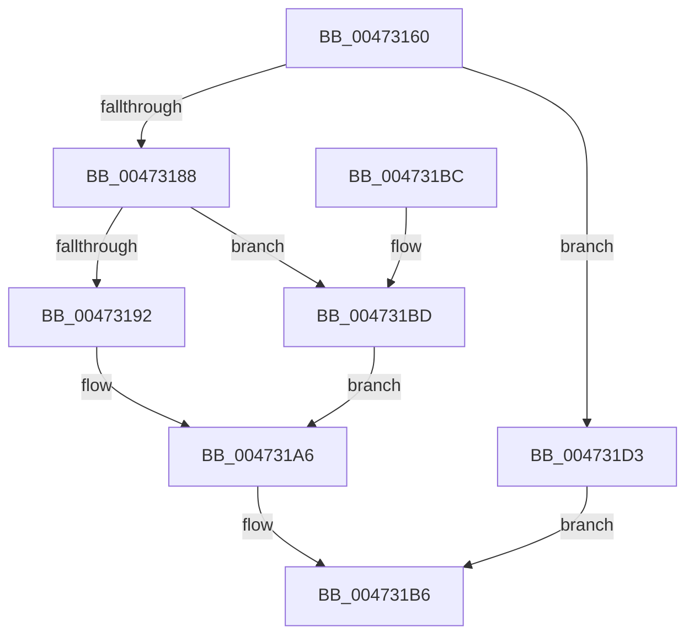

# XmGroup1General

- RVA: `0x00473160`–`0x004731D5` (길이 `117` bytes)
- VA: `0x0000000140473160`
- 실행 섹션: `.text`
- PDB 이름 있음: `예`; PDB Function 태그: `아니요`
- unwind 정보 RVA: `0x0008C174`
- 디코드: `35`개 명령, `117/117` bytes 표시
- 미해석 바이트: `0` (있으면 어셈블리에 `.byte`로 보존)

> 이 문서는 커널 이미지의 기계어와 PDB 기호를 분석해 생성했습니다. 4번과 5번은 함수 원형과 자료형을 바이너리 사용 방식에서 추정한 C 해석이며 원본 소스 복구 결과는 아닙니다.

## 1. Dependencies

- 직접 호출 지점: **7**; 고유 호출 대상: **5**
- 직접 호출자로 확인된 함수: **0**
- RIP 상대 이미지 참조: **0**

### Outgoing calls
- `0x0047316E` → [XmSetDataType](XmSetDataType_function_004734C0.md) (function, `0x004734C0`)
- `0x0047317B` → [XmEvaluateAddressSpecifier](XmEvaluateAddressSpecifier_function_00473224.md) (function, `0x00473224`)
- `0x00473195` → [XmSetDestinationValue](XmSetDestinationValue_function_004734EC.md) (function, `0x004734EC`)
- `0x0047319E` → [XmGetRegisterAddress](XmGetRegisterAddress_function_00473778.md) (function, `0x00473778`)
- `0x004731AC` → [XmSetSourceValue](XmSetSourceValue_function_004737A8.md) (function, `0x004737A8`)
- `0x004731C1` → [XmGetRegisterAddress](XmGetRegisterAddress_function_00473778.md) (function, `0x00473778`)
- `0x004731CC` → [XmSetDestinationValue](XmSetDestinationValue_function_004734EC.md) (function, `0x004734EC`)

### Direct callers
- 이 함수 시작 RVA로 연결되는 직접 call은 확인되지 않았습니다. 간접 호출은 완전히 역산할 수 없습니다.

### Static image references
- 디코드된 RIP-relative 메모리 참조가 없습니다.

## 2. Other-region calls and transfers

- 다른 실행 섹션으로 향하는 call: **0**
- 별도 외부 분기/꼬리 이동을 확인하지 못했습니다.

## 3. Assembly (complete function range)

```asm
00473160  40 53                           push rbx
00473162  48 83 EC 20                     sub rsp, 0x20
00473166  83 64 24 38 00                  and dword ptr [rsp + 0x38], 0
0047316B  48 8B D9                        mov rbx, rcx
0047316E  E8 4D 03 00 00                  call 0x1404734c0
00473173  48 8D 54 24 38                  lea rdx, [rsp + 0x38]
00473178  48 8B CB                        mov rcx, rbx
0047317B  E8 A4 00 00 00                  call 0x140473224
00473180  4C 8B C8                        mov r9, rax
00473183  48 85 C0                        test rax, rax
00473186  74 4B                           je 0x1404731d3
00473188  8B 43 70                        mov eax, dword ptr [rbx + 0x70]
0047318B  48 8B CB                        mov rcx, rbx
0047318E  A8 02                           test al, 2
00473190  75 2B                           jne 0x1404731bd
00473192  49 8B D1                        mov rdx, r9
00473195  E8 52 03 00 00                  call 0x1404734ec
0047319A  8B 54 24 38                     mov edx, dword ptr [rsp + 0x38]
0047319E  E8 D5 05 00 00                  call 0x140473778
004731A3  4C 8B C8                        mov r9, rax
004731A6  49 8B D1                        mov rdx, r9
004731A9  48 8B CB                        mov rcx, rbx
004731AC  E8 F7 05 00 00                  call 0x1404737a8
004731B1  B8 01 00 00 00                  mov eax, 1
004731B6  48 83 C4 20                     add rsp, 0x20
004731BA  5B                              pop rbx
004731BB  C3                              ret
004731BC  CC                              int3
004731BD  8B 54 24 38                     mov edx, dword ptr [rsp + 0x38]
004731C1  E8 B2 05 00 00                  call 0x140473778
004731C6  48 8B D0                        mov rdx, rax
004731C9  48 8B CB                        mov rcx, rbx
004731CC  E8 1B 03 00 00                  call 0x1404734ec
004731D1  EB D3                           jmp 0x1404731a6
004731D3  EB E1                           jmp 0x1404731b6
```

## 4. C-style interpretation (structured pseudocode)

```c
__int64 __fastcall XmGroup1General(__int64 a1)
{
    __int64 result;
    __int64 v_rsp;
    unsigned int v_stack_p10;
    unsigned int v_stack_p38;

    v_rsp = (v_rsp) - (32);
    result = XmSetDataType(a1, a2, a3, a4);
    result = XmEvaluateAddressSpecifier(a1, v_stack_p10, a3, a4);
    if (result == 0) goto loc_004731D3;
    if ((((unsigned __int8)((unsigned int)(*(unsigned int *)(a1 + 112)))) & (2)) != 0) goto loc_004731BD;
    result = XmSetDestinationValue(a1, result, a3, result);
    result = XmGetRegisterAddress(a1, (unsigned int)(v_stack_p10), a3, result);
loc_004731A6:
    result = XmSetSourceValue(a1, result, a3, result);
loc_004731B6:
    v_rsp = (v_rsp) + (32);
    return 1;
loc_004731BD:
    result = XmGetRegisterAddress(a1, (unsigned int)(v_stack_p38), a3, result);
    result = XmSetDestinationValue(a1, result, a3, result);
    goto loc_004731A6;
loc_004731D3:
    goto loc_004731B6;
}
```

## 5. (Beta) C Style

```c
int64_t XmGroup1General(void *Arg1)
{
    uint8_t *arg1 = (uint8_t *)Arg1;

    int64_t result;
    int64_t local_rsp;
    uint32_t v_stack_p10;
    uint32_t v_stack_p38;

    local_rsp = (local_rsp) - (32);
    result = XmSetDataType(Arg1, a2, a3, a4);
    result = XmEvaluateAddressSpecifier(Arg1, v_stack_p10, a3, a4);
    if (result == 0) goto loc_004731D3;
    if ((((uint8_t)((uint32_t)(*(uint32_t *)(arg1 + 0x70)))) & (2)) != 0) goto loc_004731BD;
    result = XmSetDestinationValue(Arg1, result, a3, result);
    result = XmGetRegisterAddress(Arg1, (uint32_t)(v_stack_p10), a3, result);
loc_004731A6:
    result = XmSetSourceValue(Arg1, result, a3, result);
loc_004731B6:
    local_rsp = (local_rsp) + (32);
    return 1;
loc_004731BD:
    result = XmGetRegisterAddress(Arg1, (uint32_t)(v_stack_p38), a3, result);
    result = XmSetDestinationValue(Arg1, result, a3, result);
    goto loc_004731A6;
loc_004731D3:
    goto loc_004731B6;
}
```

### 관측된 메모리 오프셋

구조체 형식이 확인되지 않은 접근은 인자 기준의 오프셋으로만 기록했습니다.

| 기준 인자 | 오프셋 표현 | 폭 (bit) | 접근 |
|---|---:|---:|---|
| `Arg1` | `+ 0x70` | `32` | `R` |

## 6. Execution-region graph

[열기: 2D/3D 그래프와 함수 탐색 컨트롤 패널](../../../control-panel.html?section=text&rva=0x00473160&view=graph)

- 2D 그래프는 위에서 아래로 흐르고, 3D 그래프는 빈 공간을 드래그해 회전합니다. Shift+드래그는 이동, 휠은 확대·축소, 함수 노드 선택은 대상 보고서 이동입니다.

### Static fallback


