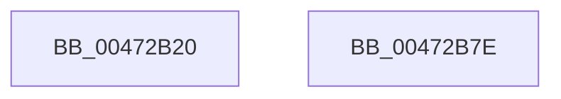

# XmGroup1Immediate

- RVA: `0x00472B20`–`0x00472B7F` (길이 `95` bytes)
- VA: `0x0000000140472B20`
- 실행 섹션: `.text`
- PDB 이름 있음: `예`; PDB Function 태그: `아니요`
- unwind 정보 RVA: `0x00068D5C`
- 디코드: `27`개 명령, `95/95` bytes 표시
- 미해석 바이트: `0` (있으면 어셈블리에 `.byte`로 보존)

> 이 문서는 커널 이미지의 기계어와 PDB 기호를 분석해 생성했습니다. 4번과 5번은 함수 원형과 자료형을 바이너리 사용 방식에서 추정한 C 해석이며 원본 소스 복구 결과는 아닙니다.

## 1. Dependencies

- 직접 호출 지점: **4**; 고유 호출 대상: **4**
- 직접 호출자로 확인된 함수: **0**
- RIP 상대 이미지 참조: **0**

### Outgoing calls
- `0x00472B32` → [XmSetDataType](XmSetDataType_function_004734C0.md) (function, `0x004734C0`)
- `0x00472B3F` → [XmEvaluateAddressSpecifier](XmEvaluateAddressSpecifier_function_00473224.md) (function, `0x00473224`)
- `0x00472B50` → [XmGetImmediateSourceValue](XmGetImmediateSourceValue_function_0047340C.md) (function, `0x0047340C`)
- `0x00472B5E` → [XmSetDestinationValue](XmSetDestinationValue_function_004734EC.md) (function, `0x004734EC`)

### Direct callers
- 이 함수 시작 RVA로 연결되는 직접 call은 확인되지 않았습니다. 간접 호출은 완전히 역산할 수 없습니다.

### Static image references
- 디코드된 RIP-relative 메모리 참조가 없습니다.

## 2. Other-region calls and transfers

- 다른 실행 섹션으로 향하는 call: **0**
- 별도 외부 분기/꼬리 이동을 확인하지 못했습니다.

## 3. Assembly (complete function range)

```asm
00472B20  48 89 5C 24 10                  mov qword ptr [rsp + 0x10], rbx
00472B25  57                              push rdi
00472B26  48 83 EC 20                     sub rsp, 0x20
00472B2A  83 64 24 30 00                  and dword ptr [rsp + 0x30], 0
00472B2F  48 8B F9                        mov rdi, rcx
00472B32  E8 89 09 00 00                  call 0x1404734c0
00472B37  48 8D 54 24 30                  lea rdx, [rsp + 0x30]
00472B3C  48 8B CF                        mov rcx, rdi
00472B3F  E8 E0 06 00 00                  call 0x140473224
00472B44  8B 57 70                        mov edx, dword ptr [rdi + 0x70]
00472B47  48 8B CF                        mov rcx, rdi
00472B4A  83 E2 02                        and edx, 2
00472B4D  48 8B D8                        mov rbx, rax
00472B50  E8 B7 08 00 00                  call 0x14047340c
00472B55  48 8B D3                        mov rdx, rbx
00472B58  48 8B CF                        mov rcx, rdi
00472B5B  44 8B C0                        mov r8d, eax
00472B5E  E8 89 09 00 00                  call 0x1404734ec
00472B63  8B 44 24 30                     mov eax, dword ptr [rsp + 0x30]
00472B67  01 47 7C                        add dword ptr [rdi + 0x7c], eax
00472B6A  B8 01 00 00 00                  mov eax, 1
00472B6F  48 8B 5C 24 38                  mov rbx, qword ptr [rsp + 0x38]
00472B74  44 89 47 6C                     mov dword ptr [rdi + 0x6c], r8d
00472B78  48 83 C4 20                     add rsp, 0x20
00472B7C  5F                              pop rdi
00472B7D  C3                              ret
00472B7E  CC                              int3
```

## 4. C-style interpretation (structured pseudocode)

```c
__int64 __fastcall XmGroup1Immediate(__int64 a1)
{
    __int64 result;
    __int64 v_rsp;
    unsigned __int64 v_stack_p10;
    unsigned int v_stack_p8;

    v_stack_p10 = v_rbx;
    v_rsp = (v_rsp) - (32);
    result = XmSetDataType(a1, a2, a3, a4);
    result = XmEvaluateAddressSpecifier(a1, v_stack_p8, a3, a4);
    a2 = (unsigned int)(((unsigned int)(*(unsigned int *)(a1 + 112))) & (2));
    result = XmGetImmediateSourceValue(a1, a2, a3, a4);
    result = XmSetDestinationValue(a1, result, (unsigned int)((unsigned int)(result)), a4);
    *(unsigned int *)(a1 + 108) = (unsigned int)((unsigned int)((unsigned int)(result)));
    v_rsp = (v_rsp) + (32);
    return 1;
}
```

## 5. (Beta) C Style

```c
int64_t XmGroup1Immediate(void *Arg1)
{
    uint8_t *arg1 = (uint8_t *)Arg1;

    int64_t result;
    int64_t local_rsp;
    uint64_t v_stack_p10;
    uint32_t v_stack_p8;

    v_stack_p10 = local_rbx;
    local_rsp = (local_rsp) - (32);
    result = XmSetDataType(Arg1, a2, a3, a4);
    result = XmEvaluateAddressSpecifier(Arg1, v_stack_p8, a3, a4);
    a2 = (uint32_t)(((uint32_t)(*(uint32_t *)(arg1 + 0x70))) & (2));
    result = XmGetImmediateSourceValue(Arg1, a2, a3, a4);
    result = XmSetDestinationValue(Arg1, result, (uint32_t)((uint32_t)(result)), a4);
    *(uint32_t *)(arg1 + 0x6C) = (uint32_t)((uint32_t)((uint32_t)(result)));
    local_rsp = (local_rsp) + (32);
    return 1;
}
```

### 관측된 메모리 오프셋

구조체 형식이 확인되지 않은 접근은 인자 기준의 오프셋으로만 기록했습니다.

| 기준 인자 | 오프셋 표현 | 폭 (bit) | 접근 |
|---|---:|---:|---|
| `Arg1` | `+ 0x6C` | `32` | `W` |
| `Arg1` | `+ 0x70` | `32` | `R` |
| `Arg1` | `+ 0x7C` | `32` | `R/W` |

## 6. Execution-region graph

[열기: 2D/3D 그래프와 함수 탐색 컨트롤 패널](../../../control-panel.html?section=text&rva=0x00472B20&view=graph)

- 2D 그래프는 위에서 아래로 흐르고, 3D 그래프는 빈 공간을 드래그해 회전합니다. Shift+드래그는 이동, 휠은 확대·축소, 함수 노드 선택은 대상 보고서 이동입니다.

### Static fallback


