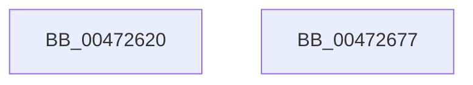

# XmGroup2ByByte

- RVA: `0x00472620`–`0x00472678` (길이 `88` bytes)
- VA: `0x0000000140472620`
- 실행 섹션: `.text`
- PDB 이름 있음: `예`; PDB Function 태그: `아니요`
- unwind 정보 RVA: `0x00068D5C`
- 디코드: `25`개 명령, `88/88` bytes 표시
- 미해석 바이트: `0` (있으면 어셈블리에 `.byte`로 보존)

> 이 문서는 커널 이미지의 기계어와 PDB 기호를 분석해 생성했습니다. 4번과 5번은 함수 원형과 자료형을 바이너리 사용 방식에서 추정한 C 해석이며 원본 소스 복구 결과는 아닙니다.

## 1. Dependencies

- 직접 호출 지점: **4**; 고유 호출 대상: **4**
- 직접 호출자로 확인된 함수: **0**
- RIP 상대 이미지 참조: **0**

### Outgoing calls
- `0x00472632` → [XmSetDataType](XmSetDataType_function_004734C0.md) (function, `0x004734C0`)
- `0x0047263F` → [XmEvaluateAddressSpecifier](XmEvaluateAddressSpecifier_function_00473224.md) (function, `0x00473224`)
- `0x0047264A` → [XmGetCodeByte](XmGetCodeByte_function_00473678.md) (function, `0x00473678`)
- `0x0047265B` → [XmSetDestinationValue](XmSetDestinationValue_function_004734EC.md) (function, `0x004734EC`)

### Direct callers
- 이 함수 시작 RVA로 연결되는 직접 call은 확인되지 않았습니다. 간접 호출은 완전히 역산할 수 없습니다.

### Static image references
- 디코드된 RIP-relative 메모리 참조가 없습니다.

## 2. Other-region calls and transfers

- 다른 실행 섹션으로 향하는 call: **0**
- 별도 외부 분기/꼬리 이동을 확인하지 못했습니다.

## 3. Assembly (complete function range)

```asm
00472620  48 89 5C 24 10                  mov qword ptr [rsp + 0x10], rbx
00472625  57                              push rdi
00472626  48 83 EC 20                     sub rsp, 0x20
0047262A  83 64 24 30 00                  and dword ptr [rsp + 0x30], 0
0047262F  48 8B F9                        mov rdi, rcx
00472632  E8 89 0E 00 00                  call 0x1404734c0
00472637  48 8D 54 24 30                  lea rdx, [rsp + 0x30]
0047263C  48 8B CF                        mov rcx, rdi
0047263F  E8 E0 0B 00 00                  call 0x140473224
00472644  48 8B CF                        mov rcx, rdi
00472647  48 8B D8                        mov rbx, rax
0047264A  E8 29 10 00 00                  call 0x140473678
0047264F  83 E0 1F                        and eax, 0x1f
00472652  48 8B D3                        mov rdx, rbx
00472655  48 8B CF                        mov rcx, rdi
00472658  89 47 6C                        mov dword ptr [rdi + 0x6c], eax
0047265B  E8 8C 0E 00 00                  call 0x1404734ec
00472660  8B 44 24 30                     mov eax, dword ptr [rsp + 0x30]
00472664  01 47 7C                        add dword ptr [rdi + 0x7c], eax
00472667  B8 01 00 00 00                  mov eax, 1
0047266C  48 8B 5C 24 38                  mov rbx, qword ptr [rsp + 0x38]
00472671  48 83 C4 20                     add rsp, 0x20
00472675  5F                              pop rdi
00472676  C3                              ret
00472677  CC                              int3
```

## 4. C-style interpretation (structured pseudocode)

```c
__int64 __fastcall XmGroup2ByByte(__int64 a1)
{
    __int64 result;
    __int64 v_rsp;
    unsigned __int64 v_stack_p10;
    unsigned int v_stack_p8;

    v_stack_p10 = v_rbx;
    v_rsp = (v_rsp) - (32);
    result = XmSetDataType(a1, a2, a3, a4);
    result = XmEvaluateAddressSpecifier(a1, v_stack_p8, a3, a4);
    result = XmGetCodeByte(a1, v_stack_p8, a3, a4);
    result = (unsigned int)((result) & (31));
    *(unsigned int *)(a1 + 108) = (unsigned int)(result);
    result = XmSetDestinationValue(a1, result, a3, a4);
    v_rsp = (v_rsp) + (32);
    return 1;
}
```

## 5. (Beta) C Style

```c
int64_t XmGroup2ByByte(void *Arg1)
{
    uint8_t *arg1 = (uint8_t *)Arg1;

    int64_t result;
    int64_t local_rsp;
    uint64_t v_stack_p10;
    uint32_t v_stack_p8;

    v_stack_p10 = local_rbx;
    local_rsp = (local_rsp) - (32);
    result = XmSetDataType(Arg1, a2, a3, a4);
    result = XmEvaluateAddressSpecifier(Arg1, v_stack_p8, a3, a4);
    result = XmGetCodeByte(Arg1, v_stack_p8, a3, a4);
    result = (uint32_t)((result) & (31));
    *(uint32_t *)(arg1 + 0x6C) = (uint32_t)(result);
    result = XmSetDestinationValue(Arg1, result, a3, a4);
    local_rsp = (local_rsp) + (32);
    return 1;
}
```

### 관측된 메모리 오프셋

구조체 형식이 확인되지 않은 접근은 인자 기준의 오프셋으로만 기록했습니다.

| 기준 인자 | 오프셋 표현 | 폭 (bit) | 접근 |
|---|---:|---:|---|
| `Arg1` | `+ 0x6C` | `32` | `W` |
| `Arg1` | `+ 0x7C` | `32` | `R/W` |

## 6. Execution-region graph

[열기: 2D/3D 그래프와 함수 탐색 컨트롤 패널](../../../control-panel.html?section=text&rva=0x00472620&view=graph)

- 2D 그래프는 위에서 아래로 흐르고, 3D 그래프는 빈 공간을 드래그해 회전합니다. Shift+드래그는 이동, 휠은 확대·축소, 함수 노드 선택은 대상 보고서 이동입니다.

### Static fallback


