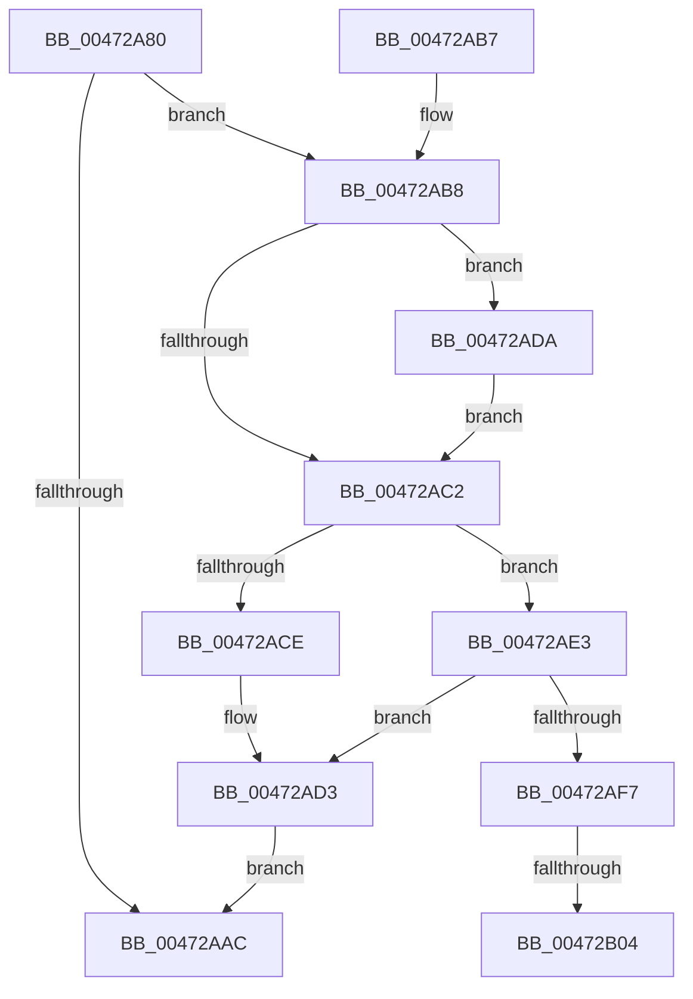

# XmGroup45General

- RVA: `0x00472A80`–`0x00472B16` (길이 `150` bytes)
- VA: `0x0000000140472A80`
- 실행 섹션: `.text`
- PDB 이름 있음: `예`; PDB Function 태그: `예`
- unwind 정보 RVA: `0x0006AF6C`
- 디코드: `41`개 명령, `150/150` bytes 표시
- 미해석 바이트: `0` (있으면 어셈블리에 `.byte`로 보존)

> 이 문서는 커널 이미지의 기계어와 PDB 기호를 분석해 생성했습니다. 4번과 5번은 함수 원형과 자료형을 바이너리 사용 방식에서 추정한 C 해석이며 원본 소스 복구 결과는 아닙니다.

## 1. Dependencies

- 직접 호출 지점: **5**; 고유 호출 대상: **5**
- 직접 호출자로 확인된 함수: **0**
- RIP 상대 이미지 참조: **0**

### Outgoing calls
- `0x00472A92` → [XmSetDataType](XmSetDataType_function_004734C0.md) (function, `0x004734C0`)
- `0x00472A9F` → [XmEvaluateAddressSpecifier](XmEvaluateAddressSpecifier_function_00473224.md) (function, `0x00473224`)
- `0x00472ACE` → [XmSetSourceValue](XmSetSourceValue_function_004737A8.md) (function, `0x004737A8`)
- `0x00472AE3` → [XmSetDestinationValue](XmSetDestinationValue_function_004734EC.md) (function, `0x004734EC`)
- `0x00472B10` → [longjmp](../4F/longjmp_function_004FD5F0.md) (function, `0x004FD5F0`)

### Direct callers
- 이 함수 시작 RVA로 연결되는 직접 call은 확인되지 않았습니다. 간접 호출은 완전히 역산할 수 없습니다.

### Static image references
- 디코드된 RIP-relative 메모리 참조가 없습니다.

## 2. Other-region calls and transfers

- 다른 실행 섹션으로 향하는 call: **0**
- call이 아닌 외부 분기/꼬리 이동: **1**
  - `0x00472AFE` → [sub_006F3D5A](../6F/Unknown_function_006F3D5A.md) (`tail-transfer`)

## 3. Assembly (complete function range)

```asm
00472A80  48 89 5C 24 08                  mov qword ptr [rsp + 8], rbx
00472A85  57                              push rdi
00472A86  48 83 EC 20                     sub rsp, 0x20
00472A8A  83 64 24 38 00                  and dword ptr [rsp + 0x38], 0
00472A8F  48 8B F9                        mov rdi, rcx
00472A92  E8 29 0A 00 00                  call 0x1404734c0
00472A97  48 8D 54 24 38                  lea rdx, [rsp + 0x38]
00472A9C  48 8B CF                        mov rcx, rdi
00472A9F  E8 80 07 00 00                  call 0x140473224
00472AA4  48 8B D0                        mov rdx, rax
00472AA7  48 85 C0                        test rax, rax
00472AAA  75 0C                           jne 0x140472ab8
00472AAC  48 8B 5C 24 30                  mov rbx, qword ptr [rsp + 0x30]
00472AB1  48 83 C4 20                     add rsp, 0x20
00472AB5  5F                              pop rdi
00472AB6  C3                              ret
00472AB7  CC                              int3
00472AB8  80 7F 51 12                     cmp byte ptr [rdi + 0x51], 0x12
00472ABC  8B 44 24 38                     mov eax, dword ptr [rsp + 0x38]
00472AC0  74 18                           je 0x140472ada
00472AC2  01 47 7C                        add dword ptr [rdi + 0x7c], eax
00472AC5  48 8B CF                        mov rcx, rdi
00472AC8  83 7F 7C 24                     cmp dword ptr [rdi + 0x7c], 0x24
00472ACC  75 15                           jne 0x140472ae3
00472ACE  E8 D5 0C 00 00                  call 0x1404737a8
00472AD3  B8 01 00 00 00                  mov eax, 1
00472AD8  EB D2                           jmp 0x140472aac
00472ADA  83 E0 01                        and eax, 1
00472ADD  89 44 24 38                     mov dword ptr [rsp + 0x38], eax
00472AE1  EB DF                           jmp 0x140472ac2
00472AE3  E8 04 0A 00 00                  call 0x1404734ec
00472AE8  8B 4C 24 38                     mov ecx, dword ptr [rsp + 0x38]
00472AEC  83 C1 FD                        add ecx, -3
00472AEF  F7 C1 FD FF FF FF               test ecx, 0xfffffffd
00472AF5  75 DC                           jne 0x140472ad3
00472AF7  80 BF 8E 00 00 00 00            cmp byte ptr [rdi + 0x8e], 0
00472AFE  0F 84 56 12 28 00               je 0x1406f3d5a
00472B04  48 8D 8F A0 00 00 00            lea rcx, [rdi + 0xa0]
00472B0B  BA 0B 00 00 00                  mov edx, 0xb
00472B10  E8 DB AA 08 00                  call 0x1404fd5f0
00472B15  CC                              int3
```

## 4. C-style interpretation (structured pseudocode)

```c
__int64 __fastcall XmGroup45General(__int64 a1)
{
    __int64 result;
    __int64 v_rsp;
    unsigned int v_stack_p10;
    unsigned int v_stack_p38;
    unsigned __int64 v_stack_p8;

    v_stack_p8 = v_rbx;
    v_rsp = (v_rsp) - (32);
    result = XmSetDataType(a1, a2, a3, a4);
    result = XmEvaluateAddressSpecifier(a1, v_stack_p10, a3, a4);
    if (result != 0) goto loc_00472AB8;
loc_00472AAC:
    v_rsp = (v_rsp) + (32);
    return result;
loc_00472AB8:
    if ((*(unsigned __int8 *)(a1 + 81)) == 18) goto loc_00472ADA;
loc_00472AC2:
    if ((*(unsigned int *)(a1 + 124)) != 36) goto loc_00472AE3;
    result = XmSetSourceValue(a1, result, a3, a4);
loc_00472AD3:
    goto loc_00472AAC;
loc_00472ADA:
    result = (unsigned int)((1) & (1));
    v_stack_p38 = (unsigned int)(result);
    goto loc_00472AC2;
loc_00472AE3:
    result = XmSetDestinationValue(a1, result, a3, a4);
    a1 = (unsigned int)(((unsigned int)(v_stack_p38)) + (-3));
    if ((((unsigned int)(a1)) & (0xFFFFFFFDULL)) != 0) goto loc_00472AD3;
    result = longjmp(a1 + 160, 11, a3, a4);
    return result;
}
```

## 5. (Beta) C Style

```c
int64_t XmGroup45General(void *Arg1)
{
    uint8_t *arg1 = (uint8_t *)Arg1;

    int64_t result;
    int64_t local_rsp;
    uint32_t v_stack_p10;
    uint32_t v_stack_p38;
    uint64_t v_stack_p8;

    v_stack_p8 = local_rbx;
    local_rsp = (local_rsp) - (32);
    result = XmSetDataType(Arg1, a2, a3, a4);
    result = XmEvaluateAddressSpecifier(Arg1, v_stack_p10, a3, a4);
    if (result != 0) goto loc_00472AB8;
loc_00472AAC:
    local_rsp = (local_rsp) + (32);
    return result;
loc_00472AB8:
    if ((*(uint8_t *)(arg1 + 0x51)) == 18) goto loc_00472ADA;
loc_00472AC2:
    if ((*(uint32_t *)(arg1 + 0x7C)) != 36) goto loc_00472AE3;
    result = XmSetSourceValue(Arg1, result, a3, a4);
loc_00472AD3:
    goto loc_00472AAC;
loc_00472ADA:
    result = (uint32_t)((1) & (1));
    v_stack_p38 = (uint32_t)(result);
    goto loc_00472AC2;
loc_00472AE3:
    result = XmSetDestinationValue(Arg1, result, a3, a4);
    Arg1 = (uint32_t)(((uint32_t)(v_stack_p38)) + (-3));
    if ((((uint32_t)(Arg1)) & (0xFFFFFFFDULL)) != 0) goto loc_00472AD3;
    result = longjmp(Arg1 + 160, 11, a3, a4);
    return result;
}
```

### 관측된 메모리 오프셋

구조체 형식이 확인되지 않은 접근은 인자 기준의 오프셋으로만 기록했습니다.

| 기준 인자 | 오프셋 표현 | 폭 (bit) | 접근 |
|---|---:|---:|---|
| `Arg1` | `+ 0x51` | `8` | `R` |
| `Arg1` | `+ 0x7C` | `32` | `R` |
| `Arg1` | `+ 0x7C` | `32` | `R/W` |
| `Arg1` | `+ 0x8E` | `8` | `R` |
| `Arg1` | `+ 0xA0` | `64` | `R` |

## 6. Execution-region graph

[열기: 2D/3D 그래프와 함수 탐색 컨트롤 패널](../../../control-panel.html?section=text&rva=0x00472A80&view=graph)

- 2D 그래프는 위에서 아래로 흐르고, 3D 그래프는 빈 공간을 드래그해 회전합니다. Shift+드래그는 이동, 휠은 확대·축소, 함수 노드 선택은 대상 보고서 이동입니다.

### Static fallback


