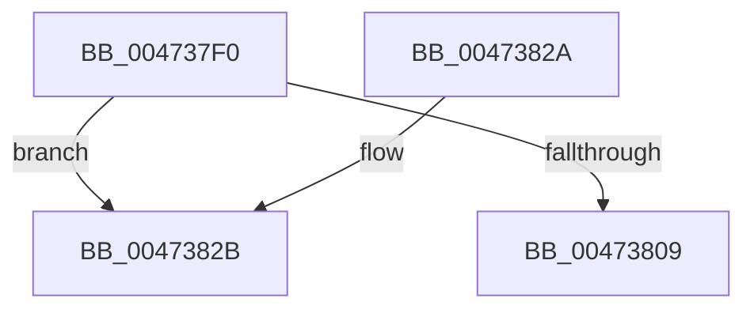

# XmInOp

- RVA: `0x004737F0`–`0x0047383D` (길이 `77` bytes)
- VA: `0x00000001404737F0`
- 실행 섹션: `.text`
- PDB 이름 있음: `예`; PDB Function 태그: `아니요`
- unwind 정보 RVA: `0x0006F13C`
- 디코드: `23`개 명령, `77/77` bytes 표시
- 미해석 바이트: `0` (있으면 어셈블리에 `.byte`로 보존)

> 이 문서는 커널 이미지의 기계어와 PDB 기호를 분석해 생성했습니다. 4번과 5번은 함수 원형과 자료형을 바이너리 사용 방식에서 추정한 C 해석이며 원본 소스 복구 결과는 아닙니다.

## 1. Dependencies

- 직접 호출 지점: **3**; 고유 호출 대상: **3**
- 직접 호출자로 확인된 함수: **0**
- RIP 상대 이미지 참조: **0**

### Outgoing calls
- `0x00473815` → [x86BiosReadIoSpace](x86BiosReadIoSpace_function_00473850.md) (function, `0x00473850`)
- `0x0047381F` → [XmStoreResult](XmStoreResult_function_004739FC.md) (function, `0x004739FC`)
- `0x00473837` → [longjmp](../4F/longjmp_function_004FD5F0.md) (function, `0x004FD5F0`)

### Direct callers
- 이 함수 시작 RVA로 연결되는 직접 call은 확인되지 않았습니다. 간접 호출은 완전히 역산할 수 없습니다.

### Static image references
- 디코드된 RIP-relative 메모리 참조가 없습니다.

## 2. Other-region calls and transfers

- 다른 실행 섹션으로 향하는 call: **0**
- 별도 외부 분기/꼬리 이동을 확인하지 못했습니다.

## 3. Assembly (complete function range)

```asm
004737F0  40 53                           push rbx
004737F2  48 83 EC 20                     sub rsp, 0x20
004737F6  48 8B D9                        mov rbx, rcx
004737F9  8B 49 78                        mov ecx, dword ptr [rcx + 0x78]
004737FC  8B 53 6C                        mov edx, dword ptr [rbx + 0x6c]
004737FF  03 D1                           add edx, ecx
00473801  81 FA FF FF 00 00               cmp edx, 0xffff
00473807  77 22                           ja 0x14047382b
00473809  0F B7 53 6C                     movzx edx, word ptr [rbx + 0x6c]
0047380D  48 8D 43 18                     lea rax, [rbx + 0x18]
00473811  48 89 43 58                     mov qword ptr [rbx + 0x58], rax
00473815  E8 36 00 00 00                  call 0x140473850
0047381A  8B D0                           mov edx, eax
0047381C  48 8B CB                        mov rcx, rbx
0047381F  E8 D8 01 00 00                  call 0x1404739fc
00473824  48 83 C4 20                     add rsp, 0x20
00473828  5B                              pop rbx
00473829  C3                              ret
0047382A  CC                              int3
0047382B  48 8D 8B A0 00 00 00            lea rcx, [rbx + 0xa0]
00473832  BA 09 00 00 00                  mov edx, 9
00473837  E8 B4 9D 08 00                  call 0x1404fd5f0
0047383C  CC                              int3
```

## 4. C-style interpretation (structured pseudocode)

```c
__int64 __fastcall XmInOp(__int64 a1)
{
    __int64 result;
    __int64 v_rsp;

    v_rsp = (v_rsp) - (32);
    a2 = (unsigned int)(((unsigned int)(*(unsigned int *)(a1 + 108))) + ((unsigned int)((unsigned int)(*(unsigned int *)(a1 + 120)))));
    if (((unsigned int)(a2)) > 0xFFFFULL) goto loc_0047382B;
    *(unsigned __int64 *)(a1 + 88) = a1 + 24;
    result = x86BiosReadIoSpace((unsigned int)(*(unsigned int *)(a1 + 120)), *(unsigned __int16 *)(a1 + 108), a3, a4);
    result = XmStoreResult(a1, (unsigned int)((unsigned int)(result)), a3, a4);
    v_rsp = (v_rsp) + (32);
    return result;
loc_0047382B:
    result = longjmp(a1 + 160, 9, a3, a4);
    return result;
}
```

## 5. (Beta) C Style

```c
int64_t XmInOp(void *Arg1)
{
    uint8_t *arg1 = (uint8_t *)Arg1;

    int64_t result;
    int64_t local_rsp;

    local_rsp = (local_rsp) - (32);
    a2 = (uint32_t)(((uint32_t)(*(uint32_t *)(arg1 + 0x6C))) + ((uint32_t)((uint32_t)(*(uint32_t *)(arg1 + 0x78)))));
    if (((uint32_t)(a2)) > 0xFFFFULL) goto loc_0047382B;
    *(void **)(arg1 + 0x58) = Arg1 + 24;
    result = x86BiosReadIoSpace((uint32_t)(*(uint32_t *)(arg1 + 0x78)), *(uint16_t *)(arg1 + 0x6C), a3, a4);
    result = XmStoreResult(Arg1, (uint32_t)((uint32_t)(result)), a3, a4);
    local_rsp = (local_rsp) + (32);
    return result;
loc_0047382B:
    result = longjmp(Arg1 + 160, 9, a3, a4);
    return result;
}
```

### 관측된 메모리 오프셋

구조체 형식이 확인되지 않은 접근은 인자 기준의 오프셋으로만 기록했습니다.

| 기준 인자 | 오프셋 표현 | 폭 (bit) | 접근 |
|---|---:|---:|---|
| `Arg1` | `+ 0x18` | `64` | `R` |
| `Arg1` | `+ 0x58` | `64` | `W` |
| `Arg1` | `+ 0x6C` | `16` | `R` |
| `Arg1` | `+ 0x6C` | `32` | `R` |
| `Arg1` | `+ 0x78` | `32` | `R` |
| `Arg1` | `+ 0xA0` | `64` | `R` |

## 6. Execution-region graph

[열기: 2D/3D 그래프와 함수 탐색 컨트롤 패널](../../../control-panel.html?section=text&rva=0x004737F0&view=graph)

- 2D 그래프는 위에서 아래로 흐르고, 3D 그래프는 빈 공간을 드래그해 회전합니다. Shift+드래그는 이동, 휠은 확대·축소, 함수 노드 선택은 대상 보고서 이동입니다.

### Static fallback


