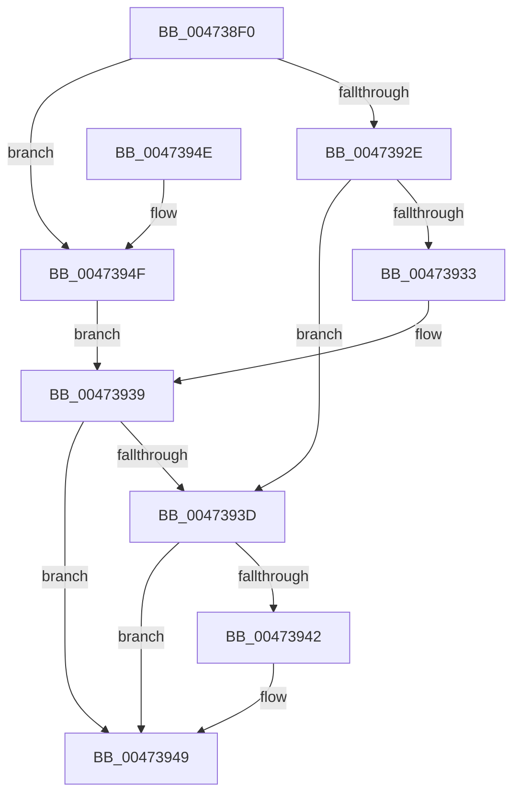

# XmLoopOp

- RVA: `0x004738F0`–`0x00473959` (길이 `105` bytes)
- VA: `0x00000001404738F0`
- 실행 섹션: `.text`
- PDB 이름 있음: `예`; PDB Function 태그: `아니요`
- unwind 정보 RVA: `0x0005F758`
- 디코드: `36`개 명령, `105/105` bytes 표시
- 미해석 바이트: `0` (있으면 어셈블리에 `.byte`로 보존)

> 이 문서는 커널 이미지의 기계어와 PDB 기호를 분석해 생성했습니다. 4번과 5번은 함수 원형과 자료형을 바이너리 사용 방식에서 추정한 C 해석이며 원본 소스 복구 결과는 아닙니다.

## 1. Dependencies

- 직접 호출 지점: **1**; 고유 호출 대상: **1**
- 직접 호출자로 확인된 함수: **0**
- RIP 상대 이미지 참조: **0**

### Outgoing calls
- `0x00473921` → [XmStoreResult](XmStoreResult_function_004739FC.md) (function, `0x004739FC`)

### Direct callers
- 이 함수 시작 RVA로 연결되는 직접 call은 확인되지 않았습니다. 간접 호출은 완전히 역산할 수 없습니다.

### Static image references
- 디코드된 RIP-relative 메모리 참조가 없습니다.

## 2. Other-region calls and transfers

- 다른 실행 섹션으로 향하는 call: **0**
- 별도 외부 분기/꼬리 이동을 확인하지 못했습니다.

## 3. Assembly (complete function range)

```asm
004738F0  48 83 EC 28                     sub rsp, 0x28
004738F4  48 8D 51 1C                     lea rdx, [rcx + 0x1c]
004738F8  44 8B 0A                        mov r9d, dword ptr [rdx]
004738FB  48 89 51 58                     mov qword ptr [rcx + 0x58], rdx
004738FF  41 FF C9                        dec r9d
00473902  8A 91 89 00 00 00               mov dl, byte ptr [rcx + 0x89]
00473908  84 D2                           test dl, dl
0047390A  41 0F B7 C1                     movzx eax, r9w
0047390E  44 0F 44 C8                     cmove r9d, eax
00473912  F6 DA                           neg dl
00473914  41 8B D1                        mov edx, r9d
00473917  1B C0                           sbb eax, eax
00473919  83 E0 02                        and eax, 2
0047391C  FF C0                           inc eax
0047391E  89 41 78                        mov dword ptr [rcx + 0x78], eax
00473921  E8 D6 00 00 00                  call 0x1404739fc
00473926  8B 51 70                        mov edx, dword ptr [rcx + 0x70]
00473929  83 E2 03                        and edx, 3
0047392C  74 21                           je 0x14047394f
0047392E  83 FA 01                        cmp edx, 1
00473931  75 0A                           jne 0x14047393d
00473933  8B 41 10                        mov eax, dword ptr [rcx + 0x10]
00473936  C1 E8 06                        shr eax, 6
00473939  A8 01                           test al, 1
0047393B  74 0C                           je 0x140473949
0047393D  45 85 C9                        test r9d, r9d
00473940  74 07                           je 0x140473949
00473942  0F B7 41 68                     movzx eax, word ptr [rcx + 0x68]
00473946  89 41 14                        mov dword ptr [rcx + 0x14], eax
00473949  48 83 C4 28                     add rsp, 0x28
0047394D  C3                              ret
0047394E  CC                              int3
0047394F  8B 41 10                        mov eax, dword ptr [rcx + 0x10]
00473952  C1 E8 06                        shr eax, 6
00473955  F7 D0                           not eax
00473957  EB E0                           jmp 0x140473939
```

## 4. C-style interpretation (structured pseudocode)

```c
__int64 __fastcall XmLoopOp(__int64 a1)
{
    __int64 result;
    __int64 v_rsp;

    v_rsp = (v_rsp) - (40);
    *(unsigned __int64 *)(a1 + 88) = a1 + 28;
    a4 = (unsigned int)(((unsigned int)(*(unsigned int *)(a1 + 28))) - 1);
    if ((unsigned __int8)(*(unsigned __int8 *)(a1 + 137)) == 0) { a4 = (unsigned int)((unsigned __int16)(a4)); }
    a2 = (unsigned __int8)(-(*(unsigned __int8 *)(a1 + 137)));
    result = (unsigned int)(((unsigned __int16)(a4)) & (2));
    result = (unsigned int)((result) + 1);
    *(unsigned int *)(a1 + 120) = (unsigned int)(result);
    result = XmStoreResult(a1, (unsigned int)((unsigned int)(a4)), a3, a4);
    a2 = (unsigned int)(((unsigned int)(*(unsigned int *)(a1 + 112))) & (3));
    if (condition_is_equal) goto loc_0047394F;
    if (((unsigned int)(a2)) != 1) goto loc_0047393D;
    result = (unsigned int)(((unsigned int)(*(unsigned int *)(a1 + 16))) >> (6));
loc_00473939:
    if ((((unsigned __int8)(result)) & (1)) == 0) goto loc_00473949;
loc_0047393D:
    if ((unsigned int)(a4) != 0) {
        result = *(unsigned __int16 *)(a1 + 104);
        *(unsigned int *)(a1 + 20) = (unsigned int)(result);
    }
    v_rsp = (v_rsp) + (40);
    return result;
loc_0047394F:
    result = (unsigned int)(((unsigned int)(*(unsigned int *)(a1 + 16))) >> (6));
    result = (unsigned int)(~(result));
    goto loc_00473939;
}
```

## 5. (Beta) C Style

```c
int64_t XmLoopOp(void *Arg1)
{
    uint8_t *arg1 = (uint8_t *)Arg1;

    int64_t result;
    int64_t local_rsp;

    local_rsp = (local_rsp) - (40);
    *(void **)(arg1 + 0x58) = Arg1 + 28;
    a4 = (uint32_t)(((uint32_t)(*(uint32_t *)(arg1 + 0x1C))) - 1);
    if ((uint8_t)(*(uint8_t *)(arg1 + 0x89)) == 0) { a4 = (uint32_t)((uint16_t)(a4)); }
    a2 = (uint8_t)(-(*(uint8_t *)(arg1 + 0x89)));
    result = (uint32_t)(((uint16_t)(a4)) & (2));
    result = (uint32_t)((result) + 1);
    *(uint32_t *)(arg1 + 0x78) = (uint32_t)(result);
    result = XmStoreResult(Arg1, (uint32_t)((uint32_t)(a4)), a3, a4);
    a2 = (uint32_t)(((uint32_t)(*(uint32_t *)(arg1 + 0x70))) & (3));
    if (condition_is_equal) goto loc_0047394F;
    if (((uint32_t)(a2)) != 1) goto loc_0047393D;
    result = (uint32_t)(((uint32_t)(*(uint32_t *)(arg1 + 0x10))) >> (6));
loc_00473939:
    if ((((uint8_t)(result)) & (1)) == 0) goto loc_00473949;
loc_0047393D:
    if ((uint32_t)(a4) != 0) {
        result = *(uint16_t *)(arg1 + 0x68);
        *(uint32_t *)(arg1 + 0x14) = (uint32_t)(result);
    }
    local_rsp = (local_rsp) + (40);
    return result;
loc_0047394F:
    result = (uint32_t)(((uint32_t)(*(uint32_t *)(arg1 + 0x10))) >> (6));
    result = (uint32_t)(~(result));
    goto loc_00473939;
}
```

### 관측된 메모리 오프셋

구조체 형식이 확인되지 않은 접근은 인자 기준의 오프셋으로만 기록했습니다.

| 기준 인자 | 오프셋 표현 | 폭 (bit) | 접근 |
|---|---:|---:|---|
| `Arg1` | `+ 0x0` | `32` | `R` |
| `Arg1` | `+ 0x1C` | `64` | `R` |
| `Arg1` | `+ 0x58` | `64` | `W` |
| `Arg1` | `+ 0x78` | `32` | `W` |
| `Arg1` | `+ 0x89` | `8` | `R` |

## 6. Execution-region graph

[열기: 2D/3D 그래프와 함수 탐색 컨트롤 패널](../../../control-panel.html?section=text&rva=0x004738F0&view=graph)

- 2D 그래프는 위에서 아래로 흐르고, 3D 그래프는 빈 공간을 드래그해 회전합니다. Shift+드래그는 이동, 휠은 확대·축소, 함수 노드 선택은 대상 보고서 이동입니다.

### Static fallback


