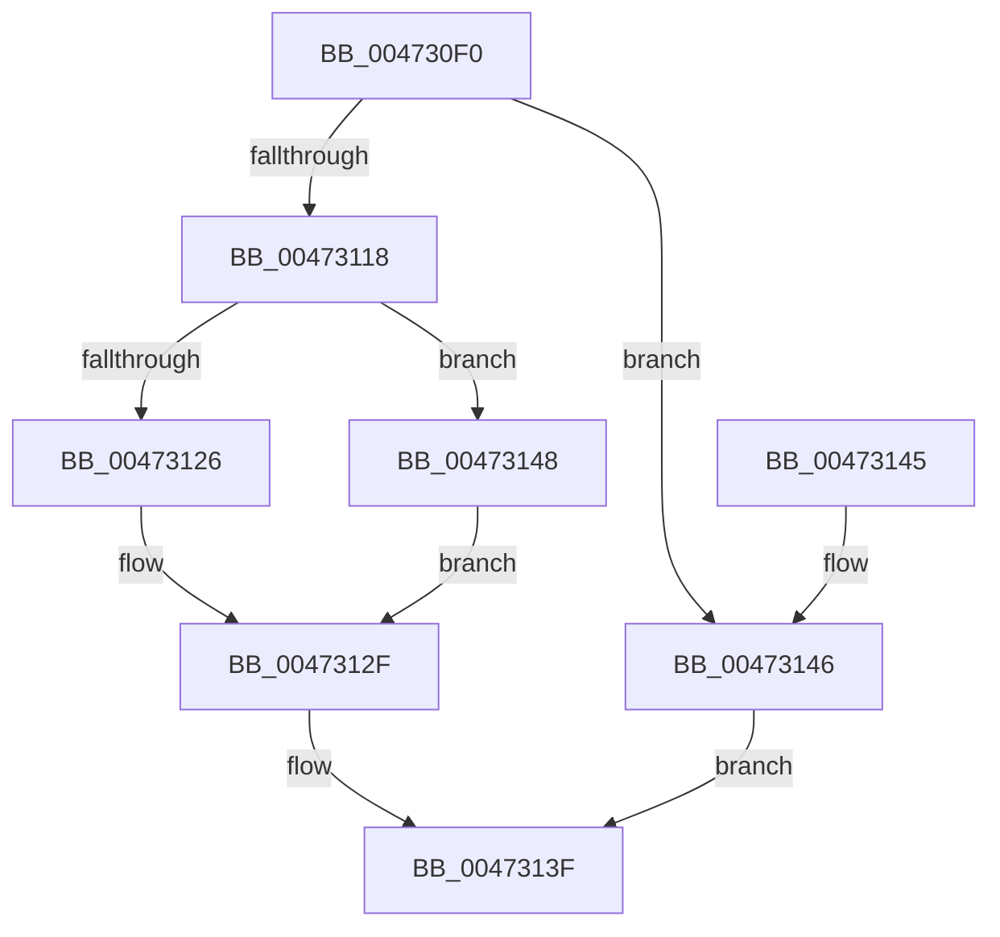

# XmMoveGeneral

- RVA: `0x004730F0`–`0x00473156` (길이 `102` bytes)
- VA: `0x00000001404730F0`
- 실행 섹션: `.text`
- PDB 이름 있음: `예`; PDB Function 태그: `아니요`
- unwind 정보 RVA: `0x00070B1C`
- 디코드: `31`개 명령, `102/102` bytes 표시
- 미해석 바이트: `0` (있으면 어셈블리에 `.byte`로 보존)

> 이 문서는 커널 이미지의 기계어와 PDB 기호를 분석해 생성했습니다. 4번과 5번은 함수 원형과 자료형을 바이너리 사용 방식에서 추정한 C 해석이며 원본 소스 복구 결과는 아닙니다.

## 1. Dependencies

- 직접 호출 지점: **5**; 고유 호출 대상: **4**
- 직접 호출자로 확인된 함수: **0**
- RIP 상대 이미지 참조: **0**

### Outgoing calls
- `0x004730FE` → [XmSetDataType](XmSetDataType_function_004734C0.md) (function, `0x004734C0`)
- `0x0047310B` → [XmEvaluateAddressSpecifier](XmEvaluateAddressSpecifier_function_00473224.md) (function, `0x00473224`)
- `0x00473126` → [XmGetRegisterAddress](XmGetRegisterAddress_function_00473778.md) (function, `0x00473778`)
- `0x00473135` → [XmSetSourceValue](XmSetSourceValue_function_004737A8.md) (function, `0x004737A8`)
- `0x0047314C` → [XmGetRegisterAddress](XmGetRegisterAddress_function_00473778.md) (function, `0x00473778`)

### Direct callers
- 이 함수 시작 RVA로 연결되는 직접 call은 확인되지 않았습니다. 간접 호출은 완전히 역산할 수 없습니다.

### Static image references
- 디코드된 RIP-relative 메모리 참조가 없습니다.

## 2. Other-region calls and transfers

- 다른 실행 섹션으로 향하는 call: **0**
- 별도 외부 분기/꼬리 이동을 확인하지 못했습니다.

## 3. Assembly (complete function range)

```asm
004730F0  40 53                           push rbx
004730F2  48 83 EC 20                     sub rsp, 0x20
004730F6  83 64 24 38 00                  and dword ptr [rsp + 0x38], 0
004730FB  48 8B D9                        mov rbx, rcx
004730FE  E8 BD 03 00 00                  call 0x1404734c0
00473103  48 8D 54 24 38                  lea rdx, [rsp + 0x38]
00473108  48 8B CB                        mov rcx, rbx
0047310B  E8 14 01 00 00                  call 0x140473224
00473110  4C 8B C8                        mov r9, rax
00473113  48 85 C0                        test rax, rax
00473116  74 2E                           je 0x140473146
00473118  8B 43 70                        mov eax, dword ptr [rbx + 0x70]
0047311B  48 8B CB                        mov rcx, rbx
0047311E  8B 54 24 38                     mov edx, dword ptr [rsp + 0x38]
00473122  A8 02                           test al, 2
00473124  74 22                           je 0x140473148
00473126  E8 4D 06 00 00                  call 0x140473778
0047312B  48 89 43 58                     mov qword ptr [rbx + 0x58], rax
0047312F  49 8B D1                        mov rdx, r9
00473132  48 8B CB                        mov rcx, rbx
00473135  E8 6E 06 00 00                  call 0x1404737a8
0047313A  B8 01 00 00 00                  mov eax, 1
0047313F  48 83 C4 20                     add rsp, 0x20
00473143  5B                              pop rbx
00473144  C3                              ret
00473145  CC                              int3
00473146  EB F7                           jmp 0x14047313f
00473148  4C 89 4B 58                     mov qword ptr [rbx + 0x58], r9
0047314C  E8 27 06 00 00                  call 0x140473778
00473151  4C 8B C8                        mov r9, rax
00473154  EB D9                           jmp 0x14047312f
```

## 4. C-style interpretation (structured pseudocode)

```c
__int64 __fastcall XmMoveGeneral(__int64 a1)
{
    __int64 result;
    __int64 v_rsp;
    unsigned int v_stack_p10;

    v_rsp = (v_rsp) - (32);
    result = XmSetDataType(a1, a2, a3, a4);
    result = XmEvaluateAddressSpecifier(a1, v_stack_p10, a3, a4);
    if (result == 0) goto loc_00473146;
    if ((((unsigned __int8)((unsigned int)(*(unsigned int *)(a1 + 112)))) & (2)) == 0) goto loc_00473148;
    result = XmGetRegisterAddress(a1, (unsigned int)(v_stack_p10), a3, result);
    *(unsigned __int64 *)(a1 + 88) = result;
loc_0047312F:
    result = XmSetSourceValue(a1, result, a3, result);
loc_0047313F:
    v_rsp = (v_rsp) + (32);
    return 1;
loc_00473146:
    goto loc_0047313F;
loc_00473148:
    *(unsigned __int64 *)(a1 + 88) = result;
    result = XmGetRegisterAddress(a1, result, a3, result);
    goto loc_0047312F;
}
```

## 5. (Beta) C Style

```c
int64_t XmMoveGeneral(void *Arg1)
{
    uint8_t *arg1 = (uint8_t *)Arg1;

    int64_t result;
    int64_t local_rsp;
    uint32_t v_stack_p10;

    local_rsp = (local_rsp) - (32);
    result = XmSetDataType(Arg1, a2, a3, a4);
    result = XmEvaluateAddressSpecifier(Arg1, v_stack_p10, a3, a4);
    if (result == 0) goto loc_00473146;
    if ((((uint8_t)((uint32_t)(*(uint32_t *)(arg1 + 0x70)))) & (2)) == 0) goto loc_00473148;
    result = XmGetRegisterAddress(Arg1, (uint32_t)(v_stack_p10), a3, result);
    *(uint64_t *)(arg1 + 0x58) = result;
loc_0047312F:
    result = XmSetSourceValue(Arg1, result, a3, result);
loc_0047313F:
    local_rsp = (local_rsp) + (32);
    return 1;
loc_00473146:
    goto loc_0047313F;
loc_00473148:
    *(uint64_t *)(arg1 + 0x58) = result;
    result = XmGetRegisterAddress(Arg1, result, a3, result);
    goto loc_0047312F;
}
```

### 관측된 메모리 오프셋

구조체 형식이 확인되지 않은 접근은 인자 기준의 오프셋으로만 기록했습니다.

| 기준 인자 | 오프셋 표현 | 폭 (bit) | 접근 |
|---|---:|---:|---|
| `Arg1` | `+ 0x58` | `64` | `W` |
| `Arg1` | `+ 0x70` | `32` | `R` |

## 6. Execution-region graph

[열기: 2D/3D 그래프와 함수 탐색 컨트롤 패널](../../../control-panel.html?section=text&rva=0x004730F0&view=graph)

- 2D 그래프는 위에서 아래로 흐르고, 3D 그래프는 빈 공간을 드래그해 회전합니다. Shift+드래그는 이동, 휠은 확대·축소, 함수 노드 선택은 대상 보고서 이동입니다.

### Static fallback


