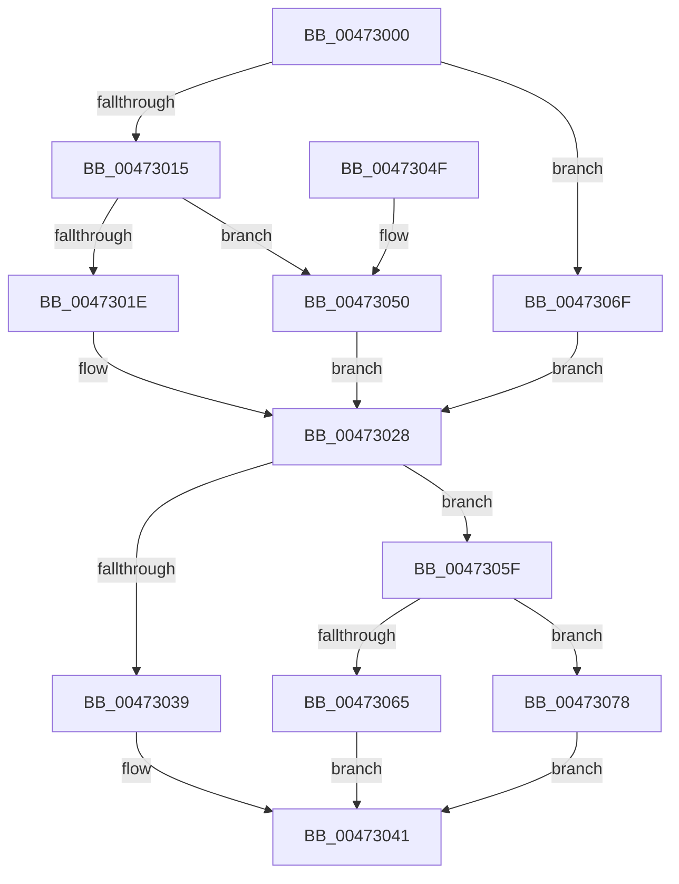

# XmMoveRegImmediate

- RVA: `0x00473000`–`0x0047307F` (길이 `127` bytes)
- VA: `0x0000000140473000`
- 실행 섹션: `.text`
- PDB 이름 있음: `예`; PDB Function 태그: `아니요`
- unwind 정보 RVA: `0x0007DF94`
- 디코드: `38`개 명령, `127/127` bytes 표시
- 미해석 바이트: `0` (있으면 어셈블리에 `.byte`로 보존)

> 이 문서는 커널 이미지의 기계어와 PDB 기호를 분석해 생성했습니다. 4번과 5번은 함수 원형과 자료형을 바이너리 사용 방식에서 추정한 C 해석이며 원본 소스 복구 결과는 아닙니다.

## 1. Dependencies

- 직접 호출 지점: **4**; 고유 호출 대상: **4**
- 직접 호출자로 확인된 함수: **0**
- RIP 상대 이미지 참조: **0**

### Outgoing calls
- `0x00473028` → [XmGetRegisterAddress](XmGetRegisterAddress_function_00473778.md) (function, `0x00473778`)
- `0x00473039` → [XmGetCodeByte](XmGetCodeByte_function_00473678.md) (function, `0x00473678`)
- `0x00473065` → [XmGetWordImmediate](XmGetWordImmediate_function_004731DC.md) (function, `0x004731DC`)
- `0x00473078` → [XmGetLongImmediate](../56/XmGetLongImmediate_function_0056DC70.md) (function, `0x0056DC70`)

### Direct callers
- 이 함수 시작 RVA로 연결되는 직접 call은 확인되지 않았습니다. 간접 호출은 완전히 역산할 수 없습니다.

### Static image references
- 디코드된 RIP-relative 메모리 참조가 없습니다.

## 2. Other-region calls and transfers

- 다른 실행 섹션으로 향하는 call: **0**
- 별도 외부 분기/꼬리 이동을 확인하지 못했습니다.

## 3. Assembly (complete function range)

```asm
00473000  40 53                           push rbx
00473002  48 83 EC 20                     sub rsp, 0x20
00473006  8B 41 70                        mov eax, dword ptr [rcx + 0x70]
00473009  48 8B D9                        mov rbx, rcx
0047300C  8B D0                           mov edx, eax
0047300E  83 E2 07                        and edx, 7
00473011  A8 08                           test al, 8
00473013  74 5A                           je 0x14047306f
00473015  80 B9 8A 00 00 00 00            cmp byte ptr [rcx + 0x8a], 0
0047301C  74 32                           je 0x140473050
0047301E  41 B9 03 00 00 00               mov r9d, 3
00473024  44 89 49 78                     mov dword ptr [rcx + 0x78], r9d
00473028  E8 4B 07 00 00                  call 0x140473778
0047302D  48 89 43 58                     mov qword ptr [rbx + 0x58], rax
00473031  48 8B CB                        mov rcx, rbx
00473034  45 85 C9                        test r9d, r9d
00473037  75 26                           jne 0x14047305f
00473039  E8 3A 06 00 00                  call 0x140473678
0047303E  0F B6 C0                        movzx eax, al
00473041  89 43 6C                        mov dword ptr [rbx + 0x6c], eax
00473044  B8 01 00 00 00                  mov eax, 1
00473049  48 83 C4 20                     add rsp, 0x20
0047304D  5B                              pop rbx
0047304E  C3                              ret
0047304F  CC                              int3
00473050  C7 41 78 01 00 00 00            mov dword ptr [rcx + 0x78], 1
00473057  41 B9 01 00 00 00               mov r9d, 1
0047305D  EB C9                           jmp 0x140473028
0047305F  41 83 F9 01                     cmp r9d, 1
00473063  75 13                           jne 0x140473078
00473065  E8 72 01 00 00                  call 0x1404731dc
0047306A  0F B7 C0                        movzx eax, ax
0047306D  EB D2                           jmp 0x140473041
0047306F  83 61 78 00                     and dword ptr [rcx + 0x78], 0
00473073  45 33 C9                        xor r9d, r9d
00473076  EB B0                           jmp 0x140473028
00473078  E8 F3 AB 0F 00                  call 0x14056dc70
0047307D  EB C2                           jmp 0x140473041
```

## 4. C-style interpretation (structured pseudocode)

```c
__int64 __fastcall XmMoveRegImmediate(__int64 a1)
{
    __int64 result;
    __int64 v_rsp;

    v_rsp = (v_rsp) - (32);
    a2 = (unsigned int)(((unsigned int)((unsigned int)((unsigned int)(*(unsigned int *)(a1 + 112))))) & (7));
    if ((((unsigned __int8)((unsigned int)(*(unsigned int *)(a1 + 112)))) & (8)) == 0) goto loc_0047306F;
    if ((*(unsigned __int8 *)(a1 + 138)) == 0) goto loc_00473050;
    *(unsigned int *)(a1 + 120) = 3;
loc_00473028:
    result = XmGetRegisterAddress(a1, a2, a3, 3);
    *(unsigned __int64 *)(a1 + 88) = result;
    if (3 != 0) goto loc_0047305F;
    result = XmGetCodeByte(a1, a2, a3, 3);
loc_00473041:
    *(unsigned int *)(a1 + 108) = (unsigned int)((unsigned __int8)(result));
    v_rsp = (v_rsp) + (32);
    return 1;
loc_00473050:
    *(unsigned int *)(a1 + 120) = 1;
    goto loc_00473028;
loc_0047305F:
    if (1 != 1) goto loc_00473078;
    result = XmGetWordImmediate(a1, a2, a3, 1);
    goto loc_00473041;
loc_0047306F:
    a4 = 0;
    goto loc_00473028;
loc_00473078:
    result = XmGetLongImmediate(a1, a2, a3, a4);
    goto loc_00473041;
}
```

## 5. (Beta) C Style

```c
int64_t XmMoveRegImmediate(void *Arg1)
{
    uint8_t *arg1 = (uint8_t *)Arg1;

    int64_t result;
    int64_t local_rsp;

    local_rsp = (local_rsp) - (32);
    a2 = (uint32_t)(((uint32_t)((uint32_t)((uint32_t)(*(uint32_t *)(arg1 + 0x70))))) & (7));
    if ((((uint8_t)((uint32_t)(*(uint32_t *)(arg1 + 0x70)))) & (8)) == 0) goto loc_0047306F;
    if ((*(uint8_t *)(arg1 + 0x8A)) == 0) goto loc_00473050;
    *(uint32_t *)(arg1 + 0x78) = 3;
loc_00473028:
    result = XmGetRegisterAddress(Arg1, a2, a3, 3);
    *(uint64_t *)(arg1 + 0x58) = result;
    if (3 != 0) goto loc_0047305F;
    result = XmGetCodeByte(Arg1, a2, a3, 3);
loc_00473041:
    *(uint32_t *)(arg1 + 0x6C) = (uint32_t)((uint8_t)(result));
    local_rsp = (local_rsp) + (32);
    return 1;
loc_00473050:
    *(uint32_t *)(arg1 + 0x78) = 1;
    goto loc_00473028;
loc_0047305F:
    if (1 != 1) goto loc_00473078;
    result = XmGetWordImmediate(Arg1, a2, a3, 1);
    goto loc_00473041;
loc_0047306F:
    a4 = 0;
    goto loc_00473028;
loc_00473078:
    result = XmGetLongImmediate(Arg1, a2, a3, a4);
    goto loc_00473041;
}
```

### 관측된 메모리 오프셋

구조체 형식이 확인되지 않은 접근은 인자 기준의 오프셋으로만 기록했습니다.

| 기준 인자 | 오프셋 표현 | 폭 (bit) | 접근 |
|---|---:|---:|---|
| `Arg1` | `+ 0x58` | `64` | `W` |
| `Arg1` | `+ 0x6C` | `32` | `W` |
| `Arg1` | `+ 0x70` | `32` | `R` |
| `Arg1` | `+ 0x78` | `32` | `R/W` |
| `Arg1` | `+ 0x78` | `32` | `W` |
| `Arg1` | `+ 0x8A` | `8` | `R` |

## 6. Execution-region graph

[열기: 2D/3D 그래프와 함수 탐색 컨트롤 패널](../../../control-panel.html?section=text&rva=0x00473000&view=graph)

- 2D 그래프는 위에서 아래로 흐르고, 3D 그래프는 빈 공간을 드래그해 회전합니다. Shift+드래그는 이동, 휠은 확대·축소, 함수 노드 선택은 대상 보고서 이동입니다.

### Static fallback


