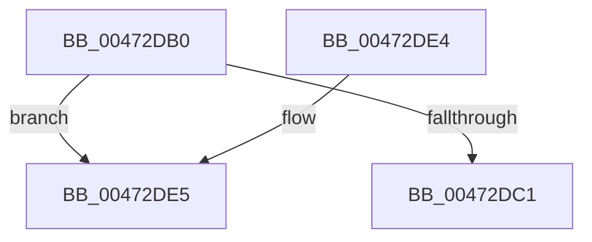

# XmOutOp

- RVA: `0x00472DB0`–`0x00472DF7` (길이 `71` bytes)
- VA: `0x0000000140472DB0`
- 실행 섹션: `.text`
- PDB 이름 있음: `예`; PDB Function 태그: `아니요`
- unwind 정보 RVA: `0x0007A1AC`
- 디코드: `19`개 명령, `71/71` bytes 표시
- 미해석 바이트: `0` (있으면 어셈블리에 `.byte`로 보존)

> 이 문서는 커널 이미지의 기계어와 PDB 기호를 분석해 생성했습니다. 4번과 5번은 함수 원형과 자료형을 바이너리 사용 방식에서 추정한 C 해석이며 원본 소스 복구 결과는 아닙니다.

## 1. Dependencies

- 직접 호출 지점: **3**; 고유 호출 대상: **3**
- 직접 호출자로 확인된 함수: **0**
- RIP 상대 이미지 참조: **0**

### Outgoing calls
- `0x00472DCA` → [XmSetSourceValue](XmSetSourceValue_function_004737A8.md) (function, `0x004737A8`)
- `0x00472DDA` → [x86BiosWriteIoSpace](x86BiosWriteIoSpace_function_00472E00.md) (function, `0x00472E00`)
- `0x00472DF1` → [longjmp](../4F/longjmp_function_004FD5F0.md) (function, `0x004FD5F0`)

### Direct callers
- 이 함수 시작 RVA로 연결되는 직접 call은 확인되지 않았습니다. 간접 호출은 완전히 역산할 수 없습니다.

### Static image references
- 디코드된 RIP-relative 메모리 참조가 없습니다.

## 2. Other-region calls and transfers

- 다른 실행 섹션으로 향하는 call: **0**
- 별도 외부 분기/꼬리 이동을 확인하지 못했습니다.

## 3. Assembly (complete function range)

```asm
00472DB0  48 83 EC 28                     sub rsp, 0x28
00472DB4  8B 41 6C                        mov eax, dword ptr [rcx + 0x6c]
00472DB7  03 41 78                        add eax, dword ptr [rcx + 0x78]
00472DBA  3D FF FF 00 00                  cmp eax, 0xffff
00472DBF  77 24                           ja 0x140472de5
00472DC1  44 0F B7 49 6C                  movzx r9d, word ptr [rcx + 0x6c]
00472DC6  48 8D 51 18                     lea rdx, [rcx + 0x18]
00472DCA  E8 D9 09 00 00                  call 0x1404737a8
00472DCF  44 8B 41 6C                     mov r8d, dword ptr [rcx + 0x6c]
00472DD3  41 0F B7 D1                     movzx edx, r9w
00472DD7  8B 49 78                        mov ecx, dword ptr [rcx + 0x78]
00472DDA  E8 21 00 00 00                  call 0x140472e00
00472DDF  48 83 C4 28                     add rsp, 0x28
00472DE3  C3                              ret
00472DE4  CC                              int3
00472DE5  48 81 C1 A0 00 00 00            add rcx, 0xa0
00472DEC  BA 09 00 00 00                  mov edx, 9
00472DF1  E8 FA A7 08 00                  call 0x1404fd5f0
00472DF6  CC                              int3
```

## 4. C-style interpretation (structured pseudocode)

```c
__int64 __fastcall XmOutOp(__int64 a1)
{
    __int64 result;
    __int64 v_rsp;

    v_rsp = (v_rsp) - (40);
    result = (unsigned int)(((unsigned int)(*(unsigned int *)(a1 + 108))) + (*(unsigned int *)(a1 + 120)));
    if (((unsigned int)(result)) > 0xFFFFULL) goto loc_00472DE5;
    result = XmSetSourceValue(a1, a1 + 24, a3, *(unsigned __int16 *)(a1 + 108));
    result = x86BiosWriteIoSpace((unsigned int)(*(unsigned int *)(a1 + 120)), (unsigned __int16)(*(unsigned __int16 *)(a1 + 108)), (unsigned int)(*(unsigned int *)(a1 + 108)), *(unsigned __int16 *)(a1 + 108));
    v_rsp = (v_rsp) + (40);
    return result;
loc_00472DE5:
    a1 = ((unsigned int)(*(unsigned int *)(a1 + 120))) + (160);
    result = longjmp(a1, 9, (unsigned int)(*(unsigned int *)(a1 + 108)), *(unsigned __int16 *)(a1 + 108));
    return result;
}
```

## 5. (Beta) C Style

```c
int64_t XmOutOp(void *Arg1)
{
    uint8_t *arg1 = (uint8_t *)Arg1;

    int64_t result;
    int64_t local_rsp;

    local_rsp = (local_rsp) - (40);
    result = (uint32_t)(((uint32_t)(*(uint32_t *)(arg1 + 0x6C))) + (*(uint32_t *)(arg1 + 0x78)));
    if (((uint32_t)(result)) > 0xFFFFULL) goto loc_00472DE5;
    result = XmSetSourceValue(Arg1, Arg1 + 24, a3, *(uint16_t *)(arg1 + 0x6C));
    result = x86BiosWriteIoSpace((uint32_t)(*(uint32_t *)(arg1 + 0x78)), (uint16_t)(*(uint16_t *)(arg1 + 0x6C)), (uint32_t)(*(uint32_t *)(arg1 + 0x6C)), *(uint16_t *)(arg1 + 0x6C));
    local_rsp = (local_rsp) + (40);
    return result;
loc_00472DE5:
    Arg1 = ((uint32_t)(*(uint32_t *)(arg1 + 0x78))) + (160);
    result = longjmp(Arg1, 9, (uint32_t)(*(uint32_t *)(arg1 + 0x6C)), *(uint16_t *)(arg1 + 0x6C));
    return result;
}
```

### 관측된 메모리 오프셋

구조체 형식이 확인되지 않은 접근은 인자 기준의 오프셋으로만 기록했습니다.

| 기준 인자 | 오프셋 표현 | 폭 (bit) | 접근 |
|---|---:|---:|---|
| `Arg1` | `+ 0x18` | `64` | `R` |
| `Arg1` | `+ 0x6C` | `16` | `R` |
| `Arg1` | `+ 0x6C` | `32` | `R` |
| `Arg1` | `+ 0x78` | `32` | `R` |

## 6. Execution-region graph

[열기: 2D/3D 그래프와 함수 탐색 컨트롤 패널](../../../control-panel.html?section=text&rva=0x00472DB0&view=graph)

- 2D 그래프는 위에서 아래로 흐르고, 3D 그래프는 빈 공간을 드래그해 회전합니다. Shift+드래그는 이동, 휠은 확대·축소, 함수 노드 선택은 대상 보고서 이동입니다.

### Static fallback


