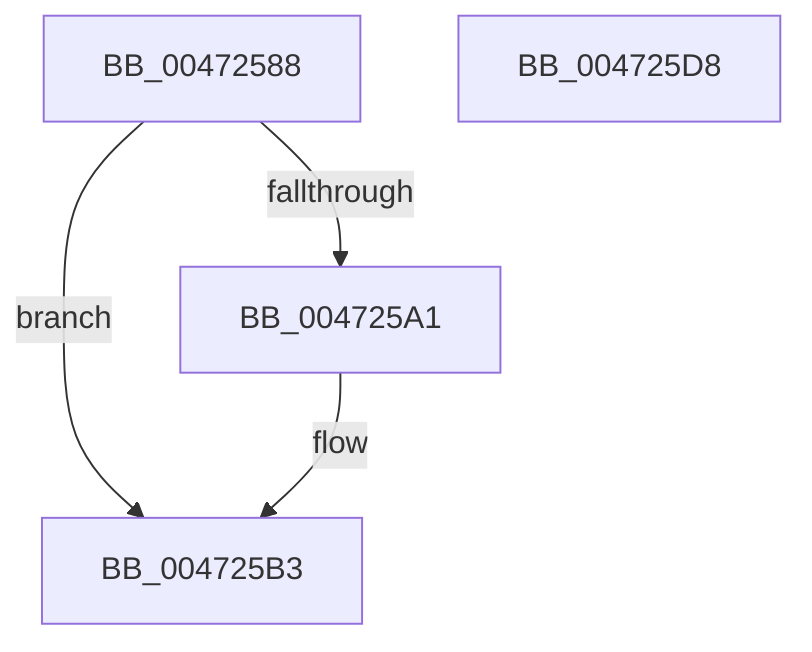

# XmPopStack

- RVA: `0x00472588`–`0x004725D9` (길이 `81` bytes)
- VA: `0x0000000140472588`
- 실행 섹션: `.text`
- PDB 이름 있음: `예`; PDB Function 태그: `아니요`
- unwind 정보 RVA: `0x0005CF00`
- 디코드: `26`개 명령, `81/81` bytes 표시
- 미해석 바이트: `0` (있으면 어셈블리에 `.byte`로 보존)

> 이 문서는 커널 이미지의 기계어와 PDB 기호를 분석해 생성했습니다. 4번과 5번은 함수 원형과 자료형을 바이너리 사용 방식에서 추정한 C 해석이며 원본 소스 복구 결과는 아닙니다.

## 1. Dependencies

- 직접 호출 지점: **3**; 고유 호출 대상: **3**
- 직접 호출자로 확인된 함수: **4**
- RIP 상대 이미지 참조: **0**

### Outgoing calls
- `0x004725AD` → [longjmp](../4F/longjmp_function_004FD5F0.md) (function, `0x004FD5F0`)
- `0x004725BF` → [x86BiosTranslateAddress](x86BiosTranslateAddress_function_004736C0.md) (function, `0x004736C0`)
- `0x004725CA` → [XmSetSourceValue](XmSetSourceValue_function_004737A8.md) (function, `0x004737A8`)

### Direct callers
- [XmPopOp](XmPopOp_function_00472560.md) at `0x00472569`
- [XmIretOp](../57/XmIretOp_function_00577B90.md) at `0x00577BAB`
- [XmIretOp](../57/XmIretOp_function_00577B90.md) at `0x00577BB6`
- [XmIretOp](../57/XmIretOp_function_00577B90.md) at `0x00577BC2`
- [XmLeaveOp](../57/XmLeaveOp_function_00577C00.md) at `0x00577C1F`
- [XmLeaveOp](../57/XmLeaveOp_function_00577C00.md) at `0x00577C38`
- [XmRetOp](../57/XmRetOp_function_00577C50.md) at `0x00577C85`
- [XmRetOp](../57/XmRetOp_function_00577C50.md) at `0x00577C97`

### Static image references
- 디코드된 RIP-relative 메모리 참조가 없습니다.

## 2. Other-region calls and transfers

- 다른 실행 섹션으로 향하는 call: **0**
- 별도 외부 분기/꼬리 이동을 확인하지 못했습니다.

## 3. Assembly (complete function range)

```asm
00472588  40 53                           push rbx
0047258A  48 83 EC 20                     sub rsp, 0x20
0047258E  8B 51 28                        mov edx, dword ptr [rcx + 0x28]
00472591  48 8B D9                        mov rbx, rcx
00472594  8B 49 78                        mov ecx, dword ptr [rcx + 0x78]
00472597  0F B7 43 48                     movzx eax, word ptr [rbx + 0x48]
0047259B  2B C1                           sub eax, ecx
0047259D  3B D0                           cmp edx, eax
0047259F  76 12                           jbe 0x1404725b3
004725A1  48 8D 8B A0 00 00 00            lea rcx, [rbx + 0xa0]
004725A8  BA 10 00 00 00                  mov edx, 0x10
004725AD  E8 3E B0 08 00                  call 0x1404fd5f0
004725B2  CC                              int3
004725B3  8D 42 01                        lea eax, [rdx + 1]
004725B6  03 C1                           add eax, ecx
004725B8  0F B7 4B 3C                     movzx ecx, word ptr [rbx + 0x3c]
004725BC  89 43 28                        mov dword ptr [rbx + 0x28], eax
004725BF  E8 FC 10 00 00                  call 0x1404736c0
004725C4  48 8B D0                        mov rdx, rax
004725C7  48 8B CB                        mov rcx, rbx
004725CA  E8 D9 11 00 00                  call 0x1404737a8
004725CF  8B 43 6C                        mov eax, dword ptr [rbx + 0x6c]
004725D2  48 83 C4 20                     add rsp, 0x20
004725D6  5B                              pop rbx
004725D7  C3                              ret
004725D8  CC                              int3
```

## 4. C-style interpretation (structured pseudocode)

```c
__int64 __fastcall XmPopStack(__int64 a1)
{
    __int64 result;
    __int64 v_rsp;

    v_rsp = (v_rsp) - (32);
    result = (unsigned int)((*(unsigned __int16 *)(a1 + 72)) - ((unsigned int)((unsigned int)(*(unsigned int *)(a1 + 120)))));
    if (((unsigned int)((unsigned int)(*(unsigned int *)(a1 + 40)))) >= = ((unsigned int)(result))) {
        a1 = a1 + 160;
        a2 = 16;
        result = longjmp(a1, a2, a3, a4);
    }
    result = (unsigned int)((a2 + 1) + ((unsigned int)(a1)));
    *(unsigned int *)(a1 + 40) = (unsigned int)(result);
    result = x86BiosTranslateAddress(*(unsigned __int16 *)(a1 + 60), a2, a3, a4);
    result = XmSetSourceValue(a1, result, a3, a4);
    v_rsp = (v_rsp) + (32);
    return (unsigned int)(*(unsigned int *)(a1 + 108));
}
```

## 5. (Beta) C Style

```c
int64_t XmPopStack(void *Arg1)
{
    uint8_t *arg1 = (uint8_t *)Arg1;

    int64_t result;
    int64_t local_rsp;

    local_rsp = (local_rsp) - (32);
    result = (uint32_t)((*(uint16_t *)(arg1 + 0x48)) - ((uint32_t)((uint32_t)(*(uint32_t *)(arg1 + 0x78)))));
    if (((uint32_t)((uint32_t)(*(uint32_t *)(arg1 + 0x28)))) >= = ((uint32_t)(result))) {
        Arg1 = Arg1 + 160;
        a2 = 16;
        result = longjmp(Arg1, a2, a3, a4);
    }
    result = (uint32_t)((a2 + 1) + ((uint32_t)(Arg1)));
    *(uint32_t *)(arg1 + 0x28) = (uint32_t)(result);
    result = x86BiosTranslateAddress(*(uint16_t *)(arg1 + 0x3C), a2, a3, a4);
    result = XmSetSourceValue(Arg1, result, a3, a4);
    local_rsp = (local_rsp) + (32);
    return (uint32_t)(*(uint32_t *)(arg1 + 0x6C));
}
```

### 관측된 메모리 오프셋

구조체 형식이 확인되지 않은 접근은 인자 기준의 오프셋으로만 기록했습니다.

| 기준 인자 | 오프셋 표현 | 폭 (bit) | 접근 |
|---|---:|---:|---|
| `Arg1` | `+ 0x28` | `32` | `R` |
| `Arg1` | `+ 0x28` | `32` | `W` |
| `Arg1` | `+ 0x3C` | `16` | `R` |
| `Arg1` | `+ 0x48` | `16` | `R` |
| `Arg1` | `+ 0x6C` | `32` | `R` |
| `Arg1` | `+ 0x78` | `32` | `R` |
| `Arg1` | `+ 0xA0` | `64` | `R` |

## 6. Execution-region graph

[열기: 2D/3D 그래프와 함수 탐색 컨트롤 패널](../../../control-panel.html?section=text&rva=0x00472588&view=graph)

- 2D 그래프는 위에서 아래로 흐르고, 3D 그래프는 빈 공간을 드래그해 회전합니다. Shift+드래그는 이동, 휠은 확대·축소, 함수 노드 선택은 대상 보고서 이동입니다.

### Static fallback


