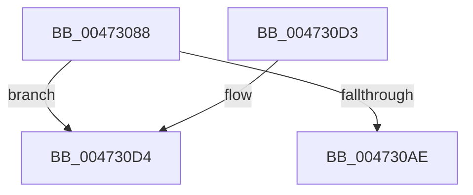

# XmPushStack

- RVA: `0x00473088`–`0x004730E6` (길이 `94` bytes)
- VA: `0x0000000140473088`
- 실행 섹션: `.text`
- PDB 이름 있음: `예`; PDB Function 태그: `아니요`
- unwind 정보 RVA: `0x00093470`
- 디코드: `29`개 명령, `94/94` bytes 표시
- 미해석 바이트: `0` (있으면 어셈블리에 `.byte`로 보존)

> 이 문서는 커널 이미지의 기계어와 PDB 기호를 분석해 생성했습니다. 4번과 5번은 함수 원형과 자료형을 바이너리 사용 방식에서 추정한 C 해석이며 원본 소스 복구 결과는 아닙니다.

## 1. Dependencies

- 직접 호출 지점: **3**; 고유 호출 대상: **3**
- 직접 호출자로 확인된 함수: **5**
- RIP 상대 이미지 참조: **0**

### Outgoing calls
- `0x004730B5` → [x86BiosTranslateAddress](x86BiosTranslateAddress_function_004736C0.md) (function, `0x004736C0`)
- `0x004730C3` → [XmStoreResult](XmStoreResult_function_004739FC.md) (function, `0x004739FC`)
- `0x004730E0` → [longjmp](../4F/longjmp_function_004FD5F0.md) (function, `0x004FD5F0`)

### Direct callers
- [XmCallOp](XmCallOp_function_00472D00.md) at `0x00472D2F`
- [XmCallOp](XmCallOp_function_00472D00.md) at `0x00472D3A`
- [XmCallOp](XmCallOp_function_00472D00.md) at `0x00472D5F`
- [XmPushOp](XmPushOp_function_00472D90.md) at `0x00472D97`
- [XmPushaOp](../57/XmPushaOp_function_005777C0.md) at `0x0057780C`
- [XmEnterOp](../57/XmEnterOp_function_00577A10.md) at `0x00577A40`
- [XmEnterOp](../57/XmEnterOp_function_00577A10.md) at `0x00577A55`
- [XmEnterOp](../57/XmEnterOp_function_00577A10.md) at `0x00577A7E`
- [XmIntOp](../57/XmIntOp_function_00577AE0.md) at `0x00577B44`
- [XmIntOp](../57/XmIntOp_function_00577AE0.md) at `0x00577B50`
- [XmIntOp](../57/XmIntOp_function_00577AE0.md) at `0x00577B5B`

### Static image references
- 디코드된 RIP-relative 메모리 참조가 없습니다.

## 2. Other-region calls and transfers

- 다른 실행 섹션으로 향하는 call: **0**
- 별도 외부 분기/꼬리 이동을 확인하지 못했습니다.

## 3. Assembly (complete function range)

```asm
00473088  48 89 5C 24 08                  mov qword ptr [rsp + 8], rbx
0047308D  57                              push rdi
0047308E  48 83 EC 20                     sub rsp, 0x20
00473092  44 8B 41 78                     mov r8d, dword ptr [rcx + 0x78]
00473096  8B FA                           mov edi, edx
00473098  8B 51 28                        mov edx, dword ptr [rcx + 0x28]
0047309B  48 8B D9                        mov rbx, rcx
0047309E  0F B7 41 48                     movzx eax, word ptr [rcx + 0x48]
004730A2  41 2B D0                        sub edx, r8d
004730A5  FF CA                           dec edx
004730A7  41 2B C0                        sub eax, r8d
004730AA  3B D0                           cmp edx, eax
004730AC  77 26                           ja 0x1404730d4
004730AE  89 51 28                        mov dword ptr [rcx + 0x28], edx
004730B1  0F B7 49 3C                     movzx ecx, word ptr [rcx + 0x3c]
004730B5  E8 06 06 00 00                  call 0x1404736c0
004730BA  8B D7                           mov edx, edi
004730BC  48 89 43 58                     mov qword ptr [rbx + 0x58], rax
004730C0  48 8B CB                        mov rcx, rbx
004730C3  E8 34 09 00 00                  call 0x1404739fc
004730C8  48 8B 5C 24 30                  mov rbx, qword ptr [rsp + 0x30]
004730CD  48 83 C4 20                     add rsp, 0x20
004730D1  5F                              pop rdi
004730D2  C3                              ret
004730D3  CC                              int3
004730D4  48 81 C1 A0 00 00 00            add rcx, 0xa0
004730DB  BA 0F 00 00 00                  mov edx, 0xf
004730E0  E8 0B A5 08 00                  call 0x1404fd5f0
004730E5  CC                              int3
```

## 4. C-style interpretation (structured pseudocode)

```c
__int64 __fastcall XmPushStack(__int64 a1, int a2)
{
    __int64 result;
    __int64 v_rsp;
    unsigned __int64 v_stack_p8;

    v_stack_p8 = v_rbx;
    v_rsp = (v_rsp) - (32);
    a2 = (unsigned int)(((unsigned int)(*(unsigned int *)(a1 + 40))) - ((unsigned int)((unsigned int)(*(unsigned int *)(a1 + 120)))));
    a2 = (unsigned int)((a2) - 1);
    result = (unsigned int)((*(unsigned __int16 *)(a1 + 72)) - ((unsigned int)((unsigned int)(*(unsigned int *)(a1 + 120)))));
    if (a2 > ((unsigned int)(result))) goto loc_004730D4;
    *(unsigned int *)(a1 + 40) = a2;
    result = x86BiosTranslateAddress(*(unsigned __int16 *)(a1 + 60), a2, (unsigned int)(*(unsigned int *)(a1 + 120)), a4);
    *(unsigned __int64 *)(a1 + 88) = result;
    result = XmStoreResult(a1, (unsigned int)((unsigned int)((unsigned int)(a2))), (unsigned int)(*(unsigned int *)(a1 + 120)), a4);
    v_rsp = (v_rsp) + (32);
    return result;
loc_004730D4:
    a1 = (a1) + (160);
    result = longjmp(a1, 15, (unsigned int)(*(unsigned int *)(a1 + 120)), a4);
    return result;
}
```

## 5. (Beta) C Style

```c
int64_t XmPushStack(void *Arg1, int32_t Arg2)
{
    uint8_t *arg1 = (uint8_t *)Arg1;

    int64_t result;
    int64_t local_rsp;
    uint64_t v_stack_p8;

    v_stack_p8 = local_rbx;
    local_rsp = (local_rsp) - (32);
    Arg2 = (uint32_t)(((uint32_t)(*(uint32_t *)(arg1 + 0x28))) - ((uint32_t)((uint32_t)(*(uint32_t *)(arg1 + 0x78)))));
    Arg2 = (uint32_t)((Arg2) - 1);
    result = (uint32_t)((*(uint16_t *)(arg1 + 0x48)) - ((uint32_t)((uint32_t)(*(uint32_t *)(arg1 + 0x78)))));
    if (Arg2 > ((uint32_t)(result))) goto loc_004730D4;
    *(uint32_t *)(arg1 + 0x28) = Arg2;
    result = x86BiosTranslateAddress(*(uint16_t *)(arg1 + 0x3C), Arg2, (uint32_t)(*(uint32_t *)(arg1 + 0x78)), a4);
    *(uint64_t *)(arg1 + 0x58) = result;
    result = XmStoreResult(Arg1, (uint32_t)((uint32_t)((uint32_t)(Arg2))), (uint32_t)(*(uint32_t *)(arg1 + 0x78)), a4);
    local_rsp = (local_rsp) + (32);
    return result;
loc_004730D4:
    Arg1 = (Arg1) + (160);
    result = longjmp(Arg1, 15, (uint32_t)(*(uint32_t *)(arg1 + 0x78)), a4);
    return result;
}
```

### 관측된 메모리 오프셋

구조체 형식이 확인되지 않은 접근은 인자 기준의 오프셋으로만 기록했습니다.

| 기준 인자 | 오프셋 표현 | 폭 (bit) | 접근 |
|---|---:|---:|---|
| `Arg1` | `+ 0x28` | `32` | `R` |
| `Arg1` | `+ 0x28` | `32` | `W` |
| `Arg1` | `+ 0x3C` | `16` | `R` |
| `Arg1` | `+ 0x48` | `16` | `R` |
| `Arg1` | `+ 0x58` | `64` | `W` |
| `Arg1` | `+ 0x78` | `32` | `R` |

## 6. Execution-region graph

[열기: 2D/3D 그래프와 함수 탐색 컨트롤 패널](../../../control-panel.html?section=text&rva=0x00473088&view=graph)

- 2D 그래프는 위에서 아래로 흐르고, 3D 그래프는 빈 공간을 드래그해 회전합니다. Shift+드래그는 이동, 휠은 확대·축소, 함수 노드 선택은 대상 보고서 이동입니다.

### Static fallback


