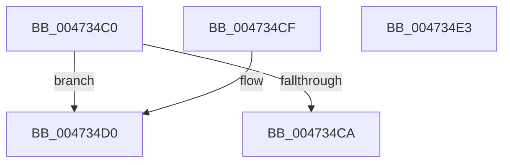

# XmSetDataType

- RVA: `0x004734C0`–`0x004734E4` (길이 `36` bytes)
- VA: `0x00000001404734C0`
- 실행 섹션: `.text`
- PDB 이름 있음: `예`; PDB Function 태그: `아니요`
- unwind 정보 RVA: `0x000DB714`
- 디코드: `15`개 명령, `36/36` bytes 표시
- 미해석 바이트: `0` (있으면 어셈블리에 `.byte`로 보존)

> 이 문서는 커널 이미지의 기계어와 PDB 기호를 분석해 생성했습니다. 4번과 5번은 함수 원형과 자료형을 바이너리 사용 방식에서 추정한 C 해석이며 원본 소스 복구 결과는 아닙니다.

## 1. Dependencies

- 직접 호출 지점: **0**; 고유 호출 대상: **0**
- 직접 호출자로 확인된 함수: **14**
- RIP 상대 이미지 참조: **0**

### Outgoing calls
- 직접 디코드된 call 명령이 없습니다.

### Direct callers
- [XmGroup2ByByte](XmGroup2ByByte_function_00472620.md) at `0x00472632`
- [XmGroup45General](XmGroup45General_function_00472A80.md) at `0x00472A92`
- [XmGroup1Immediate](XmGroup1Immediate_function_00472B20.md) at `0x00472B32`
- [XmMoveGeneral](XmMoveGeneral_function_004730F0.md) at `0x004730FE`
- [XmGroup1General](XmGroup1General_function_00473160.md) at `0x0047316E`
- [XmPortDX](XmPortDX_function_004733E0.md) at `0x004733F5`
- [XmAccumImmediate](XmAccumImmediate_function_00473460.md) at `0x00473469`
- [XmGroup2By1](../57/XmGroup2By1_function_00576330.md) at `0x0057633E`
- [XmGroup2ByCL](../57/XmGroup2ByCL_function_00576390.md) at `0x0057639E`
- [XmGroup3General](../57/XmGroup3General_function_005763F0.md) at `0x00576402`
- [XmMoveImmediate](../57/XmMoveImmediate_function_005767E0.md) at `0x005767EE`
- [XmPortImmediate](../57/XmPortImmediate_function_005769A0.md) at `0x005769C1`
- [XmSegmentOffset](../57/XmSegmentOffset_function_00576A60.md) at `0x00576A69`
- [XmStringOperands](../57/XmStringOperands_function_00576B90.md) at `0x00576B94`

### Static image references
- 디코드된 RIP-relative 메모리 참조가 없습니다.

## 2. Other-region calls and transfers

- 다른 실행 섹션으로 향하는 call: **0**
- 별도 외부 분기/꼬리 이동을 확인하지 못했습니다.

## 3. Assembly (complete function range)

```asm
004734C0  8B 41 70                        mov eax, dword ptr [rcx + 0x70]
004734C3  48 8B D1                        mov rdx, rcx
004734C6  A8 01                           test al, 1
004734C8  75 06                           jne 0x1404734d0
004734CA  83 61 78 00                     and dword ptr [rcx + 0x78], 0
004734CE  C3                              ret
004734CF  CC                              int3
004734D0  8A 81 8A 00 00 00               mov al, byte ptr [rcx + 0x8a]
004734D6  F6 D8                           neg al
004734D8  1B C9                           sbb ecx, ecx
004734DA  83 E1 02                        and ecx, 2
004734DD  FF C1                           inc ecx
004734DF  89 4A 78                        mov dword ptr [rdx + 0x78], ecx
004734E2  C3                              ret
004734E3  CC                              int3
```

## 4. C-style interpretation (structured pseudocode)

```c
__int64 __fastcall XmSetDataType(__int64 a1)
{
    __int64 result;

    if ((((unsigned __int8)((unsigned int)(*(unsigned int *)(a1 + 112)))) & (1)) != 0) goto loc_004734D0;
    return (unsigned int)(*(unsigned int *)(a1 + 112));
loc_004734D0:
    result = (unsigned __int8)(-(*(unsigned __int8 *)(a1 + 138)));
    a1 = (unsigned int)((a1) & (2));
    a1 = (unsigned int)((a1) + 1);
    *(unsigned int *)(a1 + 120) = (unsigned int)(a1);
    return result;
}
```

## 5. (Beta) C Style

```c
int64_t XmSetDataType(void *Arg1)
{
    uint8_t *arg1 = (uint8_t *)Arg1;

    int64_t result;

    if ((((uint8_t)((uint32_t)(*(uint32_t *)(arg1 + 0x70)))) & (1)) != 0) goto loc_004734D0;
    return (uint32_t)(*(uint32_t *)(arg1 + 0x70));
loc_004734D0:
    result = (uint8_t)(-(*(uint8_t *)(arg1 + 0x8A)));
    Arg1 = (uint32_t)((Arg1) & (2));
    Arg1 = (uint32_t)((Arg1) + 1);
    *(uint32_t *)(arg1 + 0x78) = (uint32_t)(Arg1);
    return result;
}
```

### 관측된 메모리 오프셋

구조체 형식이 확인되지 않은 접근은 인자 기준의 오프셋으로만 기록했습니다.

| 기준 인자 | 오프셋 표현 | 폭 (bit) | 접근 |
|---|---:|---:|---|
| `Arg1` | `+ 0x70` | `32` | `R` |
| `Arg1` | `+ 0x78` | `32` | `R/W` |
| `Arg1` | `+ 0x78` | `32` | `W` |
| `Arg1` | `+ 0x8A` | `8` | `R` |

## 6. Execution-region graph

[열기: 2D/3D 그래프와 함수 탐색 컨트롤 패널](../../../control-panel.html?section=text&rva=0x004734C0&view=graph)

- 2D 그래프는 위에서 아래로 흐르고, 3D 그래프는 빈 공간을 드래그해 회전합니다. Shift+드래그는 이동, 휠은 확대·축소, 함수 노드 선택은 대상 보고서 이동입니다.

### Static fallback


