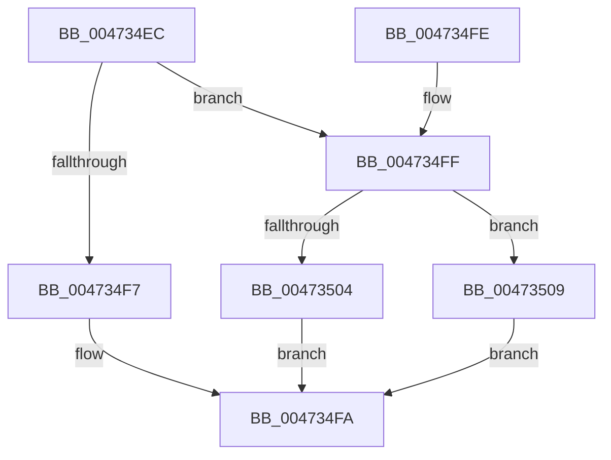

# XmSetDestinationValue

- RVA: `0x004734EC`–`0x0047350D` (길이 `33` bytes)
- VA: `0x00000001404734EC`
- 실행 섹션: `.text`
- PDB 이름 있음: `예`; PDB Function 태그: `아니요`
- unwind 정보 RVA: `0x000DB714`
- 디코드: `14`개 명령, `33/33` bytes 표시
- 미해석 바이트: `0` (있으면 어셈블리에 `.byte`로 보존)

> 이 문서는 커널 이미지의 기계어와 PDB 기호를 분석해 생성했습니다. 4번과 5번은 함수 원형과 자료형을 바이너리 사용 방식에서 추정한 C 해석이며 원본 소스 복구 결과는 아닙니다.

## 1. Dependencies

- 직접 호출 지점: **0**; 고유 호출 대상: **0**
- 직접 호출자로 확인된 함수: **22**
- RIP 상대 이미지 참조: **0**

### Outgoing calls
- 직접 디코드된 call 명령이 없습니다.

### Direct callers
- [XmGroup2ByByte](XmGroup2ByByte_function_00472620.md) at `0x0047265B`
- [XmFlagsRegister](XmFlagsRegister_function_00472880.md) at `0x004728B0`
- [XmOpcodeRegister](XmOpcodeRegister_function_004728C0.md) at `0x004728FC`
- [XmGroup45General](XmGroup45General_function_00472A80.md) at `0x00472AE3`
- [XmGroup1Immediate](XmGroup1Immediate_function_00472B20.md) at `0x00472B5E`
- [XmGroup1General](XmGroup1General_function_00473160.md) at `0x00473195`
- [XmGroup1General](XmGroup1General_function_00473160.md) at `0x004731CC`
- [XmAccumImmediate](XmAccumImmediate_function_00473460.md) at `0x0047348A`
- [XmAccumRegister](../57/XmAccumRegister_function_005760A0.md) at `0x005760D2`
- [XmGeneralBitOffset](../57/XmGeneralBitOffset_function_00576200.md) at `0x0057628B`
- [XmGroup2By1](../57/XmGroup2By1_function_00576330.md) at `0x00576365`
- [XmGroup2ByCL](../57/XmGroup2ByCL_function_00576390.md) at `0x005763C5`
- [XmGroup3General](../57/XmGroup3General_function_005763F0.md) at `0x00576437`
- [XmGroup3General](../57/XmGroup3General_function_005763F0.md) at `0x00576451`
- [XmGroup3General](../57/XmGroup3General_function_005763F0.md) at `0x0057646F`
- [XmGroup7General](../57/XmGroup7General_function_00576490.md) at `0x005764D3`
- [XmGroup8BitOffset](../57/XmGroup8BitOffset_function_005764F0.md) at `0x00576575`
- [XmImulImmediate](../57/XmImulImmediate_function_00576640.md) at `0x00576688`
- [XmLoadSegment](../57/XmLoadSegment_function_005766C0.md) at `0x00576741`
- [XmPopGeneral](../57/XmPopGeneral_function_00576950.md) at `0x00576985`
- [XmPushPopSegment](../57/XmPushPopSegment_function_00576A20.md) at `0x00576A47`
- [XmShiftDouble](../57/XmShiftDouble_function_00576B10.md) at `0x00576B74`
- [XmPopaOp](../57/XmPopaOp_function_00577750.md) at `0x00577796`
- [XmCmpsOp](../57/XmCmpsOp_function_00577CD0.md) at `0x00577D2E`
- [XmScasOp](../57/XmScasOp_function_00578000.md) at `0x0057804E`

### Static image references
- 디코드된 RIP-relative 메모리 참조가 없습니다.

## 2. Other-region calls and transfers

- 다른 실행 섹션으로 향하는 call: **0**
- 별도 외부 분기/꼬리 이동을 확인하지 못했습니다.

## 3. Assembly (complete function range)

```asm
004734EC  8B 41 78                        mov eax, dword ptr [rcx + 0x78]
004734EF  48 89 51 58                     mov qword ptr [rcx + 0x58], rdx
004734F3  85 C0                           test eax, eax
004734F5  75 08                           jne 0x1404734ff
004734F7  0F B6 02                        movzx eax, byte ptr [rdx]
004734FA  89 41 68                        mov dword ptr [rcx + 0x68], eax
004734FD  C3                              ret
004734FE  CC                              int3
004734FF  83 F8 01                        cmp eax, 1
00473502  75 05                           jne 0x140473509
00473504  0F B7 02                        movzx eax, word ptr [rdx]
00473507  EB F1                           jmp 0x1404734fa
00473509  8B 02                           mov eax, dword ptr [rdx]
0047350B  EB ED                           jmp 0x1404734fa
```

## 4. C-style interpretation (structured pseudocode)

```c
__int64 __fastcall XmSetDestinationValue(__int64 a1, __int64 a2)
{
    *(unsigned __int64 *)(a1 + 88) = a2;
    if ((unsigned int)((unsigned int)(*(unsigned int *)(a1 + 120))) != 0) goto loc_004734FF;
loc_004734FA:
    *(unsigned int *)(a1 + 104) = (unsigned int)(*(unsigned __int8 *)(a2));
    return *(unsigned __int8 *)(a2);
loc_004734FF:
    if (((unsigned int)(*(unsigned __int8 *)(a2))) != 1) goto loc_00473509;
    goto loc_004734FA;
loc_00473509:
    goto loc_004734FA;
}
```

## 5. (Beta) C Style

```c
int64_t XmSetDestinationValue(void *Arg1, void *Arg2)
{
    uint8_t *arg1 = (uint8_t *)Arg1;
    uint8_t *arg2 = (uint8_t *)Arg2;

    *(void **)(arg1 + 0x58) = Arg2;
    if ((uint32_t)((uint32_t)(*(uint32_t *)(arg1 + 0x78))) != 0) goto loc_004734FF;
loc_004734FA:
    *(uint32_t *)(arg1 + 0x68) = (uint32_t)(*(uint8_t *)(arg2));
    return *(uint8_t *)(arg2);
loc_004734FF:
    if (((uint32_t)(*(uint8_t *)(arg2))) != 1) goto loc_00473509;
    goto loc_004734FA;
loc_00473509:
    goto loc_004734FA;
}
```

### 관측된 메모리 오프셋

구조체 형식이 확인되지 않은 접근은 인자 기준의 오프셋으로만 기록했습니다.

| 기준 인자 | 오프셋 표현 | 폭 (bit) | 접근 |
|---|---:|---:|---|
| `Arg1` | `+ 0x58` | `64` | `W` |
| `Arg1` | `+ 0x68` | `32` | `W` |
| `Arg1` | `+ 0x78` | `32` | `R` |
| `Arg2` | `+ 0x0` | `8` | `R` |
| `Arg2` | `+ 0x0` | `16` | `R` |
| `Arg2` | `+ 0x0` | `32` | `R` |

## 6. Execution-region graph

[열기: 2D/3D 그래프와 함수 탐색 컨트롤 패널](../../../control-panel.html?section=text&rva=0x004734EC&view=graph)

- 2D 그래프는 위에서 아래로 흐르고, 3D 그래프는 빈 공간을 드래그해 회전합니다. Shift+드래그는 이동, 휠은 확대·축소, 함수 노드 선택은 대상 보고서 이동입니다.

### Static fallback


