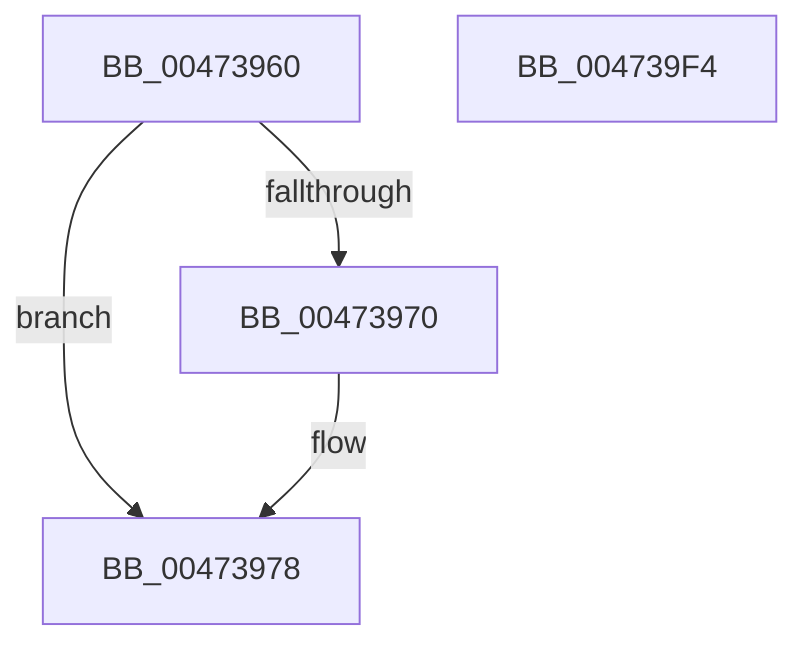

# XmSetLogicalResult

- RVA: `0x00473960`–`0x004739F5` (길이 `149` bytes)
- VA: `0x0000000140473960`
- 실행 섹션: `.text`
- PDB 이름 있음: `예`; PDB Function 태그: `아니요`
- unwind 정보 RVA: `0x0005C788`
- 디코드: `42`개 명령, `149/149` bytes 표시
- 미해석 바이트: `0` (있으면 어셈블리에 `.byte`로 보존)

> 이 문서는 커널 이미지의 기계어와 PDB 기호를 분석해 생성했습니다. 4번과 5번은 함수 원형과 자료형을 바이너리 사용 방식에서 추정한 C 해석이며 원본 소스 복구 결과는 아닙니다.

## 1. Dependencies

- 직접 호출 지점: **1**; 고유 호출 대상: **1**
- 직접 호출자로 확인된 함수: **3**
- RIP 상대 이미지 참조: **1**

### Outgoing calls
- `0x00473973` → [XmStoreResult](XmStoreResult_function_004739FC.md) (function, `0x004739FC`)

### Direct callers
- [XmXorOp](XmXorOp_function_00472930.md) at `0x0047293A`
- [XmAndOp](XmAndOp_function_004737D0.md) at `0x004737DA`
- [XmOrOp](../57/XmOrOp_function_00576C50.md) at `0x00576C5A`

### Static image references
- `0x00473982` → RVA `0x0001A190` (`.rdata`; read)

## 2. Other-region calls and transfers

- 다른 실행 섹션으로 향하는 call: **0**
- 별도 외부 분기/꼬리 이동을 확인하지 못했습니다.

## 3. Assembly (complete function range)

```asm
00473960  48 83 EC 28                     sub rsp, 0x28
00473964  83 79 7C 16                     cmp dword ptr [rcx + 0x7c], 0x16
00473968  4C 8B D9                        mov r11, rcx
0047396B  44 8B D2                        mov r10d, edx
0047396E  74 08                           je 0x140473978
00473970  41 8B D2                        mov edx, r10d
00473973  E8 84 00 00 00                  call 0x1404739fc
00473978  44 8B 41 10                     mov r8d, dword ptr [rcx + 0x10]
0047397C  49 8B D2                        mov rdx, r10
0047397F  49 8B C2                        mov rax, r10
00473982  48 8D 0D 07 68 BA FF            lea rcx, [rip - 0x4597f9]
00473989  48 C1 E8 04                     shr rax, 4
0047398D  83 E2 0F                        and edx, 0xf
00473990  83 E0 0F                        and eax, 0xf
00473993  41 83 E0 FE                     and r8d, 0xfffffffe
00473997  41 83 E0 FB                     and r8d, 0xfffffffb
0047399B  44 0F B6 0C 08                  movzx r9d, byte ptr [rax + rcx]
004739A0  0F B6 04 0A                     movzx eax, byte ptr [rdx + rcx]
004739A4  44 03 C8                        add r9d, eax
004739A7  41 8B C2                        mov eax, r10d
004739AA  41 F7 D1                        not r9d
004739AD  41 83 E1 01                     and r9d, 1
004739B1  41 C1 E1 02                     shl r9d, 2
004739B5  45 33 C8                        xor r9d, r8d
004739B8  41 83 E1 AF                     and r9d, 0xffffffaf
004739BC  F7 D8                           neg eax
004739BE  1B C9                           sbb ecx, ecx
004739C0  F7 D1                           not ecx
004739C2  83 E1 40                        and ecx, 0x40
004739C5  44 0B C9                        or r9d, ecx
004739C8  41 8B 4B 78                     mov ecx, dword ptr [r11 + 0x78]
004739CC  41 0F BA F1 07                  btr r9d, 7
004739D1  8D 0C CD 07 00 00 00            lea ecx, [rcx*8 + 7]
004739D8  41 D3 EA                        shr r10d, cl
004739DB  41 83 E2 01                     and r10d, 1
004739DF  41 C1 E2 07                     shl r10d, 7
004739E3  45 33 D1                        xor r10d, r9d
004739E6  41 0F BA F2 0B                  btr r10d, 0xb
004739EB  45 89 53 10                     mov dword ptr [r11 + 0x10], r10d
004739EF  48 83 C4 28                     add rsp, 0x28
004739F3  C3                              ret
004739F4  CC                              int3
```

## 4. C-style interpretation (structured pseudocode)

```c
__int64 __fastcall XmSetLogicalResult(__int64 a1, int a2)
{
    __int64 result;
    __int64 v_r10;
    __int64 v_rsp;

    v_rsp = (v_rsp) - (40);
    if ((*(unsigned int *)(a1 + 124)) != 22) {
        a2 = (unsigned int)((unsigned int)(a2));
        result = XmStoreResult(a1, a2, a3, a4);
    }
    result = ((unsigned int)(a2)) >> (4);
    a2 = (unsigned int)(((unsigned int)(a2)) & (15));
    result = (unsigned int)((result) & (15));
    a3 = (unsigned int)(((unsigned int)(*(unsigned int *)(a1 + 16))) & (0xFFFFFFFEULL));
    a3 = (unsigned int)((a3) & (0xFFFFFFFBULL));
    a4 = (unsigned int)((*(unsigned __int8 *)(result + v_rip - 4560889 * 1)) + ((unsigned int)(*(unsigned __int8 *)(a2 + v_rip - 4560889 * 1))));
    a4 = (unsigned int)(~(a4));
    a4 = (unsigned int)((a4) & (1));
    a4 = (unsigned int)((a4) << (2));
    a4 = (unsigned int)((a4) ^ ((unsigned int)(a3)));
    a4 = (unsigned int)((a4) & (0xFFFFFFAFULL));
    result = (unsigned int)(-((unsigned int)((unsigned int)((unsigned int)(a2)))));
    a1 = (unsigned int)(~(v_rip - 4560889));
    a1 = (unsigned int)((a1) & (64));
    a4 = (unsigned int)((a4) | ((unsigned int)(a1)));
    v_r10 = (unsigned int)(((unsigned int)(a2)) >> ((unsigned __int8)((unsigned int)(*(unsigned int *)(a1 + 120)) * 8 + 7)));
    v_r10 = (unsigned int)((v_r10) & (1));
    v_r10 = (unsigned int)((v_r10) << (7));
    v_r10 = (unsigned int)((v_r10) ^ ((unsigned int)(a4)));
    *(unsigned int *)(a1 + 16) = (unsigned int)(v_r10);
    v_rsp = (v_rsp) + (40);
    return result;
}
```

## 5. (Beta) C Style

```c
int64_t XmSetLogicalResult(void *Arg1, int32_t Arg2)
{
    uint8_t *arg1 = (uint8_t *)Arg1;

    int64_t result;
    int64_t local_r10;
    int64_t local_rsp;

    local_rsp = (local_rsp) - (40);
    if ((*(uint32_t *)(arg1 + 0x7C)) != 22) {
        Arg2 = (uint32_t)((uint32_t)(Arg2));
        result = XmStoreResult(Arg1, Arg2, a3, a4);
    }
    result = ((uint32_t)(Arg2)) >> (4);
    Arg2 = (uint32_t)(((uint32_t)(Arg2)) & (15));
    result = (uint32_t)((result) & (15));
    a3 = (uint32_t)(((uint32_t)(*(uint32_t *)(arg1 + 0x10))) & (0xFFFFFFFEULL));
    a3 = (uint32_t)((a3) & (0xFFFFFFFBULL));
    a4 = (uint32_t)((*(uint8_t *)(result + v_rip - 0x4597F9 * 1)) + ((uint32_t)(*(uint8_t *)(Arg2 + v_rip - 0x4597F9 * 1))));
    a4 = (uint32_t)(~(a4));
    a4 = (uint32_t)((a4) & (1));
    a4 = (uint32_t)((a4) << (2));
    a4 = (uint32_t)((a4) ^ ((uint32_t)(a3)));
    a4 = (uint32_t)((a4) & (0xFFFFFFAFULL));
    result = (uint32_t)(-((uint32_t)((uint32_t)((uint32_t)(Arg2)))));
    Arg1 = (uint32_t)(~(v_rip - 4560889));
    Arg1 = (uint32_t)((Arg1) & (64));
    a4 = (uint32_t)((a4) | ((uint32_t)(Arg1)));
    local_r10 = (uint32_t)(((uint32_t)(Arg2)) >> ((uint8_t)((uint32_t)(*(uint32_t *)(arg1 + 0x78)) * 8 + 7)));
    local_r10 = (uint32_t)((local_r10) & (1));
    local_r10 = (uint32_t)((local_r10) << (7));
    local_r10 = (uint32_t)((local_r10) ^ ((uint32_t)(a4)));
    *(uint32_t *)(arg1 + 0x10) = (uint32_t)(local_r10);
    local_rsp = (local_rsp) + (40);
    return result;
}
```

### 관측된 메모리 오프셋

구조체 형식이 확인되지 않은 접근은 인자 기준의 오프셋으로만 기록했습니다.

| 기준 인자 | 오프셋 표현 | 폭 (bit) | 접근 |
|---|---:|---:|---|
| `Arg1` | `+ 0x7C` | `32` | `R` |

## 6. Execution-region graph

[열기: 2D/3D 그래프와 함수 탐색 컨트롤 패널](../../../control-panel.html?section=text&rva=0x00473960&view=graph)

- 2D 그래프는 위에서 아래로 흐르고, 3D 그래프는 빈 공간을 드래그해 회전합니다. Shift+드래그는 이동, 휠은 확대·축소, 함수 노드 선택은 대상 보고서 이동입니다.

### Static fallback


