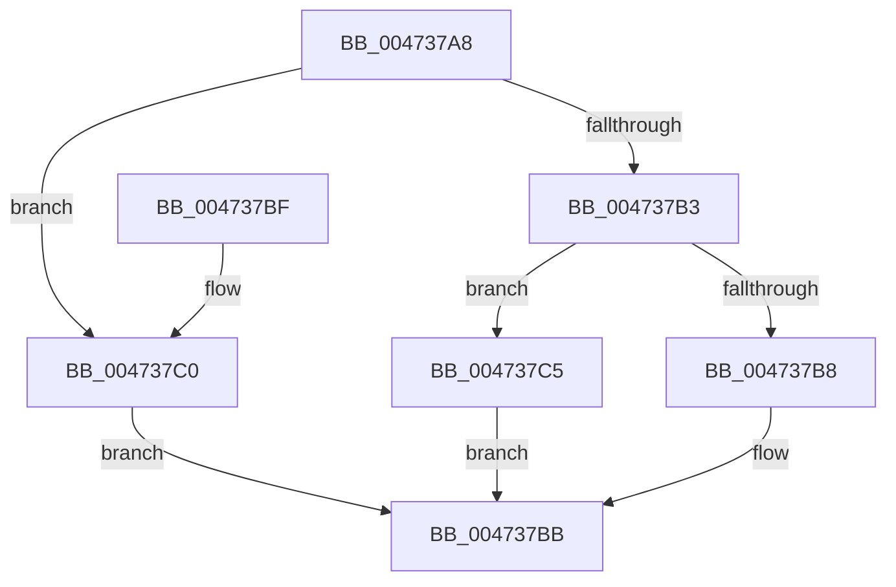

# XmSetSourceValue

- RVA: `0x004737A8`–`0x004737C9` (길이 `33` bytes)
- VA: `0x00000001404737A8`
- 실행 섹션: `.text`
- PDB 이름 있음: `예`; PDB Function 태그: `아니요`
- unwind 정보 RVA: `0x000DB714`
- 디코드: `14`개 명령, `33/33` bytes 표시
- 미해석 바이트: `0` (있으면 어셈블리에 `.byte`로 보존)

> 이 문서는 커널 이미지의 기계어와 PDB 기호를 분석해 생성했습니다. 4번과 5번은 함수 원형과 자료형을 바이너리 사용 방식에서 추정한 C 해석이며 원본 소스 복구 결과는 아닙니다.

## 1. Dependencies

- 직접 호출 지점: **0**; 고유 호출 대상: **0**
- 직접 호출자로 확인된 함수: **28**
- RIP 상대 이미지 참조: **0**

### Outgoing calls
- 직접 디코드된 call 명령이 없습니다.

### Direct callers
- [XmPopStack](XmPopStack_function_00472588.md) at `0x004725CA`
- [XmFlagsRegister](XmFlagsRegister_function_00472880.md) at `0x004728A0`
- [XmOpcodeRegister](XmOpcodeRegister_function_004728C0.md) at `0x004728EC`
- [XmStosOp](XmStosOp_function_00472950.md) at `0x00472969`
- [XmGroup45General](XmGroup45General_function_00472A80.md) at `0x00472ACE`
- [XmOutOp](XmOutOp_function_00472DB0.md) at `0x00472DCA`
- [XmMoveGeneral](XmMoveGeneral_function_004730F0.md) at `0x00473135`
- [XmGroup1General](XmGroup1General_function_00473160.md) at `0x004731AC`
- [XmAccumRegister](../57/XmAccumRegister_function_005760A0.md) at `0x005760C9`
- [XmBitScanGeneral](../57/XmBitScanGeneral_function_005760F0.md) at `0x00576135`
- [XmGeneralBitOffset](../57/XmGeneralBitOffset_function_00576200.md) at `0x00576240`
- [XmGeneralRegister](../57/XmGeneralRegister_function_005762B0.md) at `0x00576304`
- [XmGroup3General](../57/XmGroup3General_function_005763F0.md) at `0x00576462`
- [XmLoadSegment](../57/XmLoadSegment_function_005766C0.md) at `0x0057671D`
- [XmMoveSegment](../57/XmMoveSegment_function_00576830.md) at `0x00576882`
- [XmMoveXxGeneral](../57/XmMoveXxGeneral_function_005768A0.md) at `0x005768D1`
- [XmPushPopSegment](../57/XmPushPopSegment_function_00576A20.md) at `0x00576A40`
- [XmSegmentOffset](../57/XmSegmentOffset_function_00576A60.md) at `0x00576AB2`
- [XmShiftDouble](../57/XmShiftDouble_function_00576B10.md) at `0x00576B6C`
- [XmXlatOpcode](../57/XmXlatOpcode_function_00576BB0.md) at `0x00576BEB`
- [XmPushaOp](../57/XmPushaOp_function_005777C0.md) at `0x00577801`
- [XmOutsOp](../57/XmOutsOp_function_00577980.md) at `0x005779D8`
- [XmCmpsOp](../57/XmCmpsOp_function_00577CD0.md) at `0x00577D18`
- [XmLodsOp](../57/XmLodsOp_function_00577EF0.md) at `0x00577F47`
- [XmMovsOp](../57/XmMovsOp_function_00577F70.md) at `0x00577FBF`
- [XmScasOp](../57/XmScasOp_function_00578000.md) at `0x00578031`
- [XmBoundOp](../57/XmBoundOp_function_005782E0.md) at `0x00578302`
- [XmBoundOp](../57/XmBoundOp_function_005782E0.md) at `0x0057831C`
- [sub_006F3D5A](../6F/Unknown_function_006F3D5A.md) at `0x006F3D7C`

### Static image references
- 디코드된 RIP-relative 메모리 참조가 없습니다.

## 2. Other-region calls and transfers

- 다른 실행 섹션으로 향하는 call: **0**
- 별도 외부 분기/꼬리 이동을 확인하지 못했습니다.

## 3. Assembly (complete function range)

```asm
004737A8  8B 41 78                        mov eax, dword ptr [rcx + 0x78]
004737AB  48 89 51 60                     mov qword ptr [rcx + 0x60], rdx
004737AF  85 C0                           test eax, eax
004737B1  74 0D                           je 0x1404737c0
004737B3  83 F8 01                        cmp eax, 1
004737B6  75 0D                           jne 0x1404737c5
004737B8  0F B7 02                        movzx eax, word ptr [rdx]
004737BB  89 41 6C                        mov dword ptr [rcx + 0x6c], eax
004737BE  C3                              ret
004737BF  CC                              int3
004737C0  0F B6 02                        movzx eax, byte ptr [rdx]
004737C3  EB F6                           jmp 0x1404737bb
004737C5  8B 02                           mov eax, dword ptr [rdx]
004737C7  EB F2                           jmp 0x1404737bb
```

## 4. C-style interpretation (structured pseudocode)

```c
__int64 __fastcall XmSetSourceValue(__int64 a1, __int64 a2)
{
    *(unsigned __int64 *)(a1 + 96) = a2;
    if ((unsigned int)((unsigned int)(*(unsigned int *)(a1 + 120))) == 0) goto loc_004737C0;
    if (((unsigned int)((unsigned int)(*(unsigned int *)(a1 + 120)))) != 1) goto loc_004737C5;
loc_004737BB:
    *(unsigned int *)(a1 + 108) = (unsigned int)(*(unsigned __int16 *)(a2));
    return *(unsigned __int16 *)(a2);
loc_004737C0:
    goto loc_004737BB;
loc_004737C5:
    goto loc_004737BB;
}
```

## 5. (Beta) C Style

```c
int64_t XmSetSourceValue(void *Arg1, void *Arg2)
{
    uint8_t *arg1 = (uint8_t *)Arg1;
    uint8_t *arg2 = (uint8_t *)Arg2;

    *(void **)(arg1 + 0x60) = Arg2;
    if ((uint32_t)((uint32_t)(*(uint32_t *)(arg1 + 0x78))) == 0) goto loc_004737C0;
    if (((uint32_t)((uint32_t)(*(uint32_t *)(arg1 + 0x78)))) != 1) goto loc_004737C5;
loc_004737BB:
    *(uint32_t *)(arg1 + 0x6C) = (uint32_t)(*(uint16_t *)(arg2));
    return *(uint16_t *)(arg2);
loc_004737C0:
    goto loc_004737BB;
loc_004737C5:
    goto loc_004737BB;
}
```

### 관측된 메모리 오프셋

구조체 형식이 확인되지 않은 접근은 인자 기준의 오프셋으로만 기록했습니다.

| 기준 인자 | 오프셋 표현 | 폭 (bit) | 접근 |
|---|---:|---:|---|
| `Arg1` | `+ 0x60` | `64` | `W` |
| `Arg1` | `+ 0x6C` | `32` | `W` |
| `Arg1` | `+ 0x78` | `32` | `R` |
| `Arg2` | `+ 0x0` | `8` | `R` |
| `Arg2` | `+ 0x0` | `16` | `R` |
| `Arg2` | `+ 0x0` | `32` | `R` |

## 6. Execution-region graph

[열기: 2D/3D 그래프와 함수 탐색 컨트롤 패널](../../../control-panel.html?section=text&rva=0x004737A8&view=graph)

- 2D 그래프는 위에서 아래로 흐르고, 3D 그래프는 빈 공간을 드래그해 회전합니다. Shift+드래그는 이동, 휠은 확대·축소, 함수 노드 선택은 대상 보고서 이동입니다.

### Static fallback


