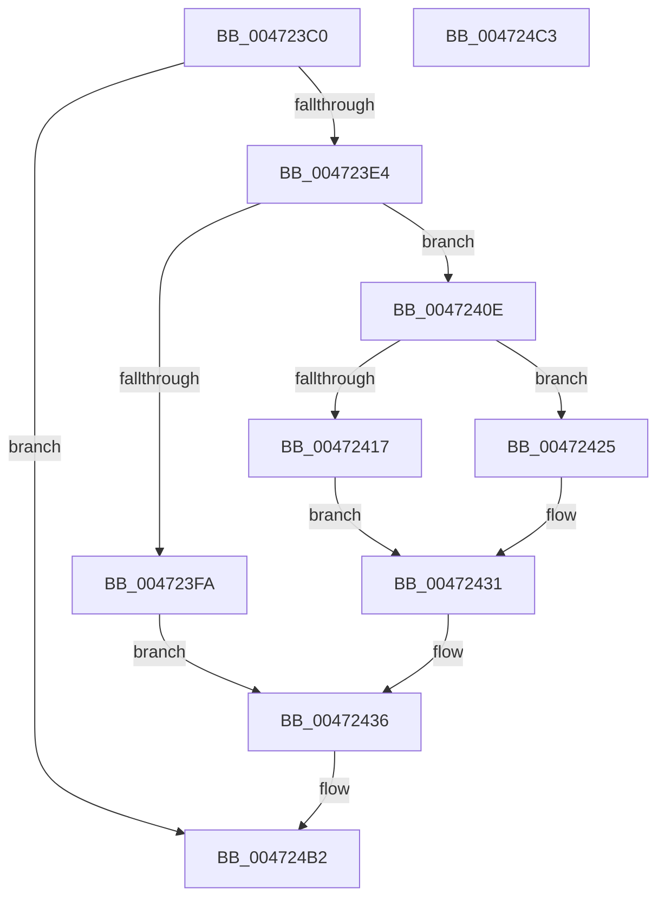

# XmShlOp

- RVA: `0x004723C0`–`0x004724C4` (길이 `260` bytes)
- VA: `0x00000001404723C0`
- 실행 섹션: `.text`
- PDB 이름 있음: `예`; PDB Function 태그: `아니요`
- unwind 정보 RVA: `0x0005CF00`
- 디코드: `81`개 명령, `260/260` bytes 표시
- 미해석 바이트: `0` (있으면 어셈블리에 `.byte`로 보존)

> 이 문서는 커널 이미지의 기계어와 PDB 기호를 분석해 생성했습니다. 4번과 5번은 함수 원형과 자료형을 바이너리 사용 방식에서 추정한 C 해석이며 원본 소스 복구 결과는 아닙니다.

## 1. Dependencies

- 직접 호출 지점: **1**; 고유 호출 대상: **1**
- 직접 호출자로 확인된 함수: **0**
- RIP 상대 이미지 참조: **1**

### Outgoing calls
- `0x004724B8` → [XmStoreResult](XmStoreResult_function_004739FC.md) (function, `0x004739FC`)

### Direct callers
- 이 함수 시작 RVA로 연결되는 직접 call은 확인되지 않았습니다. 간접 호출은 완전히 역산할 수 없습니다.

### Static image references
- `0x0047243A` → RVA `0x0001A190` (`.rdata`; read)

## 2. Other-region calls and transfers

- 다른 실행 섹션으로 향하는 call: **0**
- 별도 외부 분기/꼬리 이동을 확인하지 못했습니다.

## 3. Assembly (complete function range)

```asm
004723C0  40 53                           push rbx
004723C2  48 83 EC 20                     sub rsp, 0x20
004723C6  44 8B 41 78                     mov r8d, dword ptr [rcx + 0x78]
004723CA  4C 8B D1                        mov r10, rcx
004723CD  8B 41 6C                        mov eax, dword ptr [rcx + 0x6c]
004723D0  44 8B 49 68                     mov r9d, dword ptr [rcx + 0x68]
004723D4  42 8D 1C C5 07 00 00 00         lea ebx, [r8*8 + 7]
004723DC  85 C0                           test eax, eax
004723DE  0F 84 CE 00 00 00               je 0x1404724b2
004723E4  41 8B D1                        mov edx, r9d
004723E7  8B C8                           mov ecx, eax
004723E9  D1 EA                           shr edx, 1
004723EB  45 8B D9                        mov r11d, r9d
004723EE  41 33 D1                        xor edx, r9d
004723F1  41 D3 E3                        shl r11d, cl
004723F4  41 83 F8 03                     cmp r8d, 3
004723F8  75 14                           jne 0x14047240e
004723FA  41 8D 48 1D                     lea ecx, [r8 + 0x1d]
004723FE  C1 EA 1E                        shr edx, 0x1e
00472401  2B C8                           sub ecx, eax
00472403  41 D3 E9                        shr r9d, cl
00472406  45 8B C1                        mov r8d, r9d
00472409  45 8B CB                        mov r9d, r11d
0047240C  EB 28                           jmp 0x140472436
0047240E  41 83 F8 01                     cmp r8d, 1
00472412  45 8B C1                        mov r8d, r9d
00472415  75 0E                           jne 0x140472425
00472417  C1 EA 0E                        shr edx, 0xe
0047241A  B9 10 00 00 00                  mov ecx, 0x10
0047241F  45 0F B7 CB                     movzx r9d, r11w
00472423  EB 0C                           jmp 0x140472431
00472425  C1 EA 06                        shr edx, 6
00472428  B9 08 00 00 00                  mov ecx, 8
0047242D  45 0F B6 CB                     movzx r9d, r11b
00472431  2B C8                           sub ecx, eax
00472433  41 D3 E8                        shr r8d, cl
00472436  41 8B 42 10                     mov eax, dword ptr [r10 + 0x10]
0047243A  4C 8D 1D 4F 7D BA FF            lea r11, [rip - 0x4582b1]
00472441  8B C8                           mov ecx, eax
00472443  C1 E2 0B                        shl edx, 0xb
00472446  41 33 C8                        xor ecx, r8d
00472449  83 E1 01                        and ecx, 1
0047244C  33 C8                           xor ecx, eax
0047244E  41 8B C1                        mov eax, r9d
00472451  33 D1                           xor edx, ecx
00472453  48 C1 E8 04                     shr rax, 4
00472457  83 E0 0F                        and eax, 0xf
0047245A  81 E2 00 08 00 00               and edx, 0x800
00472460  33 D1                           xor edx, ecx
00472462  41 8B C9                        mov ecx, r9d
00472465  83 E2 FB                        and edx, 0xfffffffb
00472468  83 E1 0F                        and ecx, 0xf
0047246B  46 0F B6 04 18                  movzx r8d, byte ptr [rax + r11]
00472470  42 0F B6 04 19                  movzx eax, byte ptr [rcx + r11]
00472475  8B CB                           mov ecx, ebx
00472477  44 03 C0                        add r8d, eax
0047247A  41 8B C1                        mov eax, r9d
0047247D  41 F7 D0                        not r8d
00472480  41 83 E0 01                     and r8d, 1
00472484  41 C1 E0 02                     shl r8d, 2
00472488  44 33 C2                        xor r8d, edx
0047248B  41 83 E0 BF                     and r8d, 0xffffffbf
0047248F  F7 D8                           neg eax
00472491  41 8B C1                        mov eax, r9d
00472494  1B D2                           sbb edx, edx
00472496  D3 E8                           shr eax, cl
00472498  C1 E0 07                        shl eax, 7
0047249B  F7 D2                           not edx
0047249D  83 E2 40                        and edx, 0x40
004724A0  44 0B C2                        or r8d, edx
004724A3  41 33 C0                        xor eax, r8d
004724A6  25 80 00 00 00                  and eax, 0x80
004724AB  41 33 C0                        xor eax, r8d
004724AE  41 89 42 10                     mov dword ptr [r10 + 0x10], eax
004724B2  41 8B D1                        mov edx, r9d
004724B5  49 8B CA                        mov rcx, r10
004724B8  E8 3F 15 00 00                  call 0x1404739fc
004724BD  48 83 C4 20                     add rsp, 0x20
004724C1  5B                              pop rbx
004724C2  C3                              ret
004724C3  CC                              int3
```

## 4. C-style interpretation (structured pseudocode)

```c
__int64 __fastcall XmShlOp(__int64 a1)
{
    __int64 result;
    __int64 v_r11;
    __int64 v_rsp;

    v_rsp = (v_rsp) - (32);
    if ((unsigned int)((unsigned int)(*(unsigned int *)(a1 + 108))) == 0) goto loc_004724B2;
    a2 = (unsigned int)(((unsigned int)((unsigned int)((unsigned int)(*(unsigned int *)(a1 + 104))))) >> (1));
    a2 = (unsigned int)((a2) ^ ((unsigned int)((unsigned int)(*(unsigned int *)(a1 + 104)))));
    v_r11 = (unsigned int)(((unsigned int)((unsigned int)((unsigned int)(*(unsigned int *)(a1 + 104))))) << ((unsigned __int8)((unsigned int)((unsigned int)((unsigned int)(*(unsigned int *)(a1 + 108)))))));
    if (((unsigned int)((unsigned int)(*(unsigned int *)(a1 + 120)))) != 3) goto loc_0047240E;
    a2 = (unsigned int)((a2) >> (30));
    a1 = (unsigned int)(((unsigned int)(*(unsigned int *)(a1 + 120)) + 29) - ((unsigned int)((unsigned int)(*(unsigned int *)(a1 + 108)))));
    a4 = (unsigned int)(((unsigned int)(*(unsigned int *)(a1 + 104))) >> ((unsigned __int8)(a1)));
    goto loc_00472436;
loc_0047240E:
    if (((unsigned int)((unsigned int)((unsigned int)(a4)))) != 1) goto loc_00472425;
    a2 = (unsigned int)((a2) >> (14));
    goto loc_00472431;
loc_00472425:
    a2 = (unsigned int)((a2) >> (6));
loc_00472431:
    a1 = (unsigned int)((8) - ((unsigned int)((unsigned int)(*(unsigned int *)(a1 + 108)))));
    a3 = (unsigned int)(((unsigned int)((unsigned int)((unsigned int)((unsigned int)(v_r11))))) >> ((unsigned __int8)(a1)));
loc_00472436:
    a2 = (unsigned int)((a2) << (11));
    a1 = (unsigned int)(((unsigned int)((unsigned int)((unsigned int)(*(unsigned int *)(a1 + 16))))) ^ ((unsigned int)(a3)));
    a1 = (unsigned int)((a1) & (1));
    a1 = (unsigned int)((a1) ^ ((unsigned int)((unsigned int)(*(unsigned int *)(a1 + 16)))));
    a2 = (unsigned int)((a2) ^ ((unsigned int)(a1)));
    result = ((unsigned int)((unsigned int)((unsigned __int8)(v_r11)))) >> (4);
    result = (unsigned int)((result) & (15));
    a2 = (unsigned int)((a2) & (0x800ULL));
    a2 = (unsigned int)((a2) ^ ((unsigned int)(a1)));
    a2 = (unsigned int)((a2) & (0xFFFFFFFBULL));
    a1 = (unsigned int)(((unsigned int)((unsigned int)((unsigned __int8)(v_r11)))) & (15));
    a3 = (unsigned int)((*(unsigned __int8 *)(result + v_rip - 4555441 * 1)) + ((unsigned int)(*(unsigned __int8 *)(a1 + v_rip - 4555441 * 1))));
    a3 = (unsigned int)(~(a3));
    a3 = (unsigned int)((a3) & (1));
    a3 = (unsigned int)((a3) << (2));
    a3 = (unsigned int)((a3) ^ ((unsigned int)(a2)));
    a3 = (unsigned int)((a3) & (0xFFFFFFBFULL));
    result = (unsigned int)(-((unsigned int)((unsigned int)((unsigned __int8)(v_r11)))));
    result = (unsigned int)(((unsigned int)((unsigned int)((unsigned __int8)(v_r11)))) >> ((unsigned __int8)((unsigned int)((unsigned int)((unsigned int)(*(unsigned int *)(a1 + 120)) * 8 + 7)))));
    result = (unsigned int)((result) << (7));
    a2 = (unsigned int)(~(a2));
    a2 = (unsigned int)((a2) & (64));
    a3 = (unsigned int)((a3) | ((unsigned int)(a2)));
    result = (unsigned int)((result) ^ ((unsigned int)(a3)));
    result = (unsigned int)((result) & (128));
    result = (unsigned int)((result) ^ ((unsigned int)(a3)));
    *(unsigned int *)(a1 + 16) = (unsigned int)(result);
loc_004724B2:
    result = XmStoreResult(a1, (unsigned int)((unsigned int)((unsigned __int8)(v_r11))), a3, (unsigned __int8)(v_r11));
    v_rsp = (v_rsp) + (32);
    return result;
}
```

## 5. (Beta) C Style

```c
int64_t XmShlOp(void *Arg1)
{
    uint8_t *arg1 = (uint8_t *)Arg1;

    int64_t result;
    int64_t local_r11;
    int64_t local_rsp;

    local_rsp = (local_rsp) - (32);
    if ((uint32_t)((uint32_t)(*(uint32_t *)(arg1 + 0x6C))) == 0) goto loc_004724B2;
    a2 = (uint32_t)(((uint32_t)((uint32_t)((uint32_t)(*(uint32_t *)(arg1 + 0x68))))) >> (1));
    a2 = (uint32_t)((a2) ^ ((uint32_t)((uint32_t)(*(uint32_t *)(arg1 + 0x68)))));
    local_r11 = (uint32_t)(((uint32_t)((uint32_t)((uint32_t)(*(uint32_t *)(arg1 + 0x68))))) << ((uint8_t)((uint32_t)((uint32_t)((uint32_t)(*(uint32_t *)(arg1 + 0x6C)))))));
    if (((uint32_t)((uint32_t)(*(uint32_t *)(arg1 + 0x78)))) != 3) goto loc_0047240E;
    a2 = (uint32_t)((a2) >> (30));
    Arg1 = (uint32_t)(((uint32_t)(*(uint32_t *)(arg1 + 0x78)) + 29) - ((uint32_t)((uint32_t)(*(uint32_t *)(arg1 + 0x6C)))));
    a4 = (uint32_t)(((uint32_t)(*(uint32_t *)(arg1 + 0x68))) >> ((uint8_t)(Arg1)));
    goto loc_00472436;
loc_0047240E:
    if (((uint32_t)((uint32_t)((uint32_t)(a4)))) != 1) goto loc_00472425;
    a2 = (uint32_t)((a2) >> (14));
    goto loc_00472431;
loc_00472425:
    a2 = (uint32_t)((a2) >> (6));
loc_00472431:
    Arg1 = (uint32_t)((8) - ((uint32_t)((uint32_t)(*(uint32_t *)(arg1 + 0x6C)))));
    a3 = (uint32_t)(((uint32_t)((uint32_t)((uint32_t)((uint32_t)(local_r11))))) >> ((uint8_t)(Arg1)));
loc_00472436:
    a2 = (uint32_t)((a2) << (11));
    Arg1 = (uint32_t)(((uint32_t)((uint32_t)((uint32_t)(*(uint32_t *)(arg1 + 0x10))))) ^ ((uint32_t)(a3)));
    Arg1 = (uint32_t)((Arg1) & (1));
    Arg1 = (uint32_t)((Arg1) ^ ((uint32_t)((uint32_t)(*(uint32_t *)(arg1 + 0x10)))));
    a2 = (uint32_t)((a2) ^ ((uint32_t)(Arg1)));
    result = ((uint32_t)((uint32_t)((uint8_t)(local_r11)))) >> (4);
    result = (uint32_t)((result) & (15));
    a2 = (uint32_t)((a2) & (0x800ULL));
    a2 = (uint32_t)((a2) ^ ((uint32_t)(Arg1)));
    a2 = (uint32_t)((a2) & (0xFFFFFFFBULL));
    Arg1 = (uint32_t)(((uint32_t)((uint32_t)((uint8_t)(local_r11)))) & (15));
    a3 = (uint32_t)((*(uint8_t *)(result + v_rip - 0x4582B1 * 1)) + ((uint32_t)(*(uint8_t *)(arg1 + v_rip - 0x4582B1 * 1))));
    a3 = (uint32_t)(~(a3));
    a3 = (uint32_t)((a3) & (1));
    a3 = (uint32_t)((a3) << (2));
    a3 = (uint32_t)((a3) ^ ((uint32_t)(a2)));
    a3 = (uint32_t)((a3) & (0xFFFFFFBFULL));
    result = (uint32_t)(-((uint32_t)((uint32_t)((uint8_t)(local_r11)))));
    result = (uint32_t)(((uint32_t)((uint32_t)((uint8_t)(local_r11)))) >> ((uint8_t)((uint32_t)((uint32_t)((uint32_t)(*(uint32_t *)(arg1 + 0x78)) * 8 + 7)))));
    result = (uint32_t)((result) << (7));
    a2 = (uint32_t)(~(a2));
    a2 = (uint32_t)((a2) & (64));
    a3 = (uint32_t)((a3) | ((uint32_t)(a2)));
    result = (uint32_t)((result) ^ ((uint32_t)(a3)));
    result = (uint32_t)((result) & (128));
    result = (uint32_t)((result) ^ ((uint32_t)(a3)));
    *(uint32_t *)(arg1 + 0x10) = (uint32_t)(result);
loc_004724B2:
    result = XmStoreResult(Arg1, (uint32_t)((uint32_t)((uint8_t)(local_r11))), a3, (uint8_t)(local_r11));
    local_rsp = (local_rsp) + (32);
    return result;
}
```

### 관측된 메모리 오프셋

구조체 형식이 확인되지 않은 접근은 인자 기준의 오프셋으로만 기록했습니다.

| 기준 인자 | 오프셋 표현 | 폭 (bit) | 접근 |
|---|---:|---:|---|
| `Arg1` | `+ 0x10` | `32` | `R` |
| `Arg1` | `+ 0x10` | `32` | `W` |
| `Arg1` | `+ 0x68` | `32` | `R` |
| `Arg1` | `+ 0x6C` | `32` | `R` |
| `Arg1` | `+ 0x78` | `32` | `R` |

## 6. Execution-region graph

[열기: 2D/3D 그래프와 함수 탐색 컨트롤 패널](../../../control-panel.html?section=text&rva=0x004723C0&view=graph)

- 2D 그래프는 위에서 아래로 흐르고, 3D 그래프는 빈 공간을 드래그해 회전합니다. Shift+드래그는 이동, 휠은 확대·축소, 함수 노드 선택은 대상 보고서 이동입니다.

### Static fallback


