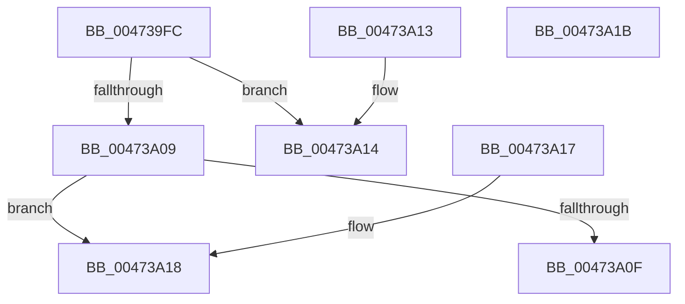

# XmStoreResult

- RVA: `0x004739FC`–`0x00473A1C` (길이 `32` bytes)
- VA: `0x00000001404739FC`
- 실행 섹션: `.text`
- PDB 이름 있음: `예`; PDB Function 태그: `아니요`
- unwind 정보 RVA: `0x000DB714`
- 디코드: `15`개 명령, `32/32` bytes 표시
- 미해석 바이트: `0` (있으면 어셈블리에 `.byte`로 보존)

> 이 문서는 커널 이미지의 기계어와 PDB 기호를 분석해 생성했습니다. 4번과 5번은 함수 원형과 자료형을 바이너리 사용 방식에서 추정한 C 해석이며 원본 소스 복구 결과는 아닙니다.

## 1. Dependencies

- 직접 호출 지점: **0**; 고유 호출 대상: **0**
- 직접 호출자로 확인된 함수: **41**
- RIP 상대 이미지 참조: **0**

### Outgoing calls
- 직접 디코드된 call 명령이 없습니다.

### Direct callers
- [XmShlOp](XmShlOp_function_004723C0.md) at `0x004724B8`
- [XmPopOp](XmPopOp_function_00472560.md) at `0x00472573`
- [XmBsfOp](XmBsfOp_function_004725E0.md) at `0x0047260C`
- [XmSubOperands](XmSubOperands_function_004726C0.md) at `0x00472848`
- [XmMovOp](XmMovOp_function_00472910.md) at `0x00472917`
- [XmStosOp](XmStosOp_function_00472950.md) at `0x00472A36`
- [XmStosOp](XmStosOp_function_00472950.md) at `0x00472A5F`
- [XmAddOperands](XmAddOperands_function_00472EA0.md) at `0x00472EF1`
- [XmPushStack](XmPushStack_function_00473088.md) at `0x004730C3`
- [XmInOp](XmInOp_function_004737F0.md) at `0x0047381F`
- [XmLoopOp](XmLoopOp_function_004738F0.md) at `0x00473921`
- [XmSetLogicalResult](XmSetLogicalResult_function_00473960.md) at `0x00473973`
- [XmNotOp](../57/XmNotOp_function_00576C10.md) at `0x00576C38`
- [XmCmpxchgOp](../57/XmCmpxchgOp_function_00576CB0.md) at `0x00576CF9`
- [XmXaddOp](../57/XmXaddOp_function_00576D70.md) at `0x00576D94`
- [XmRclOp](../57/XmRclOp_function_00577010.md) at `0x005770A7`
- [XmRcrOp](../57/XmRcrOp_function_005770E0.md) at `0x0057715B`
- [XmRolOp](../57/XmRolOp_function_00577180.md) at `0x0057720E`
- [XmRorOp](../57/XmRorOp_function_00577230.md) at `0x005772A5`
- [XmSarOp](../57/XmSarOp_function_005772C0.md) at `0x00577393`
- [XmShldOp](../57/XmShldOp_function_005773B0.md) at `0x005774E4`
- [XmShrOp](../57/XmShrOp_function_00577500.md) at `0x005775CC`
- [XmShrdOp](../57/XmShrdOp_function_005775E0.md) at `0x0057772F`
- [XmLahfOp](../57/XmLahfOp_function_00577870.md) at `0x00577884`
- [XmInsOp](../57/XmInsOp_function_005778F0.md) at `0x00577953`
- [XmLodsOp](../57/XmLodsOp_function_00577EF0.md) at `0x00577F4F`
- [XmMovsOp](../57/XmMovsOp_function_00577F70.md) at `0x00577FD9`
- [XmBsrOp](../57/XmBsrOp_function_005780A0.md) at `0x005780DE`
- [XmBtcOp](../57/XmBtcOp_function_00578120.md) at `0x00578156`
- [XmBtrOp](../57/XmBtrOp_function_00578170.md) at `0x005781A8`
- [XmBtsOp](../57/XmBtsOp_function_005781C0.md) at `0x005781F6`
- [XmCbwOp](../57/XmCbwOp_function_00578210.md) at `0x0057823E`
- [XmCwdOp](../57/XmCwdOp_function_00578250.md) at `0x00578286`
- [XmXchgOp](../57/XmXchgOp_function_005782A0.md) at `0x005782CC`
- [XmBswapOp](../57/XmBswapOp_function_00578390.md) at `0x00578399`
- [XmSmswOp](../57/XmSmswOp_function_00578400.md) at `0x00578409`
- [XmImulOp](../57/XmImulOp_function_00578420.md) at `0x00578443`
- [XmImulOp](../57/XmImulOp_function_00578420.md) at `0x00578470`
- [XmImulOp](../57/XmImulOp_function_00578420.md) at `0x00578492`
- [XmImulxOp](../57/XmImulxOp_function_005784D0.md) at `0x005784F8`
- [XmImulxOp](../57/XmImulxOp_function_005784D0.md) at `0x00578526`
- [XmImulxOp](../57/XmImulxOp_function_005784D0.md) at `0x00578533`
- [XmImulxOp](../57/XmImulxOp_function_005784D0.md) at `0x00578553`
- [XmImulxOp](../57/XmImulxOp_function_005784D0.md) at `0x00578563`
- [XmMulOp](../57/XmMulOp_function_005785A0.md) at `0x005785C8`
- [XmMulOp](../57/XmMulOp_function_005785A0.md) at `0x005785DF`
- [XmMulOp](../57/XmMulOp_function_005785A0.md) at `0x005785EC`
- [XmMulOp](../57/XmMulOp_function_005785A0.md) at `0x005785F9`
- [XmMulOp](../57/XmMulOp_function_005785A0.md) at `0x00578609`
- [XmDivOp](../57/XmDivOp_function_005786A0.md) at `0x0057874E`
- [XmDivOp](../57/XmDivOp_function_005786A0.md) at `0x00578759`
- [XmIdivOp](../57/XmIdivOp_function_00578770.md) at `0x005787CC`
- [XmIdivOp](../57/XmIdivOp_function_00578770.md) at `0x005787D8`
- [XmSxxOp](../57/XmSxxOp_function_00578880.md) at `0x00578914`

### Static image references
- 디코드된 RIP-relative 메모리 참조가 없습니다.

## 2. Other-region calls and transfers

- 다른 실행 섹션으로 향하는 call: **0**
- 별도 외부 분기/꼬리 이동을 확인하지 못했습니다.

## 3. Assembly (complete function range)

```asm
004739FC  44 8B 41 78                     mov r8d, dword ptr [rcx + 0x78]
00473A00  48 8B 41 58                     mov rax, qword ptr [rcx + 0x58]
00473A04  45 85 C0                        test r8d, r8d
00473A07  74 0B                           je 0x140473a14
00473A09  41 83 F8 01                     cmp r8d, 1
00473A0D  75 09                           jne 0x140473a18
00473A0F  66 89 10                        mov word ptr [rax], dx
00473A12  C3                              ret
00473A13  CC                              int3
00473A14  88 10                           mov byte ptr [rax], dl
00473A16  C3                              ret
00473A17  CC                              int3
00473A18  89 10                           mov dword ptr [rax], edx
00473A1A  C3                              ret
00473A1B  CC                              int3
```

## 4. C-style interpretation (structured pseudocode)

```c
__int64 __fastcall XmStoreResult(__int64 a1, int a2)
{
    if ((unsigned int)((unsigned int)(*(unsigned int *)(a1 + 120))) == 0) goto loc_00473A14;
    if (((unsigned int)((unsigned int)(*(unsigned int *)(a1 + 120)))) != 1) goto loc_00473A18;
    *(unsigned __int16 *)(*(unsigned __int64 *)(a1 + 88)) = (unsigned __int16)(a2);
    return *(unsigned __int64 *)(a1 + 88);
loc_00473A14:
    *(unsigned __int8 *)(*(unsigned __int64 *)(a1 + 88)) = (unsigned __int8)(a2);
    return *(unsigned __int64 *)(a1 + 88);
loc_00473A18:
    *(unsigned int *)(*(unsigned __int64 *)(a1 + 88)) = a2;
    return *(unsigned __int64 *)(a1 + 88);
}
```

## 5. (Beta) C Style

```c
int64_t XmStoreResult(void *Arg1, int32_t Arg2)
{
    uint8_t *arg1 = (uint8_t *)Arg1;

    if ((uint32_t)((uint32_t)(*(uint32_t *)(arg1 + 0x78))) == 0) goto loc_00473A14;
    if (((uint32_t)((uint32_t)(*(uint32_t *)(arg1 + 0x78)))) != 1) goto loc_00473A18;
    *(uint16_t *)(*(uint64_t *)(arg1 + 0x58)) = (uint16_t)(Arg2);
    return *(uint64_t *)(arg1 + 0x58);
loc_00473A14:
    *(uint8_t *)(*(uint64_t *)(arg1 + 0x58)) = (uint8_t)(Arg2);
    return *(uint64_t *)(arg1 + 0x58);
loc_00473A18:
    *(uint32_t *)(*(uint64_t *)(arg1 + 0x58)) = Arg2;
    return *(uint64_t *)(arg1 + 0x58);
}
```

### 관측된 메모리 오프셋

구조체 형식이 확인되지 않은 접근은 인자 기준의 오프셋으로만 기록했습니다.

| 기준 인자 | 오프셋 표현 | 폭 (bit) | 접근 |
|---|---:|---:|---|
| `Arg1` | `+ 0x58` | `64` | `R` |
| `Arg1` | `+ 0x78` | `32` | `R` |

## 6. Execution-region graph

[열기: 2D/3D 그래프와 함수 탐색 컨트롤 패널](../../../control-panel.html?section=text&rva=0x004739FC&view=graph)

- 2D 그래프는 위에서 아래로 흐르고, 3D 그래프는 빈 공간을 드래그해 회전합니다. Shift+드래그는 이동, 휠은 확대·축소, 함수 노드 선택은 대상 보고서 이동입니다.

### Static fallback


