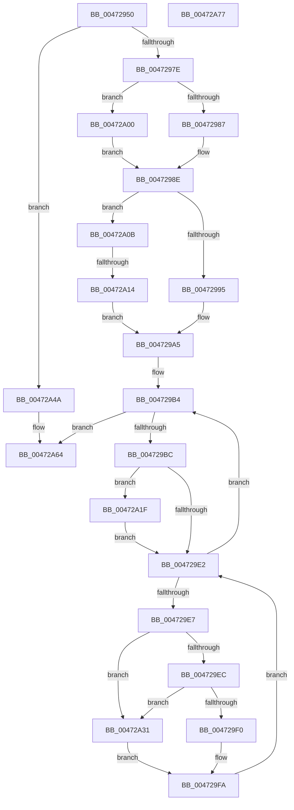

# XmStosOp

- RVA: `0x00472950`–`0x00472A78` (길이 `296` bytes)
- VA: `0x0000000140472950`
- 실행 섹션: `.text`
- PDB 이름 있음: `예`; PDB Function 태그: `예`
- unwind 정보 RVA: `0x000701D4`
- 디코드: `91`개 명령, `296/296` bytes 표시
- 미해석 바이트: `0` (있으면 어셈블리에 `.byte`로 보존)

> 이 문서는 커널 이미지의 기계어와 PDB 기호를 분석해 생성했습니다. 4번과 5번은 함수 원형과 자료형을 바이너리 사용 방식에서 추정한 C 해석이며 원본 소스 복구 결과는 아닙니다.

## 1. Dependencies

- 직접 호출 지점: **5**; 고유 호출 대상: **4**
- 직접 호출자로 확인된 함수: **0**
- RIP 상대 이미지 참조: **0**

### Outgoing calls
- `0x00472969` → [XmSetSourceValue](XmSetSourceValue_function_004737A8.md) (function, `0x004737A8`)
- `0x004729C8` → [XmGetStringAddressRange](XmGetStringAddressRange_function_00472B88.md) (function, `0x00472B88`)
- `0x00472A36` → [XmStoreResult](XmStoreResult_function_004739FC.md) (function, `0x004739FC`)
- `0x00472A50` → [XmGetStringAddress](../57/XmGetStringAddress_function_00578BCC.md) (function, `0x00578BCC`)
- `0x00472A5F` → [XmStoreResult](XmStoreResult_function_004739FC.md) (function, `0x004739FC`)

### Direct callers
- 이 함수 시작 RVA로 연결되는 직접 call은 확인되지 않았습니다. 간접 호출은 완전히 역산할 수 없습니다.

### Static image references
- 디코드된 RIP-relative 메모리 참조가 없습니다.

## 2. Other-region calls and transfers

- 다른 실행 섹션으로 향하는 call: **0**
- call이 아닌 외부 분기/꼬리 이동: **1**
  - `0x00472A0E` → [sub_006F3D52](../6F/Unknown_function_006F3D52.md) (`tail-transfer`)

## 3. Assembly (complete function range)

```asm
00472950  48 89 5C 24 10                  mov qword ptr [rsp + 0x10], rbx
00472955  48 89 6C 24 18                  mov qword ptr [rsp + 0x18], rbp
0047295A  56                              push rsi
0047295B  57                              push rdi
0047295C  41 56                           push r14
0047295E  48 83 EC 20                     sub rsp, 0x20
00472962  48 8D 51 18                     lea rdx, [rcx + 0x18]
00472966  48 8B D9                        mov rbx, rcx
00472969  E8 3A 0E 00 00                  call 0x1404737a8
0047296E  45 33 F6                        xor r14d, r14d
00472971  44 38 B1 8B 00 00 00            cmp byte ptr [rcx + 0x8b], r14b
00472978  0F 84 CC 00 00 00               je 0x140472a4a
0047297E  44 38 B1 89 00 00 00            cmp byte ptr [rcx + 0x89], r14b
00472985  74 79                           je 0x140472a00
00472987  8B 71 1C                        mov esi, dword ptr [rcx + 0x1c]
0047298A  44 89 71 1C                     mov dword ptr [rcx + 0x1c], r14d
0047298E  8B 49 78                        mov ecx, dword ptr [rcx + 0x78]
00472991  85 C9                           test ecx, ecx
00472993  75 76                           jne 0x140472a0b
00472995  0F B6 43 6C                     movzx eax, byte ptr [rbx + 0x6c]
00472999  8B F8                           mov edi, eax
0047299B  C1 E7 08                        shl edi, 8
0047299E  0B F8                           or edi, eax
004729A0  8B C7                           mov eax, edi
004729A2  C1 E0 10                        shl eax, 0x10
004729A5  0B F8                           or edi, eax
004729A7  33 D2                           xor edx, edx
004729A9  FF C1                           inc ecx
004729AB  8D 42 04                        lea eax, [rdx + 4]
004729AE  48 F7 F1                        div rcx
004729B1  48 8B E8                        mov rbp, rax
004729B4  85 F6                           test esi, esi
004729B6  0F 84 A8 00 00 00               je 0x140472a64
004729BC  4C 8D 4C 24 40                  lea r9, [rsp + 0x40]
004729C1  89 74 24 40                     mov dword ptr [rsp + 0x40], esi
004729C5  48 8B CB                        mov rcx, rbx
004729C8  E8 BB 01 00 00                  call 0x140472b88
004729CD  44 8B 4C 24 40                  mov r9d, dword ptr [rsp + 0x40]
004729D2  41 2B F1                        sub esi, r9d
004729D5  F7 43 10 00 04 00 00            test dword ptr [rbx + 0x10], 0x400
004729DC  48 89 43 58                     mov qword ptr [rbx + 0x58], rax
004729E0  75 3D                           jne 0x140472a1f
004729E2  45 85 C9                        test r9d, r9d
004729E5  74 CD                           je 0x1404729b4
004729E7  44 3B CD                        cmp r9d, ebp
004729EA  72 45                           jb 0x140472a31
004729EC  A8 03                           test al, 3
004729EE  75 41                           jne 0x140472a31
004729F0  89 38                           mov dword ptr [rax], edi
004729F2  48 83 43 58 04                  add qword ptr [rbx + 0x58], 4
004729F7  44 2B CD                        sub r9d, ebp
004729FA  48 8B 43 58                     mov rax, qword ptr [rbx + 0x58]
004729FE  EB E2                           jmp 0x1404729e2
00472A00  0F B7 71 1C                     movzx esi, word ptr [rcx + 0x1c]
00472A04  66 44 89 71 1C                  mov word ptr [rcx + 0x1c], r14w
00472A09  EB 83                           jmp 0x14047298e
00472A0B  83 F9 01                        cmp ecx, 1
00472A0E  0F 85 3E 13 28 00               jne 0x1406f3d52
00472A14  0F B7 43 6C                     movzx eax, word ptr [rbx + 0x6c]
00472A18  8B F8                           mov edi, eax
00472A1A  C1 E7 10                        shl edi, 0x10
00472A1D  EB 86                           jmp 0x1404729a5
00472A1F  8B 4B 78                        mov ecx, dword ptr [rbx + 0x78]
00472A22  FF C1                           inc ecx
00472A24  41 0F AF C9                     imul ecx, r9d
00472A28  48 2B C1                        sub rax, rcx
00472A2B  48 89 43 58                     mov qword ptr [rbx + 0x58], rax
00472A2F  EB B1                           jmp 0x1404729e2
00472A31  8B D7                           mov edx, edi
00472A33  48 8B CB                        mov rcx, rbx
00472A36  E8 C1 0F 00 00                  call 0x1404739fc
00472A3B  8B 4B 78                        mov ecx, dword ptr [rbx + 0x78]
00472A3E  48 FF C1                        inc rcx
00472A41  48 01 4B 58                     add qword ptr [rbx + 0x58], rcx
00472A45  41 FF C9                        dec r9d
00472A48  EB B0                           jmp 0x1404729fa
00472A4A  33 D2                           xor edx, edx
00472A4C  44 8D 42 07                     lea r8d, [rdx + 7]
00472A50  E8 77 61 10 00                  call 0x140578bcc
00472A55  8B 53 6C                        mov edx, dword ptr [rbx + 0x6c]
00472A58  48 8B CB                        mov rcx, rbx
00472A5B  48 89 43 58                     mov qword ptr [rbx + 0x58], rax
00472A5F  E8 98 0F 00 00                  call 0x1404739fc
00472A64  48 8B 5C 24 48                  mov rbx, qword ptr [rsp + 0x48]
00472A69  48 8B 6C 24 50                  mov rbp, qword ptr [rsp + 0x50]
00472A6E  48 83 C4 20                     add rsp, 0x20
00472A72  41 5E                           pop r14
00472A74  5F                              pop rdi
00472A75  5E                              pop rsi
00472A76  C3                              ret
00472A77  CC                              int3
```

## 4. C-style interpretation (structured pseudocode)

```c
__int64 __fastcall XmStosOp(__int64 a1)
{
    __int64 result;
    __int64 v_r14;
    __int64 v_rdi;
    __int64 v_rsi;
    __int64 v_rsp;
    unsigned __int64 v_stack_p10;
    unsigned __int64 v_stack_p18;
    unsigned __int64 v_stack_p8;

    v_stack_p10 = v_rbx;
    v_stack_p18 = v_rbp;
    v_rsp = (v_rsp) - (32);
    result = XmSetSourceValue(a1, a1 + 24, a3, a4);
    v_r14 = 0;
    if ((*(unsigned __int8 *)(a1 + 139)) == 0) goto loc_00472A4A;
    if ((*(unsigned __int8 *)(a1 + 137)) == 0) goto loc_00472A00;
    *(unsigned int *)(a1 + 28) = 0;
loc_0047298E:
    if ((unsigned int)((unsigned int)(*(unsigned int *)(a1 + 120))) != 0) goto loc_00472A0B;
    v_rdi = (unsigned int)(((unsigned int)((unsigned int)(*(unsigned __int8 *)(a1 + 108)))) << (8));
    v_rdi = (unsigned int)((v_rdi) | ((unsigned int)(*(unsigned __int8 *)(a1 + 108))));
    result = (unsigned int)(((unsigned int)((unsigned int)(v_rdi))) << (16));
loc_004729A5:
    v_rdi = (unsigned int)((v_rdi) | ((unsigned int)(result)));
    a2 = 0;
    a1 = (unsigned int)(((unsigned int)(*(unsigned int *)(a1 + 120))) + 1);
loc_004729B4:
    if ((unsigned int)((unsigned int)(*(unsigned int *)(a1 + 28))) == 0) goto loc_00472A64;
    v_stack_p8 = (unsigned int)((unsigned int)(*(unsigned int *)(a1 + 28)));
    result = XmGetStringAddressRange(a1, a2, a3, v_stack_p8);
    v_rsi = (unsigned int)(((unsigned int)(*(unsigned int *)(a1 + 28))) - ((unsigned int)((unsigned int)(v_stack_p8))));
    *(unsigned __int64 *)(a1 + 88) = result;
    if (((*(unsigned int *)(a1 + 16)) & (0x400ULL)) != 0) goto loc_00472A1F;
loc_004729E2:
    if ((unsigned int)((unsigned int)(v_stack_p8)) == 0) goto loc_004729B4;
    if (((unsigned int)((unsigned int)(v_stack_p8))) < ((unsigned int)(a2 + 4))) goto loc_00472A31;
    if ((((unsigned __int8)(result)) & (3)) != 0) goto loc_00472A31;
    *(unsigned int *)(result) = (unsigned int)(v_rdi);
    a4 = (unsigned int)(((unsigned int)(v_stack_p8)) - ((unsigned int)(a2 + 4)));
loc_004729FA:
    goto loc_004729E2;
loc_00472A00:
    *(unsigned __int16 *)(a1 + 28) = 0;
    goto loc_0047298E;
loc_00472A0B:
    v_rdi = (unsigned int)(((unsigned int)((unsigned int)(*(unsigned __int16 *)(a1 + 108)))) << (16));
    goto loc_004729A5;
loc_00472A1F:
    a1 = (unsigned int)(((unsigned int)(*(unsigned int *)(a1 + 120))) + 1);
    a1 = (unsigned int)((a1) * ((unsigned int)(a4)));
    result = (*(unsigned __int16 *)(a1 + 108)) - (a1);
    *(unsigned __int64 *)(a1 + 88) = result;
    goto loc_004729E2;
loc_00472A31:
    result = XmStoreResult(a1, (unsigned int)((unsigned int)(v_rdi)), a3, a4);
    a1 = ((unsigned int)(*(unsigned int *)(a1 + 120))) + 1;
    a4 = (unsigned int)((a4) - 1);
    goto loc_004729FA;
loc_00472A4A:
    a2 = 0;
    result = XmGetStringAddress(a1, a2, a2 + 7, a4);
    *(unsigned __int64 *)(a1 + 88) = result;
    result = XmStoreResult(a1, (unsigned int)(*(unsigned int *)(a1 + 108)), a2 + 7, a4);
loc_00472A64:
    v_rsp = (v_rsp) + (32);
    return result;
}
```

## 5. (Beta) C Style

```c
int64_t XmStosOp(void *Arg1)
{
    uint8_t *arg1 = (uint8_t *)Arg1;

    int64_t result;
    int64_t local_r14;
    int64_t local_rdi;
    int64_t local_rsi;
    int64_t local_rsp;
    uint64_t v_stack_p10;
    uint64_t v_stack_p18;
    uint64_t v_stack_p8;

    v_stack_p10 = local_rbx;
    v_stack_p18 = local_rbp;
    local_rsp = (local_rsp) - (32);
    result = XmSetSourceValue(Arg1, Arg1 + 24, a3, a4);
    local_r14 = 0;
    if ((*(uint8_t *)(arg1 + 0x8B)) == 0) goto loc_00472A4A;
    if ((*(uint8_t *)(arg1 + 0x89)) == 0) goto loc_00472A00;
    *(uint32_t *)(arg1 + 0x1C) = 0;
loc_0047298E:
    if ((uint32_t)((uint32_t)(*(uint32_t *)(arg1 + 0x78))) != 0) goto loc_00472A0B;
    local_rdi = (uint32_t)(((uint32_t)((uint32_t)(*(uint8_t *)(arg1 + 0x6C)))) << (8));
    local_rdi = (uint32_t)((local_rdi) | ((uint32_t)(*(uint8_t *)(arg1 + 0x6C))));
    result = (uint32_t)(((uint32_t)((uint32_t)(local_rdi))) << (16));
loc_004729A5:
    local_rdi = (uint32_t)((local_rdi) | ((uint32_t)(result)));
    a2 = 0;
    Arg1 = (uint32_t)(((uint32_t)(*(uint32_t *)(arg1 + 0x78))) + 1);
loc_004729B4:
    if ((uint32_t)((uint32_t)(*(uint32_t *)(arg1 + 0x1C))) == 0) goto loc_00472A64;
    v_stack_p8 = (uint32_t)((uint32_t)(*(uint32_t *)(arg1 + 0x1C)));
    result = XmGetStringAddressRange(Arg1, a2, a3, v_stack_p8);
    local_rsi = (uint32_t)(((uint32_t)(*(uint32_t *)(arg1 + 0x1C))) - ((uint32_t)((uint32_t)(v_stack_p8))));
    *(uint64_t *)(arg1 + 0x58) = result;
    if (((*(uint32_t *)(arg1 + 0x10)) & (0x400ULL)) != 0) goto loc_00472A1F;
loc_004729E2:
    if ((uint32_t)((uint32_t)(v_stack_p8)) == 0) goto loc_004729B4;
    if (((uint32_t)((uint32_t)(v_stack_p8))) < ((uint32_t)(a2 + 4))) goto loc_00472A31;
    if ((((uint8_t)(result)) & (3)) != 0) goto loc_00472A31;
    *(uint32_t *)(result) = (uint32_t)(local_rdi);
    a4 = (uint32_t)(((uint32_t)(v_stack_p8)) - ((uint32_t)(a2 + 4)));
loc_004729FA:
    goto loc_004729E2;
loc_00472A00:
    *(uint16_t *)(arg1 + 0x1C) = 0;
    goto loc_0047298E;
loc_00472A0B:
    local_rdi = (uint32_t)(((uint32_t)((uint32_t)(*(uint16_t *)(arg1 + 0x6C)))) << (16));
    goto loc_004729A5;
loc_00472A1F:
    Arg1 = (uint32_t)(((uint32_t)(*(uint32_t *)(arg1 + 0x78))) + 1);
    Arg1 = (uint32_t)((Arg1) * ((uint32_t)(a4)));
    result = (*(uint16_t *)(arg1 + 0x6C)) - (Arg1);
    *(uint64_t *)(arg1 + 0x58) = result;
    goto loc_004729E2;
loc_00472A31:
    result = XmStoreResult(Arg1, (uint32_t)((uint32_t)(local_rdi)), a3, a4);
    Arg1 = ((uint32_t)(*(uint32_t *)(arg1 + 0x78))) + 1;
    a4 = (uint32_t)((a4) - 1);
    goto loc_004729FA;
loc_00472A4A:
    a2 = 0;
    result = XmGetStringAddress(Arg1, a2, a2 + 7, a4);
    *(uint64_t *)(arg1 + 0x58) = result;
    result = XmStoreResult(Arg1, (uint32_t)(*(uint32_t *)(arg1 + 0x6C)), a2 + 7, a4);
loc_00472A64:
    local_rsp = (local_rsp) + (32);
    return result;
}
```

### 관측된 메모리 오프셋

구조체 형식이 확인되지 않은 접근은 인자 기준의 오프셋으로만 기록했습니다.

| 기준 인자 | 오프셋 표현 | 폭 (bit) | 접근 |
|---|---:|---:|---|
| `Arg1` | `+ 0x10` | `32` | `R` |
| `Arg1` | `+ 0x18` | `64` | `R` |
| `Arg1` | `+ 0x58` | `64` | `R` |
| `Arg1` | `+ 0x58` | `64` | `R/W` |
| `Arg1` | `+ 0x58` | `64` | `W` |
| `Arg1` | `+ 0x6C` | `8` | `R` |
| `Arg1` | `+ 0x6C` | `16` | `R` |
| `Arg1` | `+ 0x6C` | `32` | `R` |
| `Arg1` | `+ 0x78` | `32` | `R` |

## 6. Execution-region graph

[열기: 2D/3D 그래프와 함수 탐색 컨트롤 패널](../../../control-panel.html?section=text&rva=0x00472950&view=graph)

- 2D 그래프는 위에서 아래로 흐르고, 3D 그래프는 빈 공간을 드래그해 회전합니다. Shift+드래그는 이동, 휠은 확대·축소, 함수 노드 선택은 대상 보고서 이동입니다.

### Static fallback


