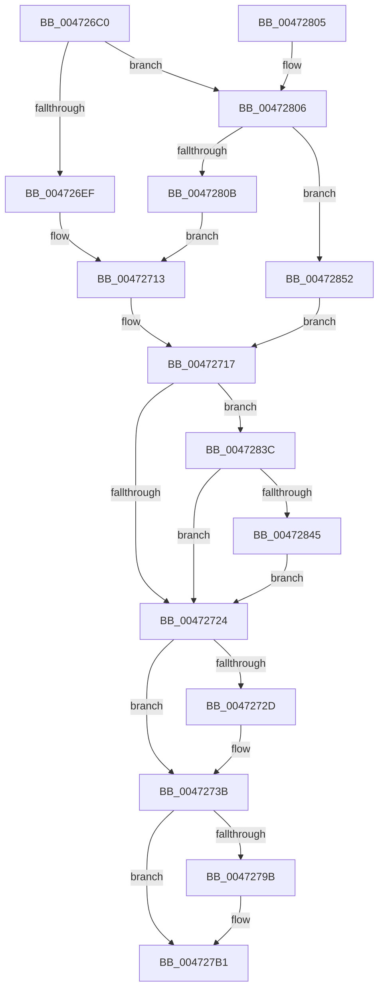

# XmSubOperands

- RVA: `0x004726C0`–`0x00472877` (길이 `439` bytes)
- VA: `0x00000001404726C0`
- 실행 섹션: `.text`
- PDB 이름 있음: `예`; PDB Function 태그: `아니요`
- unwind 정보 RVA: `0x000AC50C`
- 디코드: `127`개 명령, `439/439` bytes 표시
- 미해석 바이트: `0` (있으면 어셈블리에 `.byte`로 보존)

> 이 문서는 커널 이미지의 기계어와 PDB 기호를 분석해 생성했습니다. 4번과 5번은 함수 원형과 자료형을 바이너리 사용 방식에서 추정한 C 해석이며 원본 소스 복구 결과는 아닙니다.

## 1. Dependencies

- 직접 호출 지점: **1**; 고유 호출 대상: **1**
- 직접 호출자로 확인된 함수: **5**
- RIP 상대 이미지 참조: **1**

### Outgoing calls
- `0x00472848` → [XmStoreResult](XmStoreResult_function_004739FC.md) (function, `0x004739FC`)

### Direct callers
- [XmCmpOp](XmCmpOp_function_00472680.md) at `0x00472686`
- [XmDecOp](XmDecOp_function_004726A0.md) at `0x004726AD`
- [XmCmpxchgOp](../57/XmCmpxchgOp_function_00576CB0.md) at `0x00576D0F`
- [XmNegOp](../57/XmNegOp_function_00576D20.md) at `0x00576D30`
- [XmSbbOp](../57/XmSbbOp_function_00576D50.md) at `0x00576D5A`

### Static image references
- `0x0047273F` → RVA `0x0001A190` (`.rdata`; read)

## 2. Other-region calls and transfers

- 다른 실행 섹션으로 향하는 call: **0**
- 별도 외부 분기/꼬리 이동을 확인하지 못했습니다.

## 3. Assembly (complete function range)

```asm
004726C0  48 89 5C 24 08                  mov qword ptr [rsp + 8], rbx
004726C5  48 89 6C 24 18                  mov qword ptr [rsp + 0x18], rbp
004726CA  48 89 74 24 20                  mov qword ptr [rsp + 0x20], rsi
004726CF  57                              push rdi
004726D0  48 83 EC 20                     sub rsp, 0x20
004726D4  8B 41 78                        mov eax, dword ptr [rcx + 0x78]
004726D7  45 33 C0                        xor r8d, r8d
004726DA  44 89 44 24 38                  mov dword ptr [rsp + 0x38], r8d
004726DF  8B DA                           mov ebx, edx
004726E1  4C 8B D1                        mov r10, rcx
004726E4  45 8B D8                        mov r11d, r8d
004726E7  85 C0                           test eax, eax
004726E9  0F 85 17 01 00 00               jne 0x140472806
004726EF  8A 41 68                        mov al, byte ptr [rcx + 0x68]
004726F2  BF 07 00 00 00                  mov edi, 7
004726F7  8A 49 6C                        mov cl, byte ptr [rcx + 0x6c]
004726FA  8A D0                           mov dl, al
004726FC  2A D3                           sub dl, bl
004726FE  3A D1                           cmp dl, cl
00472700  41 0F 92 C3                     setb r11b
00472704  3A C3                           cmp al, bl
00472706  41 0F 92 C0                     setb r8b
0047270A  45 0B D8                        or r11d, r8d
0047270D  2A D1                           sub dl, cl
0047270F  88 54 24 38                     mov byte ptr [rsp + 0x38], dl
00472713  8B 54 24 38                     mov edx, dword ptr [rsp + 0x38]
00472717  41 8B 42 7C                     mov eax, dword ptr [r10 + 0x7c]
0047271B  83 F8 0D                        cmp eax, 0xd
0047271E  0F 85 18 01 00 00               jne 0x14047283c
00472724  41 8B 72 7C                     mov esi, dword ptr [r10 + 0x7c]
00472728  83 FE 1F                        cmp esi, 0x1f
0047272B  74 0E                           je 0x14047273b
0047272D  41 8B 42 10                     mov eax, dword ptr [r10 + 0x10]
00472731  83 E0 FE                        and eax, 0xfffffffe
00472734  41 0B C3                        or eax, r11d
00472737  41 89 42 10                     mov dword ptr [r10 + 0x10], eax
0047273B  45 8B 42 10                     mov r8d, dword ptr [r10 + 0x10]
0047273F  48 8D 2D 4A 7A BA FF            lea rbp, [rip - 0x4585b6]
00472746  8B CA                           mov ecx, edx
00472748  83 E1 0F                        and ecx, 0xf
0047274B  8B C2                           mov eax, edx
0047274D  48 C1 E8 04                     shr rax, 4
00472751  83 E0 0F                        and eax, 0xf
00472754  44 0F B6 0C 28                  movzx r9d, byte ptr [rax + rbp]
00472759  0F B6 04 29                     movzx eax, byte ptr [rcx + rbp]
0047275D  44 03 C8                        add r9d, eax
00472760  41 0F B6 42 6C                  movzx eax, byte ptr [r10 + 0x6c]
00472765  41 F7 D1                        not r9d
00472768  83 E0 0F                        and eax, 0xf
0047276B  41 C1 E1 02                     shl r9d, 2
0047276F  45 33 C8                        xor r9d, r8d
00472772  41 83 E1 04                     and r9d, 4
00472776  45 33 C8                        xor r9d, r8d
00472779  45 0F B6 42 68                  movzx r8d, byte ptr [r10 + 0x68]
0047277E  41 83 E0 0F                     and r8d, 0xf
00472782  44 2B C0                        sub r8d, eax
00472785  44 2B C3                        sub r8d, ebx
00472788  45 33 C1                        xor r8d, r9d
0047278B  41 83 E0 10                     and r8d, 0x10
0047278F  45 33 C1                        xor r8d, r9d
00472792  45 89 42 10                     mov dword ptr [r10 + 0x10], r8d
00472796  83 FE 57                        cmp esi, 0x57
00472799  74 16                           je 0x1404727b1
0047279B  8B C2                           mov eax, edx
0047279D  F7 D8                           neg eax
0047279F  1B C9                           sbb ecx, ecx
004727A1  41 83 E0 BF                     and r8d, 0xffffffbf
004727A5  F7 D1                           not ecx
004727A7  83 E1 40                        and ecx, 0x40
004727AA  44 0B C1                        or r8d, ecx
004727AD  45 89 42 10                     mov dword ptr [r10 + 0x10], r8d
004727B1  48 8B 5C 24 30                  mov rbx, qword ptr [rsp + 0x30]
004727B6  8B CF                           mov ecx, edi
004727B8  48 8B 6C 24 40                  mov rbp, qword ptr [rsp + 0x40]
004727BD  44 8B CA                        mov r9d, edx
004727C0  48 8B 74 24 48                  mov rsi, qword ptr [rsp + 0x48]
004727C5  41 D3 E9                        shr r9d, cl
004727C8  41 C1 E1 07                     shl r9d, 7
004727CC  45 33 C8                        xor r9d, r8d
004727CF  41 81 E1 80 00 00 00            and r9d, 0x80
004727D6  45 33 C8                        xor r9d, r8d
004727D9  45 8B 42 6C                     mov r8d, dword ptr [r10 + 0x6c]
004727DD  45 33 42 68                     xor r8d, dword ptr [r10 + 0x68]
004727E1  44 33 C2                        xor r8d, edx
004727E4  41 D3 E8                        shr r8d, cl
004727E7  45 33 C3                        xor r8d, r11d
004727EA  41 C1 E0 0B                     shl r8d, 0xb
004727EE  45 33 C1                        xor r8d, r9d
004727F1  41 81 E0 00 08 00 00            and r8d, 0x800
004727F8  45 33 C1                        xor r8d, r9d
004727FB  45 89 42 10                     mov dword ptr [r10 + 0x10], r8d
004727FF  48 83 C4 20                     add rsp, 0x20
00472803  5F                              pop rdi
00472804  C3                              ret
00472805  CC                              int3
00472806  83 F8 03                        cmp eax, 3
00472809  74 47                           je 0x140472852
0047280B  0F B7 41 68                     movzx eax, word ptr [rcx + 0x68]
0047280F  BF 0F 00 00 00                  mov edi, 0xf
00472814  0F B7 49 6C                     movzx ecx, word ptr [rcx + 0x6c]
00472818  0F B7 D0                        movzx edx, ax
0047281B  66 2B D3                        sub dx, bx
0047281E  66 3B D1                        cmp dx, cx
00472821  41 0F 92 C3                     setb r11b
00472825  66 3B C3                        cmp ax, bx
00472828  41 0F 92 C0                     setb r8b
0047282C  45 0B D8                        or r11d, r8d
0047282F  66 2B D1                        sub dx, cx
00472832  66 89 54 24 38                  mov word ptr [rsp + 0x38], dx
00472837  E9 D7 FE FF FF                  jmp 0x140472713
0047283C  83 F8 57                        cmp eax, 0x57
0047283F  0F 84 DF FE FF FF               je 0x140472724
00472845  49 8B CA                        mov rcx, r10
00472848  E8 AF 11 00 00                  call 0x1404739fc
0047284D  E9 D2 FE FF FF                  jmp 0x140472724
00472852  8B 41 68                        mov eax, dword ptr [rcx + 0x68]
00472855  BF 1F 00 00 00                  mov edi, 0x1f
0047285A  8B 49 6C                        mov ecx, dword ptr [rcx + 0x6c]
0047285D  8B D0                           mov edx, eax
0047285F  2B D3                           sub edx, ebx
00472861  3B D1                           cmp edx, ecx
00472863  41 0F 92 C3                     setb r11b
00472867  3B C3                           cmp eax, ebx
00472869  41 0F 92 C0                     setb r8b
0047286D  45 0B D8                        or r11d, r8d
00472870  2B D1                           sub edx, ecx
00472872  E9 A0 FE FF FF                  jmp 0x140472717
```

## 4. C-style interpretation (structured pseudocode)

```c
__int64 __fastcall XmSubOperands(__int64 a1, int a2, int a3)
{
    __int64 result;
    __int64 v_r11;
    __int64 v_rsp;
    unsigned int v_stack_p10;
    unsigned __int64 v_stack_p18;
    unsigned __int64 v_stack_p20;
    unsigned __int16 v_stack_p38;
    unsigned __int64 v_stack_p8;

    v_stack_p8 = v_rbx;
    v_stack_p18 = v_rbp;
    v_stack_p20 = v_rsi;
    v_rsp = (v_rsp) - (32);
    a3 = 0;
    v_stack_p10 = 0;
    if ((unsigned int)((unsigned int)(*(unsigned int *)(a1 + 120))) != 0) goto loc_00472806;
    a2 = (unsigned __int8)(((unsigned __int8)(*(unsigned __int8 *)(a1 + 104))) - ((unsigned __int8)((unsigned int)(a2))));
    v_r11 = (((unsigned __int8)(a2)) < ((unsigned __int8)(*(unsigned __int8 *)(a1 + 108)))) ? 1 : 0;
    a3 = (((unsigned __int8)(*(unsigned __int8 *)(a1 + 104))) < ((unsigned __int8)((unsigned int)(a2)))) ? 1 : 0;
    v_r11 = (unsigned int)((v_r11) | (a3));
    a2 = (unsigned __int8)((a2) - ((unsigned __int8)(*(unsigned __int8 *)(a1 + 108))));
    v_stack_p10 = (unsigned __int8)(a2);
loc_00472713:
loc_00472717:
    if (((unsigned int)((unsigned int)(*(unsigned int *)(a1 + 124)))) != 13) goto loc_0047283C;
loc_00472724:
    result = (unsigned int)(*(unsigned int *)(a1 + 124));
    if (((unsigned int)((unsigned int)(*(unsigned int *)(a1 + 124)))) != 31) {
        result = *(unsigned int *)(a1 + 16);
        result = (unsigned int)((result) & (0xFFFFFFFEULL));
        result = (unsigned int)((result) | ((unsigned int)(v_r11)));
        *(unsigned int *)(a1 + 16) = (unsigned int)(result);
    }
    a1 = (unsigned int)(((unsigned int)((unsigned int)((unsigned int)(v_stack_p10)))) & (15));
    result = ((unsigned int)((unsigned int)((unsigned int)(v_stack_p10)))) >> (4);
    result = (unsigned int)((result) & (15));
    a4 = (unsigned int)((*(unsigned __int8 *)(result + v_rip - 4556214 * 1)) + ((unsigned int)(*(unsigned __int8 *)(a1 + v_rip - 4556214 * 1))));
    a4 = (unsigned int)(~(a4));
    result = (unsigned int)((*(unsigned __int8 *)(a1 + 108)) & (15));
    a4 = (unsigned int)((a4) << (2));
    a4 = (unsigned int)((a4) ^ ((unsigned int)((unsigned int)(*(unsigned int *)(a1 + 16)))));
    a4 = (unsigned int)((a4) & (4));
    a4 = (unsigned int)((a4) ^ ((unsigned int)((unsigned int)(*(unsigned int *)(a1 + 16)))));
    a3 = (unsigned int)((*(unsigned __int8 *)(a1 + 104)) & (15));
    a3 = (unsigned int)((a3) - ((unsigned int)(result)));
    a3 = (unsigned int)((a3) - ((unsigned int)((unsigned int)(a2))));
    a3 = (unsigned int)((a3) ^ ((unsigned int)(a4)));
    a3 = (unsigned int)((a3) & (16));
    a3 = (unsigned int)((a3) ^ ((unsigned int)(a4)));
    *(unsigned int *)(a1 + 16) = a3;
    if (((unsigned int)((unsigned int)(*(unsigned int *)(a1 + 124)))) != 87) {
        result = (unsigned int)((unsigned int)(v_stack_p10));
        result = (unsigned int)(-(result));
        a3 = (unsigned int)((a3) & (0xFFFFFFBFULL));
        a1 = (unsigned int)(~(a1));
        a1 = (unsigned int)((a1) & (64));
        a3 = (unsigned int)((a3) | ((unsigned int)(a1)));
        *(unsigned int *)(a1 + 16) = a3;
    }
    a4 = (unsigned int)(((unsigned int)((unsigned int)((unsigned int)(v_stack_p10)))) >> (7));
    a4 = (unsigned int)((a4) << (7));
    a4 = (unsigned int)((a4) ^ (a3));
    a4 = (unsigned int)((a4) & (128));
    a4 = (unsigned int)((a4) ^ (a3));
    a3 = (unsigned int)(((unsigned int)(*(unsigned int *)(a1 + 108))) ^ (*(unsigned int *)(a1 + 104)));
    a3 = (unsigned int)((a3) ^ ((unsigned int)((unsigned int)(v_stack_p10))));
    a3 = (unsigned int)((a3) >> (7));
    a3 = (unsigned int)((a3) ^ ((unsigned int)(v_r11)));
    a3 = (unsigned int)((a3) << (11));
    a3 = (unsigned int)((a3) ^ ((unsigned int)(a4)));
    a3 = (unsigned int)((a3) & (0x800ULL));
    a3 = (unsigned int)((a3) ^ ((unsigned int)(a4)));
    *(unsigned int *)(a1 + 16) = a3;
    v_rsp = (v_rsp) + (32);
    return result;
loc_00472806:
    if (((unsigned int)(result)) == 3) goto loc_00472852;
    a2 = (unsigned __int16)(((unsigned __int16)(*(unsigned __int16 *)(7 + 104))) - ((unsigned __int16)(v_stack_p8)));
    v_r11 = (((unsigned __int16)(a2)) < ((unsigned __int16)(*(unsigned __int16 *)(7 + 108)))) ? 1 : 0;
    a3 = (((unsigned __int16)(*(unsigned __int16 *)(7 + 104))) < ((unsigned __int16)(v_stack_p8))) ? 1 : 0;
    v_r11 = (unsigned int)((v_r11) | (a3));
    a2 = (unsigned __int16)((a2) - ((unsigned __int16)(*(unsigned __int16 *)(7 + 108))));
    v_stack_p38 = (unsigned __int16)(a2);
    goto loc_00472713;
loc_0047283C:
    if (((unsigned int)(*(unsigned __int16 *)(7 + 104))) == 87) goto loc_00472724;
    result = XmStoreResult(a1, a2, a3, a4);
    goto loc_00472724;
loc_00472852:
    a2 = (unsigned int)(((unsigned int)((unsigned int)((unsigned int)(*(unsigned int *)(a1 + 104))))) - ((unsigned int)(v_stack_p8)));
    v_r11 = (a2 < ((unsigned int)((unsigned int)(*(unsigned int *)(a1 + 108))))) ? 1 : 0;
    a3 = (((unsigned int)((unsigned int)(*(unsigned int *)(a1 + 104)))) < ((unsigned int)(v_stack_p8))) ? 1 : 0;
    v_r11 = (unsigned int)((v_r11) | (a3));
    a2 = (unsigned int)((a2) - ((unsigned int)((unsigned int)(*(unsigned int *)(a1 + 108)))));
    goto loc_00472717;
}
```

## 5. (Beta) C Style

```c
int64_t XmSubOperands(void *Arg1, int32_t Arg2, int32_t Arg3)
{
    uint8_t *arg1 = (uint8_t *)Arg1;

    int64_t result;
    int64_t local_r11;
    int64_t local_rsp;
    uint32_t v_stack_p10;
    uint64_t v_stack_p18;
    uint64_t v_stack_p20;
    uint16_t v_stack_p38;
    uint64_t v_stack_p8;

    v_stack_p8 = local_rbx;
    v_stack_p18 = local_rbp;
    v_stack_p20 = local_rsi;
    local_rsp = (local_rsp) - (32);
    Arg3 = 0;
    v_stack_p10 = 0;
    if ((uint32_t)((uint32_t)(*(uint32_t *)(arg1 + 0x78))) != 0) goto loc_00472806;
    Arg2 = (uint8_t)(((uint8_t)(*(uint8_t *)(arg1 + 0x68))) - ((uint8_t)((uint32_t)(Arg2))));
    local_r11 = (((uint8_t)(Arg2)) < ((uint8_t)(*(uint8_t *)(arg1 + 0x6C)))) ? 1 : 0;
    Arg3 = (((uint8_t)(*(uint8_t *)(arg1 + 0x68))) < ((uint8_t)((uint32_t)(Arg2)))) ? 1 : 0;
    local_r11 = (uint32_t)((local_r11) | (Arg3));
    Arg2 = (uint8_t)((Arg2) - ((uint8_t)(*(uint8_t *)(arg1 + 0x6C))));
    v_stack_p10 = (uint8_t)(Arg2);
loc_00472713:
loc_00472717:
    if (((uint32_t)((uint32_t)(*(uint32_t *)(arg1 + 0x7C)))) != 13) goto loc_0047283C;
loc_00472724:
    result = (uint32_t)(*(uint32_t *)(arg1 + 0x7C));
    if (((uint32_t)((uint32_t)(*(uint32_t *)(arg1 + 0x7C)))) != 31) {
        result = *(uint32_t *)(arg1 + 0x10);
        result = (uint32_t)((result) & (0xFFFFFFFEULL));
        result = (uint32_t)((result) | ((uint32_t)(local_r11)));
        *(uint32_t *)(arg1 + 0x10) = (uint32_t)(result);
    }
    Arg1 = (uint32_t)(((uint32_t)((uint32_t)((uint32_t)(v_stack_p10)))) & (15));
    result = ((uint32_t)((uint32_t)((uint32_t)(v_stack_p10)))) >> (4);
    result = (uint32_t)((result) & (15));
    a4 = (uint32_t)((*(uint8_t *)(result + v_rip - 0x4585B6 * 1)) + ((uint32_t)(*(uint8_t *)(arg1 + v_rip - 0x4585B6 * 1))));
    a4 = (uint32_t)(~(a4));
    result = (uint32_t)((*(uint8_t *)(arg1 + 0x6C)) & (15));
    a4 = (uint32_t)((a4) << (2));
    a4 = (uint32_t)((a4) ^ ((uint32_t)((uint32_t)(*(uint32_t *)(arg1 + 0x10)))));
    a4 = (uint32_t)((a4) & (4));
    a4 = (uint32_t)((a4) ^ ((uint32_t)((uint32_t)(*(uint32_t *)(arg1 + 0x10)))));
    Arg3 = (uint32_t)((*(uint8_t *)(arg1 + 0x68)) & (15));
    Arg3 = (uint32_t)((Arg3) - ((uint32_t)(result)));
    Arg3 = (uint32_t)((Arg3) - ((uint32_t)((uint32_t)(Arg2))));
    Arg3 = (uint32_t)((Arg3) ^ ((uint32_t)(a4)));
    Arg3 = (uint32_t)((Arg3) & (16));
    Arg3 = (uint32_t)((Arg3) ^ ((uint32_t)(a4)));
    *(uint32_t *)(arg1 + 0x10) = Arg3;
    if (((uint32_t)((uint32_t)(*(uint32_t *)(arg1 + 0x7C)))) != 87) {
        result = (uint32_t)((uint32_t)(v_stack_p10));
        result = (uint32_t)(-(result));
        Arg3 = (uint32_t)((Arg3) & (0xFFFFFFBFULL));
        Arg1 = (uint32_t)(~(Arg1));
        Arg1 = (uint32_t)((Arg1) & (64));
        Arg3 = (uint32_t)((Arg3) | ((uint32_t)(Arg1)));
        *(uint32_t *)(arg1 + 0x10) = Arg3;
    }
    a4 = (uint32_t)(((uint32_t)((uint32_t)((uint32_t)(v_stack_p10)))) >> (7));
    a4 = (uint32_t)((a4) << (7));
    a4 = (uint32_t)((a4) ^ (Arg3));
    a4 = (uint32_t)((a4) & (128));
    a4 = (uint32_t)((a4) ^ (Arg3));
    Arg3 = (uint32_t)(((uint32_t)(*(uint32_t *)(arg1 + 0x6C))) ^ (*(uint32_t *)(arg1 + 0x68)));
    Arg3 = (uint32_t)((Arg3) ^ ((uint32_t)((uint32_t)(v_stack_p10))));
    Arg3 = (uint32_t)((Arg3) >> (7));
    Arg3 = (uint32_t)((Arg3) ^ ((uint32_t)(local_r11)));
    Arg3 = (uint32_t)((Arg3) << (11));
    Arg3 = (uint32_t)((Arg3) ^ ((uint32_t)(a4)));
    Arg3 = (uint32_t)((Arg3) & (0x800ULL));
    Arg3 = (uint32_t)((Arg3) ^ ((uint32_t)(a4)));
    *(uint32_t *)(arg1 + 0x10) = Arg3;
    local_rsp = (local_rsp) + (32);
    return result;
loc_00472806:
    if (((uint32_t)(result)) == 3) goto loc_00472852;
    Arg2 = (uint16_t)(((uint16_t)(*(uint16_t *)(7 + 0x68))) - ((uint16_t)(v_stack_p8)));
    local_r11 = (((uint16_t)(Arg2)) < ((uint16_t)(*(uint16_t *)(7 + 0x6C)))) ? 1 : 0;
    Arg3 = (((uint16_t)(*(uint16_t *)(7 + 0x68))) < ((uint16_t)(v_stack_p8))) ? 1 : 0;
    local_r11 = (uint32_t)((local_r11) | (Arg3));
    Arg2 = (uint16_t)((Arg2) - ((uint16_t)(*(uint16_t *)(7 + 0x6C))));
    v_stack_p38 = (uint16_t)(Arg2);
    goto loc_00472713;
loc_0047283C:
    if (((uint32_t)(*(uint16_t *)(7 + 0x68))) == 87) goto loc_00472724;
    result = XmStoreResult(Arg1, Arg2, Arg3, a4);
    goto loc_00472724;
loc_00472852:
    Arg2 = (uint32_t)(((uint32_t)((uint32_t)((uint32_t)(*(uint32_t *)(arg1 + 0x68))))) - ((uint32_t)(v_stack_p8)));
    local_r11 = (Arg2 < ((uint32_t)((uint32_t)(*(uint32_t *)(arg1 + 0x6C))))) ? 1 : 0;
    Arg3 = (((uint32_t)((uint32_t)(*(uint32_t *)(arg1 + 0x68)))) < ((uint32_t)(v_stack_p8))) ? 1 : 0;
    local_r11 = (uint32_t)((local_r11) | (Arg3));
    Arg2 = (uint32_t)((Arg2) - ((uint32_t)((uint32_t)(*(uint32_t *)(arg1 + 0x6C)))));
    goto loc_00472717;
}
```

### 관측된 메모리 오프셋

구조체 형식이 확인되지 않은 접근은 인자 기준의 오프셋으로만 기록했습니다.

| 기준 인자 | 오프셋 표현 | 폭 (bit) | 접근 |
|---|---:|---:|---|
| `Arg1` | `+ 0x68` | `8` | `R` |
| `Arg1` | `+ 0x68` | `16` | `R` |
| `Arg1` | `+ 0x68` | `32` | `R` |
| `Arg1` | `+ 0x6C` | `8` | `R` |
| `Arg1` | `+ 0x6C` | `16` | `R` |
| `Arg1` | `+ 0x6C` | `32` | `R` |
| `Arg1` | `+ 0x78` | `32` | `R` |
| `Arg1` | `+ 0x7C` | `32` | `R` |

## 6. Execution-region graph

[열기: 2D/3D 그래프와 함수 탐색 컨트롤 패널](../../../control-panel.html?section=text&rva=0x004726C0&view=graph)

- 2D 그래프는 위에서 아래로 흐르고, 3D 그래프는 빈 공간을 드래그해 회전합니다. Shift+드래그는 이동, 휠은 확대·축소, 함수 노드 선택은 대상 보고서 이동입니다.

### Static fallback


