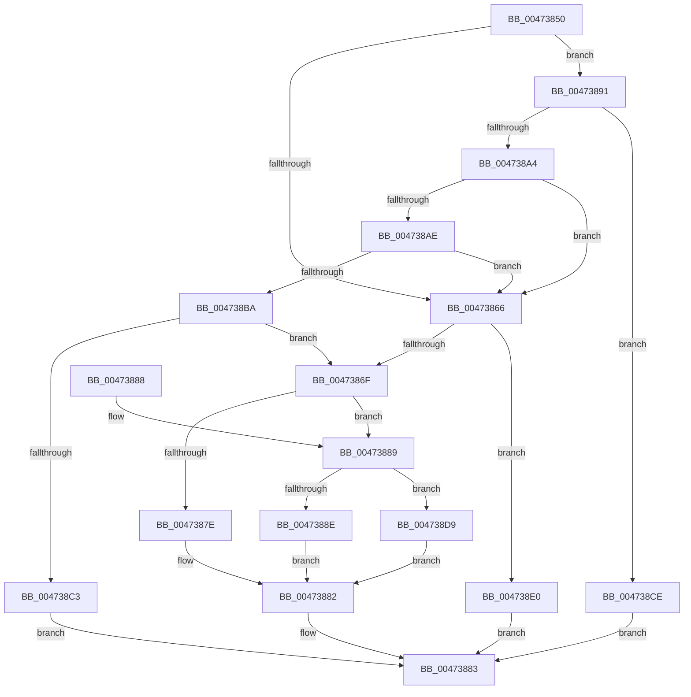

# x86BiosReadIoSpace

- RVA: `0x00473850`–`0x004738E7` (길이 `151` bytes)
- VA: `0x0000000140473850`
- 실행 섹션: `.text`
- PDB 이름 있음: `예`; PDB Function 태그: `아니요`
- unwind 정보 RVA: `0x000AC5BC`
- 디코드: `48`개 명령, `151/151` bytes 표시
- 미해석 바이트: `0` (있으면 어셈블리에 `.byte`로 보존)

> 이 문서는 커널 이미지의 기계어와 PDB 기호를 분석해 생성했습니다. 4번과 5번은 함수 원형과 자료형을 바이너리 사용 방식에서 추정한 C 해석이며 원본 소스 복구 결과는 아닙니다.

## 1. Dependencies

- 직접 호출 지점: **3**; 고유 호출 대상: **3**
- 직접 호출자로 확인된 함수: **2**
- RIP 상대 이미지 참조: **3**

### Outgoing calls
- `0x004738C7` → [x86BiosReadPciDataPort](x86BiosReadPciDataPort_function_00473AAC.md) (function, `0x00473AAC`)
- `0x004738D2` → [x86BiosReadPciAddressPort](../54/x86BiosReadPciAddressPort_function_00547E28.md) (function, `0x00547E28`)
- `0x004738E0` → [x86BiosReadCmosPort](../54/x86BiosReadCmosPort_function_00547D64.md) (function, `0x00547D64`)

### Direct callers
- [XmInOp](XmInOp_function_004737F0.md) at `0x00473815`
- [XmInsOp](../57/XmInsOp_function_005778F0.md) at `0x00577949`

### Static image references
- `0x00473857` → RVA `0x00E10328` (`.data`; read)
- `0x00473872` → RVA `0x00FC22E8` (`.data`; read)
- `0x004738A4` → RVA `0x00E1032C` (`.data`; read)

## 2. Other-region calls and transfers

- 다른 실행 섹션으로 향하는 call: **0**
- 별도 외부 분기/꼬리 이동을 확인하지 못했습니다.

## 3. Assembly (complete function range)

```asm
00473850  48 83 EC 28                     sub rsp, 0x28
00473854  0F AE E8                        lfence
00473857  80 3D CA CA 99 00 00            cmp byte ptr [rip + 0x99caca], 0
0047385E  41 B8 03 00 00 00               mov r8d, 3
00473864  75 2B                           jne 0x140473891
00473866  8D 42 90                        lea eax, [rdx - 0x70]
00473869  66 83 F8 01                     cmp ax, 1
0047386D  76 71                           jbe 0x1404738e0
0047386F  0F B7 D2                        movzx edx, dx
00473872  48 03 15 6F EA B4 00            add rdx, qword ptr [rip + 0xb4ea6f]
00473879  90                              nop
0047387A  85 C9                           test ecx, ecx
0047387C  75 0B                           jne 0x140473889
0047387E  EC                              in al, dx
0047387F  0F B6 C0                        movzx eax, al
00473882  90                              nop
00473883  48 83 C4 28                     add rsp, 0x28
00473887  C3                              ret
00473888  CC                              int3
00473889  41 3B C8                        cmp ecx, r8d
0047388C  75 4B                           jne 0x1404738d9
0047388E  ED                              in eax, dx
0047388F  EB F1                           jmp 0x140473882
00473891  41 B9 F8 0C 00 00               mov r9d, 0xcf8
00473897  0F B7 C2                        movzx eax, dx
0047389A  66 41 2B C1                     sub ax, r9w
0047389E  66 41 3B C0                     cmp ax, r8w
004738A2  76 2A                           jbe 0x1404738ce
004738A4  8B 05 82 CA 99 00               mov eax, dword ptr [rip + 0x99ca82]
004738AA  85 C0                           test eax, eax
004738AC  79 B8                           jns 0x140473866
004738AE  41 B9 FC 0C 00 00               mov r9d, 0xcfc
004738B4  66 44 3B CA                     cmp r9w, dx
004738B8  77 AC                           ja 0x140473866
004738BA  41 8D 41 03                     lea eax, [r9 + 3]
004738BE  66 3B D0                        cmp dx, ax
004738C1  77 AC                           ja 0x14047386f
004738C3  66 41 2B D1                     sub dx, r9w
004738C7  E8 E0 01 00 00                  call 0x140473aac
004738CC  EB B5                           jmp 0x140473883
004738CE  66 41 2B D1                     sub dx, r9w
004738D2  E8 51 45 0D 00                  call 0x140547e28
004738D7  EB AA                           jmp 0x140473883
004738D9  66 ED                           in ax, dx
004738DB  0F B7 C0                        movzx eax, ax
004738DE  EB A2                           jmp 0x140473882
004738E0  E8 7F 44 0D 00                  call 0x140547d64
004738E5  EB 9C                           jmp 0x140473883
```

## 4. C-style interpretation (structured pseudocode)

```c
__int64 __fastcall x86BiosReadIoSpace(int a1, __int64 a2)
{
    __int64 result;
    __int64 v_rsp;

    v_rsp = (v_rsp) - (40);
    if ((*(unsigned __int8 *)(v_rip + 10078922)) != 0) goto loc_00473891;
loc_00473866:
    if (((unsigned __int16)(a2 - 112)) <= 1) goto loc_004738E0;
loc_0047386F:
    a2 = ((unsigned __int16)(a2)) + (*(unsigned __int64 *)(v_rip + 11856495));
    if (a1 != 0) goto loc_00473889;
loc_00473882:
loc_00473883:
    v_rsp = (v_rsp) + (40);
    return (unsigned __int8)(a2 - 112);
loc_00473889:
    if (a1 != 3) goto loc_004738D9;
    goto loc_00473882;
loc_00473891:
    result = (unsigned __int16)(((unsigned __int16)(a2)) - ((unsigned __int16)((unsigned int)(0xCF8ULL))));
    if (((unsigned __int16)(result)) <= 3) goto loc_004738CE;
    if (!sign_flag) goto loc_00473866;
    if (((unsigned __int16)((unsigned int)(0xCFCULL))) > ((unsigned __int16)(a2))) goto loc_00473866;
    if (((unsigned __int16)(a2)) > ((unsigned __int16)((unsigned int)(0xCFCULL) + 3))) goto loc_0047386F;
    a2 = (unsigned __int16)((a2) - ((unsigned __int16)((unsigned int)(0xCFCULL))));
    result = x86BiosReadPciDataPort(a1, a2, 3, (unsigned int)(0xCFCULL));
    goto loc_00473883;
loc_004738CE:
    a2 = (unsigned __int16)((a2) - ((unsigned __int16)((unsigned int)(0xCFCULL))));
    result = x86BiosReadPciAddressPort(a1, a2, 3, (unsigned int)(0xCFCULL));
    goto loc_00473883;
loc_004738D9:
    goto loc_00473882;
loc_004738E0:
    result = x86BiosReadCmosPort(a1, a2, 3, (unsigned int)(0xCFCULL));
    goto loc_00473883;
}
```

## 5. (Beta) C Style

```c
int64_t x86BiosReadIoSpace(int32_t Arg1, void *Arg2)
{
    uint8_t *arg2 = (uint8_t *)Arg2;

    int64_t result;
    int64_t local_rsp;

    local_rsp = (local_rsp) - (40);
    if ((*(uint8_t *)(v_rip + 0x99CACA)) != 0) goto loc_00473891;
loc_00473866:
    if (((uint16_t)(Arg2 - 112)) <= 1) goto loc_004738E0;
loc_0047386F:
    Arg2 = ((uint16_t)(Arg2)) + (*(uint64_t *)(v_rip + 0xB4EA6F));
    if (Arg1 != 0) goto loc_00473889;
loc_00473882:
loc_00473883:
    local_rsp = (local_rsp) + (40);
    return (uint8_t)(Arg2 - 112);
loc_00473889:
    if (Arg1 != 3) goto loc_004738D9;
    goto loc_00473882;
loc_00473891:
    result = (uint16_t)(((uint16_t)(Arg2)) - ((uint16_t)((uint32_t)(0xCF8ULL))));
    if (((uint16_t)(result)) <= 3) goto loc_004738CE;
    if (!sign_flag) goto loc_00473866;
    if (((uint16_t)((uint32_t)(0xCFCULL))) > ((uint16_t)(Arg2))) goto loc_00473866;
    if (((uint16_t)(Arg2)) > ((uint16_t)((uint32_t)(0xCFCULL) + 3))) goto loc_0047386F;
    Arg2 = (uint16_t)((Arg2) - ((uint16_t)((uint32_t)(0xCFCULL))));
    result = x86BiosReadPciDataPort(Arg1, Arg2, 3, (uint32_t)(0xCFCULL));
    goto loc_00473883;
loc_004738CE:
    Arg2 = (uint16_t)((Arg2) - ((uint16_t)((uint32_t)(0xCFCULL))));
    result = x86BiosReadPciAddressPort(Arg1, Arg2, 3, (uint32_t)(0xCFCULL));
    goto loc_00473883;
loc_004738D9:
    goto loc_00473882;
loc_004738E0:
    result = x86BiosReadCmosPort(Arg1, Arg2, 3, (uint32_t)(0xCFCULL));
    goto loc_00473883;
}
```

### 관측된 메모리 오프셋

구조체 형식이 확인되지 않은 접근은 인자 기준의 오프셋으로만 기록했습니다.

| 기준 인자 | 오프셋 표현 | 폭 (bit) | 접근 |
|---|---:|---:|---|
| `Arg2` | `- 0x70` | `32` | `R` |

## 6. Execution-region graph

[열기: 2D/3D 그래프와 함수 탐색 컨트롤 패널](../../../control-panel.html?section=text&rva=0x00473850&view=graph)

- 2D 그래프는 위에서 아래로 흐르고, 3D 그래프는 빈 공간을 드래그해 회전합니다. Shift+드래그는 이동, 휠은 확대·축소, 함수 노드 선택은 대상 보고서 이동입니다.

### Static fallback


