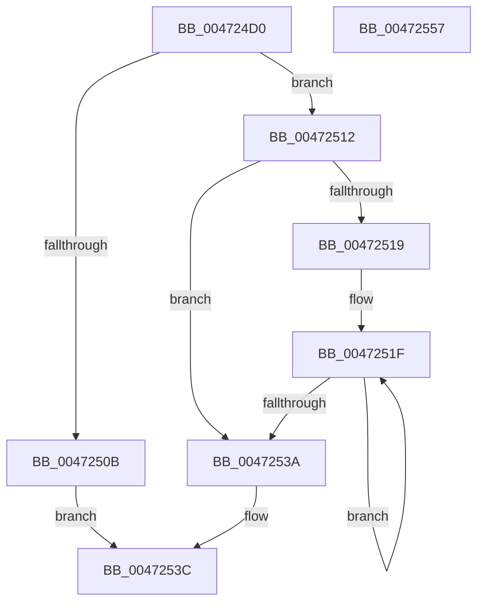

# x86BiosReadMemory

- RVA: `0x004724D0`–`0x00472558` (길이 `136` bytes)
- VA: `0x00000001404724D0`
- 실행 섹션: `.text`
- PDB 이름 있음: `예`; PDB Function 태그: `아니요`
- unwind 정보 RVA: `0x0005E6B4`
- 디코드: `41`개 명령, `136/136` bytes 표시
- 미해석 바이트: `0` (있으면 어셈블리에 `.byte`로 보존)

> 이 문서는 커널 이미지의 기계어와 PDB 기호를 분석해 생성했습니다. 4번과 5번은 함수 원형과 자료형을 바이너리 사용 방식에서 추정한 C 해석이며 원본 소스 복구 결과는 아닙니다.

## 1. Dependencies

- 직접 호출 지점: **1**; 고유 호출 대상: **1**
- 직접 호출자로 확인된 함수: **0**
- RIP 상대 이미지 참조: **0**

### Outgoing calls
- `0x00472525` → [x86BiosTranslateAddress](x86BiosTranslateAddress_function_004736C0.md) (function, `0x004736C0`)

### Direct callers
- 이 함수 시작 RVA로 연결되는 직접 call은 확인되지 않았습니다. 간접 호출은 완전히 역산할 수 없습니다.

### Static image references
- 디코드된 RIP-relative 메모리 참조가 없습니다.

## 2. Other-region calls and transfers

- 다른 실행 섹션으로 향하는 call: **0**
- 별도 외부 분기/꼬리 이동을 확인하지 못했습니다.

## 3. Assembly (complete function range)

```asm
004724D0  48 8B C4                        mov rax, rsp
004724D3  48 89 58 08                     mov qword ptr [rax + 8], rbx
004724D7  48 89 68 10                     mov qword ptr [rax + 0x10], rbp
004724DB  48 89 70 18                     mov qword ptr [rax + 0x18], rsi
004724DF  48 89 78 20                     mov qword ptr [rax + 0x20], rdi
004724E3  41 56                           push r14
004724E5  48 83 EC 20                     sub rsp, 0x20
004724E9  0F B7 E9                        movzx ebp, cx
004724EC  41 8B D9                        mov ebx, r9d
004724EF  44 8B D5                        mov r10d, ebp
004724F2  0F B7 FA                        movzx edi, dx
004724F5  41 C1 E2 04                     shl r10d, 4
004724F9  49 8B F0                        mov rsi, r8
004724FC  45 03 D1                        add r10d, r9d
004724FF  44 03 D7                        add r10d, edi
00472502  41 81 FA 00 00 10 00            cmp r10d, 0x100000
00472509  76 07                           jbe 0x140472512
0047250B  B8 0D 00 00 C0                  mov eax, 0xc000000d
00472510  EB 2A                           jmp 0x14047253c
00472512  0F AE E8                        lfence
00472515  85 DB                           test ebx, ebx
00472517  74 21                           je 0x14047253a
00472519  41 BE 01 00 00 00               mov r14d, 1
0047251F  0F B7 D7                        movzx edx, di
00472522  0F B7 CD                        movzx ecx, bp
00472525  E8 96 11 00 00                  call 0x1404736c0
0047252A  66 41 03 FE                     add di, r14w
0047252E  8A 08                           mov cl, byte ptr [rax]
00472530  88 0E                           mov byte ptr [rsi], cl
00472532  49 03 F6                        add rsi, r14
00472535  83 C3 FF                        add ebx, -1
00472538  75 E5                           jne 0x14047251f
0047253A  33 C0                           xor eax, eax
0047253C  48 8B 5C 24 30                  mov rbx, qword ptr [rsp + 0x30]
00472541  48 8B 6C 24 38                  mov rbp, qword ptr [rsp + 0x38]
00472546  48 8B 74 24 40                  mov rsi, qword ptr [rsp + 0x40]
0047254B  48 8B 7C 24 48                  mov rdi, qword ptr [rsp + 0x48]
00472550  48 83 C4 20                     add rsp, 0x20
00472554  41 5E                           pop r14
00472556  C3                              ret
00472557  CC                              int3
```

## 4. C-style interpretation (structured pseudocode)

```c
__int64 __fastcall x86BiosReadMemory(unsigned __int16 a1, unsigned __int16 a2, __int64 a3, int a4)
{
    __int64 result;
    __int64 v_r10;
    __int64 v_rbx;
    __int64 v_rdi;
    __int64 v_rsi;
    __int64 v_rsp;
    unsigned __int64 v_stack_p10;
    unsigned __int64 v_stack_p18;
    unsigned __int64 v_stack_p20;
    unsigned __int64 v_stack_p8;

    *(unsigned __int64 *)(v_rsp + 8) = v_rbx;
    *(unsigned __int64 *)(v_rsp + 16) = v_rbp;
    *(unsigned __int64 *)(v_rsp + 24) = v_rsi;
    *(unsigned __int64 *)(v_rsp + 32) = v_rdi;
    v_rsp = (v_rsp) - (32);
    v_r10 = (unsigned int)(((unsigned int)(a1)) << (4));
    v_r10 = (unsigned int)((v_r10) + (a4));
    v_r10 = (unsigned int)((v_r10) + (a2));
    if (((unsigned int)(v_r10)) <= 0x100000ULL) goto loc_00472512;
    goto loc_0047253C;
loc_00472512:
    if ((unsigned int)((unsigned int)(a4)) == 0) goto loc_0047253A;
loc_0047251F:
    result = x86BiosTranslateAddress(a1, a2, a3, a4);
    v_rdi = (unsigned __int16)((a2) + (1));
    *(unsigned __int8 *)(a3) = (unsigned __int8)(*(unsigned __int8 *)(result));
    v_rsi = (a3) + (1);
    v_rbx = (unsigned int)(((unsigned int)(a4)) + (-1));
    if (condition_is_not_equal) goto loc_0047251F;
loc_0047253A:
    result = 0;
loc_0047253C:
    v_rsp = (v_rsp) + (32);
    return result;
}
```

## 5. (Beta) C Style

```c
int64_t x86BiosReadMemory(uint16_t Arg1, uint16_t Arg2, void *Arg3, int32_t Arg4)
{
    uint8_t *arg3 = (uint8_t *)Arg3;

    int64_t result;
    int64_t local_r10;
    int64_t local_rbx;
    int64_t local_rdi;
    int64_t local_rsi;
    int64_t local_rsp;
    uint64_t v_stack_p10;
    uint64_t v_stack_p18;
    uint64_t v_stack_p20;
    uint64_t v_stack_p8;

    *(uint64_t *)(local_rsp + 0x8) = local_rbx;
    *(uint64_t *)(local_rsp + 0x10) = local_rbp;
    *(uint64_t *)(local_rsp + 0x18) = local_rsi;
    *(uint64_t *)(local_rsp + 0x20) = local_rdi;
    local_rsp = (local_rsp) - (32);
    local_r10 = (uint32_t)(((uint32_t)(Arg1)) << (4));
    local_r10 = (uint32_t)((local_r10) + (Arg4));
    local_r10 = (uint32_t)((local_r10) + (Arg2));
    if (((uint32_t)(local_r10)) <= 0x100000ULL) goto loc_00472512;
    goto loc_0047253C;
loc_00472512:
    if ((uint32_t)((uint32_t)(Arg4)) == 0) goto loc_0047253A;
loc_0047251F:
    result = x86BiosTranslateAddress(Arg1, Arg2, Arg3, Arg4);
    local_rdi = (uint16_t)((Arg2) + (1));
    *(uint8_t *)(arg3) = (uint8_t)(*(uint8_t *)(result));
    local_rsi = (Arg3) + (1);
    local_rbx = (uint32_t)(((uint32_t)(Arg4)) + (-1));
    if (condition_is_not_equal) goto loc_0047251F;
loc_0047253A:
    result = 0;
loc_0047253C:
    local_rsp = (local_rsp) + (32);
    return result;
}
```

### 관측된 메모리 오프셋

구조체 형식이 확인되지 않은 접근은 인자 기준의 오프셋으로만 기록했습니다.

| 기준 인자 | 오프셋 표현 | 폭 (bit) | 접근 |
|---|---:|---:|---|
| `Arg3` | `+ 0x0` | `8` | `W` |

## 6. Execution-region graph

[열기: 2D/3D 그래프와 함수 탐색 컨트롤 패널](../../../control-panel.html?section=text&rva=0x004724D0&view=graph)

- 2D 그래프는 위에서 아래로 흐르고, 3D 그래프는 빈 공간을 드래그해 회전합니다. Shift+드래그는 이동, 휠은 확대·축소, 함수 노드 선택은 대상 보고서 이동입니다.

### Static fallback


