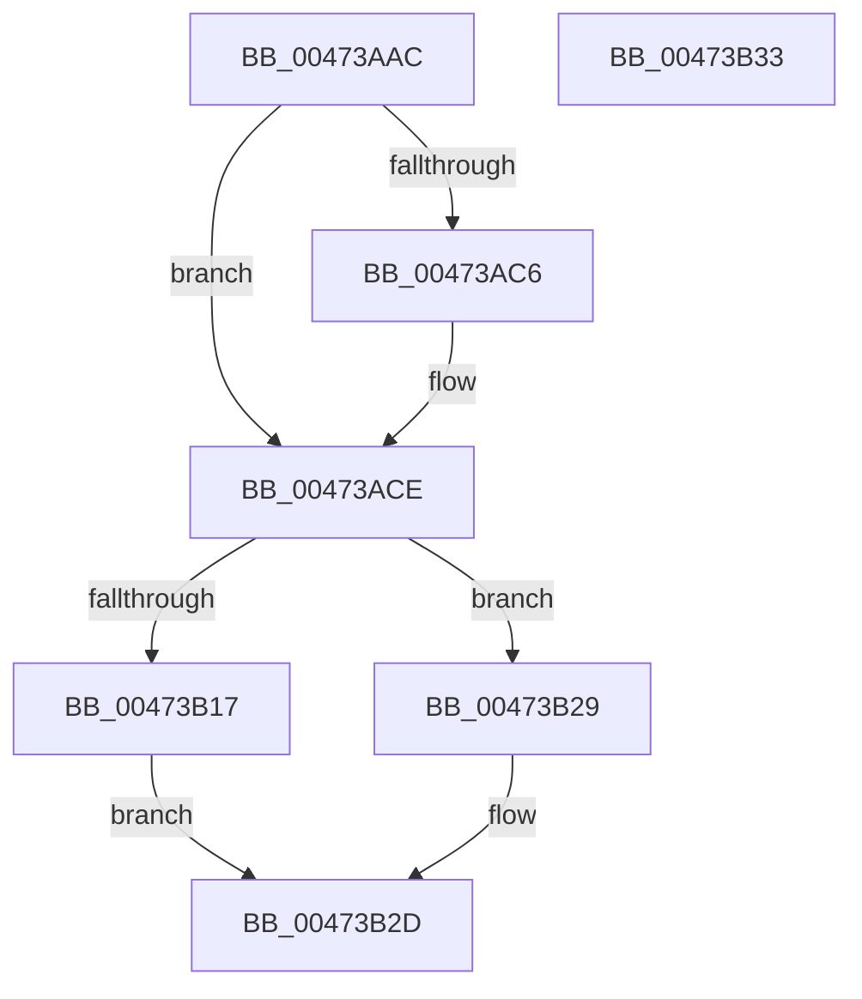

# x86BiosReadPciDataPort

- RVA: `0x00473AAC`–`0x00473B34` (길이 `136` bytes)
- VA: `0x0000000140473AAC`
- 실행 섹션: `.text`
- PDB 이름 있음: `예`; PDB Function 태그: `아니요`
- unwind 정보 RVA: `0x00064C80`
- 디코드: `38`개 명령, `136/136` bytes 표시
- 미해석 바이트: `0` (있으면 어셈블리에 `.byte`로 보존)

> 이 문서는 커널 이미지의 기계어와 PDB 기호를 분석해 생성했습니다. 4번과 5번은 함수 원형과 자료형을 바이너리 사용 방식에서 추정한 C 해석이며 원본 소스 복구 결과는 아닙니다.

## 1. Dependencies

- 직접 호출 지점: **1**; 고유 호출 대상: **1**
- 직접 호출자로 확인된 함수: **1**
- RIP 상대 이미지 참조: **3**

### Outgoing calls
- `0x00473B0E` → [guard_dispatch_icall](../6B/guard_dispatch_icall_function_006BAAD0.md) (function, `0x006BAAD0`)

### Direct callers
- [x86BiosReadIoSpace](x86BiosReadIoSpace_function_00473850.md) at `0x004738C7`

### Static image references
- `0x00473ACE` → RVA `0x00E1032C` (`.data`; read)
- `0x00473AE5` → RVA `0x00E1032E` (`.data`; read)
- `0x00473B04` → RVA `0x00FC2300` (`.data`; read)

## 2. Other-region calls and transfers

- 다른 실행 섹션으로 향하는 call: **0**
- 별도 외부 분기/꼬리 이동을 확인하지 못했습니다.

## 3. Assembly (complete function range)

```asm
00473AAC  40 53                           push rbx
00473AAE  48 83 EC 30                     sub rsp, 0x30
00473AB2  83 64 24 48 00                  and dword ptr [rsp + 0x48], 0
00473AB7  8B D9                           mov ebx, ecx
00473AB9  44 0F B7 D2                     movzx r10d, dx
00473ABD  41 8D 04 0A                     lea eax, [r10 + rcx]
00473AC1  83 F8 03                        cmp eax, 3
00473AC4  7E 08                           jle 0x140473ace
00473AC6  BB 03 00 00 00                  mov ebx, 3
00473ACB  41 2B DA                        sub ebx, r10d
00473ACE  8B 0D 58 C8 99 00               mov ecx, dword ptr [rip + 0x99c858]
00473AD4  44 8D 43 01                     lea r8d, [rbx + 1]
00473AD8  8B C1                           mov eax, ecx
00473ADA  44 0F B6 C9                     movzx r9d, cl
00473ADE  8B D1                           mov edx, ecx
00473AE0  44 89 44 24 20                  mov dword ptr [rsp + 0x20], r8d
00473AE5  0F B6 0D 42 C8 99 00            movzx ecx, byte ptr [rip + 0x99c842]
00473AEC  4C 8D 44 24 48                  lea r8, [rsp + 0x48]
00473AF1  C1 EA 08                        shr edx, 8
00473AF4  25 00 07 00 00                  and eax, 0x700
00473AF9  81 E2 F8 00 00 00               and edx, 0xf8
00473AFF  45 0B CA                        or r9d, r10d
00473B02  0B D0                           or edx, eax
00473B04  48 8B 05 F5 E7 B4 00            mov rax, qword ptr [rip + 0xb4e7f5]
00473B0B  C1 EA 03                        shr edx, 3
00473B0E  E8 BD 6F 24 00                  call 0x1406baad0
00473B13  85 C0                           test eax, eax
00473B15  75 12                           jne 0x140473b29
00473B17  8D 0C DD 08 00 00 00            lea ecx, [rbx*8 + 8]
00473B1E  B8 01 00 00 00                  mov eax, 1
00473B23  D3 E0                           shl eax, cl
00473B25  FF C8                           dec eax
00473B27  EB 04                           jmp 0x140473b2d
00473B29  8B 44 24 48                     mov eax, dword ptr [rsp + 0x48]
00473B2D  48 83 C4 30                     add rsp, 0x30
00473B31  5B                              pop rbx
00473B32  C3                              ret
00473B33  CC                              int3
```

## 4. C-style interpretation (structured pseudocode)

```c
__int64 __fastcall x86BiosReadPciDataPort(__int64 a1, unsigned __int16 a2)
{
    __int64 result;
    __int64 v_rbx;
    __int64 v_rsp;
    unsigned int v_stack_m18;
    unsigned int v_stack_p10;

    v_rsp = (v_rsp) - (48);
    v_rbx = (unsigned int)((unsigned int)(a1));
    if (((unsigned int)(a2 + a1 * 1)) >= = 3) {
        v_rbx = 3;
        v_rbx = (unsigned int)((v_rbx) - (a2));
    }
    v_stack_m18 = (unsigned int)(v_rbx + 1);
    a2 = (unsigned int)(((unsigned int)((unsigned int)((unsigned int)(*(unsigned int *)(v_rip + 10078296))))) >> (8));
    result = (unsigned int)(((unsigned int)((unsigned int)((unsigned int)(*(unsigned int *)(v_rip + 10078296))))) & (0x700ULL));
    a2 = (unsigned int)((a2) & (248));
    a4 = (unsigned int)(((unsigned __int8)((unsigned int)(*(unsigned int *)(v_rip + 10078296)))) | (a2));
    a2 = (unsigned int)((a2) | ((unsigned int)(result)));
    a2 = (unsigned int)((a2) >> (3));
    result = guard_dispatch_icall(*(unsigned __int8 *)(v_rip + 10078274), a2, v_stack_p10, a4);
    if ((unsigned int)(result) != 0) goto loc_00473B29;
    result = (unsigned int)((1) << ((unsigned __int8)(v_rbx * 8 + 8)));
    result = (unsigned int)((result) - 1);
    goto loc_00473B2D;
loc_00473B29:
loc_00473B2D:
    v_rsp = (v_rsp) + (48);
    return (unsigned int)(v_stack_p10);
}
```

## 5. (Beta) C Style

```c
int64_t x86BiosReadPciDataPort(int64_t Arg1, void *Arg2)
{
    uint8_t *arg2 = (uint8_t *)Arg2;

    int64_t result;
    int64_t local_rbx;
    int64_t local_rsp;
    uint32_t v_stack_m18;
    uint32_t v_stack_p10;

    local_rsp = (local_rsp) - (48);
    local_rbx = (uint32_t)((uint32_t)(Arg1));
    if (((uint32_t)(Arg2 + Arg1 * 1)) >= = 3) {
        local_rbx = 3;
        local_rbx = (uint32_t)((local_rbx) - (Arg2));
    }
    v_stack_m18 = (uint32_t)(local_rbx + 1);
    Arg2 = (uint32_t)(((uint32_t)((uint32_t)((uint32_t)(*(uint32_t *)(v_rip + 0x99C858))))) >> (8));
    result = (uint32_t)(((uint32_t)((uint32_t)((uint32_t)(*(uint32_t *)(v_rip + 0x99C858))))) & (0x700ULL));
    Arg2 = (uint32_t)((Arg2) & (248));
    a4 = (uint32_t)(((uint8_t)((uint32_t)(*(uint32_t *)(v_rip + 0x99C858)))) | (Arg2));
    Arg2 = (uint32_t)((Arg2) | ((uint32_t)(result)));
    Arg2 = (uint32_t)((Arg2) >> (3));
    result = guard_dispatch_icall(*(uint8_t *)(v_rip + 0x99C842), Arg2, v_stack_p10, a4);
    if ((uint32_t)(result) != 0) goto loc_00473B29;
    result = (uint32_t)((1) << ((uint8_t)(local_rbx * 8 + 8)));
    result = (uint32_t)((result) - 1);
    goto loc_00473B2D;
loc_00473B29:
loc_00473B2D:
    local_rsp = (local_rsp) + (48);
    return (uint32_t)(v_stack_p10);
}
```

### 관측된 메모리 오프셋

구조체 형식이 확인되지 않은 접근은 인자 기준의 오프셋으로만 기록했습니다.

| 기준 인자 | 오프셋 표현 | 폭 (bit) | 접근 |
|---|---:|---:|---|
| `Arg2` | `+ 0x0 + rcx*1` | `32` | `R` |

## 6. Execution-region graph

[열기: 2D/3D 그래프와 함수 탐색 컨트롤 패널](../../../control-panel.html?section=text&rva=0x00473AAC&view=graph)

- 2D 그래프는 위에서 아래로 흐르고, 3D 그래프는 빈 공간을 드래그해 회전합니다. Shift+드래그는 이동, 휠은 확대·축소, 함수 노드 선택은 대상 보고서 이동입니다.

### Static fallback


