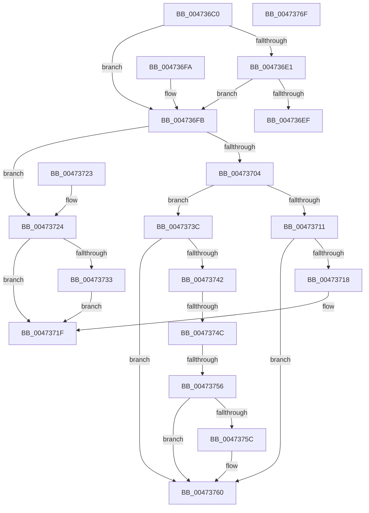

# x86BiosTranslateAddress

- RVA: `0x004736C0`–`0x00473770` (길이 `176` bytes)
- VA: `0x00000001404736C0`
- 실행 섹션: `.text`
- PDB 이름 있음: `예`; PDB Function 태그: `예`
- unwind 정보 RVA: `0x000DB714`
- 디코드: `46`개 명령, `176/176` bytes 표시
- 미해석 바이트: `0` (있으면 어셈블리에 `.byte`로 보존)

> 이 문서는 커널 이미지의 기계어와 PDB 기호를 분석해 생성했습니다. 4번과 5번은 함수 원형과 자료형을 바이너리 사용 방식에서 추정한 C 해석이며 원본 소스 복구 결과는 아닙니다.

## 1. Dependencies

- 직접 호출 지점: **0**; 고유 호출 대상: **0**
- 직접 호출자로 확인된 함수: **15**
- RIP 상대 이미지 참조: **5**

### Outgoing calls
- 직접 디코드된 call 명령이 없습니다.

### Direct callers
- [x86BiosReadMemory](x86BiosReadMemory_function_004724D0.md) at `0x00472525`
- [XmPopStack](XmPopStack_function_00472588.md) at `0x004725BF`
- [XmGetStringAddressRange](XmGetStringAddressRange_function_00472B88.md) at `0x00472C0C`
- [XmGetStringAddressRange](XmGetStringAddressRange_function_00472B88.md) at `0x00472C38`
- [XmPushStack](XmPushStack_function_00473088.md) at `0x004730B5`
- [XmGetWordImmediate](XmGetWordImmediate_function_004731DC.md) at `0x004731FD`
- [XmGetCodeByte](XmGetCodeByte_function_00473678.md) at `0x0047368F`
- [HalInitializeBios](../53/HalInitializeBios_function_0053D9A0.md) at `0x0053DA3C`
- [HalInitializeBios](../53/HalInitializeBios_function_0053D9A0.md) at `0x0053DC25`
- [x86BiosWriteMemory](../54/x86BiosWriteMemory_function_00547FB0.md) at `0x00548005`
- [XmEmulateInterrupt](../56/XmEmulateInterrupt_function_005600F0.md) at `0x00560136`
- [XmEmulateInterrupt](../56/XmEmulateInterrupt_function_005600F0.md) at `0x00560159`
- [XmInitializeEmulator](../56/XmInitializeEmulator_function_00560188.md) at `0x00560208`
- [XmGetLongImmediate](../56/XmGetLongImmediate_function_0056DC70.md) at `0x0056DCA3`
- [XmIntOp](../57/XmIntOp_function_00577AE0.md) at `0x00577B64`
- [XmGetOffsetAddress](../57/XmGetOffsetAddress_function_00578B84.md) at `0x00578BA9`
- [XmGetStringAddress](../57/XmGetStringAddress_function_00578BCC.md) at `0x00578C35`
- [sub_006F3DB6](../6F/Unknown_function_006F3DB6.md) at `0x006F414C`

### Static image references
- `0x004736F2` → RVA `0x00FC2B28` (`.data`; read)
- `0x00473718` → RVA `0x00FC2320` (`.data`; read)
- `0x00473724` → RVA `0x00FC22F0` (`.data`; read)
- `0x00473760` → RVA `0x00FC22F8` (`.data`; read/write)
- `0x00473767` → RVA `0x00FC22F8` (`.data`; read)

## 2. Other-region calls and transfers

- 다른 실행 섹션으로 향하는 call: **0**
- call이 아닌 외부 분기/꼬리 이동: **2**
  - `0x00473746` → `0x006F4178` (`tail-transfer`)
  - `0x00473750` → `0x006F4178` (`tail-transfer`)

## 3. Assembly (complete function range)

```asm
004736C0  0F AE E8                        lfence
004736C3  44 0F B7 C1                     movzx r8d, cx
004736C7  41 C1 E0 04                     shl r8d, 4
004736CB  0F B7 C2                        movzx eax, dx
004736CE  44 03 C0                        add r8d, eax
004736D1  41 81 E0 FF FF 0F 00            and r8d, 0xfffff
004736D8  41 81 F8 FF FF 08 00            cmp r8d, 0x8ffff
004736DF  76 1A                           jbe 0x1404736fb
004736E1  41 8D 80 00 00 F6 FF            lea eax, [r8 - 0xa0000]
004736E8  3D FF FF 01 00                  cmp eax, 0x1ffff
004736ED  76 0C                           jbe 0x1404736fb
004736EF  41 8B C0                        mov eax, r8d
004736F2  48 03 05 2F F4 B4 00            add rax, qword ptr [rip + 0xb4f42f]
004736F9  C3                              ret
004736FA  CC                              int3
004736FB  41 81 F8 00 00 0A 00            cmp r8d, 0xa0000
00473702  73 20                           jae 0x140473724
00473704  41 0F B7 C0                     movzx eax, r8w
00473708  41 C1 E8 10                     shr r8d, 0x10
0047370C  45 85 C0                        test r8d, r8d
0047370F  75 2B                           jne 0x14047373c
00473711  3D 00 08 00 00                  cmp eax, 0x800
00473716  77 48                           ja 0x140473760
00473718  48 8D 0D 01 EC B4 00            lea rcx, [rip + 0xb4ec01]
0047371F  48 03 C1                        add rax, rcx
00473722  C3                              ret
00473723  CC                              int3
00473724  48 8B 05 C5 EB B4 00            mov rax, qword ptr [rip + 0xb4ebc5]
0047372B  41 8B C8                        mov ecx, r8d
0047372E  48 85 C0                        test rax, rax
00473731  75 EC                           jne 0x14047371f
00473733  48 8B 05 EE F3 B4 00            mov rax, qword ptr [rip + 0xb4f3ee]
0047373A  EB E3                           jmp 0x14047371f
0047373C  41 83 E8 01                     sub r8d, 1
00473740  74 1E                           je 0x140473760
00473742  41 83 E8 01                     sub r8d, 1
00473746  0F 84 2C 0A 28 00               je 0x1406f4178
0047374C  41 83 E8 01                     sub r8d, 1
00473750  0F 84 22 0A 28 00               je 0x1406f4178
00473756  41 83 E8 01                     sub r8d, 1
0047375A  74 04                           je 0x140473760
0047375C  41 83 E8 01                     sub r8d, 1
00473760  83 25 91 EB B4 00 00            and dword ptr [rip + 0xb4eb91], 0
00473767  48 8D 05 8A EB B4 00            lea rax, [rip + 0xb4eb8a]
0047376E  C3                              ret
0047376F  CC                              int3
```

## 4. C-style interpretation (structured pseudocode)

```c
__int64 __fastcall x86BiosTranslateAddress(unsigned __int16 a1, unsigned __int16 a2)
{
    __int64 result;

    a3 = (unsigned int)((a1) << (4));
    a3 = (unsigned int)((a3) + (a2));
    a3 = (unsigned int)((a3) & (0xFFFFFULL));
    if (((unsigned int)(a3)) <= 0x8FFFFULL) goto loc_004736FB;
    if (((unsigned int)(a3 - 655360)) <= 0x1FFFFULL) goto loc_004736FB;
    result = ((unsigned int)((unsigned int)(a3))) + (*(unsigned __int64 *)(v_rip + 11858991));
    return result;
loc_004736FB:
    if (((unsigned int)(a3)) >= 0xA0000ULL) goto loc_00473724;
    a3 = (unsigned int)((a3) >> (16));
    if ((unsigned int)(a3) != 0) goto loc_0047373C;
    if (((unsigned int)((unsigned __int16)(a3))) > 0x800ULL) goto loc_00473760;
loc_0047371F:
    result = ((unsigned __int16)(a3)) + (v_rip + 11856897);
    return result;
loc_00473724:
    if (*(unsigned __int64 *)(v_rip + 11856837) != 0) goto loc_0047371F;
    goto loc_0047371F;
loc_0047373C:
    a3 = (unsigned int)((a3) - (1));
    if (condition_is_equal) goto loc_00473760;
    a3 = (unsigned int)((a3) - (1));
    a3 = (unsigned int)((a3) - (1));
    a3 = (unsigned int)((a3) - (1));
    if (!(condition_is_equal)) {
        a3 = (unsigned int)((a3) - (1));
    }
    return v_rip + 11856778;
}
```

## 5. (Beta) C Style

```c
int64_t x86BiosTranslateAddress(uint16_t Arg1, uint16_t Arg2)
{
    int64_t result;

    a3 = (uint32_t)((Arg1) << (4));
    a3 = (uint32_t)((a3) + (Arg2));
    a3 = (uint32_t)((a3) & (0xFFFFFULL));
    if (((uint32_t)(a3)) <= 0x8FFFFULL) goto loc_004736FB;
    if (((uint32_t)(a3 - 655360)) <= 0x1FFFFULL) goto loc_004736FB;
    result = ((uint32_t)((uint32_t)(a3))) + (*(uint64_t *)(v_rip + 0xB4F42F));
    return result;
loc_004736FB:
    if (((uint32_t)(a3)) >= 0xA0000ULL) goto loc_00473724;
    a3 = (uint32_t)((a3) >> (16));
    if ((uint32_t)(a3) != 0) goto loc_0047373C;
    if (((uint32_t)((uint16_t)(a3))) > 0x800ULL) goto loc_00473760;
loc_0047371F:
    result = ((uint16_t)(a3)) + (v_rip + 11856897);
    return result;
loc_00473724:
    if (*(uint64_t *)(v_rip + 0xB4EBC5) != 0) goto loc_0047371F;
    goto loc_0047371F;
loc_0047373C:
    a3 = (uint32_t)((a3) - (1));
    if (condition_is_equal) goto loc_00473760;
    a3 = (uint32_t)((a3) - (1));
    a3 = (uint32_t)((a3) - (1));
    a3 = (uint32_t)((a3) - (1));
    if (!(condition_is_equal)) {
        a3 = (uint32_t)((a3) - (1));
    }
    return v_rip + 11856778;
}
```

## 6. Execution-region graph

[열기: 2D/3D 그래프와 함수 탐색 컨트롤 패널](../../../control-panel.html?section=text&rva=0x004736C0&view=graph)

- 2D 그래프는 위에서 아래로 흐르고, 3D 그래프는 빈 공간을 드래그해 회전합니다. Shift+드래그는 이동, 휠은 확대·축소, 함수 노드 선택은 대상 보고서 이동입니다.

### Static fallback


