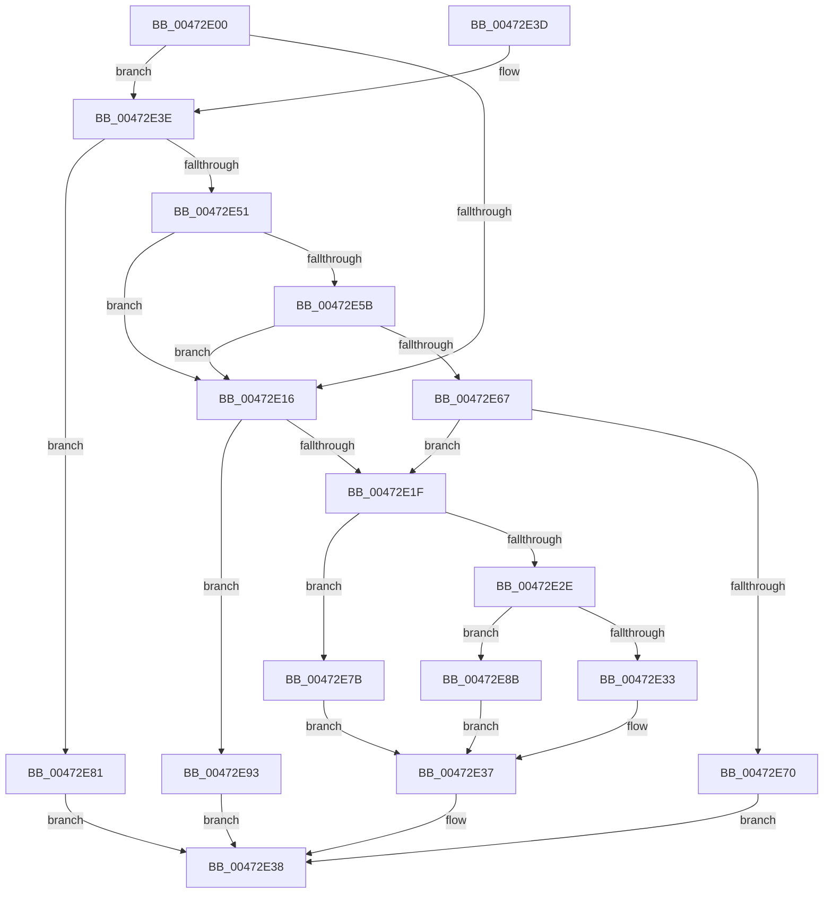

# x86BiosWriteIoSpace

- RVA: `0x00472E00`–`0x00472E9A` (길이 `154` bytes)
- VA: `0x0000000140472E00`
- 실행 섹션: `.text`
- PDB 이름 있음: `예`; PDB Function 태그: `아니요`
- unwind 정보 RVA: `0x000AC544`
- 디코드: `49`개 명령, `154/154` bytes 표시
- 미해석 바이트: `0` (있으면 어셈블리에 `.byte`로 보존)

> 이 문서는 커널 이미지의 기계어와 PDB 기호를 분석해 생성했습니다. 4번과 5번은 함수 원형과 자료형을 바이너리 사용 방식에서 추정한 C 해석이며 원본 소스 복구 결과는 아닙니다.

## 1. Dependencies

- 직접 호출 지점: **3**; 고유 호출 대상: **3**
- 직접 호출자로 확인된 함수: **2**
- RIP 상대 이미지 참조: **3**

### Outgoing calls
- `0x00472E74` → [x86BiosWritePciDataPort](../54/x86BiosWritePciDataPort_function_00548040.md) (function, `0x00548040`)
- `0x00472E84` → [x86BiosWritePciAddressPort](x86BiosWritePciAddressPort_function_00473A24.md) (function, `0x00473A24`)
- `0x00472E93` → [x86BiosWriteCmosPort](../54/x86BiosWriteCmosPort_function_00547EE8.md) (function, `0x00547EE8`)

### Direct callers
- [XmOutOp](XmOutOp_function_00472DB0.md) at `0x00472DDA`
- [XmOutsOp](../57/XmOutsOp_function_00577980.md) at `0x005779E7`

### Static image references
- `0x00472E07` → RVA `0x00E10328` (`.data`; read)
- `0x00472E22` → RVA `0x00FC22E8` (`.data`; read)
- `0x00472E51` → RVA `0x00E1032C` (`.data`; read)

## 2. Other-region calls and transfers

- 다른 실행 섹션으로 향하는 call: **0**
- 별도 외부 분기/꼬리 이동을 확인하지 못했습니다.

## 3. Assembly (complete function range)

```asm
00472E00  48 83 EC 28                     sub rsp, 0x28
00472E04  0F AE E8                        lfence
00472E07  80 3D 1A D5 99 00 00            cmp byte ptr [rip + 0x99d51a], 0
00472E0E  41 BA 03 00 00 00               mov r10d, 3
00472E14  75 28                           jne 0x140472e3e
00472E16  8D 42 90                        lea eax, [rdx - 0x70]
00472E19  66 83 F8 01                     cmp ax, 1
00472E1D  76 74                           jbe 0x140472e93
00472E1F  0F B7 D2                        movzx edx, dx
00472E22  48 03 15 BF F4 B4 00            add rdx, qword ptr [rip + 0xb4f4bf]
00472E29  90                              nop
00472E2A  85 C9                           test ecx, ecx
00472E2C  74 4D                           je 0x140472e7b
00472E2E  41 3B CA                        cmp ecx, r10d
00472E31  75 58                           jne 0x140472e8b
00472E33  41 8B C0                        mov eax, r8d
00472E36  EF                              out dx, eax
00472E37  90                              nop
00472E38  48 83 C4 28                     add rsp, 0x28
00472E3C  C3                              ret
00472E3D  CC                              int3
00472E3E  41 B9 F8 0C 00 00               mov r9d, 0xcf8
00472E44  0F B7 C2                        movzx eax, dx
00472E47  66 41 2B C1                     sub ax, r9w
00472E4B  66 41 3B C2                     cmp ax, r10w
00472E4F  76 30                           jbe 0x140472e81
00472E51  8B 05 D5 D4 99 00               mov eax, dword ptr [rip + 0x99d4d5]
00472E57  85 C0                           test eax, eax
00472E59  79 BB                           jns 0x140472e16
00472E5B  41 B9 FC 0C 00 00               mov r9d, 0xcfc
00472E61  66 44 3B CA                     cmp r9w, dx
00472E65  77 AF                           ja 0x140472e16
00472E67  41 8D 41 03                     lea eax, [r9 + 3]
00472E6B  66 3B D0                        cmp dx, ax
00472E6E  77 AF                           ja 0x140472e1f
00472E70  66 41 2B D1                     sub dx, r9w
00472E74  E8 C7 51 0D 00                  call 0x140548040
00472E79  EB BD                           jmp 0x140472e38
00472E7B  41 8A C0                        mov al, r8b
00472E7E  EE                              out dx, al
00472E7F  EB B6                           jmp 0x140472e37
00472E81  0F B7 D0                        movzx edx, ax
00472E84  E8 9B 0B 00 00                  call 0x140473a24
00472E89  EB AD                           jmp 0x140472e38
00472E8B  41 0F B7 C0                     movzx eax, r8w
00472E8F  66 EF                           out dx, ax
00472E91  EB A4                           jmp 0x140472e37
00472E93  E8 50 50 0D 00                  call 0x140547ee8
00472E98  EB 9E                           jmp 0x140472e38
```

## 4. C-style interpretation (structured pseudocode)

```c
__int64 __fastcall x86BiosWriteIoSpace(int a1, __int64 a2, int a3)
{
    __int64 result;
    __int64 v_rsp;

    v_rsp = (v_rsp) - (40);
    if ((*(unsigned __int8 *)(v_rip + 10081562)) != 0) goto loc_00472E3E;
loc_00472E16:
    if (((unsigned __int16)(a2 - 112)) <= 1) goto loc_00472E93;
loc_00472E1F:
    a2 = ((unsigned __int16)(a2)) + (*(unsigned __int64 *)(v_rip + 11859135));
    if (a1 == 0) goto loc_00472E7B;
    if (a1 != 3) goto loc_00472E8B;
loc_00472E37:
loc_00472E38:
    v_rsp = (v_rsp) + (40);
    return (unsigned int)(a3);
loc_00472E3E:
    result = (unsigned __int16)(((unsigned __int16)(a2)) - ((unsigned __int16)((unsigned int)(0xCF8ULL))));
    if (((unsigned __int16)(result)) <= 3) goto loc_00472E81;
    if (!sign_flag) goto loc_00472E16;
    if (((unsigned __int16)((unsigned int)(0xCFCULL))) > ((unsigned __int16)(a2))) goto loc_00472E16;
    if (((unsigned __int16)(a2)) > ((unsigned __int16)((unsigned int)(0xCFCULL) + 3))) goto loc_00472E1F;
    a2 = (unsigned __int16)((a2) - ((unsigned __int16)((unsigned int)(0xCFCULL))));
    result = x86BiosWritePciDataPort(a1, a2, a3, (unsigned int)(0xCFCULL));
    goto loc_00472E38;
loc_00472E7B:
    goto loc_00472E37;
loc_00472E81:
    result = x86BiosWritePciAddressPort(a1, (unsigned __int16)((unsigned __int8)(a3)), a3, (unsigned int)(0xCFCULL));
    goto loc_00472E38;
loc_00472E8B:
    goto loc_00472E37;
loc_00472E93:
    result = x86BiosWriteCmosPort(a1, (unsigned __int16)((unsigned __int8)(a3)), a3, (unsigned int)(0xCFCULL));
    goto loc_00472E38;
}
```

## 5. (Beta) C Style

```c
int64_t x86BiosWriteIoSpace(int32_t Arg1, void *Arg2, int32_t Arg3)
{
    uint8_t *arg2 = (uint8_t *)Arg2;

    int64_t result;
    int64_t local_rsp;

    local_rsp = (local_rsp) - (40);
    if ((*(uint8_t *)(v_rip + 0x99D51A)) != 0) goto loc_00472E3E;
loc_00472E16:
    if (((uint16_t)(Arg2 - 112)) <= 1) goto loc_00472E93;
loc_00472E1F:
    Arg2 = ((uint16_t)(Arg2)) + (*(uint64_t *)(v_rip + 0xB4F4BF));
    if (Arg1 == 0) goto loc_00472E7B;
    if (Arg1 != 3) goto loc_00472E8B;
loc_00472E37:
loc_00472E38:
    local_rsp = (local_rsp) + (40);
    return (uint32_t)(Arg3);
loc_00472E3E:
    result = (uint16_t)(((uint16_t)(Arg2)) - ((uint16_t)((uint32_t)(0xCF8ULL))));
    if (((uint16_t)(result)) <= 3) goto loc_00472E81;
    if (!sign_flag) goto loc_00472E16;
    if (((uint16_t)((uint32_t)(0xCFCULL))) > ((uint16_t)(Arg2))) goto loc_00472E16;
    if (((uint16_t)(Arg2)) > ((uint16_t)((uint32_t)(0xCFCULL) + 3))) goto loc_00472E1F;
    Arg2 = (uint16_t)((Arg2) - ((uint16_t)((uint32_t)(0xCFCULL))));
    result = x86BiosWritePciDataPort(Arg1, Arg2, Arg3, (uint32_t)(0xCFCULL));
    goto loc_00472E38;
loc_00472E7B:
    goto loc_00472E37;
loc_00472E81:
    result = x86BiosWritePciAddressPort(Arg1, (uint16_t)((uint8_t)(Arg3)), Arg3, (uint32_t)(0xCFCULL));
    goto loc_00472E38;
loc_00472E8B:
    goto loc_00472E37;
loc_00472E93:
    result = x86BiosWriteCmosPort(Arg1, (uint16_t)((uint8_t)(Arg3)), Arg3, (uint32_t)(0xCFCULL));
    goto loc_00472E38;
}
```

### 관측된 메모리 오프셋

구조체 형식이 확인되지 않은 접근은 인자 기준의 오프셋으로만 기록했습니다.

| 기준 인자 | 오프셋 표현 | 폭 (bit) | 접근 |
|---|---:|---:|---|
| `Arg2` | `- 0x70` | `32` | `R` |

## 6. Execution-region graph

[열기: 2D/3D 그래프와 함수 탐색 컨트롤 패널](../../../control-panel.html?section=text&rva=0x00472E00&view=graph)

- 2D 그래프는 위에서 아래로 흐르고, 3D 그래프는 빈 공간을 드래그해 회전합니다. Shift+드래그는 이동, 휠은 확대·축소, 함수 노드 선택은 대상 보고서 이동입니다.

### Static fallback


