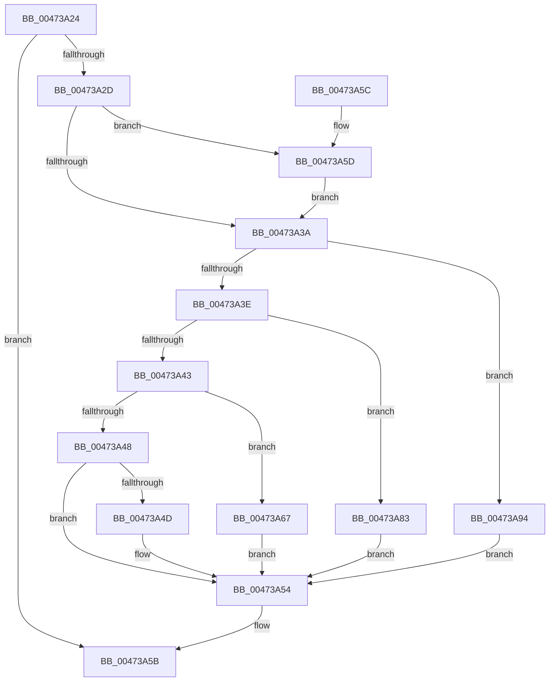

# x86BiosWritePciAddressPort

- RVA: `0x00473A24`–`0x00473AA4` (길이 `128` bytes)
- VA: `0x0000000140473A24`
- 실행 섹션: `.text`
- PDB 이름 있음: `예`; PDB Function 태그: `아니요`
- unwind 정보 RVA: `0x000DB714`
- 디코드: `35`개 명령, `128/128` bytes 표시
- 미해석 바이트: `0` (있으면 어셈블리에 `.byte`로 보존)

> 이 문서는 커널 이미지의 기계어와 PDB 기호를 분석해 생성했습니다. 4번과 5번은 함수 원형과 자료형을 바이너리 사용 방식에서 추정한 C 해석이며 원본 소스 복구 결과는 아닙니다.

## 1. Dependencies

- 직접 호출 지점: **0**; 고유 호출 대상: **0**
- 직접 호출자로 확인된 함수: **1**
- RIP 상대 이미지 참조: **5**

### Outgoing calls
- 직접 디코드된 call 명령이 없습니다.

### Direct callers
- [x86BiosWriteIoSpace](x86BiosWriteIoSpace_function_00472E00.md) at `0x00472E84`

### Static image references
- `0x00473A24` → RVA `0x00E10328` (`.data`; read)
- `0x00473A4D` → RVA `0x00E1032C` (`.data`; write)
- `0x00473A54` → RVA `0x00E1032C` (`.data`; read/write)
- `0x00473A6A` → RVA `0x00E1032C` (`.data`; read)
- `0x00473A7A` → RVA `0x00E1032F` (`.data`; write)

## 2. Other-region calls and transfers

- 다른 실행 섹션으로 향하는 call: **0**
- 별도 외부 분기/꼬리 이동을 확인하지 못했습니다.

## 3. Assembly (complete function range)

```asm
00473A24  80 3D FD C8 99 00 00            cmp byte ptr [rip + 0x99c8fd], 0
00473A2B  74 2E                           je 0x140473a5b
00473A2D  44 0F B7 CA                     movzx r9d, dx
00473A31  41 8D 04 09                     lea eax, [r9 + rcx]
00473A35  83 F8 03                        cmp eax, 3
00473A38  7F 23                           jg 0x140473a5d
00473A3A  85 C9                           test ecx, ecx
00473A3C  74 56                           je 0x140473a94
00473A3E  83 E9 01                        sub ecx, 1
00473A41  74 40                           je 0x140473a83
00473A43  83 E9 01                        sub ecx, 1
00473A46  74 1F                           je 0x140473a67
00473A48  83 F9 01                        cmp ecx, 1
00473A4B  75 07                           jne 0x140473a54
00473A4D  44 89 05 D8 C8 99 00            mov dword ptr [rip + 0x99c8d8], r8d
00473A54  83 25 D1 C8 99 00 FC            and dword ptr [rip + 0x99c8d1], 0xfffffffc
00473A5B  C3                              ret
00473A5C  CC                              int3
00473A5D  B9 03 00 00 00                  mov ecx, 3
00473A62  41 2B C9                        sub ecx, r9d
00473A65  EB D3                           jmp 0x140473a3a
00473A67  0F B7 C2                        movzx eax, dx
00473A6A  48 8D 0D BB C8 99 00            lea rcx, [rip + 0x99c8bb]
00473A71  66 44 89 04 08                  mov word ptr [rax + rcx], r8w
00473A76  41 C1 E8 10                     shr r8d, 0x10
00473A7A  44 88 05 AE C8 99 00            mov byte ptr [rip + 0x99c8ae], r8b
00473A81  EB D1                           jmp 0x140473a54
00473A83  0F B7 C2                        movzx eax, dx
00473A86  48 8D 0D 9F C8 99 00            lea rcx, [rip + 0x99c89f]
00473A8D  66 44 89 04 08                  mov word ptr [rax + rcx], r8w
00473A92  EB C0                           jmp 0x140473a54
00473A94  0F B7 C2                        movzx eax, dx
00473A97  48 8D 0D 8E C8 99 00            lea rcx, [rip + 0x99c88e]
00473A9E  44 88 04 08                     mov byte ptr [rax + rcx], r8b
00473AA2  EB B0                           jmp 0x140473a54
```

## 4. C-style interpretation (structured pseudocode)

```c
__int64 __fastcall x86BiosWritePciAddressPort(__int64 a1, unsigned __int16 a2, int a3)
{
    if ((*(unsigned __int8 *)(v_rip + 10078461)) == 0) goto loc_00473A5B;
    if (((unsigned int)(a2 + a1 * 1)) > 3) goto loc_00473A5D;
loc_00473A3A:
    if ((unsigned int)(a1) == 0) goto loc_00473A94;
    a1 = (unsigned int)((a1) - (1));
    if (condition_is_equal) goto loc_00473A83;
    a1 = (unsigned int)((a1) - (1));
    if (condition_is_equal) goto loc_00473A67;
    if (((unsigned int)(a1)) == 1) {
        *(unsigned int *)(v_rip + 10078424) = a3;
    }
loc_00473A5B:
    return a2 + a1 * 1;
loc_00473A5D:
    a1 = (unsigned int)((3) - (a2));
    goto loc_00473A3A;
loc_00473A67:
    *(unsigned __int16 *)(a2 + v_rip + 10078395 * 1) = (unsigned __int16)(a3);
    a3 = (unsigned int)((a3) >> (16));
    *(unsigned __int8 *)(v_rip + 10078382) = (unsigned __int8)(a3);
    goto loc_00473A54;
loc_00473A83:
    *(unsigned __int16 *)(a2 + v_rip + 10078367 * 1) = (unsigned __int16)(a3);
    goto loc_00473A54;
loc_00473A94:
    *(unsigned __int8 *)(a2 + v_rip + 10078350 * 1) = (unsigned __int8)(a3);
    goto loc_00473A54;
}
```

## 5. (Beta) C Style

```c
int64_t x86BiosWritePciAddressPort(int64_t Arg1, void *Arg2, int32_t Arg3)
{
    uint8_t *arg2 = (uint8_t *)Arg2;

    if ((*(uint8_t *)(v_rip + 0x99C8FD)) == 0) goto loc_00473A5B;
    if (((uint32_t)(Arg2 + Arg1 * 1)) > 3) goto loc_00473A5D;
loc_00473A3A:
    if ((uint32_t)(Arg1) == 0) goto loc_00473A94;
    Arg1 = (uint32_t)((Arg1) - (1));
    if (condition_is_equal) goto loc_00473A83;
    Arg1 = (uint32_t)((Arg1) - (1));
    if (condition_is_equal) goto loc_00473A67;
    if (((uint32_t)(Arg1)) == 1) {
        *(uint32_t *)(v_rip + 0x99C8D8) = Arg3;
    }
loc_00473A5B:
    return Arg2 + Arg1 * 1;
loc_00473A5D:
    Arg1 = (uint32_t)((3) - (Arg2));
    goto loc_00473A3A;
loc_00473A67:
    *(uint16_t *)(arg2 + v_rip + 0x99C8BB * 1) = (uint16_t)(Arg3);
    Arg3 = (uint32_t)((Arg3) >> (16));
    *(uint8_t *)(v_rip + 0x99C8AE) = (uint8_t)(Arg3);
    goto loc_00473A54;
loc_00473A83:
    *(uint16_t *)(arg2 + v_rip + 0x99C89F * 1) = (uint16_t)(Arg3);
    goto loc_00473A54;
loc_00473A94:
    *(uint8_t *)(arg2 + v_rip + 0x99C88E * 1) = (uint8_t)(Arg3);
    goto loc_00473A54;
}
```

### 관측된 메모리 오프셋

구조체 형식이 확인되지 않은 접근은 인자 기준의 오프셋으로만 기록했습니다.

| 기준 인자 | 오프셋 표현 | 폭 (bit) | 접근 |
|---|---:|---:|---|
| `Arg2` | `+ 0x0 + rcx*1` | `8` | `W` |
| `Arg2` | `+ 0x0 + rcx*1` | `16` | `W` |
| `Arg2` | `+ 0x0 + rcx*1` | `32` | `R` |

## 6. Execution-region graph

[열기: 2D/3D 그래프와 함수 탐색 컨트롤 패널](../../../control-panel.html?section=text&rva=0x00473A24&view=graph)

- 2D 그래프는 위에서 아래로 흐르고, 3D 그래프는 빈 공간을 드래그해 회전합니다. Shift+드래그는 이동, 휠은 확대·축소, 함수 노드 선택은 대상 보고서 이동입니다.

### Static fallback


