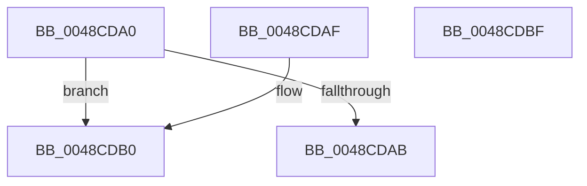

# BgpGetBitsPerPixel

- RVA: `0x0048CDA0`–`0x0048CDC0` (길이 `32` bytes)
- VA: `0x000000014048CDA0`
- 실행 섹션: `.text`
- PDB 이름 있음: `예`; PDB Function 태그: `아니요`
- unwind 정보 RVA: `0x000DB714`
- 디코드: `12`개 명령, `32/32` bytes 표시
- 미해석 바이트: `0` (있으면 어셈블리에 `.byte`로 보존)

> 이 문서는 커널 이미지의 기계어와 PDB 기호를 분석해 생성했습니다. 4번과 5번은 함수 원형과 자료형을 바이너리 사용 방식에서 추정한 C 해석이며 원본 소스 복구 결과는 아닙니다.

## 1. Dependencies

- 직접 호출 지점: **0**; 고유 호출 대상: **0**
- 직접 호출자로 확인된 함수: **12**
- RIP 상대 이미지 참조: **1**

### Outgoing calls
- 직접 디코드된 call 명령이 없습니다.

### Direct callers
- [BgpTxtDisplayCharacter](../47/BgpTxtDisplayCharacter_function_0047F120.md) at `0x0047F2B4`
- [BgpGxDrawRectangle](BgpGxDrawRectangle_function_0048C91C.md) at `0x0048C95A`
- [GxpWriteFrameBufferPixels](GxpWriteFrameBufferPixels_function_0048C9F4.md) at `0x0048CA5D`
- [BgpClearScreen](../69/BgpClearScreen_function_0069EAB0.md) at `0x0069EAF6`
- [BgpClearScreen](../69/BgpClearScreen_function_0069EAB0.md) at `0x0069EB47`
- [BgpGxProcessQrCodeBitmap](../69/BgpGxProcessQrCodeBitmap_function_0069F244.md) at `0x0069F273`
- [BgpFwDisplayBugCheckScreen](../6A/BgpFwDisplayBugCheckScreen_function_006A0FE8.md) at `0x006A11C7`
- [AnFwConfigureProgressResources](../../pagebgfx/BC/AnFwConfigureProgressResources_function_00BC1CFC.md) at `0x00BC1DD4`
- [AnFwpFadeAnimationTimer](../../pagebgfx/BC/AnFwpFadeAnimationTimer_function_00BC2F50.md) at `0x00BC302A`
- [AnFwDisplayFade](../../pagebgfx/BC/AnFwDisplayFade_function_00BC36EC.md) at `0x00BC3817`
- [BgpGxReadRectangle](../../pagebgfx/BC/BgpGxReadRectangle_function_00BC3D18.md) at `0x00BC3D3A`
- [GxpReadFrameBufferPixels](../../pagebgfx/BC/GxpReadFrameBufferPixels_function_00BC3F2C.md) at `0x00BC3F6B`
- [LogFwReport](../../pagebgfx/BC/LogFwReport_function_00BC43FC.md) at `0x00BC4445`

### Static image references
- `0x0048CDA0` → RVA `0x00EF03F0` (`.data`; read)

## 2. Other-region calls and transfers

- 다른 실행 섹션으로 향하는 call: **0**
- 별도 외부 분기/꼬리 이동을 확인하지 못했습니다.

## 3. Assembly (complete function range)

```asm
0048CDA0  8B 0D 4A 36 A6 00               mov ecx, dword ptr [rip + 0xa6364a]
0048CDA6  83 F9 04                        cmp ecx, 4
0048CDA9  75 05                           jne 0x14048cdb0
0048CDAB  8D 41 14                        lea eax, [rcx + 0x14]
0048CDAE  C3                              ret
0048CDAF  CC                              int3
0048CDB0  B8 01 00 00 00                  mov eax, 1
0048CDB5  83 F9 05                        cmp ecx, 5
0048CDB8  8D 50 1F                        lea edx, [rax + 0x1f]
0048CDBB  0F 44 C2                        cmove eax, edx
0048CDBE  C3                              ret
0048CDBF  CC                              int3
```

## 4. C-style interpretation (structured pseudocode)

```c
__int64 __fastcall BgpGetBitsPerPixel(void)
{
    __int64 result;

    if (((unsigned int)((unsigned int)(*(unsigned int *)(v_rip + 10892874)))) != 4) goto loc_0048CDB0;
    return (unsigned int)(*(unsigned int *)(v_rip + 10892874)) + 20;
loc_0048CDB0:
    result = 1;
    if (((unsigned int)((unsigned int)(*(unsigned int *)(v_rip + 10892874)))) == 5) { result = (unsigned int)(1 + 31); }
    return result;
}
```

## 5. (Beta) C Style

```c
void BgpGetBitsPerPixel(void)
{
    int64_t result;

    if (((uint32_t)((uint32_t)(*(uint32_t *)(v_rip + 0xA6364A)))) != 4) goto loc_0048CDB0;
    return (uint32_t)(*(uint32_t *)(v_rip + 0xA6364A)) + 20;
loc_0048CDB0:
    result = 1;
    if (((uint32_t)((uint32_t)(*(uint32_t *)(v_rip + 0xA6364A)))) == 5) { result = (uint32_t)(1 + 31); }
    return result;
}
```

## 6. Execution-region graph

[열기: 2D/3D 그래프와 함수 탐색 컨트롤 패널](../../../control-panel.html?section=text&rva=0x0048CDA0&view=graph)

- 2D 그래프는 위에서 아래로 흐르고, 3D 그래프는 빈 공간을 드래그해 회전합니다. Shift+드래그는 이동, 휠은 확대·축소, 함수 노드 선택은 대상 보고서 이동입니다.

### Static fallback


