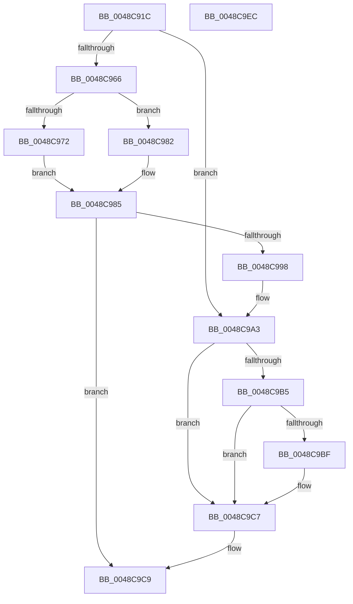

# BgpGxDrawRectangle

- RVA: `0x0048C91C`–`0x0048C9ED` (길이 `209` bytes)
- VA: `0x000000014048C91C`
- 실행 섹션: `.text`
- PDB 이름 있음: `예`; PDB Function 태그: `아니요`
- unwind 정보 RVA: `0x000B1330`
- 디코드: `58`개 명령, `209/209` bytes 표시
- 미해석 바이트: `0` (있으면 어셈블리에 `.byte`로 보존)

> 이 문서는 커널 이미지의 기계어와 PDB 기호를 분석해 생성했습니다. 4번과 5번은 함수 원형과 자료형을 바이너리 사용 방식에서 추정한 C 해석이며 원본 소스 복구 결과는 아닙니다.

## 1. Dependencies

- 직접 호출 지점: **6**; 고유 호출 대상: **6**
- 직접 호출자로 확인된 함수: **7**
- RIP 상대 이미지 참조: **2**

### Outgoing calls
- `0x0048C94E` → [memset](../6C/memset_function_006C6C40.md) (function, `0x006C6C40`)
- `0x0048C95A` → [BgpGetBitsPerPixel](BgpGetBitsPerPixel_function_0048CDA0.md) (function, `0x0048CDA0`)
- `0x0048C98F` → [BgpGxConvertRectangleEx](../46/BgpGxConvertRectangleEx_function_004696D4.md) (function, `0x004696D4`)
- `0x0048C9A9` → [GxpWriteFrameBufferPixels](GxpWriteFrameBufferPixels_function_0048C9F4.md) (function, `0x0048C9F4`)
- `0x0048C9C2` → [BgpGxRectangleDestroy](../../pagebgfx/BC/BgpGxRectangleDestroy_function_00BC3F04.md) (function, `0x00BC3F04`)
- `0x0048C9D4` → [_security_check_cookie](../6A/_security_check_cookie_function_006AC640.md) (function, `0x006AC640`)

### Direct callers
- [BgpTxtDisplayCharacter](../47/BgpTxtDisplayCharacter_function_0047F120.md) at `0x0047F31A`
- [BgpClearScreen](../69/BgpClearScreen_function_0069EAB0.md) at `0x0069EB94`
- [BgpFwDisplayBugCheckScreen](../6A/BgpFwDisplayBugCheckScreen_function_006A0FE8.md) at `0x006A1267`
- [BgpGxDrawBitmapImage](../../pagebgfx/BC/BgpGxDrawBitmapImage_function_00BC26EC.md) at `0x00BC2717`
- [BgpTxtClearRegion](../../pagebgfx/BC/BgpTxtClearRegion_function_00BC28D8.md) at `0x00BC28EF`
- [BgpTxtDisplayString](../../pagebgfx/BC/BgpTxtDisplayString_function_00BC2BB0.md) at `0x00BC2D88`
- [AnFwpFadeAnimationTimer](../../pagebgfx/BC/AnFwpFadeAnimationTimer_function_00BC2F50.md) at `0x00BC3116`
- [AnFwpFadeAnimationTimer](../../pagebgfx/BC/AnFwpFadeAnimationTimer_function_00BC2F50.md) at `0x00BC3144`
- [AnFwpFadeAnimationTimer](../../pagebgfx/BC/AnFwpFadeAnimationTimer_function_00BC2F50.md) at `0x00BC336C`

### Static image references
- `0x0048C92B` → RVA `0x00E0A740` (`.data`; read)
- `0x0048C966` → RVA `0x00EF0450` (`.data`; read)

## 2. Other-region calls and transfers

- 다른 실행 섹션으로 향하는 call: **1**
  - `0x0048C9C2` → [BgpGxRectangleDestroy](../../pagebgfx/BC/BgpGxRectangleDestroy_function_00BC3F04.md) (`.text` → `PAGEBGFX`)
- 별도 외부 분기/꼬리 이동을 확인하지 못했습니다.

## 3. Assembly (complete function range)

```asm
0048C91C  48 89 5C 24 18                  mov qword ptr [rsp + 0x18], rbx
0048C921  55                              push rbp
0048C922  56                              push rsi
0048C923  57                              push rdi
0048C924  48 81 EC 90 00 00 00            sub rsp, 0x90
0048C92B  48 8B 05 0E DE 97 00            mov rax, qword ptr [rip + 0x97de0e]
0048C932  48 33 C4                        xor rax, rsp
0048C935  48 89 84 24 80 00 00 00         mov qword ptr [rsp + 0x80], rax
0048C93D  48 8B EA                        mov rbp, rdx
0048C940  48 8B F9                        mov rdi, rcx
0048C943  33 D2                           xor edx, edx
0048C945  48 8D 4C 24 30                  lea rcx, [rsp + 0x30]
0048C94A  44 8D 42 48                     lea r8d, [rdx + 0x48]
0048C94E  E8 ED A2 23 00                  call 0x1406c6c40
0048C953  33 DB                           xor ebx, ebx
0048C955  48 89 5C 24 20                  mov qword ptr [rsp + 0x20], rbx
0048C95A  E8 41 04 00 00                  call 0x14048cda0
0048C95F  33 F6                           xor esi, esi
0048C961  39 47 08                        cmp dword ptr [rdi + 8], eax
0048C964  74 3D                           je 0x14048c9a3
0048C966  F7 05 E0 3A A6 00 00 0C 00 00   test dword ptr [rip + 0xa63ae0], 0xc00
0048C970  74 10                           je 0x14048c982
0048C972  48 8D 4C 24 30                  lea rcx, [rsp + 0x30]
0048C977  48 89 4C 24 20                  mov qword ptr [rsp + 0x20], rcx
0048C97C  44 8D 4B 01                     lea r9d, [rbx + 1]
0048C980  EB 03                           jmp 0x14048c985
0048C982  45 33 C9                        xor r9d, r9d
0048C985  4C 8D 44 24 20                  lea r8, [rsp + 0x20]
0048C98A  8B D0                           mov edx, eax
0048C98C  48 8B CF                        mov rcx, rdi
0048C98F  E8 40 CD FD FF                  call 0x1404696d4
0048C994  85 C0                           test eax, eax
0048C996  78 31                           js 0x14048c9c9
0048C998  48 8B 5C 24 20                  mov rbx, qword ptr [rsp + 0x20]
0048C99D  48 8B FB                        mov rdi, rbx
0048C9A0  48 8B F3                        mov rsi, rbx
0048C9A3  48 8B D5                        mov rdx, rbp
0048C9A6  48 8B CF                        mov rcx, rdi
0048C9A9  E8 46 00 00 00                  call 0x14048c9f4
0048C9AE  8B F8                           mov edi, eax
0048C9B0  48 85 F6                        test rsi, rsi
0048C9B3  74 12                           je 0x14048c9c7
0048C9B5  48 8D 44 24 30                  lea rax, [rsp + 0x30]
0048C9BA  48 3B F0                        cmp rsi, rax
0048C9BD  74 08                           je 0x14048c9c7
0048C9BF  48 8B CB                        mov rcx, rbx
0048C9C2  E8 3D 75 73 00                  call 0x140bc3f04
0048C9C7  8B C7                           mov eax, edi
0048C9C9  48 8B 8C 24 80 00 00 00         mov rcx, qword ptr [rsp + 0x80]
0048C9D1  48 33 CC                        xor rcx, rsp
0048C9D4  E8 67 FC 21 00                  call 0x1406ac640
0048C9D9  48 8B 9C 24 C0 00 00 00         mov rbx, qword ptr [rsp + 0xc0]
0048C9E1  48 81 C4 90 00 00 00            add rsp, 0x90
0048C9E8  5F                              pop rdi
0048C9E9  5E                              pop rsi
0048C9EA  5D                              pop rbp
0048C9EB  C3                              ret
0048C9EC  CC                              int3
```

## 4. C-style interpretation (structured pseudocode)

```c
__int64 __fastcall BgpGxDrawRectangle(__int64 a1, __int64 a2)
{
    __int64 result;
    __int64 v_rbx;
    __int64 v_rsi;
    __int64 v_rsp;
    unsigned __int64 v_stack_m28;
    unsigned __int64 v_stack_m78;
    unsigned __int64 v_stack_m88;
    unsigned __int64 v_stack_p18;

    v_stack_p18 = v_rbx;
    v_rsp = (v_rsp) - (144);
    result = (*(unsigned __int64 *)(v_rip + 9952782)) ^ (v_rsp);
    v_stack_m28 = result;
    a2 = 0;
    result = memset(v_stack_m78, a2, a2 + 72, a4);
    v_rbx = 0;
    v_stack_m88 = 0;
    result = BgpGetBitsPerPixel(v_stack_m78, a2, a2 + 72, a4);
    v_rsi = 0;
    if ((*(unsigned int *)(a1 + 8)) == ((unsigned int)(result))) goto loc_0048C9A3;
    if (((*(unsigned int *)(v_rip + 10894048)) & (0xC00ULL)) == 0) goto loc_0048C982;
    v_stack_m88 = v_stack_m78;
    goto loc_0048C985;
loc_0048C982:
    a4 = 0;
loc_0048C985:
    result = BgpGxConvertRectangleEx(a1, (unsigned int)((unsigned int)(result)), v_stack_m88, a4);
    if (sign_flag) goto loc_0048C9C9;
loc_0048C9A3:
    result = GxpWriteFrameBufferPixels(v_stack_m88, 0, v_stack_m88, a4);
    if (v_stack_m88 == 0) goto loc_0048C9C7;
    result = v_stack_m78;
    if (v_stack_m88 != v_stack_m78) {
        a1 = v_stack_m88;
        result = BgpGxRectangleDestroy(a1, 0, v_stack_m88, a4);
    }
loc_0048C9C9:
    a1 = (v_stack_m28) ^ (v_rsp);
    result = _security_check_cookie(a1, 0, v_stack_m88, a4);
    v_rsp = (v_rsp) + (144);
    return result;
}
```

## 5. (Beta) C Style

```c
int64_t BgpGxDrawRectangle(void *Arg1, int64_t Arg2)
{
    uint8_t *arg1 = (uint8_t *)Arg1;

    int64_t result;
    int64_t local_rbx;
    int64_t local_rsi;
    int64_t local_rsp;
    uint64_t v_stack_m28;
    uint64_t v_stack_m78;
    uint64_t v_stack_m88;
    uint64_t v_stack_p18;

    v_stack_p18 = local_rbx;
    local_rsp = (local_rsp) - (144);
    result = (*(uint64_t *)(v_rip + 0x97DE0E)) ^ (local_rsp);
    v_stack_m28 = result;
    Arg2 = 0;
    result = memset(v_stack_m78, Arg2, Arg2 + 72, a4);
    local_rbx = 0;
    v_stack_m88 = 0;
    result = BgpGetBitsPerPixel(v_stack_m78, Arg2, Arg2 + 72, a4);
    local_rsi = 0;
    if ((*(uint32_t *)(arg1 + 0x8)) == ((uint32_t)(result))) goto loc_0048C9A3;
    if (((*(uint32_t *)(v_rip + 0xA63AE0)) & (0xC00ULL)) == 0) goto loc_0048C982;
    v_stack_m88 = v_stack_m78;
    goto loc_0048C985;
loc_0048C982:
    a4 = 0;
loc_0048C985:
    result = BgpGxConvertRectangleEx(Arg1, (uint32_t)((uint32_t)(result)), v_stack_m88, a4);
    if (sign_flag) goto loc_0048C9C9;
loc_0048C9A3:
    result = GxpWriteFrameBufferPixels(v_stack_m88, 0, v_stack_m88, a4);
    if (v_stack_m88 == 0) goto loc_0048C9C7;
    result = v_stack_m78;
    if (v_stack_m88 != v_stack_m78) {
        Arg1 = v_stack_m88;
        result = BgpGxRectangleDestroy(Arg1, 0, v_stack_m88, a4);
    }
loc_0048C9C9:
    Arg1 = (v_stack_m28) ^ (local_rsp);
    result = _security_check_cookie(Arg1, 0, v_stack_m88, a4);
    local_rsp = (local_rsp) + (144);
    return result;
}
```

### 관측된 메모리 오프셋

구조체 형식이 확인되지 않은 접근은 인자 기준의 오프셋으로만 기록했습니다.

| 기준 인자 | 오프셋 표현 | 폭 (bit) | 접근 |
|---|---:|---:|---|
| `Arg1` | `+ 0x8` | `32` | `R` |

## 6. Execution-region graph

[열기: 2D/3D 그래프와 함수 탐색 컨트롤 패널](../../../control-panel.html?section=text&rva=0x0048C91C&view=graph)

- 2D 그래프는 위에서 아래로 흐르고, 3D 그래프는 빈 공간을 드래그해 회전합니다. Shift+드래그는 이동, 휠은 확대·축소, 함수 노드 선택은 대상 보고서 이동입니다.

### Static fallback


