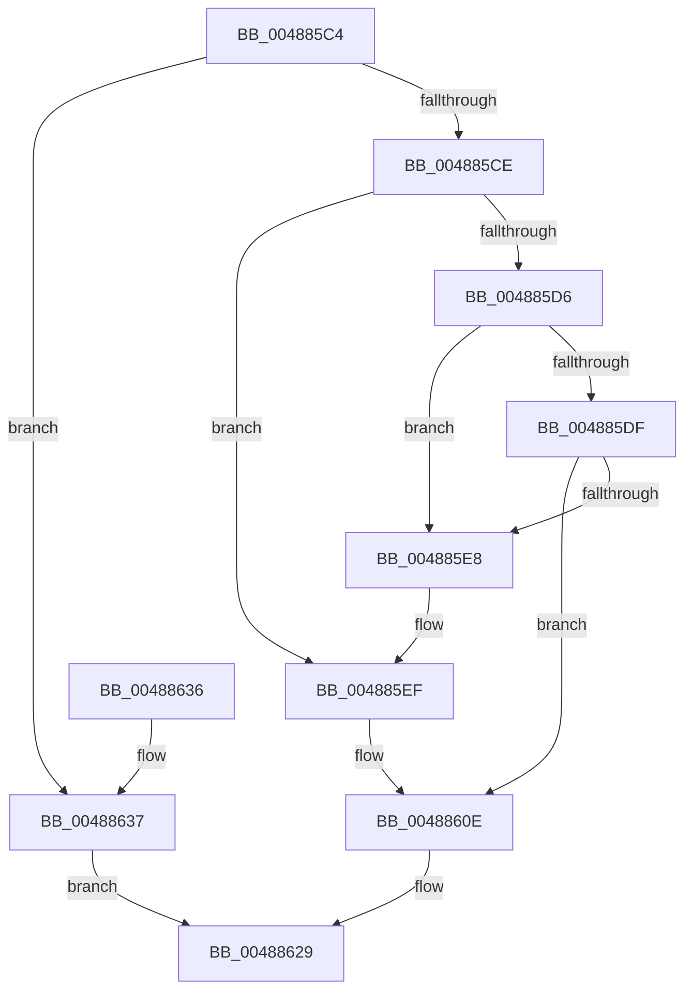

# CcAllocateVacbLevel

- RVA: `0x004885C4`–`0x0048865C` (길이 `152` bytes)
- VA: `0x00000001404885C4`
- 실행 섹션: `.text`
- PDB 이름 있음: `예`; PDB Function 태그: `아니요`
- unwind 정보 RVA: `0x000AFD98`
- 디코드: `44`개 명령, `152/152` bytes 표시
- 미해석 바이트: `0` (있으면 어셈블리에 `.byte`로 보존)

> 이 문서는 커널 이미지의 기계어와 PDB 기호를 분석해 생성했습니다. 4번과 5번은 함수 원형과 자료형을 바이너리 사용 방식에서 추정한 C 해석이며 원본 소스 복구 결과는 아닙니다.

## 1. Dependencies

- 직접 호출 지점: **3**; 고유 호출 대상: **2**
- 직접 호출자로 확인된 함수: **2**
- RIP 상대 이미지 참조: **0**

### Outgoing calls
- `0x00488608` → [KeBugCheckEx](../4F/KeBugCheckEx_function_004FD660.md) (function, `0x004FD660`)
- `0x00488624` → [memset](../6C/memset_function_006C6C40.md) (function, `0x006C6C40`)
- `0x0048864C` → [memset](../6C/memset_function_006C6C40.md) (function, `0x006C6C40`)

### Direct callers
- [CcExtendVacbArray](../26/CcExtendVacbArray_function_0026DCD0.md) at `0x0026E180`
- [CcSetVacbLargeOffset](../27/CcSetVacbLargeOffset_function_002733D0.md) at `0x0027365C`

### Static image references
- 디코드된 RIP-relative 메모리 참조가 없습니다.

## 2. Other-region calls and transfers

- 다른 실행 섹션으로 향하는 call: **0**
- 별도 외부 분기/꼬리 이동을 확인하지 못했습니다.

## 3. Assembly (complete function range)

```asm
004885C4  40 53                           push rbx
004885C6  48 83 EC 30                     sub rsp, 0x30
004885CA  85 D2                           test edx, edx
004885CC  75 69                           jne 0x140488637
004885CE  48 8B 19                        mov rbx, qword ptr [rcx]
004885D1  48 3B D9                        cmp rbx, rcx
004885D4  74 19                           je 0x1404885ef
004885D6  48 8B 13                        mov rdx, qword ptr [rbx]
004885D9  48 39 5A 08                     cmp qword ptr [rdx + 8], rbx
004885DD  75 09                           jne 0x1404885e8
004885DF  48 8B 43 08                     mov rax, qword ptr [rbx + 8]
004885E3  48 39 18                        cmp qword ptr [rax], rbx
004885E6  74 26                           je 0x14048860e
004885E8  B9 03 00 00 00                  mov ecx, 3
004885ED  CD 29                           int 0x29
004885EF  48 83 64 24 20 00               and qword ptr [rsp + 0x20], 0
004885F5  45 33 C9                        xor r9d, r9d
004885F8  BA 32 16 00 00                  mov edx, 0x1632
004885FD  49 C7 C0 20 04 00 C0            mov r8, 0xffffffffc0000420
00488604  41 8D 49 34                     lea ecx, [r9 + 0x34]
00488608  E8 53 50 07 00                  call 0x1404fd660
0048860D  CC                              int3
0048860E  48 89 10                        mov qword ptr [rax], rdx
00488611  41 B8 00 04 00 00               mov r8d, 0x400
00488617  48 89 42 08                     mov qword ptr [rdx + 8], rax
0048861B  33 D2                           xor edx, edx
0048861D  FF 49 18                        dec dword ptr [rcx + 0x18]
00488620  48 8D 4B 08                     lea rcx, [rbx + 8]
00488624  E8 17 E6 23 00                  call 0x1406c6c40
00488629  48 83 23 00                     and qword ptr [rbx], 0
0048862D  48 8B C3                        mov rax, rbx
00488630  48 83 C4 30                     add rsp, 0x30
00488634  5B                              pop rbx
00488635  C3                              ret
00488636  CC                              int3
00488637  48 8B 59 10                     mov rbx, qword ptr [rcx + 0x10]
0048863B  33 D2                           xor edx, edx
0048863D  48 83 61 10 00                  and qword ptr [rcx + 0x10], 0
00488642  41 B8 F8 03 00 00               mov r8d, 0x3f8
00488648  48 8D 4B 08                     lea rcx, [rbx + 8]
0048864C  E8 EF E5 23 00                  call 0x1406c6c40
00488651  33 C0                           xor eax, eax
00488653  48 89 83 00 08 00 00            mov qword ptr [rbx + 0x800], rax
0048865A  EB CD                           jmp 0x140488629
```

## 4. C-style interpretation (structured pseudocode)

```c
__int64 __fastcall CcAllocateVacbLevel(__int64 a1, int a2, __int64 a3, int a4)
{
    __int64 result;
    __int64 v_rsp;
    unsigned __int64 v_stack_m18;

    v_rsp = (v_rsp) - (48);
    if (a2 != 0) goto loc_00488637;
    if ((*(unsigned __int64 *)(a1)) == a1) goto loc_004885EF;
    if ((*(unsigned __int64 *)(*(unsigned __int64 *)(*(unsigned __int64 *)(a1)) + 8)) != (*(unsigned __int64 *)(a1))) goto loc_004885E8;
    if ((*(unsigned __int64 *)(*(unsigned __int64 *)(*(unsigned __int64 *)(a1) + 8))) == (*(unsigned __int64 *)(a1))) goto loc_0048860E;
loc_004885E8:
loc_004885EF:
    a4 = 0;
    result = KeBugCheckEx(a4 + 52, (unsigned int)(0x1632ULL), 0xFFFFFFFFC0000420ULL, a4);
loc_0048860E:
    *(unsigned __int64 *)(result) = (unsigned int)(0x1632ULL);
    *(unsigned __int64 *)((unsigned int)(0x1632ULL) + 8) = result;
    a2 = 0;
    result = memset(*(unsigned __int64 *)(a1) + 8, a2, (unsigned int)(0x400ULL), a4);
loc_00488629:
    v_rsp = (v_rsp) + (48);
    return *(unsigned __int64 *)(a1);
loc_00488637:
    a2 = 0;
    result = memset(*(unsigned __int64 *)(*(unsigned __int64 *)(a1) + 8 + 16) + 8, a2, (unsigned int)(0x3F8ULL), a4);
    result = 0;
    *(unsigned __int64 *)(*(unsigned __int64 *)(*(unsigned __int64 *)(a1) + 8 + 16) + 2048) = 0;
    goto loc_00488629;
}
```

## 5. (Beta) C Style

```c
int64_t CcAllocateVacbLevel(void *Arg1, int32_t Arg2, int64_t Arg3, int32_t Arg4)
{
    uint8_t *arg1 = (uint8_t *)Arg1;

    int64_t result;
    int64_t local_rsp;
    uint64_t v_stack_m18;

    local_rsp = (local_rsp) - (48);
    if (Arg2 != 0) goto loc_00488637;
    if ((*(uint64_t *)(arg1)) == Arg1) goto loc_004885EF;
    if ((*(uint64_t *)(*(uint64_t *)(*(uint64_t *)(arg1)) + 0x8)) != (*(uint64_t *)(arg1))) goto loc_004885E8;
    if ((*(uint64_t *)(*(uint64_t *)(*(uint64_t *)(arg1) + 0x8))) == (*(uint64_t *)(arg1))) goto loc_0048860E;
loc_004885E8:
loc_004885EF:
    Arg4 = 0;
    result = KeBugCheckEx(Arg4 + 52, (uint32_t)(0x1632ULL), 0xFFFFFFFFC0000420ULL, Arg4);
loc_0048860E:
    *(uint64_t *)(result) = (uint32_t)(0x1632ULL);
    *(uint64_t *)((uint32_t)(0x1632ULL) + 0x8) = result;
    Arg2 = 0;
    result = memset(*(uint64_t *)(arg1) + 8, Arg2, (uint32_t)(0x400ULL), Arg4);
loc_00488629:
    local_rsp = (local_rsp) + (48);
    return *(uint64_t *)(arg1);
loc_00488637:
    Arg2 = 0;
    result = memset(*(uint64_t *)(*(uint64_t *)(arg1) + 0x8 + 0x10) + 8, Arg2, (uint32_t)(0x3F8ULL), Arg4);
    result = 0;
    *(uint64_t *)(*(uint64_t *)(*(uint64_t *)(arg1) + 0x8 + 0x10) + 0x800) = 0;
    goto loc_00488629;
}
```

### 관측된 메모리 오프셋

구조체 형식이 확인되지 않은 접근은 인자 기준의 오프셋으로만 기록했습니다.

| 기준 인자 | 오프셋 표현 | 폭 (bit) | 접근 |
|---|---:|---:|---|
| `Arg1` | `+ 0x0` | `64` | `R` |
| `Arg1` | `+ 0x10` | `64` | `R` |
| `Arg1` | `+ 0x10` | `64` | `R/W` |

## 6. Execution-region graph

[열기: 2D/3D 그래프와 함수 탐색 컨트롤 패널](../../../control-panel.html?section=text&rva=0x004885C4&view=graph)

- 2D 그래프는 위에서 아래로 흐르고, 3D 그래프는 빈 공간을 드래그해 회전합니다. Shift+드래그는 이동, 휠은 확대·축소, 함수 노드 선택은 대상 보고서 이동입니다.

### Static fallback


