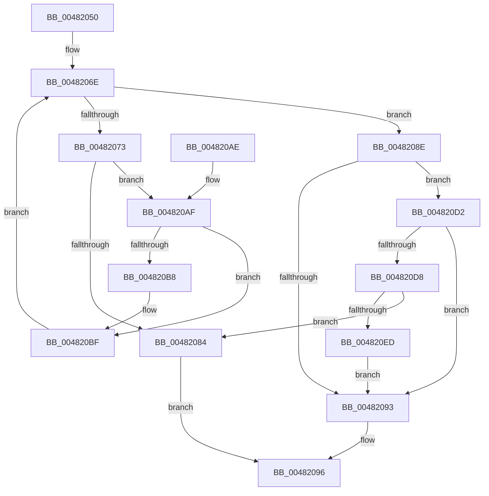

# CcAllocateVacbLevels

- RVA: `0x00482050`–`0x004820EF` (길이 `159` bytes)
- VA: `0x0000000140482050`
- 실행 섹션: `.text`
- PDB 이름 있음: `예`; PDB Function 태그: `아니요`
- unwind 정보 RVA: `0x000676D8`
- 디코드: `48`개 명령, `159/159` bytes 표시
- 미해석 바이트: `0` (있으면 어셈블리에 `.byte`로 보존)

> 이 문서는 커널 이미지의 기계어와 PDB 기호를 분석해 생성했습니다. 4번과 5번은 함수 원형과 자료형을 바이너리 사용 방식에서 추정한 C 해석이며 원본 소스 복구 결과는 아닙니다.

## 1. Dependencies

- 직접 호출 지점: **3**; 고유 호출 대상: **2**
- 직접 호출자로 확인된 함수: **2**
- RIP 상대 이미지 참조: **2**

### Outgoing calls
- `0x0048207A` → [ExAllocateFromNPagedLookasideList](../38/ExAllocateFromNPagedLookasideList_function_0038E6C0.md) (function, `0x0038E6C0`)
- `0x00482087` → [CcFreeUnusedVacbLevels](../27/CcFreeUnusedVacbLevels_function_00273B1C.md) (function, `0x00273B1C`)
- `0x004820DF` → [ExAllocateFromNPagedLookasideList](../38/ExAllocateFromNPagedLookasideList_function_0038E6C0.md) (function, `0x0038E6C0`)

### Direct callers
- [CcSetVacbLargeOffset](../27/CcSetVacbLargeOffset_function_002733D0.md) at `0x0027363F`
- [CcPinFileData](../33/CcPinFileData_function_0033FB40.md) at `0x00340C2D`

### Static image references
- `0x00482073` → RVA `0x00E11A80` (`.data`; read)
- `0x004820D8` → RVA `0x00E11B80` (`.data`; read)

## 2. Other-region calls and transfers

- 다른 실행 섹션으로 향하는 call: **0**
- 별도 외부 분기/꼬리 이동을 확인하지 못했습니다.

## 3. Assembly (complete function range)

```asm
00482050  48 89 5C 24 08                  mov qword ptr [rsp + 8], rbx
00482055  48 89 6C 24 10                  mov qword ptr [rsp + 0x10], rbp
0048205A  48 89 74 24 18                  mov qword ptr [rsp + 0x18], rsi
0048205F  57                              push rdi
00482060  48 83 EC 20                     sub rsp, 0x20
00482064  49 8B D8                        mov rbx, r8
00482067  40 8A F2                        mov sil, dl
0048206A  8B E9                           mov ebp, ecx
0048206C  33 FF                           xor edi, edi
0048206E  3B 6B 18                        cmp ebp, dword ptr [rbx + 0x18]
00482071  76 1B                           jbe 0x14048208e
00482073  48 8D 0D 06 FA 98 00            lea rcx, [rip + 0x98fa06]
0048207A  E8 41 C6 F0 FF                  call 0x14038e6c0
0048207F  48 85 C0                        test rax, rax
00482082  75 2B                           jne 0x1404820af
00482084  48 8B CB                        mov rcx, rbx
00482087  E8 90 1A DF FF                  call 0x140273b1c
0048208C  EB 08                           jmp 0x140482096
0048208E  40 84 F6                        test sil, sil
00482091  75 3F                           jne 0x1404820d2
00482093  40 B7 01                        mov dil, 1
00482096  48 8B 5C 24 30                  mov rbx, qword ptr [rsp + 0x30]
0048209B  40 8A C7                        mov al, dil
0048209E  48 8B 6C 24 38                  mov rbp, qword ptr [rsp + 0x38]
004820A3  48 8B 74 24 40                  mov rsi, qword ptr [rsp + 0x40]
004820A8  48 83 C4 20                     add rsp, 0x20
004820AC  5F                              pop rdi
004820AD  C3                              ret
004820AE  CC                              int3
004820AF  48 8B 4B 08                     mov rcx, qword ptr [rbx + 8]
004820B3  48 39 19                        cmp qword ptr [rcx], rbx
004820B6  74 07                           je 0x1404820bf
004820B8  B9 03 00 00 00                  mov ecx, 3
004820BD  CD 29                           int 0x29
004820BF  48 89 18                        mov qword ptr [rax], rbx
004820C2  48 89 48 08                     mov qword ptr [rax + 8], rcx
004820C6  48 89 01                        mov qword ptr [rcx], rax
004820C9  48 89 43 08                     mov qword ptr [rbx + 8], rax
004820CD  FF 43 18                        inc dword ptr [rbx + 0x18]
004820D0  EB 9C                           jmp 0x14048206e
004820D2  48 39 7B 10                     cmp qword ptr [rbx + 0x10], rdi
004820D6  75 BB                           jne 0x140482093
004820D8  48 8D 0D A1 FA 98 00            lea rcx, [rip + 0x98faa1]
004820DF  E8 DC C5 F0 FF                  call 0x14038e6c0
004820E4  48 89 43 10                     mov qword ptr [rbx + 0x10], rax
004820E8  48 85 C0                        test rax, rax
004820EB  74 97                           je 0x140482084
004820ED  EB A4                           jmp 0x140482093
```

## 4. C-style interpretation (structured pseudocode)

```c
__int64 __fastcall CcAllocateVacbLevels(int a1, unsigned __int8 a2, __int64 a3)
{
    __int64 result;
    __int64 v_rdi;
    __int64 v_rsp;
    unsigned __int64 v_stack_p10;
    unsigned __int64 v_stack_p18;
    unsigned __int64 v_stack_p8;

    v_stack_p8 = v_rbx;
    v_stack_p10 = v_rbp;
    v_stack_p18 = v_rsi;
    v_rsp = (v_rsp) - (32);
    v_rdi = 0;
loc_0048206E:
    if (((unsigned int)((unsigned int)(a1))) <= (*(unsigned int *)(a3 + 24))) goto loc_0048208E;
    result = ExAllocateFromNPagedLookasideList(v_rip + 10025478, a2, a3, a4);
    if (result != 0) goto loc_004820AF;
loc_00482084:
    result = CcFreeUnusedVacbLevels(a3, a2, a3, a4);
    goto loc_00482096;
loc_0048208E:
    if (a2 != 0) goto loc_004820D2;
loc_00482093:
loc_00482096:
    v_rsp = (v_rsp) + (32);
    return 1;
loc_004820AF:
    if ((*(unsigned __int64 *)(*(unsigned __int64 *)(v_stack_p8 + 8))) != v_stack_p8) {
        a1 = 3;
    }
    *(unsigned __int64 *)(1) = v_stack_p8;
    *(unsigned __int64 *)(1 + 8) = a1;
    *(unsigned __int64 *)(a1) = 1;
    *(unsigned __int64 *)(v_stack_p8 + 8) = 1;
    goto loc_0048206E;
loc_004820D2:
    if ((*(unsigned __int64 *)(v_stack_p8 + 16)) != 1) goto loc_00482093;
    result = ExAllocateFromNPagedLookasideList(v_rip + 10025633, a2, a3, a4);
    *(unsigned __int64 *)(v_stack_p8 + 16) = result;
    if (result == 0) goto loc_00482084;
    goto loc_00482093;
}
```

## 5. (Beta) C Style

```c
int64_t CcAllocateVacbLevels(int32_t Arg1, uint8_t Arg2, void *Arg3)
{
    uint8_t *arg3 = (uint8_t *)Arg3;

    int64_t result;
    int64_t local_rdi;
    int64_t local_rsp;
    uint64_t v_stack_p10;
    uint64_t v_stack_p18;
    uint64_t v_stack_p8;

    v_stack_p8 = local_rbx;
    v_stack_p10 = local_rbp;
    v_stack_p18 = local_rsi;
    local_rsp = (local_rsp) - (32);
    local_rdi = 0;
loc_0048206E:
    if (((uint32_t)((uint32_t)(Arg1))) <= (*(uint32_t *)(arg3 + 0x18))) goto loc_0048208E;
    result = ExAllocateFromNPagedLookasideList(v_rip + 10025478, Arg2, Arg3, a4);
    if (result != 0) goto loc_004820AF;
loc_00482084:
    result = CcFreeUnusedVacbLevels(Arg3, Arg2, Arg3, a4);
    goto loc_00482096;
loc_0048208E:
    if (Arg2 != 0) goto loc_004820D2;
loc_00482093:
loc_00482096:
    local_rsp = (local_rsp) + (32);
    return 1;
loc_004820AF:
    if ((*(uint64_t *)(*(uint64_t *)(v_stack_p8 + 0x8))) != v_stack_p8) {
        Arg1 = 3;
    }
    *(uint64_t *)(1) = v_stack_p8;
    *(uint64_t *)(1 + 0x8) = Arg1;
    *(uint64_t *)(Arg1) = 1;
    *(uint64_t *)(v_stack_p8 + 0x8) = 1;
    goto loc_0048206E;
loc_004820D2:
    if ((*(uint64_t *)(v_stack_p8 + 0x10)) != 1) goto loc_00482093;
    result = ExAllocateFromNPagedLookasideList(v_rip + 10025633, Arg2, Arg3, a4);
    *(uint64_t *)(v_stack_p8 + 0x10) = result;
    if (result == 0) goto loc_00482084;
    goto loc_00482093;
}
```

### 관측된 메모리 오프셋

구조체 형식이 확인되지 않은 접근은 인자 기준의 오프셋으로만 기록했습니다.

| 기준 인자 | 오프셋 표현 | 폭 (bit) | 접근 |
|---|---:|---:|---|
| `Arg3` | `+ 0x8` | `64` | `R` |
| `Arg3` | `+ 0x8` | `64` | `W` |
| `Arg3` | `+ 0x10` | `64` | `R` |
| `Arg3` | `+ 0x10` | `64` | `W` |
| `Arg3` | `+ 0x18` | `32` | `R` |
| `Arg3` | `+ 0x18` | `32` | `R/W` |

## 6. Execution-region graph

[열기: 2D/3D 그래프와 함수 탐색 컨트롤 패널](../../../control-panel.html?section=text&rva=0x00482050&view=graph)

- 2D 그래프는 위에서 아래로 흐르고, 3D 그래프는 빈 공간을 드래그해 회전합니다. Shift+드래그는 이동, 휠은 확대·축소, 함수 노드 선택은 대상 보고서 이동입니다.

### Static fallback


