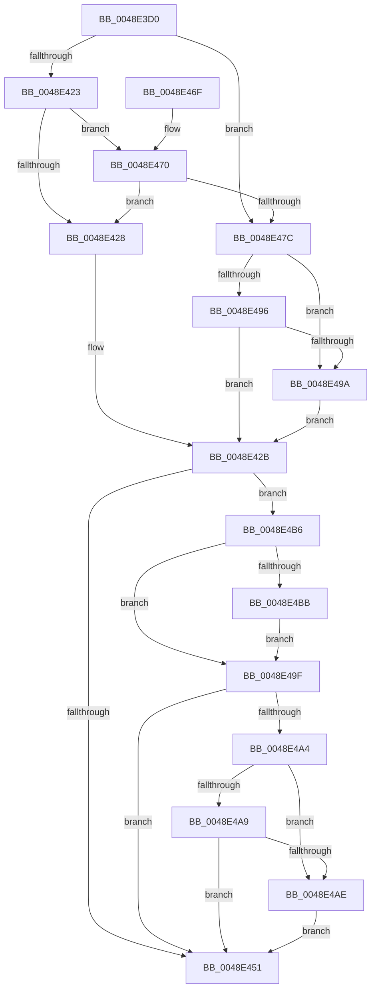

# CcCoherencyFlushAndPurgeCache

- RVA: `0x0048E3D0`–`0x0048E4D6` (길이 `262` bytes)
- VA: `0x000000014048E3D0`
- 실행 섹션: `.text`
- PDB 이름 있음: `예`; PDB Function 태그: `아니요`
- unwind 정보 RVA: `0x000B1624`
- 디코드: `85`개 명령, `262/262` bytes 표시
- 미해석 바이트: `0` (있으면 어셈블리에 `.byte`로 보존)

> 이 문서는 커널 이미지의 기계어와 PDB 기호를 분석해 생성했습니다. 4번과 5번은 함수 원형과 자료형을 바이너리 사용 방식에서 추정한 C 해석이며 원본 소스 복구 결과는 아닙니다.

## 1. Dependencies

- 직접 호출 지점: **4**; 고유 호출 대상: **4**
- 직접 호출자로 확인된 함수: **0**
- RIP 상대 이미지 참조: **0**

### Outgoing calls
- `0x0048E447` → [CcFlushCachePriv](../35/CcFlushCachePriv_function_0035B040.md) (function, `0x0035B040`)
- `0x0048E473` → [MmOnlySystemCacheViewsPresent](MmOnlySystemCacheViewsPresent_function_0048E4DC.md) (function, `0x0048E4DC`)
- `0x0048E488` → [MmTrimSection](../38/MmTrimSection_function_0038A4EC.md) (function, `0x0038A4EC`)
- `0x0048E4C9` → [CcPurgeCacheSection](../38/CcPurgeCacheSection_function_0038B130.md) (function, `0x0038B130`)

### Direct callers
- 이 함수 시작 RVA로 연결되는 직접 call은 확인되지 않았습니다. 간접 호출은 완전히 역산할 수 없습니다.

### Static image references
- 디코드된 RIP-relative 메모리 참조가 없습니다.

## 2. Other-region calls and transfers

- 다른 실행 섹션으로 향하는 call: **0**
- 별도 외부 분기/꼬리 이동을 확인하지 못했습니다.

## 3. Assembly (complete function range)

```asm
0048E3D0  48 89 5C 24 08                  mov qword ptr [rsp + 8], rbx
0048E3D5  48 89 6C 24 10                  mov qword ptr [rsp + 0x10], rbp
0048E3DA  48 89 74 24 18                  mov qword ptr [rsp + 0x18], rsi
0048E3DF  57                              push rdi
0048E3E0  41 54                           push r12
0048E3E2  41 55                           push r13
0048E3E4  41 56                           push r14
0048E3E6  41 57                           push r15
0048E3E8  48 83 EC 40                     sub rsp, 0x40
0048E3EC  45 32 F6                        xor r14b, r14b
0048E3EF  41 8B F0                        mov esi, r8d
0048E3F2  45 32 FF                        xor r15b, r15b
0048E3F5  48 8B F9                        mov rdi, rcx
0048E3F8  8B 8C 24 90 00 00 00            mov ecx, dword ptr [rsp + 0x90]
0048E3FF  49 8B D9                        mov rbx, r9
0048E402  8B C1                           mov eax, ecx
0048E404  44 8B E1                        mov r12d, ecx
0048E407  D1 E8                           shr eax, 1
0048E409  48 8B EA                        mov rbp, rdx
0048E40C  83 E0 01                        and eax, 1
0048E40F  44 8B E8                        mov r13d, eax
0048E412  41 83 CD 02                     or r13d, 2
0048E416  41 83 E4 01                     and r12d, 1
0048E41A  44 0F 44 E8                     cmove r13d, eax
0048E41E  45 85 E4                        test r12d, r12d
0048E421  74 59                           je 0x14048e47c
0048E423  F6 C1 04                        test cl, 4
0048E426  74 48                           je 0x14048e470
0048E428  83 23 00                        and dword ptr [rbx], 0
0048E42B  48 83 64 24 30 00               and qword ptr [rsp + 0x30], 0
0048E431  45 33 C9                        xor r9d, r9d
0048E434  48 89 5C 24 28                  mov qword ptr [rsp + 0x28], rbx
0048E439  44 8B C6                        mov r8d, esi
0048E43C  48 8B D5                        mov rdx, rbp
0048E43F  44 88 7C 24 20                  mov byte ptr [rsp + 0x20], r15b
0048E444  48 8B CF                        mov rcx, rdi
0048E447  E8 F4 CB EC FF                  call 0x14035b040
0048E44C  83 3B 00                        cmp dword ptr [rbx], 0
0048E44F  7D 65                           jge 0x14048e4b6
0048E451  4C 8D 5C 24 40                  lea r11, [rsp + 0x40]
0048E456  49 8B 5B 30                     mov rbx, qword ptr [r11 + 0x30]
0048E45A  49 8B 6B 38                     mov rbp, qword ptr [r11 + 0x38]
0048E45E  49 8B 73 40                     mov rsi, qword ptr [r11 + 0x40]
0048E462  49 8B E3                        mov rsp, r11
0048E465  41 5F                           pop r15
0048E467  41 5E                           pop r14
0048E469  41 5D                           pop r13
0048E46B  41 5C                           pop r12
0048E46D  5F                              pop rdi
0048E46E  C3                              ret
0048E46F  CC                              int3
0048E470  48 8B CF                        mov rcx, rdi
0048E473  E8 64 00 00 00                  call 0x14048e4dc
0048E478  84 C0                           test al, al
0048E47A  75 AC                           jne 0x14048e428
0048E47C  4C 8B C6                        mov r8, rsi
0048E47F  45 8B CD                        mov r9d, r13d
0048E482  48 8B D5                        mov rdx, rbp
0048E485  48 8B CF                        mov rcx, rdi
0048E488  E8 5F C0 EF FF                  call 0x14038a4ec
0048E48D  89 03                           mov dword ptr [rbx], eax
0048E48F  3D 15 01 00 00                  cmp eax, 0x115
0048E494  74 04                           je 0x14048e49a
0048E496  85 C0                           test eax, eax
0048E498  79 91                           jns 0x14048e42b
0048E49A  41 B6 01                        mov r14b, 1
0048E49D  EB 8C                           jmp 0x14048e42b
0048E49F  83 3B 00                        cmp dword ptr [rbx], 0
0048E4A2  7C AD                           jl 0x14048e451
0048E4A4  45 84 F6                        test r14b, r14b
0048E4A7  75 05                           jne 0x14048e4ae
0048E4A9  45 84 FF                        test r15b, r15b
0048E4AC  74 A3                           je 0x14048e451
0048E4AE  C7 03 15 01 00 00               mov dword ptr [rbx], 0x115
0048E4B4  EB 9B                           jmp 0x14048e451
0048E4B6  45 85 E4                        test r12d, r12d
0048E4B9  75 E4                           jne 0x14048e49f
0048E4BB  45 8D 4C 24 04                  lea r9d, [r12 + 4]
0048E4C0  44 8B C6                        mov r8d, esi
0048E4C3  48 8B D5                        mov rdx, rbp
0048E4C6  48 8B CF                        mov rcx, rdi
0048E4C9  E8 62 CC EF FF                  call 0x14038b130
0048E4CE  84 C0                           test al, al
0048E4D0  41 0F 94 C7                     sete r15b
0048E4D4  EB C9                           jmp 0x14048e49f
```

## 4. C-style interpretation (structured pseudocode)

```c
__int64 __fastcall CcCoherencyFlushAndPurgeCache(__int64 a1, __int64 a2, int a3, __int64 a4, unsigned int a5)
{
    __int64 result;
    __int64 v_r12;
    __int64 v_r13;
    __int64 v_r14;
    __int64 v_r15;
    __int64 v_rsp;
    unsigned __int64 v_stack_m28;
    unsigned __int64 v_stack_m38;
    unsigned __int64 v_stack_m40;
    unsigned __int8 v_stack_m48;
    unsigned __int64 v_stack_p10;
    unsigned __int64 v_stack_p18;
    unsigned __int64 v_stack_p8;

    v_stack_p8 = v_rbx;
    v_stack_p10 = v_rbp;
    v_stack_p18 = v_rsi;
    v_rsp = (v_rsp) - (64);
    v_r14 = 0;
    v_r15 = 0;
    result = (unsigned int)(((unsigned int)((unsigned int)((unsigned int)(a5)))) >> (1));
    result = (unsigned int)((result) & (1));
    v_r13 = (unsigned int)(((unsigned int)((unsigned int)(result))) | (2));
    v_r12 = (unsigned int)(((unsigned int)((unsigned int)((unsigned int)(a5)))) & (1));
    if (condition_is_equal) { v_r13 = (unsigned int)(result); }
    if ((unsigned int)(v_r12) == 0) goto loc_0048E47C;
    if ((((unsigned __int8)((unsigned int)(a5))) & (4)) == 0) goto loc_0048E470;
loc_0048E428:
loc_0048E42B:
    a4 = 0;
    v_stack_m40 = 0;
    v_stack_m48 = 0;
    result = CcFlushCachePriv(a1, a2, (unsigned int)((unsigned int)((unsigned int)(a3))), a4);
    if ((*(unsigned int *)(a4)) >= 0) goto loc_0048E4B6;
loc_0048E451:
    return result;
loc_0048E470:
    result = MmOnlySystemCacheViewsPresent(a1, a2, (unsigned int)((unsigned int)((unsigned int)(a3))), a4);
    if ((unsigned __int8)(result) != 0) goto loc_0048E428;
loc_0048E47C:
    result = MmTrimSection(a1, *(unsigned __int64 *)(v_stack_m28 + 56), *(unsigned __int64 *)(v_stack_m28 + 64), (unsigned int)((unsigned int)(v_r13)));
    *(unsigned int *)(*(unsigned __int64 *)(v_stack_m28 + 48)) = (unsigned int)(result);
    if (((unsigned int)(result)) == 277) goto loc_0048E49A;
    if (!sign_flag) goto loc_0048E42B;
loc_0048E49A:
    goto loc_0048E42B;
loc_0048E49F:
    if ((*(unsigned int *)(*(unsigned __int64 *)(v_stack_m28 + 48))) < 0) goto loc_0048E451;
    if (1 != 0) goto loc_0048E4AE;
    if (0 == 0) goto loc_0048E451;
loc_0048E4AE:
    *(unsigned int *)(*(unsigned __int64 *)(v_stack_m28 + 48)) = 277;
    goto loc_0048E451;
loc_0048E4B6:
    if ((unsigned int)(v_r12) != 0) goto loc_0048E49F;
    result = CcPurgeCacheSection(a1, *(unsigned __int64 *)(v_stack_m28 + 56), (unsigned int)((unsigned int)(*(unsigned __int64 *)(v_stack_m28 + 64))), v_r12 + 4);
    v_r15 = ((unsigned __int8)(result) == 0) ? 1 : 0;
    goto loc_0048E49F;
}
```

## 5. (Beta) C Style

```c
int64_t CcCoherencyFlushAndPurgeCache(int64_t Arg1, int64_t Arg2, int32_t Arg3, void *Arg4, uint32_t Arg5)
{
    uint8_t *arg4 = (uint8_t *)Arg4;

    int64_t result;
    int64_t local_r12;
    int64_t local_r13;
    int64_t local_r14;
    int64_t local_r15;
    int64_t local_rsp;
    uint64_t v_stack_m28;
    uint64_t v_stack_m38;
    uint64_t v_stack_m40;
    uint8_t v_stack_m48;
    uint64_t v_stack_p10;
    uint64_t v_stack_p18;
    uint64_t v_stack_p8;

    v_stack_p8 = local_rbx;
    v_stack_p10 = local_rbp;
    v_stack_p18 = local_rsi;
    local_rsp = (local_rsp) - (64);
    local_r14 = 0;
    local_r15 = 0;
    result = (uint32_t)(((uint32_t)((uint32_t)((uint32_t)(Arg5)))) >> (1));
    result = (uint32_t)((result) & (1));
    local_r13 = (uint32_t)(((uint32_t)((uint32_t)(result))) | (2));
    local_r12 = (uint32_t)(((uint32_t)((uint32_t)((uint32_t)(Arg5)))) & (1));
    if (condition_is_equal) { local_r13 = (uint32_t)(result); }
    if ((uint32_t)(local_r12) == 0) goto loc_0048E47C;
    if ((((uint8_t)((uint32_t)(Arg5))) & (4)) == 0) goto loc_0048E470;
loc_0048E428:
loc_0048E42B:
    Arg4 = 0;
    v_stack_m40 = 0;
    v_stack_m48 = 0;
    result = CcFlushCachePriv(Arg1, Arg2, (uint32_t)((uint32_t)((uint32_t)(Arg3))), Arg4);
    if ((*(uint32_t *)(arg4)) >= 0) goto loc_0048E4B6;
loc_0048E451:
    return result;
loc_0048E470:
    result = MmOnlySystemCacheViewsPresent(Arg1, Arg2, (uint32_t)((uint32_t)((uint32_t)(Arg3))), Arg4);
    if ((uint8_t)(result) != 0) goto loc_0048E428;
loc_0048E47C:
    result = MmTrimSection(Arg1, *(uint64_t *)(v_stack_m28 + 0x38), *(uint64_t *)(v_stack_m28 + 0x40), (uint32_t)((uint32_t)(local_r13)));
    *(uint32_t *)(*(uint64_t *)(v_stack_m28 + 0x30)) = (uint32_t)(result);
    if (((uint32_t)(result)) == 277) goto loc_0048E49A;
    if (!sign_flag) goto loc_0048E42B;
loc_0048E49A:
    goto loc_0048E42B;
loc_0048E49F:
    if ((*(uint32_t *)(*(uint64_t *)(v_stack_m28 + 0x30))) < 0) goto loc_0048E451;
    if (1 != 0) goto loc_0048E4AE;
    if (0 == 0) goto loc_0048E451;
loc_0048E4AE:
    *(uint32_t *)(*(uint64_t *)(v_stack_m28 + 0x30)) = 277;
    goto loc_0048E451;
loc_0048E4B6:
    if ((uint32_t)(local_r12) != 0) goto loc_0048E49F;
    result = CcPurgeCacheSection(Arg1, *(uint64_t *)(v_stack_m28 + 0x38), (uint32_t)((uint32_t)(*(uint64_t *)(v_stack_m28 + 0x40))), local_r12 + 4);
    local_r15 = ((uint8_t)(result) == 0) ? 1 : 0;
    goto loc_0048E49F;
}
```

### 관측된 메모리 오프셋

구조체 형식이 확인되지 않은 접근은 인자 기준의 오프셋으로만 기록했습니다.

| 기준 인자 | 오프셋 표현 | 폭 (bit) | 접근 |
|---|---:|---:|---|
| `Arg4` | `+ 0x0` | `32` | `R` |
| `Arg4` | `+ 0x0` | `32` | `R/W` |
| `Arg4` | `+ 0x0` | `32` | `W` |

## 6. Execution-region graph

[열기: 2D/3D 그래프와 함수 탐색 컨트롤 패널](../../../control-panel.html?section=text&rva=0x0048E3D0&view=graph)

- 2D 그래프는 위에서 아래로 흐르고, 3D 그래프는 빈 공간을 드래그해 회전합니다. Shift+드래그는 이동, 휠은 확대·축소, 함수 노드 선택은 대상 보고서 이동입니다.

### Static fallback


