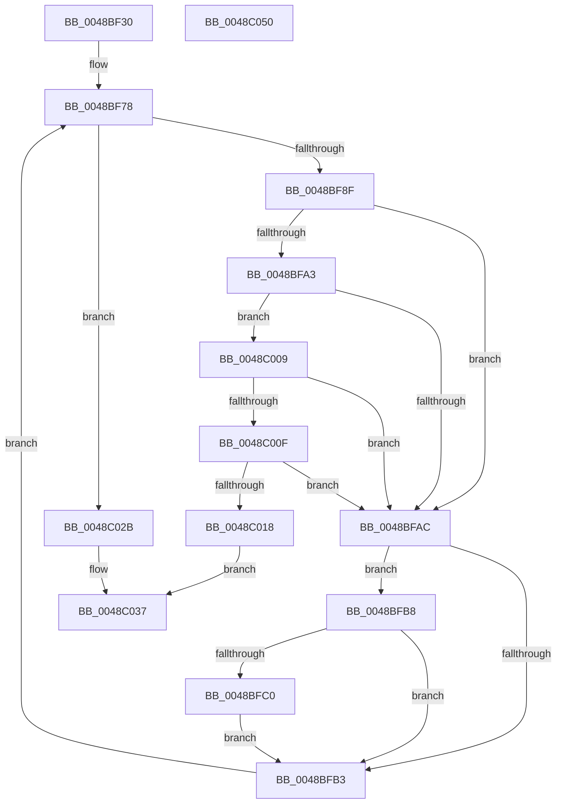

# CcIsThereDirtyDataHelper

- RVA: `0x0048BF30`–`0x0048C051` (길이 `289` bytes)
- VA: `0x000000014048BF30`
- 실행 섹션: `.text`
- PDB 이름 있음: `예`; PDB Function 태그: `아니요`
- unwind 정보 RVA: `0x00093E28`
- 디코드: `79`개 명령, `289/289` bytes 표시
- 미해석 바이트: `0` (있으면 어셈블리에 `.byte`로 보존)

> 이 문서는 커널 이미지의 기계어와 PDB 기호를 분석해 생성했습니다. 4번과 5번은 함수 원형과 자료형을 바이너리 사용 방식에서 추정한 C 해석이며 원본 소스 복구 결과는 아닙니다.

## 1. Dependencies

- 직접 호출 지점: **5**; 고유 호출 대상: **2**
- 직접 호출자로 확인된 함수: **1**
- RIP 상대 이미지 참조: **0**

### Outgoing calls
- `0x0048BF70` → [KeAcquireInStackQueuedSpinLock](../27/KeAcquireInStackQueuedSpinLock_function_002757A0.md) (function, `0x002757A0`)
- `0x0048BFDC` → [KeReleaseInStackQueuedSpinLock](../34/KeReleaseInStackQueuedSpinLock_function_00342CE0.md) (function, `0x00342CE0`)
- `0x0048BFEB` → [KeAcquireInStackQueuedSpinLock](../27/KeAcquireInStackQueuedSpinLock_function_002757A0.md) (function, `0x002757A0`)
- `0x0048C01D` → [KeReleaseInStackQueuedSpinLock](../34/KeReleaseInStackQueuedSpinLock_function_00342CE0.md) (function, `0x00342CE0`)
- `0x0048C030` → [KeReleaseInStackQueuedSpinLock](../34/KeReleaseInStackQueuedSpinLock_function_00342CE0.md) (function, `0x00342CE0`)

### Direct callers
- [CcIsThereDirtyData](CcIsThereDirtyData_function_0048BE30.md) at `0x0048BEC7`

### Static image references
- 디코드된 RIP-relative 메모리 참조가 없습니다.

## 2. Other-region calls and transfers

- 다른 실행 섹션으로 향하는 call: **0**
- 별도 외부 분기/꼬리 이동을 확인하지 못했습니다.

## 3. Assembly (complete function range)

```asm
0048BF30  4C 8B DC                        mov r11, rsp
0048BF33  49 89 5B 08                     mov qword ptr [r11 + 8], rbx
0048BF37  49 89 6B 10                     mov qword ptr [r11 + 0x10], rbp
0048BF3B  49 89 73 18                     mov qword ptr [r11 + 0x18], rsi
0048BF3F  57                              push rdi
0048BF40  41 56                           push r14
0048BF42  41 57                           push r15
0048BF44  48 83 EC 40                     sub rsp, 0x40
0048BF48  0F 57 C0                        xorps xmm0, xmm0
0048BF4B  48 8D A9 00 03 00 00            lea rbp, [rcx + 0x300]
0048BF52  4C 8D B9 A0 02 00 00            lea r15, [rcx + 0x2a0]
0048BF59  33 C0                           xor eax, eax
0048BF5B  0F 11 44 24 20                  movups xmmword ptr [rsp + 0x20], xmm0
0048BF60  48 8B CD                        mov rcx, rbp
0048BF63  49 89 43 D8                     mov qword ptr [r11 - 0x28], rax
0048BF67  33 FF                           xor edi, edi
0048BF69  49 8D 53 C8                     lea rdx, [r11 - 0x38]
0048BF6D  4D 8B F0                        mov r14, r8
0048BF70  E8 2B 98 DE FF                  call 0x1402757a0
0048BF75  49 8B 1F                        mov rbx, qword ptr [r15]
0048BF78  48 81 EB 88 00 00 00            sub rbx, 0x88
0048BF7F  48 8D B3 88 00 00 00            lea rsi, [rbx + 0x88]
0048BF86  49 3B F7                        cmp rsi, r15
0048BF89  0F 84 9C 00 00 00               je 0x14048c02b
0048BF8F  48 8B 4B 60                     mov rcx, qword ptr [rbx + 0x60]
0048BF93  8B 93 98 00 00 00               mov edx, dword ptr [rbx + 0x98]
0048BF99  48 83 E1 F0                     and rcx, 0xfffffffffffffff0
0048BF9D  0F BA E2 0B                     bt edx, 0xb
0048BFA1  72 09                           jb 0x14048bfac
0048BFA3  49 8B 06                        mov rax, qword ptr [r14]
0048BFA6  48 39 41 10                     cmp qword ptr [rcx + 0x10], rax
0048BFAA  74 5D                           je 0x14048c009
0048BFAC  FF C7                           inc edi
0048BFAE  83 FF 14                        cmp edi, 0x14
0048BFB1  73 05                           jae 0x14048bfb8
0048BFB3  48 8B 1E                        mov rbx, qword ptr [rsi]
0048BFB6  EB C0                           jmp 0x14048bf78
0048BFB8  F7 C2 20 08 00 00               test edx, 0x820
0048BFBE  75 F3                           jne 0x14048bfb3
0048BFC0  8B 83 98 00 00 00               mov eax, dword ptr [rbx + 0x98]
0048BFC6  48 8D 4C 24 20                  lea rcx, [rsp + 0x20]
0048BFCB  83 C8 20                        or eax, 0x20
0048BFCE  89 83 98 00 00 00               mov dword ptr [rbx + 0x98], eax
0048BFD4  8B 43 70                        mov eax, dword ptr [rbx + 0x70]
0048BFD7  FF C0                           inc eax
0048BFD9  89 43 70                        mov dword ptr [rbx + 0x70], eax
0048BFDC  E8 FF 6C EB FF                  call 0x140342ce0
0048BFE1  48 8D 54 24 20                  lea rdx, [rsp + 0x20]
0048BFE6  48 8B CD                        mov rcx, rbp
0048BFE9  33 FF                           xor edi, edi
0048BFEB  E8 B0 97 DE FF                  call 0x1402757a0
0048BFF0  8B 83 98 00 00 00               mov eax, dword ptr [rbx + 0x98]
0048BFF6  83 E0 DF                        and eax, 0xffffffdf
0048BFF9  89 83 98 00 00 00               mov dword ptr [rbx + 0x98], eax
0048BFFF  8B 43 70                        mov eax, dword ptr [rbx + 0x70]
0048C002  FF C8                           dec eax
0048C004  89 43 70                        mov dword ptr [rbx + 0x70], eax
0048C007  EB AA                           jmp 0x14048bfb3
0048C009  83 7B 70 00                     cmp dword ptr [rbx + 0x70], 0
0048C00D  74 9D                           je 0x14048bfac
0048C00F  F7 41 50 00 80 00 00            test dword ptr [rcx + 0x50], 0x8000
0048C016  75 94                           jne 0x14048bfac
0048C018  48 8D 4C 24 20                  lea rcx, [rsp + 0x20]
0048C01D  E8 BE 6C EB FF                  call 0x140342ce0
0048C022  32 C0                           xor al, al
0048C024  41 C6 46 08 01                  mov byte ptr [r14 + 8], 1
0048C029  EB 0C                           jmp 0x14048c037
0048C02B  48 8D 4C 24 20                  lea rcx, [rsp + 0x20]
0048C030  E8 AB 6C EB FF                  call 0x140342ce0
0048C035  B0 01                           mov al, 1
0048C037  48 8B 5C 24 60                  mov rbx, qword ptr [rsp + 0x60]
0048C03C  48 8B 6C 24 68                  mov rbp, qword ptr [rsp + 0x68]
0048C041  48 8B 74 24 70                  mov rsi, qword ptr [rsp + 0x70]
0048C046  48 83 C4 40                     add rsp, 0x40
0048C04A  41 5F                           pop r15
0048C04C  41 5E                           pop r14
0048C04E  5F                              pop rdi
0048C04F  C3                              ret
0048C050  CC                              int3
```

## 4. C-style interpretation (structured pseudocode)

```c
__int64 __fastcall CcIsThereDirtyDataHelper(__int64 a1, __int64 a2, __int64 a3)
{
    __int64 result;
    __int64 v_rbx;
    __int64 v_rdi;
    __int64 v_rsp;
    unsigned __int64 v_stack_m38;
    unsigned __int64 v_stack_p10;
    unsigned __int64 v_stack_p18;
    unsigned __int64 v_stack_p8;

    *(unsigned __int64 *)(v_rsp + 8) = v_rbx;
    *(unsigned __int64 *)(v_rsp + 16) = v_rbp;
    *(unsigned __int64 *)(v_rsp + 24) = v_rsi;
    v_rsp = (v_rsp) - (64);
    result = 0;
    v_stack_m38 = v_xmm0;
    *(unsigned __int64 *)(v_rsp - 40) = 0;
    v_rdi = 0;
    result = KeAcquireInStackQueuedSpinLock(a1 + 768, v_rsp - 56, a3, a4);
loc_0048BF78:
    v_rbx = (*(unsigned __int64 *)(a1 + 672)) - (136);
    if ((v_rbx + 136) == (a1 + 672)) goto loc_0048C02B;
    a1 = (*(unsigned __int64 *)(v_rbx + 96)) & (-16);
    if (condition_is_below) goto loc_0048BFAC;
    if ((*(unsigned __int64 *)(a1 + 16)) == (*(unsigned __int64 *)(a3))) goto loc_0048C009;
loc_0048BFAC:
    v_rdi = (unsigned int)((v_rdi) + 1);
    if (((unsigned int)(v_rdi)) >= 20) goto loc_0048BFB8;
loc_0048BFB3:
    goto loc_0048BF78;
loc_0048BFB8:
    if ((((unsigned int)((unsigned int)(*(unsigned int *)(v_rbx + 152)))) & (0x820ULL)) != 0) goto loc_0048BFB3;
    result = (unsigned int)(((unsigned int)(*(unsigned int *)(*(unsigned __int64 *)(v_rbx + 136) + 152))) | (32));
    *(unsigned int *)(*(unsigned __int64 *)(v_rbx + 136) + 152) = (unsigned int)(result);
    result = (unsigned int)(((unsigned int)(*(unsigned int *)(*(unsigned __int64 *)(v_rbx + 136) + 112))) + 1);
    *(unsigned int *)(*(unsigned __int64 *)(v_rbx + 136) + 112) = (unsigned int)(result);
    result = KeReleaseInStackQueuedSpinLock(v_stack_m38, (unsigned int)(*(unsigned int *)(v_rbx + 152)), a3, a4);
    v_rdi = 0;
    result = KeAcquireInStackQueuedSpinLock(a1 + 768, v_stack_m38, a3, a4);
    result = (unsigned int)(((unsigned int)(*(unsigned int *)(*(unsigned __int64 *)(v_rbx + 136) + 152))) & (0xFFFFFFDFULL));
    *(unsigned int *)(*(unsigned __int64 *)(v_rbx + 136) + 152) = (unsigned int)(result);
    result = (unsigned int)(((unsigned int)(*(unsigned int *)(*(unsigned __int64 *)(v_rbx + 136) + 112))) - 1);
    *(unsigned int *)(*(unsigned __int64 *)(v_rbx + 136) + 112) = (unsigned int)(result);
    goto loc_0048BFB3;
loc_0048C009:
    if ((*(unsigned int *)(*(unsigned __int64 *)(v_rbx + 136) + 112)) == 0) goto loc_0048BFAC;
    if (((*(unsigned int *)(a1 + 768 + 80)) & (0x8000ULL)) != 0) goto loc_0048BFAC;
    result = KeReleaseInStackQueuedSpinLock(v_stack_m38, v_stack_m38, a3, a4);
    result = 0;
    *(unsigned __int8 *)(a3 + 8) = 1;
    goto loc_0048C037;
loc_0048C02B:
    result = KeReleaseInStackQueuedSpinLock(v_stack_m38, v_stack_m38, a3, a4);
loc_0048C037:
    v_rsp = (v_rsp) + (64);
    return 1;
}
```

## 5. (Beta) C Style

```c
int64_t CcIsThereDirtyDataHelper(void *Arg1, int64_t Arg2, void *Arg3)
{
    uint8_t *arg1 = (uint8_t *)Arg1;
    uint8_t *arg3 = (uint8_t *)Arg3;

    int64_t result;
    int64_t local_rbx;
    int64_t local_rdi;
    int64_t local_rsp;
    uint64_t v_stack_m38;
    uint64_t v_stack_p10;
    uint64_t v_stack_p18;
    uint64_t v_stack_p8;

    *(uint64_t *)(local_rsp + 0x8) = local_rbx;
    *(uint64_t *)(local_rsp + 0x10) = local_rbp;
    *(uint64_t *)(local_rsp + 0x18) = local_rsi;
    local_rsp = (local_rsp) - (64);
    result = 0;
    v_stack_m38 = v_xmm0;
    *(uint64_t *)(local_rsp - 0x28) = 0;
    local_rdi = 0;
    result = KeAcquireInStackQueuedSpinLock(Arg1 + 768, local_rsp - 56, Arg3, a4);
loc_0048BF78:
    local_rbx = (*(uint64_t *)(arg1 + 0x2A0)) - (136);
    if ((local_rbx + 136) == (Arg1 + 672)) goto loc_0048C02B;
    Arg1 = (*(uint64_t *)(local_rbx + 0x60)) & (-16);
    if (condition_is_below) goto loc_0048BFAC;
    if ((*(uint64_t *)(arg1 + 0x10)) == (*(uint64_t *)(arg3))) goto loc_0048C009;
loc_0048BFAC:
    local_rdi = (uint32_t)((local_rdi) + 1);
    if (((uint32_t)(local_rdi)) >= 20) goto loc_0048BFB8;
loc_0048BFB3:
    goto loc_0048BF78;
loc_0048BFB8:
    if ((((uint32_t)((uint32_t)(*(uint32_t *)(local_rbx + 0x98)))) & (0x820ULL)) != 0) goto loc_0048BFB3;
    result = (uint32_t)(((uint32_t)(*(uint32_t *)(*(uint64_t *)(local_rbx + 0x88) + 0x98))) | (32));
    *(uint32_t *)(*(uint64_t *)(local_rbx + 0x88) + 0x98) = (uint32_t)(result);
    result = (uint32_t)(((uint32_t)(*(uint32_t *)(*(uint64_t *)(local_rbx + 0x88) + 0x70))) + 1);
    *(uint32_t *)(*(uint64_t *)(local_rbx + 0x88) + 0x70) = (uint32_t)(result);
    result = KeReleaseInStackQueuedSpinLock(v_stack_m38, (uint32_t)(*(uint32_t *)(local_rbx + 0x98)), Arg3, a4);
    local_rdi = 0;
    result = KeAcquireInStackQueuedSpinLock(Arg1 + 768, v_stack_m38, Arg3, a4);
    result = (uint32_t)(((uint32_t)(*(uint32_t *)(*(uint64_t *)(local_rbx + 0x88) + 0x98))) & (0xFFFFFFDFULL));
    *(uint32_t *)(*(uint64_t *)(local_rbx + 0x88) + 0x98) = (uint32_t)(result);
    result = (uint32_t)(((uint32_t)(*(uint32_t *)(*(uint64_t *)(local_rbx + 0x88) + 0x70))) - 1);
    *(uint32_t *)(*(uint64_t *)(local_rbx + 0x88) + 0x70) = (uint32_t)(result);
    goto loc_0048BFB3;
loc_0048C009:
    if ((*(uint32_t *)(*(uint64_t *)(local_rbx + 0x88) + 0x70)) == 0) goto loc_0048BFAC;
    if (((*(uint32_t *)(arg1 + 0x300 + 0x50)) & (0x8000ULL)) != 0) goto loc_0048BFAC;
    result = KeReleaseInStackQueuedSpinLock(v_stack_m38, v_stack_m38, Arg3, a4);
    result = 0;
    *(uint8_t *)(arg3 + 0x8) = 1;
    goto loc_0048C037;
loc_0048C02B:
    result = KeReleaseInStackQueuedSpinLock(v_stack_m38, v_stack_m38, Arg3, a4);
loc_0048C037:
    local_rsp = (local_rsp) + (64);
    return 1;
}
```

### 관측된 메모리 오프셋

구조체 형식이 확인되지 않은 접근은 인자 기준의 오프셋으로만 기록했습니다.

| 기준 인자 | 오프셋 표현 | 폭 (bit) | 접근 |
|---|---:|---:|---|
| `Arg1` | `+ 0x0` | `64` | `R` |
| `Arg1` | `+ 0x2A0` | `64` | `R` |
| `Arg1` | `+ 0x300` | `64` | `R` |
| `Arg3` | `+ 0x0` | `64` | `R` |
| `Arg3` | `+ 0x8` | `8` | `W` |

## 6. Execution-region graph

[열기: 2D/3D 그래프와 함수 탐색 컨트롤 패널](../../../control-panel.html?section=text&rva=0x0048BF30&view=graph)

- 2D 그래프는 위에서 아래로 흐르고, 3D 그래프는 빈 공간을 드래그해 회전합니다. Shift+드래그는 이동, 휠은 확대·축소, 함수 노드 선택은 대상 보고서 이동입니다.

### Static fallback


