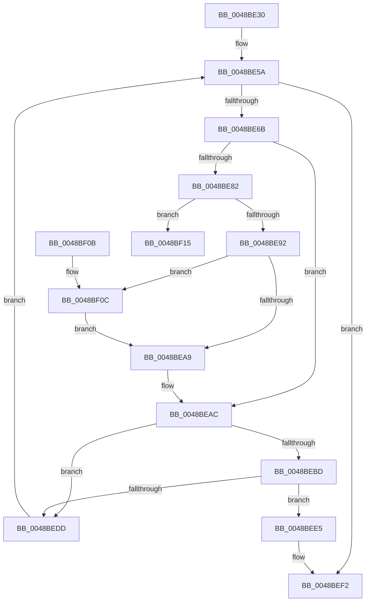

# CcIsThereDirtyData

- RVA: `0x0048BE30`–`0x0048BF28` (길이 `248` bytes)
- VA: `0x000000014048BE30`
- 실행 섹션: `.text`
- PDB 이름 있음: `예`; PDB Function 태그: `예`
- unwind 정보 RVA: `0x000677C8`
- 디코드: `65`개 명령, `248/248` bytes 표시
- 미해석 바이트: `0` (있으면 어셈블리에 `.byte`로 보존)

> 이 문서는 커널 이미지의 기계어와 PDB 기호를 분석해 생성했습니다. 4번과 5번은 함수 원형과 자료형을 바이너리 사용 방식에서 추정한 C 해석이며 원본 소스 복구 결과는 아닙니다.

## 1. Dependencies

- 직접 호출 지점: **6**; 고유 호출 대상: **6**
- 직접 호출자로 확인된 함수: **0**
- RIP 상대 이미지 참조: **1**

### Outgoing calls
- `0x0048BE5A` → [PsGetNextPartitionUnsafe](../2F/PsGetNextPartitionUnsafe_function_002F0E38.md) (function, `0x002F0E38`)
- `0x0048BE72` → [KeAcquireSpinLockRaiseToDpc](../20/KeAcquireSpinLockRaiseToDpc_function_00208470.md) (function, `0x00208470`)
- `0x0048BEB3` → [KeReleaseSpinLock](../39/KeReleaseSpinLock_function_00392BA0.md) (function, `0x00392BA0`)
- `0x0048BEC7` → [CcIsThereDirtyDataHelper](CcIsThereDirtyDataHelper_function_0048BF30.md) (function, `0x0048BF30`)
- `0x0048BED1` → [CcDereferencePartition](../35/CcDereferencePartition_function_003572F0.md) (function, `0x003572F0`)
- `0x0048BEED` → [ObfDereferenceObjectWithTag](../2F/ObfDereferenceObjectWithTag_function_002F78E0.md) (function, `0x002F78E0`)

### Direct callers
- 이 함수 시작 RVA로 연결되는 직접 call은 확인되지 않았습니다. 간접 호출은 완전히 역산할 수 없습니다.

### Static image references
- `0x0048BE6B` → RVA `0x00F8F510` (`.data`; read)

## 2. Other-region calls and transfers

- 다른 실행 섹션으로 향하는 call: **0**
- call이 아닌 외부 분기/꼬리 이동: **1**
  - `0x0048BF23` → [sub_006F636E](../6F/Unknown_function_006F636E.md) (`tail-transfer`)

## 3. Assembly (complete function range)

```asm
0048BE30  48 8B C4                        mov rax, rsp
0048BE33  48 89 58 08                     mov qword ptr [rax + 8], rbx
0048BE37  48 89 68 10                     mov qword ptr [rax + 0x10], rbp
0048BE3B  48 89 70 18                     mov qword ptr [rax + 0x18], rsi
0048BE3F  57                              push rdi
0048BE40  48 83 EC 30                     sub rsp, 0x30
0048BE44  0F 57 C0                        xorps xmm0, xmm0
0048BE47  33 FF                           xor edi, edi
0048BE49  0F 11 40 E8                     movups xmmword ptr [rax - 0x18], xmm0
0048BE4D  40 32 F6                        xor sil, sil
0048BE50  48 89 48 E8                     mov qword ptr [rax - 0x18], rcx
0048BE54  33 C9                           xor ecx, ecx
0048BE56  C6 40 F0 00                     mov byte ptr [rax - 0x10], 0
0048BE5A  E8 D9 4F E6 FF                  call 0x1402f0e38
0048BE5F  48 8B E8                        mov rbp, rax
0048BE62  48 85 C0                        test rax, rax
0048BE65  0F 84 87 00 00 00               je 0x14048bef2
0048BE6B  48 8D 0D 9E 36 B0 00            lea rcx, [rip + 0xb0369e]
0048BE72  E8 F9 C5 D7 FF                  call 0x140208470
0048BE77  48 8B 4D 08                     mov rcx, qword ptr [rbp + 8]
0048BE7B  8A D0                           mov dl, al
0048BE7D  48 85 C9                        test rcx, rcx
0048BE80  74 2A                           je 0x14048beac
0048BE82  80 B9 0E 05 00 00 02            cmp byte ptr [rcx + 0x50e], 2
0048BE89  48 8B F9                        mov rdi, rcx
0048BE8C  0F 83 83 00 00 00               jae 0x14048bf15
0048BE92  B9 01 00 00 00                  mov ecx, 1
0048BE97  F0 48 0F C1 8F 10 05 00 00      lock xadd qword ptr [rdi + 0x510], rcx
0048BEA0  48 FF C1                        inc rcx
0048BEA3  48 83 F9 01                     cmp rcx, 1
0048BEA7  7E 63                           jle 0x14048bf0c
0048BEA9  40 B6 01                        mov sil, 1
0048BEAC  48 8D 0D 5D 36 B0 00            lea rcx, [rip + 0xb0365d]
0048BEB3  E8 E8 6C F0 FF                  call 0x140392ba0
0048BEB8  40 84 F6                        test sil, sil
0048BEBB  74 20                           je 0x14048bedd
0048BEBD  4C 8D 44 24 20                  lea r8, [rsp + 0x20]
0048BEC2  33 D2                           xor edx, edx
0048BEC4  48 8B CF                        mov rcx, rdi
0048BEC7  E8 64 00 00 00                  call 0x14048bf30
0048BECC  48 8B CF                        mov rcx, rdi
0048BECF  8A D8                           mov bl, al
0048BED1  E8 1A B4 EC FF                  call 0x1403572f0
0048BED6  40 32 F6                        xor sil, sil
0048BED9  84 DB                           test bl, bl
0048BEDB  74 08                           je 0x14048bee5
0048BEDD  48 8B CD                        mov rcx, rbp
0048BEE0  E9 75 FF FF FF                  jmp 0x14048be5a
0048BEE5  BA 50 73 45 6E                  mov edx, 0x6e457350
0048BEEA  48 8B CD                        mov rcx, rbp
0048BEED  E8 EE B9 E6 FF                  call 0x1402f78e0
0048BEF2  8A 44 24 28                     mov al, byte ptr [rsp + 0x28]
0048BEF6  48 8B 5C 24 40                  mov rbx, qword ptr [rsp + 0x40]
0048BEFB  48 8B 6C 24 48                  mov rbp, qword ptr [rsp + 0x48]
0048BF00  48 8B 74 24 50                  mov rsi, qword ptr [rsp + 0x50]
0048BF05  48 83 C4 30                     add rsp, 0x30
0048BF09  5F                              pop rdi
0048BF0A  C3                              ret
0048BF0B  CC                              int3
0048BF0C  B9 0E 00 00 00                  mov ecx, 0xe
0048BF11  CD 29                           int 0x29
0048BF13  EB 94                           jmp 0x14048bea9
0048BF15  0F 0D 89 10 05 00 00            prefetchw byte ptr [rcx + 0x510]
0048BF1C  48 8B 81 10 05 00 00            mov rax, qword ptr [rcx + 0x510]
0048BF23  E9 46 A4 26 00                  jmp 0x1406f636e
```

## 4. C-style interpretation (structured pseudocode)

```c
__int64 __fastcall CcIsThereDirtyData(__int64 a1)
{
    __int64 result;
    __int64 v_rdi;
    __int64 v_rsi;
    __int64 v_rsp;
    unsigned __int8 v_stack_m10;
    unsigned __int64 v_stack_m18;
    unsigned __int64 v_stack_p10;
    unsigned __int64 v_stack_p18;
    unsigned __int64 v_stack_p8;

    *(unsigned __int64 *)(v_rsp + 8) = v_rbx;
    *(unsigned __int64 *)(v_rsp + 16) = v_rbp;
    *(unsigned __int64 *)(v_rsp + 24) = v_rsi;
    v_rsp = (v_rsp) - (48);
    v_rdi = 0;
    *(unsigned __int64 *)(v_rsp - 24) = v_xmm0;
    v_rsi = 0;
    *(unsigned __int64 *)(v_rsp - 24) = a1;
    a1 = 0;
    *(unsigned __int8 *)(v_rsp - 16) = 0;
loc_0048BE5A:
    result = PsGetNextPartitionUnsafe(a1, a2, a3, a4);
    if (result == 0) goto loc_0048BEF2;
    result = KeAcquireSpinLockRaiseToDpc(v_rip + 11548318, a2, a3, a4);
    if (*(unsigned __int64 *)(result + 8) == 0) goto loc_0048BEAC;
    if ((*(unsigned __int8 *)(*(unsigned __int64 *)(result + 8) + 1294)) >= 2) goto loc_0048BF15;
    a1 = (1) + 1;
    if (a1 <= 1) goto loc_0048BF0C;
loc_0048BEA9:
loc_0048BEAC:
    result = KeReleaseSpinLock(v_rip + 11548253, (unsigned __int8)(result), a3, a4);
    if (1 == 0) goto loc_0048BEDD;
    a2 = 0;
    result = CcIsThereDirtyDataHelper(*(unsigned __int64 *)(result + 8), a2, v_stack_m18, a4);
    result = CcDereferencePartition(*(unsigned __int64 *)(result + 8), a2, v_stack_m18, a4);
    v_rsi = 0;
    if ((unsigned __int8)((unsigned __int8)(result)) == 0) goto loc_0048BEE5;
loc_0048BEDD:
    goto loc_0048BE5A;
loc_0048BEE5:
    result = ObfDereferenceObjectWithTag(result, (unsigned int)(0x6E457350ULL), v_stack_m18, a4);
loc_0048BEF2:
    v_rsp = (v_rsp) + (48);
    return v_stack_m10;
loc_0048BF0C:
    goto loc_0048BEA9;
loc_0048BF15:
}
```

## 5. (Beta) C Style

```c
int64_t CcIsThereDirtyData(int64_t Arg1)
{
    int64_t result;
    int64_t local_rdi;
    int64_t local_rsi;
    int64_t local_rsp;
    uint8_t v_stack_m10;
    uint64_t v_stack_m18;
    uint64_t v_stack_p10;
    uint64_t v_stack_p18;
    uint64_t v_stack_p8;

    *(uint64_t *)(local_rsp + 0x8) = local_rbx;
    *(uint64_t *)(local_rsp + 0x10) = local_rbp;
    *(uint64_t *)(local_rsp + 0x18) = local_rsi;
    local_rsp = (local_rsp) - (48);
    local_rdi = 0;
    *(uint64_t *)(local_rsp - 0x18) = v_xmm0;
    local_rsi = 0;
    *(uint64_t *)(local_rsp - 0x18) = Arg1;
    Arg1 = 0;
    *(uint8_t *)(local_rsp - 0x10) = 0;
loc_0048BE5A:
    result = PsGetNextPartitionUnsafe(Arg1, a2, a3, a4);
    if (result == 0) goto loc_0048BEF2;
    result = KeAcquireSpinLockRaiseToDpc(v_rip + 11548318, a2, a3, a4);
    if (*(uint64_t *)(result + 0x8) == 0) goto loc_0048BEAC;
    if ((*(uint8_t *)(*(uint64_t *)(result + 0x8) + 0x50E)) >= 2) goto loc_0048BF15;
    Arg1 = (1) + 1;
    if (Arg1 <= 1) goto loc_0048BF0C;
loc_0048BEA9:
loc_0048BEAC:
    result = KeReleaseSpinLock(v_rip + 11548253, (uint8_t)(result), a3, a4);
    if (1 == 0) goto loc_0048BEDD;
    a2 = 0;
    result = CcIsThereDirtyDataHelper(*(uint64_t *)(result + 0x8), a2, v_stack_m18, a4);
    result = CcDereferencePartition(*(uint64_t *)(result + 0x8), a2, v_stack_m18, a4);
    local_rsi = 0;
    if ((uint8_t)((uint8_t)(result)) == 0) goto loc_0048BEE5;
loc_0048BEDD:
    goto loc_0048BE5A;
loc_0048BEE5:
    result = ObfDereferenceObjectWithTag(result, (uint32_t)(0x6E457350ULL), v_stack_m18, a4);
loc_0048BEF2:
    local_rsp = (local_rsp) + (48);
    return v_stack_m10;
loc_0048BF0C:
    goto loc_0048BEA9;
loc_0048BF15:
}
```

## 6. Execution-region graph

[열기: 2D/3D 그래프와 함수 탐색 컨트롤 패널](../../../control-panel.html?section=text&rva=0x0048BE30&view=graph)

- 2D 그래프는 위에서 아래로 흐르고, 3D 그래프는 빈 공간을 드래그해 회전합니다. Shift+드래그는 이동, 휠은 확대·축소, 함수 노드 선택은 대상 보고서 이동입니다.

### Static fallback


