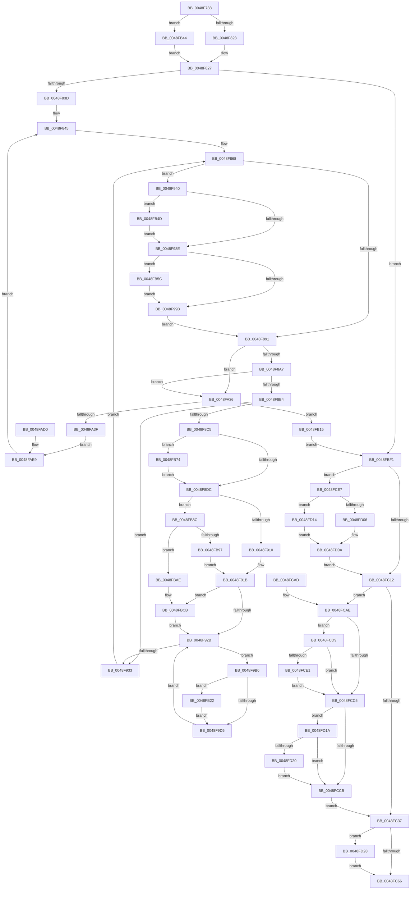

# CcPerformReadAhead

- RVA: `0x0048F738`–`0x0048FD32` (길이 `1,530` bytes)
- VA: `0x000000014048F738`
- 실행 섹션: `.text`
- PDB 이름 있음: `예`; PDB Function 태그: `아니요`
- unwind 정보 RVA: `0x000B2AB4`
- 디코드: `315`개 명령, `1,530/1,530` bytes 표시
- 미해석 바이트: `0` (있으면 어셈블리에 `.byte`로 보존)

> 이 문서는 커널 이미지의 기계어와 PDB 기호를 분석해 생성했습니다. 4번과 5번은 함수 원형과 자료형을 바이너리 사용 방식에서 추정한 C 해석이며 원본 소스 복구 결과는 아닙니다.

## 1. Dependencies

- 직접 호출 지점: **24**; 고유 호출 대상: **16**
- 직접 호출자로 확인된 함수: **1**
- RIP 상대 이미지 참조: **1**

### Outgoing calls
- `0x0048F829` → [guard_dispatch_icall](../6B/guard_dispatch_icall_function_006BAAD0.md) (function, `0x006BAAD0`)
- `0x0048F877` → [KeAcquireInStackQueuedSpinLock](../27/KeAcquireInStackQueuedSpinLock_function_002757A0.md) (function, `0x002757A0`)
- `0x0048F899` → [KeReleaseInStackQueuedSpinLock](../34/KeReleaseInStackQueuedSpinLock_function_00342CE0.md) (function, `0x00342CE0`)
- `0x0048F944` → [KeAcquireSpinLockAtDpcLevel](../20/KeAcquireSpinLockAtDpcLevel_function_00208430.md) (function, `0x00208430`)
- `0x0048F99F` → [KxReleaseSpinLock](../20/KxReleaseSpinLock_function_00206670.md) (function, `0x00206670`)
- `0x0048FA0A` → [MmPrefetchForCacheManager](../../page/93/MmPrefetchForCacheManager_function_0093D714.md) (function, `0x0093D714`)
- `0x0048FA53` → [PsGetPagePriorityThread](../3C/PsGetPagePriorityThread_function_003C3E80.md) (function, `0x003C3E80`)
- `0x0048FA70` → [MmWaitForCacheManagerPrefetch](../36/MmWaitForCacheManagerPrefetch_function_0036D644.md) (function, `0x0036D644`)
- `0x0048FA80` → [PsSetPagePriorityThread](../3C/PsSetPagePriorityThread_function_003C4138.md) (function, `0x003C4138`)
- `0x0048FAC9` → [CcMapAndCopyFromCache](../../page/A4/CcMapAndCopyFromCache_function_00A47060.md) (function, `0x00A47060`)
- `0x0048FAEE` → [PsSetPagePriorityThread](../3C/PsSetPagePriorityThread_function_003C4138.md) (function, `0x003C4138`)
- `0x0048FB3A` → [CcPerfLogReadAheadPrefetch](CcPerfLogReadAheadPrefetch_function_0048FD38.md) (function, `0x0048FD38`)
- `0x0048FBC6` → [KeBugCheckEx](../4F/KeBugCheckEx_function_004FD660.md) (function, `0x004FD660`)
- `0x0048FBE3` → [CcPerfLogReadAhead](../49/CcPerfLogReadAhead_function_00491F48.md) (function, `0x00491F48`)
- `0x0048FC29` → [KeAcquireInStackQueuedSpinLock](../27/KeAcquireInStackQueuedSpinLock_function_002757A0.md) (function, `0x002757A0`)
- `0x0048FC3F` → [KeReleaseInStackQueuedSpinLock](../34/KeReleaseInStackQueuedSpinLock_function_00342CE0.md) (function, `0x00342CE0`)
- `0x0048FC4C` → [ObfDereferenceObjectWithTag](../2F/ObfDereferenceObjectWithTag_function_002F78E0.md) (function, `0x002F78E0`)
- `0x0048FC75` → [KeAcquireInStackQueuedSpinLock](../27/KeAcquireInStackQueuedSpinLock_function_002757A0.md) (function, `0x002757A0`)
- `0x0048FC82` → [CcDecrementOpenCount](../38/CcDecrementOpenCount_function_0038B75C.md) (function, `0x0038B75C`)
- `0x0048FC97` → [KeReleaseInStackQueuedSpinLock](../34/KeReleaseInStackQueuedSpinLock_function_00342CE0.md) (function, `0x00342CE0`)
- `0x0048FCB2` → [KeAcquireSpinLockAtDpcLevel](../20/KeAcquireSpinLockAtDpcLevel_function_00208430.md) (function, `0x00208430`)
- `0x0048FCCF` → [KxReleaseSpinLock](../20/KxReleaseSpinLock_function_00206670.md) (function, `0x00206670`)
- `0x0048FD0A` → [guard_dispatch_icall](../6B/guard_dispatch_icall_function_006BAAD0.md) (function, `0x006BAAD0`)
- `0x0048FD28` → [IoDiskIoAttributionDereference](../34/IoDiskIoAttributionDereference_function_00349978.md) (function, `0x00349978`)

### Direct callers
- [CcWorkerThread](CcWorkerThread_function_0048F0F0.md) at `0x0048F391`

### Static image references
- `0x0048F91B` → RVA `0x00FC6B10` (`ALMOSTRO`; read)

## 2. Other-region calls and transfers

- 다른 실행 섹션으로 향하는 call: **2**
  - `0x0048FA0A` → [MmPrefetchForCacheManager](../../page/93/MmPrefetchForCacheManager_function_0093D714.md) (`.text` → `PAGE`)
  - `0x0048FAC9` → [CcMapAndCopyFromCache](../../page/A4/CcMapAndCopyFromCache_function_00A47060.md) (`.text` → `PAGE`)
- 별도 외부 분기/꼬리 이동을 확인하지 못했습니다.

## 3. Assembly (complete function range)

```asm
0048F738  4C 8B DC                        mov r11, rsp
0048F73B  49 89 53 10                     mov qword ptr [r11 + 0x10], rdx
0048F73F  49 89 4B 08                     mov qword ptr [r11 + 8], rcx
0048F743  53                              push rbx
0048F744  56                              push rsi
0048F745  57                              push rdi
0048F746  41 55                           push r13
0048F748  41 56                           push r14
0048F74A  41 57                           push r15
0048F74C  48 81 EC 38 01 00 00            sub rsp, 0x138
0048F753  4C 8B EA                        mov r13, rdx
0048F756  33 F6                           xor esi, esi
0048F758  48 89 74 24 70                  mov qword ptr [rsp + 0x70], rsi
0048F75D  49 89 B3 28 FF FF FF            mov qword ptr [r11 - 0xd8], rsi
0048F764  49 89 B3 78 FF FF FF            mov qword ptr [r11 - 0x88], rsi
0048F76B  89 B4 24 88 00 00 00            mov dword ptr [rsp + 0x88], esi
0048F772  89 74 24 50                     mov dword ptr [rsp + 0x50], esi
0048F776  49 89 B3 30 FF FF FF            mov qword ptr [r11 - 0xd0], rsi
0048F77D  89 74 24 78                     mov dword ptr [rsp + 0x78], esi
0048F781  89 74 24 54                     mov dword ptr [rsp + 0x54], esi
0048F785  89 74 24 64                     mov dword ptr [rsp + 0x64], esi
0048F789  89 74 24 68                     mov dword ptr [rsp + 0x68], esi
0048F78D  89 74 24 58                     mov dword ptr [rsp + 0x58], esi
0048F791  89 74 24 5C                     mov dword ptr [rsp + 0x5c], esi
0048F795  89 74 24 7C                     mov dword ptr [rsp + 0x7c], esi
0048F799  89 B4 24 80 00 00 00            mov dword ptr [rsp + 0x80], esi
0048F7A0  49 89 B3 38 FF FF FF            mov qword ptr [r11 - 0xc8], rsi
0048F7A7  0F 57 C0                        xorps xmm0, xmm0
0048F7AA  33 C0                           xor eax, eax
0048F7AC  0F 11 84 24 C8 00 00 00         movups xmmword ptr [rsp + 0xc8], xmm0
0048F7B4  49 89 83 70 FF FF FF            mov qword ptr [r11 - 0x90], rax
0048F7BB  65 48 8B 04 25 88 01 00 00      mov rax, qword ptr gs:[0x188]
0048F7C4  49 89 43 A0                     mov qword ptr [r11 - 0x60], rax
0048F7C8  89 B0 DC 05 00 00               mov dword ptr [rax + 0x5dc], esi
0048F7CE  48 8B 42 28                     mov rax, qword ptr [rdx + 0x28]
0048F7D2  4C 8B 78 08                     mov r15, qword ptr [rax + 8]
0048F7D6  4D 89 7B 80                     mov qword ptr [r11 - 0x80], r15
0048F7DA  4C 89 7C 24 70                  mov qword ptr [rsp + 0x70], r15
0048F7DF  49 8B DF                        mov rbx, r15
0048F7E2  48 89 9C 24 00 01 00 00         mov qword ptr [rsp + 0x100], rbx
0048F7EA  49 8B 8F E0 00 00 00            mov rcx, qword ptr [r15 + 0xe0]
0048F7F1  49 89 8B 30 FF FF FF            mov qword ptr [r11 - 0xd0], rcx
0048F7F8  49 8B 87 18 02 00 00            mov rax, qword ptr [r15 + 0x218]
0048F7FF  49 89 83 58 FF FF FF            mov qword ptr [r11 - 0xa8], rax
0048F806  49 89 83 38 FF FF FF            mov qword ptr [r11 - 0xc8], rax
0048F80D  49 8B 97 D8 00 00 00            mov rdx, qword ptr [r15 + 0xd8]
0048F814  41 8B 87 9C 00 00 00            mov eax, dword ptr [r15 + 0x9c]
0048F81B  A8 01                           test al, 1
0048F81D  0F 84 21 03 00 00               je 0x14048fb44
0048F823  48 8B 42 18                     mov rax, qword ptr [rdx + 0x18]
0048F827  B2 01                           mov dl, 1
0048F829  E8 A2 B2 22 00                  call 0x1406baad0
0048F82E  0F B6 C0                        movzx eax, al
0048F831  89 44 24 58                     mov dword ptr [rsp + 0x58], eax
0048F835  85 C0                           test eax, eax
0048F837  0F 84 B4 03 00 00               je 0x14048fbf1
0048F83D  48 8B 84 24 C0 00 00 00         mov rax, qword ptr [rsp + 0xc0]
0048F845  48 8B FE                        mov rdi, rsi
0048F848  48 89 B4 24 B8 00 00 00         mov qword ptr [rsp + 0xb8], rsi
0048F850  48 8B 9C 24 90 00 00 00         mov rbx, qword ptr [rsp + 0x90]
0048F858  44 8B 74 24 50                  mov r14d, dword ptr [rsp + 0x50]
0048F85D  8B 4C 24 78                     mov ecx, dword ptr [rsp + 0x78]
0048F861  89 8C 24 80 01 00 00            mov dword ptr [rsp + 0x180], ecx
0048F868  48 8D 88 00 03 00 00            lea rcx, [rax + 0x300]
0048F86F  48 8D 94 24 C8 00 00 00         lea rdx, [rsp + 0xc8]
0048F877  E8 24 5F DE FF                  call 0x1402757a0
0048F87C  4D 8B 7D 30                     mov r15, qword ptr [r13 + 0x30]
0048F880  4C 89 BC 24 10 01 00 00         mov qword ptr [rsp + 0x110], r15
0048F888  4D 85 FF                        test r15, r15
0048F88B  0F 85 AF 00 00 00               jne 0x14048f940
0048F891  48 8D 8C 24 C8 00 00 00         lea rcx, [rsp + 0xc8]
0048F899  E8 42 34 EB FF                  call 0x140342ce0
0048F89E  4D 85 FF                        test r15, r15
0048F8A1  0F 84 8F 01 00 00               je 0x14048fa36
0048F8A7  39 B4 24 80 01 00 00            cmp dword ptr [rsp + 0x180], esi
0048F8AE  0F 85 82 01 00 00               jne 0x14048fa36
0048F8B4  48 8B 84 24 E8 00 00 00         mov rax, qword ptr [rsp + 0xe8]
0048F8BC  48 8B 48 08                     mov rcx, qword ptr [rax + 8]
0048F8C0  48 3B D9                        cmp rbx, rcx
0048F8C3  7D 6E                           jge 0x14048f933
0048F8C5  C7 44 24 68 01 00 00 00         mov dword ptr [rsp + 0x68], 1
0048F8CD  41 8B C6                        mov eax, r14d
0048F8D0  48 03 C3                        add rax, rbx
0048F8D3  48 3B C1                        cmp rax, rcx
0048F8D6  0F 8D 98 02 00 00               jge 0x14048fb74
0048F8DC  41 81 C6 FF 0F 00 00            add r14d, 0xfff
0048F8E3  41 81 E6 00 F0 FF FF            and r14d, 0xfffff000
0048F8EA  44 89 74 24 50                  mov dword ptr [rsp + 0x50], r14d
0048F8EF  41 8B CE                        mov ecx, r14d
0048F8F2  89 4C 24 60                     mov dword ptr [rsp + 0x60], ecx
0048F8F6  48 89 9C 24 E0 00 00 00         mov qword ptr [rsp + 0xe0], rbx
0048F8FE  44 89 B4 24 88 00 00 00         mov dword ptr [rsp + 0x88], r14d
0048F906  39 74 24 7C                     cmp dword ptr [rsp + 0x7c], esi
0048F90A  0F 85 7C 02 00 00               jne 0x14048fb8c
0048F910  45 8B FE                        mov r15d, r14d
0048F913  44 89 B4 24 84 00 00 00         mov dword ptr [rsp + 0x84], r14d
0048F91B  F7 05 EB 71 B3 00 00 00 02 00   test dword ptr [rip + 0xb371eb], 0x20000
0048F925  0F 85 A0 02 00 00               jne 0x14048fbcb
0048F92B  85 C9                           test ecx, ecx
0048F92D  0F 85 83 00 00 00               jne 0x14048f9b6
0048F933  48 8B 84 24 C0 00 00 00         mov rax, qword ptr [rsp + 0xc0]
0048F93B  E9 28 FF FF FF                  jmp 0x14048f868
0048F940  49 8D 4F 50                     lea rcx, [r15 + 0x50]
0048F944  E8 E7 8A D7 FF                  call 0x140208430
0048F949  45 8B 77 34                     mov r14d, dword ptr [r15 + 0x34]
0048F94D  8B C6                           mov eax, esi
0048F94F  45 85 F6                        test r14d, r14d
0048F952  0F 94 C0                        sete al
0048F955  89 84 24 80 01 00 00            mov dword ptr [rsp + 0x180], eax
0048F95C  89 44 24 78                     mov dword ptr [rsp + 0x78], eax
0048F960  49 8B 5F 38                     mov rbx, qword ptr [r15 + 0x38]
0048F964  48 89 9C 24 90 00 00 00         mov qword ptr [rsp + 0x90], rbx
0048F96C  44 89 74 24 50                  mov dword ptr [rsp + 0x50], r14d
0048F971  B9 00 00 80 00                  mov ecx, 0x800000
0048F976  44 3B F1                        cmp r14d, ecx
0048F979  44 0F 47 F1                     cmova r14d, ecx
0048F97D  44 89 74 24 50                  mov dword ptr [rsp + 0x50], r14d
0048F982  41 89 77 34                     mov dword ptr [r15 + 0x34], esi
0048F986  85 C0                           test eax, eax
0048F988  0F 84 BF 01 00 00               je 0x14048fb4d
0048F98E  41 F7 07 00 00 20 00            test dword ptr [r15], 0x200000
0048F995  0F 85 C1 01 00 00               jne 0x14048fb5c
0048F99B  49 8D 4F 50                     lea rcx, [r15 + 0x50]
0048F99F  E8 CC 6C D7 FF                  call 0x140206670
0048F9A4  41 8B 07                        mov eax, dword ptr [r15]
0048F9A7  C1 E8 12                        shr eax, 0x12
0048F9AA  83 E0 07                        and eax, 7
0048F9AD  89 44 24 54                     mov dword ptr [rsp + 0x54], eax
0048F9B1  E9 DB FE FF FF                  jmp 0x14048f891
0048F9B6  44 3B F9                        cmp r15d, ecx
0048F9B9  44 0F 47 F9                     cmova r15d, ecx
0048F9BD  44 89 BC 24 84 00 00 00         mov dword ptr [rsp + 0x84], r15d
0048F9C5  F7 05 41 71 B3 00 00 00 02 00   test dword ptr [rip + 0xb37141], 0x20000
0048F9CF  0F 85 4D 01 00 00               jne 0x14048fb22
0048F9D5  41 8B FF                        mov edi, r15d
0048F9D8  48 8D 84 24 B8 00 00 00         lea rax, [rsp + 0xb8]
0048F9E0  48 89 44 24 38                  mov qword ptr [rsp + 0x38], rax
0048F9E5  48 8B 84 24 70 01 00 00         mov rax, qword ptr [rsp + 0x170]
0048F9ED  48 8B 40 18                     mov rax, qword ptr [rax + 0x18]
0048F9F1  48 89 44 24 30                  mov qword ptr [rsp + 0x30], rax
0048F9F6  8B 44 24 54                     mov eax, dword ptr [rsp + 0x54]
0048F9FA  89 44 24 20                     mov dword ptr [rsp + 0x20], eax
0048F9FE  45 8B CF                        mov r9d, r15d
0048FA01  45 33 C0                        xor r8d, r8d
0048FA04  48 8B D3                        mov rdx, rbx
0048FA07  49 8B CD                        mov rcx, r13
0048FA0A  E8 05 DD 4A 00                  call 0x14093d714
0048FA0F  09 44 24 5C                     or dword ptr [rsp + 0x5c], eax
0048FA13  8B 4C 24 60                     mov ecx, dword ptr [rsp + 0x60]
0048FA17  41 2B CF                        sub ecx, r15d
0048FA1A  89 4C 24 60                     mov dword ptr [rsp + 0x60], ecx
0048FA1E  48 03 DF                        add rbx, rdi
0048FA21  48 89 9C 24 90 00 00 00         mov qword ptr [rsp + 0x90], rbx
0048FA29  48 8B BC 24 B8 00 00 00         mov rdi, qword ptr [rsp + 0xb8]
0048FA31  E9 F5 FE FF FF                  jmp 0x14048f92b
0048FA36  48 85 FF                        test rdi, rdi
0048FA39  0F 84 D6 00 00 00               je 0x14048fb15
0048FA3F  65 48 8B 1C 25 88 01 00 00      mov rbx, qword ptr gs:[0x188]
0048FA48  48 89 9C 24 F8 00 00 00         mov qword ptr [rsp + 0xf8], rbx
0048FA50  48 8B CB                        mov rcx, rbx
0048FA53  E8 28 44 F3 FF                  call 0x1403c3e80
0048FA58  8B F8                           mov edi, eax
0048FA5A  89 84 24 80 01 00 00            mov dword ptr [rsp + 0x180], eax
0048FA61  89 B4 24 88 01 00 00            mov dword ptr [rsp + 0x188], esi
0048FA68  48 8B 8C 24 B8 00 00 00         mov rcx, qword ptr [rsp + 0xb8]
0048FA70  E8 CF DB ED FF                  call 0x14036d644
0048FA75  44 8B 74 24 54                  mov r14d, dword ptr [rsp + 0x54]
0048FA7A  41 8B D6                        mov edx, r14d
0048FA7D  48 8B CB                        mov rcx, rbx
0048FA80  E8 B3 46 F3 FF                  call 0x1403c4138
0048FA85  90                              nop
0048FA86  48 89 74 24 40                  mov qword ptr [rsp + 0x40], rsi
0048FA8B  48 8B 84 24 70 01 00 00         mov rax, qword ptr [rsp + 0x170]
0048FA93  48 8B 40 18                     mov rax, qword ptr [rax + 0x18]
0048FA97  48 89 44 24 38                  mov qword ptr [rsp + 0x38], rax
0048FA9C  44 89 74 24 30                  mov dword ptr [rsp + 0x30], r14d
0048FAA1  48 8D 84 24 88 01 00 00         lea rax, [rsp + 0x188]
0048FAA9  48 89 44 24 28                  mov qword ptr [rsp + 0x28], rax
0048FAAE  48 89 74 24 20                  mov qword ptr [rsp + 0x20], rsi
0048FAB3  41 B1 01                        mov r9b, 1
0048FAB6  44 8B 84 24 88 00 00 00         mov r8d, dword ptr [rsp + 0x88]
0048FABE  48 8B 94 24 E0 00 00 00         mov rdx, qword ptr [rsp + 0xe0]
0048FAC6  49 8B CD                        mov rcx, r13
0048FAC9  E8 92 75 5B 00                  call 0x140a47060
0048FACE  EB 19                           jmp 0x14048fae9
0048FAD0  33 F6                           xor esi, esi
0048FAD2  4C 8B AC 24 78 01 00 00         mov r13, qword ptr [rsp + 0x178]
0048FADA  8B BC 24 80 01 00 00            mov edi, dword ptr [rsp + 0x180]
0048FAE1  48 8B 9C 24 F8 00 00 00         mov rbx, qword ptr [rsp + 0xf8]
0048FAE9  8B D7                           mov edx, edi
0048FAEB  48 8B CB                        mov rcx, rbx
0048FAEE  E8 45 46 F3 FF                  call 0x1403c4138
0048FAF3  48 8B 44 24 70                  mov rax, qword ptr [rsp + 0x70]
0048FAF8  48 89 84 24 E8 00 00 00         mov qword ptr [rsp + 0xe8], rax
0048FB00  48 8B 84 24 A0 00 00 00         mov rax, qword ptr [rsp + 0xa0]
0048FB08  48 89 84 24 C0 00 00 00         mov qword ptr [rsp + 0xc0], rax
0048FB10  E9 30 FD FF FF                  jmp 0x14048f845
0048FB15  48 8B 9C 24 00 01 00 00         mov rbx, qword ptr [rsp + 0x100]
0048FB1D  E9 CF 00 00 00                  jmp 0x14048fbf1
0048FB22  44 8B 4C 24 54                  mov r9d, dword ptr [rsp + 0x54]
0048FB27  45 8B C7                        mov r8d, r15d
0048FB2A  48 8D 94 24 90 00 00 00         lea rdx, [rsp + 0x90]
0048FB32  48 8B 8C 24 70 01 00 00         mov rcx, qword ptr [rsp + 0x170]
0048FB3A  E8 F9 01 00 00                  call 0x14048fd38
0048FB3F  E9 91 FE FF FF                  jmp 0x14048f9d5
0048FB44  48 8B 42 10                     mov rax, qword ptr [rdx + 0x10]
0048FB48  E9 DA FC FF FF                  jmp 0x14048f827
0048FB4D  41 8B C6                        mov eax, r14d
0048FB50  48 03 C3                        add rax, rbx
0048FB53  49 89 47 40                     mov qword ptr [r15 + 0x40], rax
0048FB57  E9 32 FE FF FF                  jmp 0x14048f98e
0048FB5C  C7 44 24 7C 01 00 00 00         mov dword ptr [rsp + 0x7c], 1
0048FB64  41 8B 47 58                     mov eax, dword ptr [r15 + 0x58]
0048FB68  89 84 24 80 00 00 00            mov dword ptr [rsp + 0x80], eax
0048FB6F  E9 27 FE FF FF                  jmp 0x14048f99b
0048FB74  44 8B F1                        mov r14d, ecx
0048FB77  44 2B F3                        sub r14d, ebx
0048FB7A  44 89 74 24 50                  mov dword ptr [rsp + 0x50], r14d
0048FB7F  C7 44 24 64 01 00 00 00         mov dword ptr [rsp + 0x64], 1
0048FB87  E9 50 FD FF FF                  jmp 0x14048f8dc
0048FB8C  8B 84 24 80 00 00 00            mov eax, dword ptr [rsp + 0x80]
0048FB93  85 C0                           test eax, eax
0048FB95  74 17                           je 0x14048fbae
0048FB97  45 8B FE                        mov r15d, r14d
0048FB9A  44 3B F0                        cmp r14d, eax
0048FB9D  44 0F 47 F8                     cmova r15d, eax
0048FBA1  44 89 BC 24 84 00 00 00         mov dword ptr [rsp + 0x84], r15d
0048FBA9  E9 6D FD FF FF                  jmp 0x14048f91b
0048FBAE  48 89 74 24 20                  mov qword ptr [rsp + 0x20], rsi
0048FBB3  45 33 C9                        xor r9d, r9d
0048FBB6  BA BC 0A 00 00                  mov edx, 0xabc
0048FBBB  41 8D 49 34                     lea ecx, [r9 + 0x34]
0048FBBF  49 C7 C0 20 04 00 C0            mov r8, 0xffffffffc0000420
0048FBC6  E8 95 DA 06 00                  call 0x1404fd660
0048FBCB  44 8B 4C 24 54                  mov r9d, dword ptr [rsp + 0x54]
0048FBD0  45 8B C6                        mov r8d, r14d
0048FBD3  48 8D 94 24 90 00 00 00         lea rdx, [rsp + 0x90]
0048FBDB  48 8B 8C 24 70 01 00 00         mov rcx, qword ptr [rsp + 0x170]
0048FBE3  E8 60 23 00 00                  call 0x140491f48
0048FBE8  8B 4C 24 60                     mov ecx, dword ptr [rsp + 0x60]
0048FBEC  E9 3A FD FF FF                  jmp 0x14048f92b
0048FBF1  65 48 8B 04 25 88 01 00 00      mov rax, qword ptr gs:[0x188]
0048FBFA  8B 88 DC 05 00 00               mov ecx, dword ptr [rax + 0x5dc]
0048FC00  65 01 0C 25 A4 89 00 00         add dword ptr gs:[0x89a4], ecx
0048FC08  39 74 24 58                     cmp dword ptr [rsp + 0x58], esi
0048FC0C  0F 85 D5 00 00 00               jne 0x14048fce7
0048FC12  48 8B BC 24 A0 00 00 00         mov rdi, qword ptr [rsp + 0xa0]
0048FC1A  48 8D 8F 00 03 00 00            lea rcx, [rdi + 0x300]
0048FC21  48 8D 94 24 C8 00 00 00         lea rdx, [rsp + 0xc8]
0048FC29  E8 72 5B DE FF                  call 0x1402757a0
0048FC2E  49 8B 5D 30                     mov rbx, qword ptr [r13 + 0x30]
0048FC32  48 85 DB                        test rbx, rbx
0048FC35  75 77                           jne 0x14048fcae
0048FC37  48 8D 8C 24 C8 00 00 00         lea rcx, [rsp + 0xc8]
0048FC3F  E8 9C 30 EB FF                  call 0x140342ce0
0048FC44  BA 44 66 6C 74                  mov edx, 0x746c6644
0048FC49  49 8B CD                        mov rcx, r13
0048FC4C  E8 8F 7C E6 FF                  call 0x1402f78e0
0048FC51  48 8B 84 24 70 01 00 00         mov rax, qword ptr [rsp + 0x170]
0048FC59  48 8B 48 18                     mov rcx, qword ptr [rax + 0x18]
0048FC5D  48 85 C9                        test rcx, rcx
0048FC60  0F 85 C2 00 00 00               jne 0x14048fd28
0048FC66  48 8D 8F 00 03 00 00            lea rcx, [rdi + 0x300]
0048FC6D  48 8D 94 24 C8 00 00 00         lea rdx, [rsp + 0xc8]
0048FC75  E8 26 5B DE FF                  call 0x1402757a0
0048FC7A  48 8B 5C 24 70                  mov rbx, qword ptr [rsp + 0x70]
0048FC7F  48 8B CB                        mov rcx, rbx
0048FC82  E8 D5 BA EF FF                  call 0x14038b75c
0048FC87  0F BA B3 98 00 00 00 0E         btr dword ptr [rbx + 0x98], 0xe
0048FC8F  48 8D 8C 24 C8 00 00 00         lea rcx, [rsp + 0xc8]
0048FC97  E8 44 30 EB FF                  call 0x140342ce0
0048FC9C  48 81 C4 38 01 00 00            add rsp, 0x138
0048FCA3  41 5F                           pop r15
0048FCA5  41 5E                           pop r14
0048FCA7  41 5D                           pop r13
0048FCA9  5F                              pop rdi
0048FCAA  5E                              pop rsi
0048FCAB  5B                              pop rbx
0048FCAC  C3                              ret
0048FCAD  CC                              int3
0048FCAE  48 8D 4B 50                     lea rcx, [rbx + 0x50]
0048FCB2  E8 79 87 D7 FF                  call 0x140208430
0048FCB7  8B 13                           mov edx, dword ptr [rbx]
0048FCB9  0F BA F2 10                     btr edx, 0x10
0048FCBD  89 13                           mov dword ptr [rbx], edx
0048FCBF  39 74 24 64                     cmp dword ptr [rsp + 0x64], esi
0048FCC3  75 14                           jne 0x14048fcd9
0048FCC5  39 74 24 68                     cmp dword ptr [rsp + 0x68], esi
0048FCC9  75 4F                           jne 0x14048fd1a
0048FCCB  48 8D 4B 50                     lea rcx, [rbx + 0x50]
0048FCCF  E8 9C 69 D7 FF                  call 0x140206670
0048FCD4  E9 5E FF FF FF                  jmp 0x14048fc37
0048FCD9  41 8B 45 50                     mov eax, dword ptr [r13 + 0x50]
0048FCDD  A8 20                           test al, 0x20
0048FCDF  74 E4                           je 0x14048fcc5
0048FCE1  48 89 73 40                     mov qword ptr [rbx + 0x40], rsi
0048FCE5  EB DE                           jmp 0x14048fcc5
0048FCE7  48 8B 93 D8 00 00 00            mov rdx, qword ptr [rbx + 0xd8]
0048FCEE  48 8B 44 24 70                  mov rax, qword ptr [rsp + 0x70]
0048FCF3  8B 88 9C 00 00 00               mov ecx, dword ptr [rax + 0x9c]
0048FCF9  F6 C1 01                        test cl, 1
0048FCFC  48 8B 8C 24 98 00 00 00         mov rcx, qword ptr [rsp + 0x98]
0048FD04  75 0E                           jne 0x14048fd14
0048FD06  48 8B 42 18                     mov rax, qword ptr [rdx + 0x18]
0048FD0A  E8 C1 AD 22 00                  call 0x1406baad0
0048FD0F  E9 FE FE FF FF                  jmp 0x14048fc12
0048FD14  48 8B 42 20                     mov rax, qword ptr [rdx + 0x20]
0048FD18  EB F0                           jmp 0x14048fd0a
0048FD1A  39 74 24 5C                     cmp dword ptr [rsp + 0x5c], esi
0048FD1E  75 AB                           jne 0x14048fccb
0048FD20  0F BA F2 11                     btr edx, 0x11
0048FD24  89 13                           mov dword ptr [rbx], edx
0048FD26  EB A3                           jmp 0x14048fccb
0048FD28  E8 4B 9C EB FF                  call 0x140349978
0048FD2D  E9 34 FF FF FF                  jmp 0x14048fc66
```

## 4. C-style interpretation (structured pseudocode)

```c
__int64 __fastcall CcPerformReadAhead(__int64 a1, __int64 a2, int a3)
{
    __int64 result;
    __int64 v_r14;
    __int64 v_r15;
    __int64 v_rbx;
    __int64 v_rsi;
    __int64 v_rsp;
    unsigned int v_stack_m100;
    unsigned int v_stack_m104;
    unsigned int v_stack_m108;
    unsigned int v_stack_m10C;
    unsigned int v_stack_m110;
    unsigned int v_stack_m114;
    unsigned int v_stack_m118;
    unsigned __int64 v_stack_m128;
    unsigned __int64 v_stack_m130;
    unsigned __int64 v_stack_m138;
    unsigned __int64 v_stack_m140;
    unsigned int v_stack_m148;
    unsigned __int64 v_stack_m58;
    unsigned __int64 v_stack_m68;
    unsigned __int64 v_stack_m70;
    unsigned __int64 v_stack_m80;
    unsigned __int64 v_stack_m88;
    unsigned __int64 v_stack_mA0;
    unsigned __int64 v_stack_mA8;
    unsigned __int64 v_stack_mB0;
    unsigned __int64 v_stack_mC8;
    unsigned __int64 v_stack_mD8;
    unsigned int v_stack_mE0;
    unsigned int v_stack_mE4;
    unsigned int v_stack_mE8;
    unsigned int v_stack_mEC;
    unsigned int v_stack_mF0;
    unsigned __int64 v_stack_mF8;
    unsigned __int64 v_stack_p10;
    unsigned int v_stack_p18;
    unsigned int v_stack_p20;
    unsigned int v_stack_p5C;
    unsigned int v_stack_p64;
    unsigned int v_stack_p68;
    unsigned __int64 v_stack_p70;
    unsigned __int64 v_stack_p8;
    unsigned __int64 v_stack_p98;

    *(unsigned __int64 *)(v_rsp + 16) = a2;
    *(unsigned __int64 *)(v_rsp + 8) = a1;
    v_rsp = (v_rsp) - (312);
    v_rsi = 0;
    v_stack_mF8 = 0;
    *(unsigned __int64 *)(v_rsp - 216) = 0;
    *(unsigned __int64 *)(v_rsp - 136) = 0;
    v_stack_mE0 = 0;
    v_stack_m118 = 0;
    *(unsigned __int64 *)(v_rsp - 208) = 0;
    v_stack_mF0 = 0;
    v_stack_m114 = 0;
    v_stack_m104 = 0;
    v_stack_m100 = 0;
    v_stack_m110 = 0;
    v_stack_m10C = 0;
    v_stack_mEC = 0;
    v_stack_mE8 = 0;
    *(unsigned __int64 *)(v_rsp - 200) = 0;
    result = 0;
    v_stack_mA0 = v_xmm0;
    *(unsigned __int64 *)(v_rsp - 144) = 0;
    *(unsigned __int64 *)(v_rsp - 96) = *(unsigned __int64 *)(gs_base + (0 + 392));
    *(unsigned int *)(*(unsigned __int64 *)(gs_base + (0 + 392)) + 1500) = 0;
    *(unsigned __int64 *)(v_rsp - 128) = *(unsigned __int64 *)(*(unsigned __int64 *)(a2 + 40) + 8);
    v_stack_mF8 = *(unsigned __int64 *)(*(unsigned __int64 *)(a2 + 40) + 8);
    v_stack_m68 = *(unsigned __int64 *)(*(unsigned __int64 *)(a2 + 40) + 8);
    *(unsigned __int64 *)(v_rsp - 208) = *(unsigned __int64 *)(*(unsigned __int64 *)(*(unsigned __int64 *)(a2 + 40) + 8) + 224);
    *(unsigned __int64 *)(v_rsp - 168) = *(unsigned __int64 *)(*(unsigned __int64 *)(*(unsigned __int64 *)(a2 + 40) + 8) + 536);
    *(unsigned __int64 *)(v_rsp - 200) = *(unsigned __int64 *)(*(unsigned __int64 *)(*(unsigned __int64 *)(a2 + 40) + 8) + 536);
    if ((((unsigned __int8)((unsigned int)(*(unsigned int *)(*(unsigned __int64 *)(*(unsigned __int64 *)(a2 + 40) + 8) + 156)))) & (1)) == 0) goto loc_0048FB44;
loc_0048F827:
    result = guard_dispatch_icall(*(unsigned __int64 *)(*(unsigned __int64 *)(*(unsigned __int64 *)(a2 + 40) + 8) + 224), 1, a3, a4);
    v_stack_m110 = (unsigned int)((unsigned __int8)(result));
    if ((unsigned int)((unsigned __int8)(result)) == 0) goto loc_0048FBF1;
loc_0048F845:
    v_stack_mB0 = 0;
    v_stack_p18 = (unsigned int)((unsigned int)(v_stack_mF0));
loc_0048F868:
    result = KeAcquireInStackQueuedSpinLock(v_stack_mA8 + 768, v_stack_mA0, a3, a4);
    v_stack_m58 = *(unsigned __int64 *)(a2 + 48);
    if (*(unsigned __int64 *)(a2 + 48) != 0) goto loc_0048F940;
loc_0048F891:
    result = KeReleaseInStackQueuedSpinLock(v_stack_mA0, v_stack_mA0, a3, a4);
    if (*(unsigned __int64 *)(a2 + 48) == 0) goto loc_0048FA36;
    if (v_stack_p18 != 0) goto loc_0048FA36;
    if (v_stack_mD8 >= (*(unsigned __int64 *)(v_stack_m80 + 8))) goto loc_0048F933;
    v_stack_m100 = 1;
    result = ((unsigned int)((unsigned int)((unsigned int)(v_stack_m118)))) + (v_stack_mD8);
    if (result >= (*(unsigned __int64 *)(v_stack_m80 + 8))) goto loc_0048FB74;
loc_0048F8DC:
    v_r14 = (unsigned int)(((unsigned int)(v_stack_m118)) + (0xFFFULL));
    v_r14 = (unsigned int)((v_r14) & (0xFFFFF000ULL));
    v_stack_m118 = (unsigned int)(v_r14);
    v_stack_m108 = (unsigned int)((unsigned int)((unsigned int)(v_r14)));
    v_stack_m88 = v_stack_mD8;
    v_stack_mE0 = (unsigned int)(v_r14);
    if (v_stack_mEC != 0) goto loc_0048FB8C;
    v_stack_mE4 = (unsigned int)(v_r14);
loc_0048F91B:
    if (((*(unsigned int *)(v_rip + 11760107)) & (0x20000ULL)) != 0) goto loc_0048FBCB;
loc_0048F92B:
    if ((unsigned int)((unsigned int)((unsigned int)(v_r14))) != 0) goto loc_0048F9B6;
loc_0048F933:
    goto loc_0048F868;
loc_0048F940:
    result = KeAcquireSpinLockAtDpcLevel((unsigned int)((unsigned int)(v_r14)) + 80, v_stack_mA0, a3, a4);
    result = ((unsigned int)((unsigned int)(*(unsigned int *)((unsigned int)((unsigned int)(v_r14)) + 52))) == 0) ? 1 : 0;
    v_stack_p18 = (unsigned int)(result);
    v_stack_mF0 = (unsigned int)(result);
    v_stack_mD8 = *(unsigned __int64 *)((unsigned int)((unsigned int)(v_r14)) + 56);
    v_stack_m118 = (unsigned int)((unsigned int)(*(unsigned int *)((unsigned int)((unsigned int)(v_r14)) + 52)));
    v_r14 = (unsigned int)(*(unsigned int *)((unsigned int)((unsigned int)(v_r14)) + 52));
    if (((unsigned int)((unsigned int)(*(unsigned int *)((unsigned int)((unsigned int)(v_r14)) + 52)))) > ((unsigned int)((unsigned int)(0x800000ULL)))) { v_r14 = (unsigned int)((unsigned int)(0x800000ULL)); }
    v_stack_m118 = (unsigned int)(v_r14);
    *(unsigned int *)((unsigned int)((unsigned int)(v_r14)) + 52) = 0;
    if ((unsigned int)(result) == 0) goto loc_0048FB4D;
loc_0048F98E:
    if (((*(unsigned int *)((unsigned int)((unsigned int)(v_r14)))) & (0x200000ULL)) != 0) goto loc_0048FB5C;
loc_0048F99B:
    result = KxReleaseSpinLock((unsigned int)((unsigned int)(v_r14)) + 80, v_stack_mA0, a3, a4);
    result = (unsigned int)(((unsigned int)(*(unsigned int *)((unsigned int)((unsigned int)(v_r14))))) >> (18));
    result = (unsigned int)((result) & (7));
    v_stack_m114 = (unsigned int)(result);
    goto loc_0048F891;
loc_0048F9B6:
    v_r15 = (unsigned int)((unsigned int)(v_r14));
    if (((unsigned int)((unsigned int)((unsigned int)(v_r14)))) > ((unsigned int)((unsigned int)((unsigned int)(v_r14)) + 80))) { v_r15 = (unsigned int)((unsigned int)((unsigned int)(v_r14)) + 80); }
    v_stack_mE4 = (unsigned int)(v_r15);
    if (((*(unsigned int *)(v_rip + 11759937)) & (0x20000ULL)) != 0) goto loc_0048FB22;
loc_0048F9D5:
    v_stack_m130 = v_stack_mB0;
    v_stack_m138 = *(unsigned __int64 *)(v_stack_p8 + 24);
    v_stack_m148 = (unsigned int)((unsigned int)(v_stack_m114));
    a3 = 0;
    result = MmPrefetchForCacheManager(a2, *(unsigned __int64 *)((unsigned int)((unsigned int)(v_r14)) + 56), a3, (unsigned int)((unsigned int)(v_r15)));
    a1 = (unsigned int)(((unsigned int)(v_stack_m108)) - ((unsigned int)(v_r15)));
    v_stack_m108 = (unsigned int)(a1);
    v_rbx = (*(unsigned __int64 *)((unsigned int)((unsigned int)(v_r14)) + 56)) + ((unsigned int)((unsigned int)(v_r15)));
    v_stack_mD8 = v_rbx;
    goto loc_0048F92B;
loc_0048FA36:
    if (v_stack_mB0 == 0) goto loc_0048FB15;
    v_stack_m70 = *(unsigned __int64 *)(gs_base + (0 + 392));
    result = PsGetPagePriorityThread(*(unsigned __int64 *)(gs_base + (0 + 392)), *(unsigned __int64 *)((unsigned int)((unsigned int)(v_r14)) + 56), a3, (unsigned int)((unsigned int)(v_r15)));
    v_stack_p18 = (unsigned int)(result);
    v_stack_p20 = 0;
    result = MmWaitForCacheManagerPrefetch(v_stack_mB0, *(unsigned __int64 *)((unsigned int)((unsigned int)(v_r14)) + 56), a3, (unsigned int)((unsigned int)(v_r15)));
    result = PsSetPagePriorityThread(*(unsigned __int64 *)(gs_base + (0 + 392)), (unsigned int)((unsigned int)((unsigned int)(v_stack_m114))), a3, (unsigned int)((unsigned int)(v_r15)));
    v_stack_m128 = 0;
    v_stack_m130 = *(unsigned __int64 *)(v_stack_p8 + 24);
    v_stack_m138 = (unsigned int)((unsigned int)(v_stack_m114));
    v_stack_m140 = v_stack_p20;
    v_stack_m148 = 0;
    result = CcMapAndCopyFromCache(a2, v_stack_m88, (unsigned int)(v_stack_mE0), 1);
    goto loc_0048FAE9;
loc_0048FAE9:
    result = PsSetPagePriorityThread(*(unsigned __int64 *)(gs_base + (0 + 392)), (unsigned int)((unsigned int)((unsigned int)((unsigned int)(result)))), (unsigned int)(v_stack_mE0), 1);
    v_stack_m80 = v_stack_mF8;
    v_stack_mA8 = v_stack_mC8;
    goto loc_0048F845;
loc_0048FB15:
    goto loc_0048FBF1;
loc_0048FB22:
    result = CcPerfLogReadAheadPrefetch(v_stack_p8, v_stack_mD8, (unsigned int)((unsigned int)(v_r15)), (unsigned int)(v_stack_m114));
    goto loc_0048F9D5;
loc_0048FB44:
    goto loc_0048F827;
loc_0048FB4D:
    result = ((unsigned int)((unsigned int)((unsigned int)(v_stack_m114)))) + (v_stack_m68);
    *(unsigned __int64 *)(v_r15 + 64) = result;
    goto loc_0048F98E;
loc_0048FB5C:
    v_stack_mEC = 1;
    v_stack_mE8 = (unsigned int)((unsigned int)(*(unsigned int *)(v_r15 + 88)));
    goto loc_0048F99B;
loc_0048FB74:
    v_r14 = (unsigned int)(((unsigned int)((unsigned int)(v_stack_p8))) - ((unsigned int)(v_stack_m68)));
    v_stack_m118 = (unsigned int)(v_r14);
    v_stack_m104 = 1;
    goto loc_0048F8DC;
loc_0048FB8C:
    if ((unsigned int)((unsigned int)(v_stack_mE8)) == 0) goto loc_0048FBAE;
    v_r15 = (unsigned int)((unsigned int)(v_r14));
    if (((unsigned int)(v_r14)) > ((unsigned int)((unsigned int)(v_stack_mE8)))) { v_r15 = (unsigned int)((unsigned int)(v_stack_mE8)); }
    v_stack_mE4 = (unsigned int)(v_r15);
    goto loc_0048F91B;
loc_0048FBAE:
    v_stack_m148 = 0;
    a4 = 0;
    result = KeBugCheckEx(a4 + 52, (unsigned int)(0xABCULL), 0xFFFFFFFFC0000420ULL, a4);
loc_0048FBCB:
    result = CcPerfLogReadAhead(v_stack_p8, v_stack_mD8, (unsigned int)((unsigned int)(v_r14)), (unsigned int)(v_stack_m114));
    goto loc_0048F92B;
loc_0048FBF1:
    if (v_stack_m110 != 0) goto loc_0048FCE7;
loc_0048FC12:
    result = KeAcquireInStackQueuedSpinLock(v_stack_mC8 + 768, v_stack_mA0, (unsigned int)((unsigned int)(v_r14)), (unsigned int)(v_stack_m114));
    if (*(unsigned __int64 *)(a2 + 48) != 0) goto loc_0048FCAE;
loc_0048FC37:
    result = KeReleaseInStackQueuedSpinLock(v_stack_mA0, v_stack_mA0, (unsigned int)((unsigned int)(v_r14)), (unsigned int)(v_stack_m114));
    result = ObfDereferenceObjectWithTag(a2, (unsigned int)(0x746C6644ULL), (unsigned int)((unsigned int)(v_r14)), (unsigned int)(v_stack_m114));
    if (*(unsigned __int64 *)(v_stack_p8 + 24) != 0) goto loc_0048FD28;
loc_0048FC66:
    result = KeAcquireInStackQueuedSpinLock(v_stack_mC8 + 768, v_stack_mA0, (unsigned int)((unsigned int)(v_r14)), (unsigned int)(v_stack_m114));
    result = CcDecrementOpenCount(v_stack_mF8, v_stack_mA0, (unsigned int)((unsigned int)(v_r14)), (unsigned int)(v_stack_m114));
    result = KeReleaseInStackQueuedSpinLock(v_stack_mA0, v_stack_mA0, (unsigned int)((unsigned int)(v_r14)), (unsigned int)(v_stack_m114));
    v_rsp = (v_rsp) + (312);
    return result;
loc_0048FCAE:
    result = KeAcquireSpinLockAtDpcLevel(v_stack_mF8 + 80, v_stack_mA0, (unsigned int)((unsigned int)(v_r14)), (unsigned int)(v_stack_m114));
    *(unsigned int *)(v_stack_mF8) = (unsigned int)((unsigned int)(*(unsigned int *)(v_stack_mF8)));
    if (v_stack_p64 != 0) goto loc_0048FCD9;
loc_0048FCC5:
    if (v_stack_p68 != 0) goto loc_0048FD1A;
loc_0048FCCB:
    result = KxReleaseSpinLock(v_stack_mF8 + 80, (unsigned int)(*(unsigned int *)(v_stack_mF8)), (unsigned int)((unsigned int)(v_r14)), (unsigned int)(v_stack_m114));
    goto loc_0048FC37;
loc_0048FCD9:
    if ((((unsigned __int8)((unsigned int)(*(unsigned int *)(a2 + 80)))) & (32)) == 0) goto loc_0048FCC5;
    *(unsigned __int64 *)(v_stack_mF8 + 64) = 0;
    goto loc_0048FCC5;
loc_0048FCE7:
    if ((((unsigned __int8)((unsigned int)(*(unsigned int *)(v_stack_p70 + 156)))) & (1)) != 0) goto loc_0048FD14;
loc_0048FD0A:
    result = guard_dispatch_icall(v_stack_p98, *(unsigned __int64 *)(v_stack_mF8 + 216), (unsigned int)((unsigned int)(v_r14)), (unsigned int)(v_stack_m114));
    goto loc_0048FC12;
loc_0048FD14:
    goto loc_0048FD0A;
loc_0048FD1A:
    if (v_stack_p5C != 0) goto loc_0048FCCB;
    *(unsigned int *)(v_stack_mF8) = (unsigned int)(*(unsigned __int64 *)(v_stack_mF8 + 216));
    goto loc_0048FCCB;
loc_0048FD28:
    result = IoDiskIoAttributionDereference(v_stack_p98, *(unsigned __int64 *)(v_stack_mF8 + 216), (unsigned int)((unsigned int)(v_r14)), (unsigned int)(v_stack_m114));
    goto loc_0048FC66;
}
```

## 5. (Beta) C Style

```c
int64_t CcPerformReadAhead(int64_t Arg1, void *Arg2, int32_t Arg3)
{
    uint8_t *arg2 = (uint8_t *)Arg2;

    int64_t result;
    int64_t local_r14;
    int64_t local_r15;
    int64_t local_rbx;
    int64_t local_rsi;
    int64_t local_rsp;
    uint32_t v_stack_m100;
    uint32_t v_stack_m104;
    uint32_t v_stack_m108;
    uint32_t v_stack_m10C;
    uint32_t v_stack_m110;
    uint32_t v_stack_m114;
    uint32_t v_stack_m118;
    uint64_t v_stack_m128;
    uint64_t v_stack_m130;
    uint64_t v_stack_m138;
    uint64_t v_stack_m140;
    uint32_t v_stack_m148;
    uint64_t v_stack_m58;
    uint64_t v_stack_m68;
    uint64_t v_stack_m70;
    uint64_t v_stack_m80;
    uint64_t v_stack_m88;
    uint64_t v_stack_mA0;
    uint64_t v_stack_mA8;
    uint64_t v_stack_mB0;
    uint64_t v_stack_mC8;
    uint64_t v_stack_mD8;
    uint32_t v_stack_mE0;
    uint32_t v_stack_mE4;
    uint32_t v_stack_mE8;
    uint32_t v_stack_mEC;
    uint32_t v_stack_mF0;
    uint64_t v_stack_mF8;
    uint64_t v_stack_p10;
    uint32_t v_stack_p18;
    uint32_t v_stack_p20;
    uint32_t v_stack_p5C;
    uint32_t v_stack_p64;
    uint32_t v_stack_p68;
    uint64_t v_stack_p70;
    uint64_t v_stack_p8;
    uint64_t v_stack_p98;

    *(void **)(local_rsp + 0x10) = Arg2;
    *(uint64_t *)(local_rsp + 0x8) = Arg1;
    local_rsp = (local_rsp) - (312);
    local_rsi = 0;
    v_stack_mF8 = 0;
    *(uint64_t *)(local_rsp - 0xD8) = 0;
    *(uint64_t *)(local_rsp - 0x88) = 0;
    v_stack_mE0 = 0;
    v_stack_m118 = 0;
    *(uint64_t *)(local_rsp - 0xD0) = 0;
    v_stack_mF0 = 0;
    v_stack_m114 = 0;
    v_stack_m104 = 0;
    v_stack_m100 = 0;
    v_stack_m110 = 0;
    v_stack_m10C = 0;
    v_stack_mEC = 0;
    v_stack_mE8 = 0;
    *(uint64_t *)(local_rsp - 0xC8) = 0;
    result = 0;
    v_stack_mA0 = v_xmm0;
    *(uint64_t *)(local_rsp - 0x90) = 0;
    *(uint64_t *)(local_rsp - 0x60) = *(uint64_t *)(gs_base + (0 + 0x188));
    *(uint32_t *)(*(uint64_t *)(gs_base + (0 + 0x188)) + 0x5DC) = 0;
    *(uint64_t *)(local_rsp - 0x80) = *(uint64_t *)(*(uint64_t *)(arg2 + 0x28) + 0x8);
    v_stack_mF8 = *(uint64_t *)(*(uint64_t *)(arg2 + 0x28) + 0x8);
    v_stack_m68 = *(uint64_t *)(*(uint64_t *)(arg2 + 0x28) + 0x8);
    *(uint64_t *)(local_rsp - 0xD0) = *(uint64_t *)(*(uint64_t *)(*(uint64_t *)(arg2 + 0x28) + 0x8) + 0xE0);
    *(uint64_t *)(local_rsp - 0xA8) = *(uint64_t *)(*(uint64_t *)(*(uint64_t *)(arg2 + 0x28) + 0x8) + 0x218);
    *(uint64_t *)(local_rsp - 0xC8) = *(uint64_t *)(*(uint64_t *)(*(uint64_t *)(arg2 + 0x28) + 0x8) + 0x218);
    if ((((uint8_t)((uint32_t)(*(uint32_t *)(*(uint64_t *)(*(uint64_t *)(arg2 + 0x28) + 0x8) + 0x9C)))) & (1)) == 0) goto loc_0048FB44;
loc_0048F827:
    result = guard_dispatch_icall(*(uint64_t *)(*(uint64_t *)(*(uint64_t *)(arg2 + 0x28) + 0x8) + 0xE0), 1, Arg3, a4);
    v_stack_m110 = (uint32_t)((uint8_t)(result));
    if ((uint32_t)((uint8_t)(result)) == 0) goto loc_0048FBF1;
loc_0048F845:
    v_stack_mB0 = 0;
    v_stack_p18 = (uint32_t)((uint32_t)(v_stack_mF0));
loc_0048F868:
    result = KeAcquireInStackQueuedSpinLock(v_stack_mA8 + 768, v_stack_mA0, Arg3, a4);
    v_stack_m58 = *(uint64_t *)(arg2 + 0x30);
    if (*(uint64_t *)(arg2 + 0x30) != 0) goto loc_0048F940;
loc_0048F891:
    result = KeReleaseInStackQueuedSpinLock(v_stack_mA0, v_stack_mA0, Arg3, a4);
    if (*(uint64_t *)(arg2 + 0x30) == 0) goto loc_0048FA36;
    if (v_stack_p18 != 0) goto loc_0048FA36;
    if (v_stack_mD8 >= (*(uint64_t *)(v_stack_m80 + 0x8))) goto loc_0048F933;
    v_stack_m100 = 1;
    result = ((uint32_t)((uint32_t)((uint32_t)(v_stack_m118)))) + (v_stack_mD8);
    if (result >= (*(uint64_t *)(v_stack_m80 + 0x8))) goto loc_0048FB74;
loc_0048F8DC:
    local_r14 = (uint32_t)(((uint32_t)(v_stack_m118)) + (0xFFFULL));
    local_r14 = (uint32_t)((local_r14) & (0xFFFFF000ULL));
    v_stack_m118 = (uint32_t)(local_r14);
    v_stack_m108 = (uint32_t)((uint32_t)((uint32_t)(local_r14)));
    v_stack_m88 = v_stack_mD8;
    v_stack_mE0 = (uint32_t)(local_r14);
    if (v_stack_mEC != 0) goto loc_0048FB8C;
    v_stack_mE4 = (uint32_t)(local_r14);
loc_0048F91B:
    if (((*(uint32_t *)(v_rip + 0xB371EB)) & (0x20000ULL)) != 0) goto loc_0048FBCB;
loc_0048F92B:
    if ((uint32_t)((uint32_t)((uint32_t)(local_r14))) != 0) goto loc_0048F9B6;
loc_0048F933:
    goto loc_0048F868;
loc_0048F940:
    result = KeAcquireSpinLockAtDpcLevel((uint32_t)((uint32_t)(local_r14)) + 80, v_stack_mA0, Arg3, a4);
    result = ((uint32_t)((uint32_t)(*(uint32_t *)((uint32_t)((uint32_t)(local_r14)) + 0x34))) == 0) ? 1 : 0;
    v_stack_p18 = (uint32_t)(result);
    v_stack_mF0 = (uint32_t)(result);
    v_stack_mD8 = *(uint64_t *)((uint32_t)((uint32_t)(local_r14)) + 0x38);
    v_stack_m118 = (uint32_t)((uint32_t)(*(uint32_t *)((uint32_t)((uint32_t)(local_r14)) + 0x34)));
    local_r14 = (uint32_t)(*(uint32_t *)((uint32_t)((uint32_t)(local_r14)) + 0x34));
    if (((uint32_t)((uint32_t)(*(uint32_t *)((uint32_t)((uint32_t)(local_r14)) + 0x34)))) > ((uint32_t)((uint32_t)(0x800000ULL)))) { local_r14 = (uint32_t)((uint32_t)(0x800000ULL)); }
    v_stack_m118 = (uint32_t)(local_r14);
    *(uint32_t *)((uint32_t)((uint32_t)(local_r14)) + 0x34) = 0;
    if ((uint32_t)(result) == 0) goto loc_0048FB4D;
loc_0048F98E:
    if (((*(uint32_t *)((uint32_t)((uint32_t)(local_r14)))) & (0x200000ULL)) != 0) goto loc_0048FB5C;
loc_0048F99B:
    result = KxReleaseSpinLock((uint32_t)((uint32_t)(local_r14)) + 80, v_stack_mA0, Arg3, a4);
    result = (uint32_t)(((uint32_t)(*(uint32_t *)((uint32_t)((uint32_t)(local_r14))))) >> (18));
    result = (uint32_t)((result) & (7));
    v_stack_m114 = (uint32_t)(result);
    goto loc_0048F891;
loc_0048F9B6:
    local_r15 = (uint32_t)((uint32_t)(local_r14));
    if (((uint32_t)((uint32_t)((uint32_t)(local_r14)))) > ((uint32_t)((uint32_t)((uint32_t)(local_r14)) + 80))) { local_r15 = (uint32_t)((uint32_t)((uint32_t)(local_r14)) + 80); }
    v_stack_mE4 = (uint32_t)(local_r15);
    if (((*(uint32_t *)(v_rip + 0xB37141)) & (0x20000ULL)) != 0) goto loc_0048FB22;
loc_0048F9D5:
    v_stack_m130 = v_stack_mB0;
    v_stack_m138 = *(uint64_t *)(v_stack_p8 + 0x18);
    v_stack_m148 = (uint32_t)((uint32_t)(v_stack_m114));
    Arg3 = 0;
    result = MmPrefetchForCacheManager(Arg2, *(uint64_t *)((uint32_t)((uint32_t)(local_r14)) + 0x38), Arg3, (uint32_t)((uint32_t)(local_r15)));
    Arg1 = (uint32_t)(((uint32_t)(v_stack_m108)) - ((uint32_t)(local_r15)));
    v_stack_m108 = (uint32_t)(Arg1);
    local_rbx = (*(uint64_t *)((uint32_t)((uint32_t)(local_r14)) + 0x38)) + ((uint32_t)((uint32_t)(local_r15)));
    v_stack_mD8 = local_rbx;
    goto loc_0048F92B;
loc_0048FA36:
    if (v_stack_mB0 == 0) goto loc_0048FB15;
    v_stack_m70 = *(uint64_t *)(gs_base + (0 + 0x188));
    result = PsGetPagePriorityThread(*(uint64_t *)(gs_base + (0 + 0x188)), *(uint64_t *)((uint32_t)((uint32_t)(local_r14)) + 0x38), Arg3, (uint32_t)((uint32_t)(local_r15)));
    v_stack_p18 = (uint32_t)(result);
    v_stack_p20 = 0;
    result = MmWaitForCacheManagerPrefetch(v_stack_mB0, *(uint64_t *)((uint32_t)((uint32_t)(local_r14)) + 0x38), Arg3, (uint32_t)((uint32_t)(local_r15)));
    result = PsSetPagePriorityThread(*(uint64_t *)(gs_base + (0 + 0x188)), (uint32_t)((uint32_t)((uint32_t)(v_stack_m114))), Arg3, (uint32_t)((uint32_t)(local_r15)));
    v_stack_m128 = 0;
    v_stack_m130 = *(uint64_t *)(v_stack_p8 + 0x18);
    v_stack_m138 = (uint32_t)((uint32_t)(v_stack_m114));
    v_stack_m140 = v_stack_p20;
    v_stack_m148 = 0;
    result = CcMapAndCopyFromCache(Arg2, v_stack_m88, (uint32_t)(v_stack_mE0), 1);
    goto loc_0048FAE9;
loc_0048FAE9:
    result = PsSetPagePriorityThread(*(uint64_t *)(gs_base + (0 + 0x188)), (uint32_t)((uint32_t)((uint32_t)((uint32_t)(result)))), (uint32_t)(v_stack_mE0), 1);
    v_stack_m80 = v_stack_mF8;
    v_stack_mA8 = v_stack_mC8;
    goto loc_0048F845;
loc_0048FB15:
    goto loc_0048FBF1;
loc_0048FB22:
    result = CcPerfLogReadAheadPrefetch(v_stack_p8, v_stack_mD8, (uint32_t)((uint32_t)(local_r15)), (uint32_t)(v_stack_m114));
    goto loc_0048F9D5;
loc_0048FB44:
    goto loc_0048F827;
loc_0048FB4D:
    result = ((uint32_t)((uint32_t)((uint32_t)(v_stack_m114)))) + (v_stack_m68);
    *(uint64_t *)(local_r15 + 0x40) = result;
    goto loc_0048F98E;
loc_0048FB5C:
    v_stack_mEC = 1;
    v_stack_mE8 = (uint32_t)((uint32_t)(*(uint32_t *)(local_r15 + 0x58)));
    goto loc_0048F99B;
loc_0048FB74:
    local_r14 = (uint32_t)(((uint32_t)((uint32_t)(v_stack_p8))) - ((uint32_t)(v_stack_m68)));
    v_stack_m118 = (uint32_t)(local_r14);
    v_stack_m104 = 1;
    goto loc_0048F8DC;
loc_0048FB8C:
    if ((uint32_t)((uint32_t)(v_stack_mE8)) == 0) goto loc_0048FBAE;
    local_r15 = (uint32_t)((uint32_t)(local_r14));
    if (((uint32_t)(local_r14)) > ((uint32_t)((uint32_t)(v_stack_mE8)))) { local_r15 = (uint32_t)((uint32_t)(v_stack_mE8)); }
    v_stack_mE4 = (uint32_t)(local_r15);
    goto loc_0048F91B;
loc_0048FBAE:
    v_stack_m148 = 0;
    a4 = 0;
    result = KeBugCheckEx(a4 + 52, (uint32_t)(0xABCULL), 0xFFFFFFFFC0000420ULL, a4);
loc_0048FBCB:
    result = CcPerfLogReadAhead(v_stack_p8, v_stack_mD8, (uint32_t)((uint32_t)(local_r14)), (uint32_t)(v_stack_m114));
    goto loc_0048F92B;
loc_0048FBF1:
    if (v_stack_m110 != 0) goto loc_0048FCE7;
loc_0048FC12:
    result = KeAcquireInStackQueuedSpinLock(v_stack_mC8 + 768, v_stack_mA0, (uint32_t)((uint32_t)(local_r14)), (uint32_t)(v_stack_m114));
    if (*(uint64_t *)(arg2 + 0x30) != 0) goto loc_0048FCAE;
loc_0048FC37:
    result = KeReleaseInStackQueuedSpinLock(v_stack_mA0, v_stack_mA0, (uint32_t)((uint32_t)(local_r14)), (uint32_t)(v_stack_m114));
    result = ObfDereferenceObjectWithTag(Arg2, (uint32_t)(0x746C6644ULL), (uint32_t)((uint32_t)(local_r14)), (uint32_t)(v_stack_m114));
    if (*(uint64_t *)(v_stack_p8 + 0x18) != 0) goto loc_0048FD28;
loc_0048FC66:
    result = KeAcquireInStackQueuedSpinLock(v_stack_mC8 + 768, v_stack_mA0, (uint32_t)((uint32_t)(local_r14)), (uint32_t)(v_stack_m114));
    result = CcDecrementOpenCount(v_stack_mF8, v_stack_mA0, (uint32_t)((uint32_t)(local_r14)), (uint32_t)(v_stack_m114));
    result = KeReleaseInStackQueuedSpinLock(v_stack_mA0, v_stack_mA0, (uint32_t)((uint32_t)(local_r14)), (uint32_t)(v_stack_m114));
    local_rsp = (local_rsp) + (312);
    return result;
loc_0048FCAE:
    result = KeAcquireSpinLockAtDpcLevel(v_stack_mF8 + 80, v_stack_mA0, (uint32_t)((uint32_t)(local_r14)), (uint32_t)(v_stack_m114));
    *(uint32_t *)(v_stack_mF8) = (uint32_t)((uint32_t)(*(uint32_t *)(v_stack_mF8)));
    if (v_stack_p64 != 0) goto loc_0048FCD9;
loc_0048FCC5:
    if (v_stack_p68 != 0) goto loc_0048FD1A;
loc_0048FCCB:
    result = KxReleaseSpinLock(v_stack_mF8 + 80, (uint32_t)(*(uint32_t *)(v_stack_mF8)), (uint32_t)((uint32_t)(local_r14)), (uint32_t)(v_stack_m114));
    goto loc_0048FC37;
loc_0048FCD9:
    if ((((uint8_t)((uint32_t)(*(uint32_t *)(arg2 + 0x50)))) & (32)) == 0) goto loc_0048FCC5;
    *(uint64_t *)(v_stack_mF8 + 0x40) = 0;
    goto loc_0048FCC5;
loc_0048FCE7:
    if ((((uint8_t)((uint32_t)(*(uint32_t *)(v_stack_p70 + 0x9C)))) & (1)) != 0) goto loc_0048FD14;
loc_0048FD0A:
    result = guard_dispatch_icall(v_stack_p98, *(uint64_t *)(v_stack_mF8 + 0xD8), (uint32_t)((uint32_t)(local_r14)), (uint32_t)(v_stack_m114));
    goto loc_0048FC12;
loc_0048FD14:
    goto loc_0048FD0A;
loc_0048FD1A:
    if (v_stack_p5C != 0) goto loc_0048FCCB;
    *(uint32_t *)(v_stack_mF8) = (uint32_t)(*(uint64_t *)(v_stack_mF8 + 0xD8));
    goto loc_0048FCCB;
loc_0048FD28:
    result = IoDiskIoAttributionDereference(v_stack_p98, *(uint64_t *)(v_stack_mF8 + 0xD8), (uint32_t)((uint32_t)(local_r14)), (uint32_t)(v_stack_m114));
    goto loc_0048FC66;
}
```

### 관측된 메모리 오프셋

구조체 형식이 확인되지 않은 접근은 인자 기준의 오프셋으로만 기록했습니다.

| 기준 인자 | 오프셋 표현 | 폭 (bit) | 접근 |
|---|---:|---:|---|
| `Arg2` | `+ 0x28` | `64` | `R` |
| `Arg2` | `+ 0x30` | `64` | `R` |
| `Arg2` | `+ 0x50` | `32` | `R` |

## 6. Execution-region graph

[열기: 2D/3D 그래프와 함수 탐색 컨트롤 패널](../../../control-panel.html?section=text&rva=0x0048F738&view=graph)

- 2D 그래프는 위에서 아래로 흐르고, 3D 그래프는 빈 공간을 드래그해 회전합니다. Shift+드래그는 이동, 휠은 확대·축소, 함수 노드 선택은 대상 보고서 이동입니다.

### Static fallback


