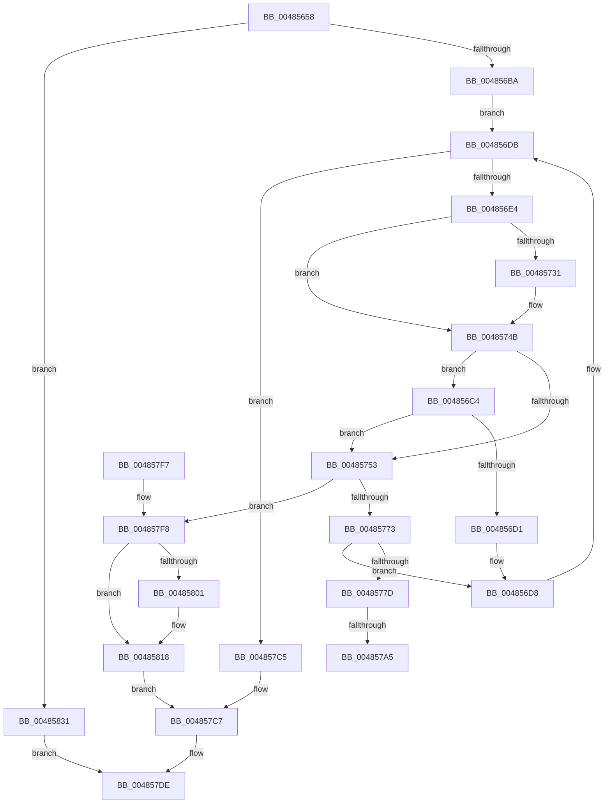

# CmpDoFileRead

- RVA: `0x00485658`–`0x00485850` (길이 `504` bytes)
- VA: `0x0000000140485658`
- 실행 섹션: `.text`
- PDB 이름 있음: `예`; PDB Function 태그: `예`
- unwind 정보 RVA: `0x000AF52C`
- 디코드: `125`개 명령, `504/504` bytes 표시
- 미해석 바이트: `0` (있으면 어셈블리에 `.byte`로 보존)

> 이 문서는 커널 이미지의 기계어와 PDB 기호를 분석해 생성했습니다. 4번과 5번은 함수 원형과 자료형을 바이너리 사용 방식에서 추정한 C 해석이며 원본 소스 복구 결과는 아닙니다.

## 1. Dependencies

- 직접 호출 지점: **8**; 고유 호출 대상: **6**
- 직접 호출자로 확인된 함수: **1**
- RIP 상대 이미지 참조: **3**

### Outgoing calls
- `0x004856AB` → [CmpCreateEvent](../../page/87/CmpCreateEvent_function_0087B638.md) (function, `0x0087B638`)
- `0x00485723` → [ZwReadFile](../6A/ZwReadFile_function_006AD190.md) (function, `0x006AD190`)
- `0x00485743` → [KeWaitForSingleObject](../20/KeWaitForSingleObject_function_0020E6B0.md) (function, `0x0020E6B0`)
- `0x00485786` → [ObfDereferenceObjectWithTag](../2F/ObfDereferenceObjectWithTag_function_002F78E0.md) (function, `0x002F78E0`)
- `0x0048578F` → [ZwClose](../6A/ZwClose_function_006AD2B0.md) (function, `0x006AD2B0`)
- `0x004857D0` → [ObfDereferenceObjectWithTag](../2F/ObfDereferenceObjectWithTag_function_002F78E0.md) (function, `0x002F78E0`)
- `0x004857D9` → [ZwClose](../6A/ZwClose_function_006AD2B0.md) (function, `0x006AD2B0`)
- `0x00485849` → [SetFailureLocation](../46/SetFailureLocation_function_0046EF54.md) (function, `0x0046EF54`)

### Direct callers
- [CmpFileRead](../../page/A6/CmpFileRead_function_00A6DBC0.md) at `0x00A6DBE7`

### Static image references
- `0x00485818` → RVA `0x00FD9EE0` (`PAGEDATA`; write)
- `0x00485822` → RVA `0x00FD9EE8` (`PAGEDATA`; write)
- `0x00485829` → RVA `0x00FD9EF0` (`PAGEDATA`; write)

## 2. Other-region calls and transfers

- 다른 실행 섹션으로 향하는 call: **1**
  - `0x004856AB` → [CmpCreateEvent](../../page/87/CmpCreateEvent_function_0087B638.md) (`.text` → `PAGE`)
- call이 아닌 외부 분기/꼬리 이동: **2**
  - `0x0048579F` → [sub_006F551C](../6F/Unknown_function_006F551C.md) (`tail-transfer`)
  - `0x004857C0` → [sub_006F551C](../6F/Unknown_function_006F551C.md) (`tail-transfer`)

## 3. Assembly (complete function range)

```asm
00485658  48 89 5C 24 08                  mov qword ptr [rsp + 8], rbx
0048565D  4C 89 4C 24 20                  mov qword ptr [rsp + 0x20], r9
00485662  44 89 44 24 18                  mov dword ptr [rsp + 0x18], r8d
00485667  55                              push rbp
00485668  56                              push rsi
00485669  57                              push rdi
0048566A  41 56                           push r14
0048566C  41 57                           push r15
0048566E  48 8B EC                        mov rbp, rsp
00485671  48 81 EC 80 00 00 00            sub rsp, 0x80
00485678  48 83 65 D0 00                  and qword ptr [rbp - 0x30], 0
0048567D  48 8D 55 E0                     lea rdx, [rbp - 0x20]
00485681  48 83 65 E0 00                  and qword ptr [rbp - 0x20], 0
00485686  41 8B F8                        mov edi, r8d
00485689  48 83 65 D8 00                  and qword ptr [rbp - 0x28], 0
0048568E  4C 8D 45 D8                     lea r8, [rbp - 0x28]
00485692  48 8B F1                        mov rsi, rcx
00485695  0F 57 C0                        xorps xmm0, xmm0
00485698  41 BE 01 00 00 00               mov r14d, 1
0048569E  41 BF 00 00 00 10               mov r15d, 0x10000000
004856A4  41 8B CE                        mov ecx, r14d
004856A7  0F 11 45 E8                     movups xmmword ptr [rbp - 0x18], xmm0
004856AB  E8 88 5F 3F 00                  call 0x14087b638
004856B0  8B D8                           mov ebx, eax
004856B2  85 C0                           test eax, eax
004856B4  0F 88 77 01 00 00               js 0x140485831
004856BA  44 8B 75 50                     mov r14d, dword ptr [rbp + 0x50]
004856BE  48 8B 4D 48                     mov rcx, qword ptr [rbp + 0x48]
004856C2  EB 17                           jmp 0x1404856db
004856C4  41 81 FF 00 00 01 00            cmp r15d, 0x10000
004856CB  0F 86 82 00 00 00               jbe 0x140485753
004856D1  48 8B 4D 48                     mov rcx, qword ptr [rbp + 0x48]
004856D5  41 D1 EF                        shr r15d, 1
004856D8  8B 7D 40                        mov edi, dword ptr [rbp + 0x40]
004856DB  45 85 F6                        test r14d, r14d
004856DE  0F 84 E1 00 00 00               je 0x1404857c5
004856E4  83 65 D4 00                     and dword ptr [rbp - 0x2c], 0
004856E8  48 8D 45 D0                     lea rax, [rbp - 0x30]
004856EC  48 8B 55 E0                     mov rdx, qword ptr [rbp - 0x20]
004856F0  45 3B F7                        cmp r14d, r15d
004856F3  89 7D D0                        mov dword ptr [rbp - 0x30], edi
004856F6  41 8B FF                        mov edi, r15d
004856F9  41 0F 46 FE                     cmovbe edi, r14d
004856FD  48 83 64 24 40 00               and qword ptr [rsp + 0x40], 0
00485703  48 89 44 24 38                  mov qword ptr [rsp + 0x38], rax
00485708  45 33 C9                        xor r9d, r9d
0048570B  89 7C 24 30                     mov dword ptr [rsp + 0x30], edi
0048570F  48 8D 45 E8                     lea rax, [rbp - 0x18]
00485713  48 89 4C 24 28                  mov qword ptr [rsp + 0x28], rcx
00485718  45 33 C0                        xor r8d, r8d
0048571B  48 8B CE                        mov rcx, rsi
0048571E  48 89 44 24 20                  mov qword ptr [rsp + 0x20], rax
00485723  E8 68 7A 22 00                  call 0x1406ad190
00485728  8B D8                           mov ebx, eax
0048572A  3D 03 01 00 00                  cmp eax, 0x103
0048572F  75 1A                           jne 0x14048574b
00485731  48 83 64 24 20 00               and qword ptr [rsp + 0x20], 0
00485737  45 33 C9                        xor r9d, r9d
0048573A  48 8B 4D D8                     mov rcx, qword ptr [rbp - 0x28]
0048573E  45 33 C0                        xor r8d, r8d
00485741  33 D2                           xor edx, edx
00485743  E8 68 8F D8 FF                  call 0x14020e6b0
00485748  8B 5D E8                        mov ebx, dword ptr [rbp - 0x18]
0048574B  85 DB                           test ebx, ebx
0048574D  0F 88 71 FF FF FF               js 0x1404856c4
00485753  8B 4D D0                        mov ecx, dword ptr [rbp - 0x30]
00485756  44 2B F7                        sub r14d, edi
00485759  03 CF                           add ecx, edi
0048575B  8B C7                           mov eax, edi
0048575D  89 4D 40                        mov dword ptr [rbp + 0x40], ecx
00485760  48 8B 4D 48                     mov rcx, qword ptr [rbp + 0x48]
00485764  48 03 C8                        add rcx, rax
00485767  48 89 4D 48                     mov qword ptr [rbp + 0x48], rcx
0048576B  85 DB                           test ebx, ebx
0048576D  0F 88 85 00 00 00               js 0x1404857f8
00485773  48 39 45 F0                     cmp qword ptr [rbp - 0x10], rax
00485777  0F 84 5B FF FF FF               je 0x1404856d8
0048577D  48 8B 4D D8                     mov rcx, qword ptr [rbp - 0x28]
00485781  BA 44 66 6C 74                  mov edx, 0x746c6644
00485786  E8 55 21 E7 FF                  call 0x1402f78e0
0048578B  48 8B 4D E0                     mov rcx, qword ptr [rbp - 0x20]
0048578F  E8 1C 7B 22 00                  call 0x1406ad2b0
00485794  48 8B 55 60                     mov rdx, qword ptr [rbp + 0x60]
00485798  48 8B 4D F0                     mov rcx, qword ptr [rbp - 0x10]
0048579C  48 85 D2                        test rdx, rdx
0048579F  0F 84 77 FD 26 00               je 0x1406f551c
004857A5  8B C1                           mov eax, ecx
004857A7  C7 82 D0 00 00 00 01 00 00 00   mov dword ptr [rdx + 0xd0], 1
004857B1  2B C7                           sub eax, edi
004857B3  48 89 B2 D8 00 00 00            mov qword ptr [rdx + 0xd8], rsi
004857BA  89 82 E0 00 00 00               mov dword ptr [rdx + 0xe0], eax
004857C0  E9 57 FD 26 00                  jmp 0x1406f551c
004857C5  33 DB                           xor ebx, ebx
004857C7  48 8B 4D D8                     mov rcx, qword ptr [rbp - 0x28]
004857CB  BA 44 66 6C 74                  mov edx, 0x746c6644
004857D0  E8 0B 21 E7 FF                  call 0x1402f78e0
004857D5  48 8B 4D E0                     mov rcx, qword ptr [rbp - 0x20]
004857D9  E8 D2 7A 22 00                  call 0x1406ad2b0
004857DE  8B C3                           mov eax, ebx
004857E0  48 8B 9C 24 B0 00 00 00         mov rbx, qword ptr [rsp + 0xb0]
004857E8  48 81 C4 80 00 00 00            add rsp, 0x80
004857EF  41 5F                           pop r15
004857F1  41 5E                           pop r14
004857F3  5F                              pop rdi
004857F4  5E                              pop rsi
004857F5  5D                              pop rbp
004857F6  C3                              ret
004857F7  CC                              int3
004857F8  48 8B 45 60                     mov rax, qword ptr [rbp + 0x60]
004857FC  48 85 C0                        test rax, rax
004857FF  74 17                           je 0x140485818
00485801  C7 80 D0 00 00 00 01 00 00 00   mov dword ptr [rax + 0xd0], 1
0048580B  48 89 B0 D8 00 00 00            mov qword ptr [rax + 0xd8], rsi
00485812  89 98 E0 00 00 00               mov dword ptr [rax + 0xe0], ebx
00485818  C7 05 BE 46 B5 00 01 00 00 00   mov dword ptr [rip + 0xb546be], 1
00485822  48 89 35 BF 46 B5 00            mov qword ptr [rip + 0xb546bf], rsi
00485829  89 1D C1 46 B5 00               mov dword ptr [rip + 0xb546c1], ebx
0048582F  EB 96                           jmp 0x1404857c7
00485831  48 8B 4D 60                     mov rcx, qword ptr [rbp + 0x60]
00485835  44 8B CB                        mov r9d, ebx
00485838  41 B8 0C 00 00 00               mov r8d, 0xc
0048583E  C7 44 24 20 10 00 00 00         mov dword ptr [rsp + 0x20], 0x10
00485846  41 8B D6                        mov edx, r14d
00485849  E8 06 97 FE FF                  call 0x14046ef54
0048584E  EB 8E                           jmp 0x1404857de
```

## 4. C-style interpretation (structured pseudocode)

```c
__int64 __fastcall CmpDoFileRead(__int64 a1, __int64 a2, int a3, __int64 a4, unsigned int a5, __int64 a6, __int64 a7)
{
    __int64 result;
    __int64 v_r14;
    __int64 v_r15;
    __int64 v_rbx;
    __int64 v_rdi;
    __int64 v_rsp;
    unsigned __int64 v_stack_m38;
    unsigned __int64 v_stack_m40;
    unsigned __int64 v_stack_m48;
    unsigned __int64 v_stack_m50;
    unsigned int v_stack_m54;
    unsigned __int64 v_stack_m58;
    unsigned __int64 v_stack_m68;
    unsigned __int64 v_stack_m70;
    unsigned int v_stack_m78;
    unsigned __int64 v_stack_m80;
    unsigned __int64 v_stack_m88;
    unsigned int v_stack_p18;
    unsigned __int64 v_stack_p20;
    unsigned __int64 v_stack_p8;

    v_stack_p8 = v_rbx;
    v_stack_p20 = a4;
    v_stack_p18 = a3;
    v_rsp = (v_rsp) - (128);
    v_stack_m40 = v_xmm0;
    result = CmpCreateEvent(1, v_stack_m48, v_stack_m50, a4);
    if (sign_flag) goto loc_00485831;
    goto loc_004856DB;
loc_004856C4:
    if (((unsigned int)((unsigned int)(0x10000000ULL))) <= 0x10000ULL) goto loc_00485753;
    v_r15 = (unsigned int)(((unsigned int)(0x10000000ULL)) >> (1));
loc_004856D8:
loc_004856DB:
    if ((unsigned int)((unsigned int)(a5)) == 0) goto loc_004857C5;
    v_stack_m58 = (unsigned int)((unsigned int)(v_stack_p18));
    v_rdi = (unsigned int)((unsigned int)(v_r15));
    if (((unsigned int)((unsigned int)(a5))) <= ((unsigned int)(v_r15))) { v_rdi = (unsigned int)((unsigned int)(a5)); }
    v_stack_m70 = v_stack_m58;
    a4 = 0;
    v_stack_m78 = (unsigned int)(v_rdi);
    v_stack_m80 = v_stack_p20;
    a3 = 0;
    v_stack_m88 = v_stack_m40;
    result = ZwReadFile(a1, v_stack_m48, a3, a4);
    v_rbx = (unsigned int)((unsigned int)(result));
    if (((unsigned int)(result)) == 259) {
        a4 = 0;
        a1 = v_stack_m50;
        a3 = 0;
        a2 = 0;
        result = KeWaitForSingleObject(a1, a2, a3, a4);
        v_rbx = v_stack_m40;
    }
    if (sign_flag) goto loc_004856C4;
loc_00485753:
    v_r14 = (unsigned int)(((unsigned int)(a5)) - ((unsigned int)(v_rdi)));
    a1 = (unsigned int)(((unsigned int)(v_stack_m58)) + ((unsigned int)(v_rdi)));
    v_stack_p18 = (unsigned int)(a1);
    a1 = (v_stack_p20) + ((unsigned int)((unsigned int)(v_rdi)));
    v_stack_p20 = a1;
    if (sign_flag) goto loc_004857F8;
    if (v_stack_m38 == ((unsigned int)((unsigned int)(v_rdi)))) goto loc_004856D8;
    result = ObfDereferenceObjectWithTag(v_stack_m50, (unsigned int)(0x746C6644ULL), a3, a4);
    result = ZwClose(v_stack_m48, (unsigned int)(0x746C6644ULL), a3, a4);
    *(unsigned int *)(a7 + 208) = 1;
    result = (unsigned int)(((unsigned int)((unsigned int)(v_stack_m38))) - ((unsigned int)(v_rdi)));
    *(unsigned __int64 *)(a7 + 216) = a1;
    *(unsigned int *)(a7 + 224) = (unsigned int)(result);
loc_004857C5:
    v_rbx = 0;
loc_004857C7:
    result = ObfDereferenceObjectWithTag(v_stack_m50, (unsigned int)(0x746C6644ULL), a3, a4);
    result = ZwClose(v_stack_m48, (unsigned int)(0x746C6644ULL), a3, a4);
loc_004857DE:
    v_rsp = (v_rsp) + (128);
    return 0;
loc_004857F8:
    if (a7 != 0) {
        *(unsigned int *)(a7 + 208) = 1;
        *(unsigned __int64 *)(a7 + 216) = a1;
        *(unsigned int *)(a7 + 224) = (unsigned int)(v_stack_p8);
    }
    *(unsigned int *)(v_rip + 11880126) = 1;
    *(unsigned __int64 *)(v_rip + 11880127) = a1;
    *(unsigned int *)(v_rip + 11880129) = (unsigned int)(v_stack_p8);
    goto loc_004857C7;
loc_00485831:
    v_stack_p20 = 16;
    result = SetFailureLocation(a7, (unsigned int)((unsigned int)(v_r14)), 12, (unsigned int)((unsigned int)(v_stack_p8)));
    goto loc_004857DE;
}
```

## 5. (Beta) C Style

```c
int64_t CmpDoFileRead(int64_t Arg1, int64_t Arg2, int32_t Arg3, int64_t Arg4, uint32_t Arg5, uint64_t Arg6, int64_t Arg7)
{
    int64_t result;
    int64_t local_r14;
    int64_t local_r15;
    int64_t local_rbx;
    int64_t local_rdi;
    int64_t local_rsp;
    uint64_t v_stack_m38;
    uint64_t v_stack_m40;
    uint64_t v_stack_m48;
    uint64_t v_stack_m50;
    uint32_t v_stack_m54;
    uint64_t v_stack_m58;
    uint64_t v_stack_m68;
    uint64_t v_stack_m70;
    uint32_t v_stack_m78;
    uint64_t v_stack_m80;
    uint64_t v_stack_m88;
    uint32_t v_stack_p18;
    uint64_t v_stack_p20;
    uint64_t v_stack_p8;

    v_stack_p8 = local_rbx;
    v_stack_p20 = Arg4;
    v_stack_p18 = Arg3;
    local_rsp = (local_rsp) - (128);
    v_stack_m40 = v_xmm0;
    result = CmpCreateEvent(1, v_stack_m48, v_stack_m50, Arg4);
    if (sign_flag) goto loc_00485831;
    goto loc_004856DB;
loc_004856C4:
    if (((uint32_t)((uint32_t)(0x10000000ULL))) <= 0x10000ULL) goto loc_00485753;
    local_r15 = (uint32_t)(((uint32_t)(0x10000000ULL)) >> (1));
loc_004856D8:
loc_004856DB:
    if ((uint32_t)((uint32_t)(Arg5)) == 0) goto loc_004857C5;
    v_stack_m58 = (uint32_t)((uint32_t)(v_stack_p18));
    local_rdi = (uint32_t)((uint32_t)(local_r15));
    if (((uint32_t)((uint32_t)(Arg5))) <= ((uint32_t)(local_r15))) { local_rdi = (uint32_t)((uint32_t)(Arg5)); }
    v_stack_m70 = v_stack_m58;
    Arg4 = 0;
    v_stack_m78 = (uint32_t)(local_rdi);
    v_stack_m80 = v_stack_p20;
    Arg3 = 0;
    v_stack_m88 = v_stack_m40;
    result = ZwReadFile(Arg1, v_stack_m48, Arg3, Arg4);
    local_rbx = (uint32_t)((uint32_t)(result));
    if (((uint32_t)(result)) == 259) {
        Arg4 = 0;
        Arg1 = v_stack_m50;
        Arg3 = 0;
        Arg2 = 0;
        result = KeWaitForSingleObject(Arg1, Arg2, Arg3, Arg4);
        local_rbx = v_stack_m40;
    }
    if (sign_flag) goto loc_004856C4;
loc_00485753:
    local_r14 = (uint32_t)(((uint32_t)(Arg5)) - ((uint32_t)(local_rdi)));
    Arg1 = (uint32_t)(((uint32_t)(v_stack_m58)) + ((uint32_t)(local_rdi)));
    v_stack_p18 = (uint32_t)(Arg1);
    Arg1 = (v_stack_p20) + ((uint32_t)((uint32_t)(local_rdi)));
    v_stack_p20 = Arg1;
    if (sign_flag) goto loc_004857F8;
    if (v_stack_m38 == ((uint32_t)((uint32_t)(local_rdi)))) goto loc_004856D8;
    result = ObfDereferenceObjectWithTag(v_stack_m50, (uint32_t)(0x746C6644ULL), Arg3, Arg4);
    result = ZwClose(v_stack_m48, (uint32_t)(0x746C6644ULL), Arg3, Arg4);
    *(uint32_t *)(Arg7 + 0xD0) = 1;
    result = (uint32_t)(((uint32_t)((uint32_t)(v_stack_m38))) - ((uint32_t)(local_rdi)));
    *(uint64_t *)(Arg7 + 0xD8) = Arg1;
    *(uint32_t *)(Arg7 + 0xE0) = (uint32_t)(result);
loc_004857C5:
    local_rbx = 0;
loc_004857C7:
    result = ObfDereferenceObjectWithTag(v_stack_m50, (uint32_t)(0x746C6644ULL), Arg3, Arg4);
    result = ZwClose(v_stack_m48, (uint32_t)(0x746C6644ULL), Arg3, Arg4);
loc_004857DE:
    local_rsp = (local_rsp) + (128);
    return 0;
loc_004857F8:
    if (Arg7 != 0) {
        *(uint32_t *)(Arg7 + 0xD0) = 1;
        *(uint64_t *)(Arg7 + 0xD8) = Arg1;
        *(uint32_t *)(Arg7 + 0xE0) = (uint32_t)(v_stack_p8);
    }
    *(uint32_t *)(v_rip + 0xB546BE) = 1;
    *(uint64_t *)(v_rip + 0xB546BF) = Arg1;
    *(uint32_t *)(v_rip + 0xB546C1) = (uint32_t)(v_stack_p8);
    goto loc_004857C7;
loc_00485831:
    v_stack_p20 = 16;
    result = SetFailureLocation(Arg7, (uint32_t)((uint32_t)(local_r14)), 12, (uint32_t)((uint32_t)(v_stack_p8)));
    goto loc_004857DE;
}
```

## 6. Execution-region graph

[열기: 2D/3D 그래프와 함수 탐색 컨트롤 패널](../../../control-panel.html?section=text&rva=0x00485658&view=graph)

- 2D 그래프는 위에서 아래로 흐르고, 3D 그래프는 빈 공간을 드래그해 회전합니다. Shift+드래그는 이동, 휠은 확대·축소, 함수 노드 선택은 대상 보고서 이동입니다.

### Static fallback


