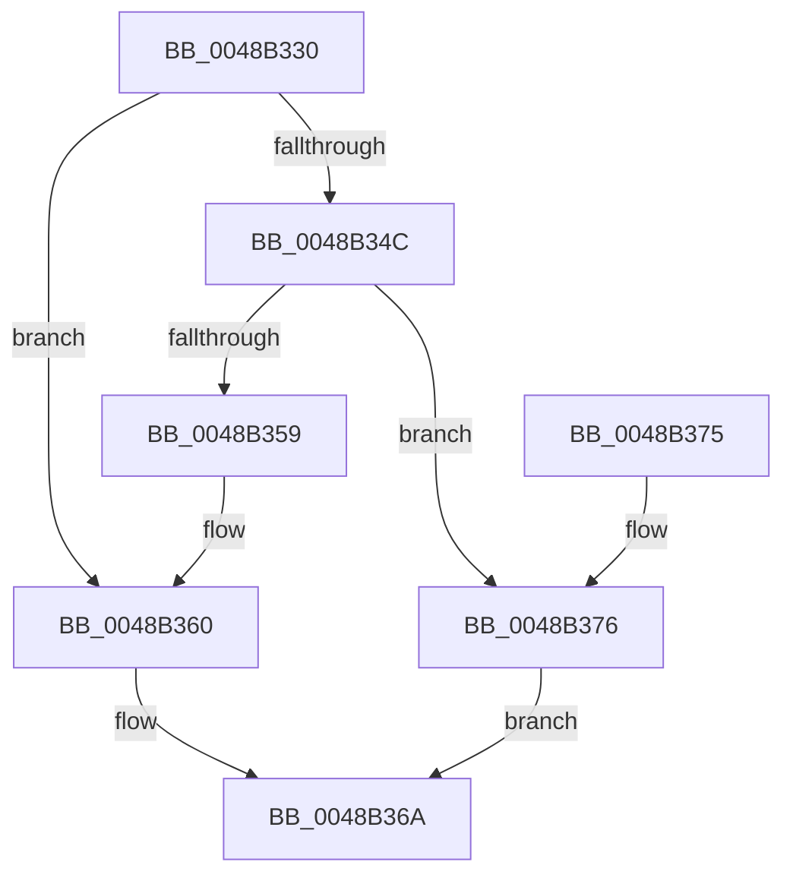

# CmpTransEnlistUowInCmTrans

- RVA: `0x0048B330`–`0x0048B391` (길이 `97` bytes)
- VA: `0x000000014048B330`
- 실행 섹션: `.text`
- PDB 이름 있음: `예`; PDB Function 태그: `아니요`
- unwind 정보 RVA: `0x0007CED0`
- 디코드: `30`개 명령, `97/97` bytes 표시
- 미해석 바이트: `0` (있으면 어셈블리에 `.byte`로 보존)

> 이 문서는 커널 이미지의 기계어와 PDB 기호를 분석해 생성했습니다. 4번과 5번은 함수 원형과 자료형을 바이너리 사용 방식에서 추정한 C 해석이며 원본 소스 복구 결과는 아닙니다.

## 1. Dependencies

- 직접 호출 지점: **3**; 고유 호출 대상: **2**
- 직접 호출자로 확인된 함수: **9**
- RIP 상대 이미지 참조: **0**

### Outgoing calls
- `0x0048B340` → [LOCK_TRANSACTION_LIST](../../page/87/LOCK_TRANSACTION_LIST_function_00874AD4.md) (function, `0x00874AD4`)
- `0x0048B360` → [UNLOCK_TRANSACTION_LIST](../../page/A6/UNLOCK_TRANSACTION_LIST_function_00A61EB8.md) (function, `0x00A61EB8`)
- `0x0048B384` → [UNLOCK_TRANSACTION_LIST](../../page/A6/UNLOCK_TRANSACTION_LIST_function_00A61EB8.md) (function, `0x00A61EB8`)

### Direct callers
- [CmSetLastWriteTimeKey](../../page/84/CmSetLastWriteTimeKey_function_00843368.md) at `0x0084361F`
- [CmSetValueKey](../../page/84/CmSetValueKey_function_008457C0.md) at `0x00846103`
- [CmDeleteValueKey](../../page/84/CmDeleteValueKey_function_008476E8.md) at `0x00847E28`
- [CmDeleteKey](../../page/84/CmDeleteKey_function_00848E5C.md) at `0x008494C3`
- [CmDeleteKey](../../page/84/CmDeleteKey_function_00848E5C.md) at `0x008494E3`
- [CmpCreateChild](../../page/94/CmpCreateChild_function_0094817C.md) at `0x00949067`
- [CmpUndoDeleteKeyForTrans](../../page/94/CmpUndoDeleteKeyForTrans_function_0094A728.md) at `0x0094A890`
- [CmpUndoDeleteKeyForTrans](../../page/94/CmpUndoDeleteKeyForTrans_function_0094A728.md) at `0x0094A945`
- [sub_00B258D8](../../page/B2/Unknown_function_00B258D8.md) at `0x00B259FB`
- [sub_00B25E36](../../page/B2/Unknown_function_00B25E36.md) at `0x00B25EAD`
- [sub_00B2D804](../../page/B2/Unknown_function_00B2D804.md) at `0x00B2D885`

### Static image references
- 디코드된 RIP-relative 메모리 참조가 없습니다.

## 2. Other-region calls and transfers

- 다른 실행 섹션으로 향하는 call: **3**
  - `0x0048B340` → [LOCK_TRANSACTION_LIST](../../page/87/LOCK_TRANSACTION_LIST_function_00874AD4.md) (`.text` → `PAGE`)
  - `0x0048B360` → [UNLOCK_TRANSACTION_LIST](../../page/A6/UNLOCK_TRANSACTION_LIST_function_00A61EB8.md) (`.text` → `PAGE`)
  - `0x0048B384` → [UNLOCK_TRANSACTION_LIST](../../page/A6/UNLOCK_TRANSACTION_LIST_function_00A61EB8.md) (`.text` → `PAGE`)
- 별도 외부 분기/꼬리 이동을 확인하지 못했습니다.

## 3. Assembly (complete function range)

```asm
0048B330  48 89 5C 24 08                  mov qword ptr [rsp + 8], rbx
0048B335  57                              push rdi
0048B336  48 83 EC 20                     sub rsp, 0x20
0048B33A  48 8B FA                        mov rdi, rdx
0048B33D  48 8B D9                        mov rbx, rcx
0048B340  E8 8F 97 3E 00                  call 0x140874ad4
0048B345  8B 47 30                        mov eax, dword ptr [rdi + 0x30]
0048B348  A8 07                           test al, 7
0048B34A  75 14                           jne 0x14048b360
0048B34C  48 8D 47 10                     lea rax, [rdi + 0x10]
0048B350  48 8B 48 08                     mov rcx, qword ptr [rax + 8]
0048B354  48 39 01                        cmp qword ptr [rcx], rax
0048B357  74 1D                           je 0x14048b376
0048B359  B9 03 00 00 00                  mov ecx, 3
0048B35E  CD 29                           int 0x29
0048B360  E8 53 6B 5D 00                  call 0x140a61eb8
0048B365  B8 02 00 19 C0                  mov eax, 0xc0190002
0048B36A  48 8B 5C 24 30                  mov rbx, qword ptr [rsp + 0x30]
0048B36F  48 83 C4 20                     add rsp, 0x20
0048B373  5F                              pop rdi
0048B374  C3                              ret
0048B375  CC                              int3
0048B376  48 89 03                        mov qword ptr [rbx], rax
0048B379  48 89 4B 08                     mov qword ptr [rbx + 8], rcx
0048B37D  48 89 19                        mov qword ptr [rcx], rbx
0048B380  48 89 58 08                     mov qword ptr [rax + 8], rbx
0048B384  E8 2F 6B 5D 00                  call 0x140a61eb8
0048B389  33 C0                           xor eax, eax
0048B38B  48 89 7B 38                     mov qword ptr [rbx + 0x38], rdi
0048B38F  EB D9                           jmp 0x14048b36a
```

## 4. C-style interpretation (structured pseudocode)

```c
__int64 __fastcall CmpTransEnlistUowInCmTrans(__int64 a1, __int64 a2)
{
    __int64 result;
    __int64 v_rsp;
    unsigned __int64 v_stack_p8;

    v_stack_p8 = v_rbx;
    v_rsp = (v_rsp) - (32);
    result = LOCK_TRANSACTION_LIST(a1, a2, a3, a4);
    if ((((unsigned __int8)((unsigned int)(*(unsigned int *)(a2 + 48)))) & (7)) != 0) goto loc_0048B360;
    if ((*(unsigned __int64 *)(*(unsigned __int64 *)(a2 + 16 + 8))) == (a2 + 16)) goto loc_0048B376;
loc_0048B360:
    result = UNLOCK_TRANSACTION_LIST(3, a2, a3, a4);
loc_0048B36A:
    v_rsp = (v_rsp) + (32);
    return (unsigned int)(0xC0190002ULL);
loc_0048B376:
    *(unsigned __int64 *)(v_stack_p8) = (unsigned int)(0xC0190002ULL);
    *(unsigned __int64 *)(v_stack_p8 + 8) = 3;
    *(unsigned __int64 *)(3) = v_stack_p8;
    *(unsigned __int64 *)((unsigned int)(0xC0190002ULL) + 8) = v_stack_p8;
    result = UNLOCK_TRANSACTION_LIST(3, a2, a3, a4);
    result = 0;
    *(unsigned __int64 *)(v_stack_p8 + 56) = a2;
    goto loc_0048B36A;
}
```

## 5. (Beta) C Style

```c
int64_t CmpTransEnlistUowInCmTrans(void *Arg1, void *Arg2)
{
    uint8_t *arg1 = (uint8_t *)Arg1;
    uint8_t *arg2 = (uint8_t *)Arg2;

    int64_t result;
    int64_t local_rsp;
    uint64_t v_stack_p8;

    v_stack_p8 = local_rbx;
    local_rsp = (local_rsp) - (32);
    result = LOCK_TRANSACTION_LIST(Arg1, Arg2, a3, a4);
    if ((((uint8_t)((uint32_t)(*(uint32_t *)(arg2 + 0x30)))) & (7)) != 0) goto loc_0048B360;
    if ((*(uint64_t *)(*(uint64_t *)(arg2 + 0x10 + 0x8))) == (Arg2 + 16)) goto loc_0048B376;
loc_0048B360:
    result = UNLOCK_TRANSACTION_LIST(3, Arg2, a3, a4);
loc_0048B36A:
    local_rsp = (local_rsp) + (32);
    return (uint32_t)(0xC0190002ULL);
loc_0048B376:
    *(uint64_t *)(v_stack_p8) = (uint32_t)(0xC0190002ULL);
    *(uint64_t *)(v_stack_p8 + 0x8) = 3;
    *(uint64_t *)(3) = v_stack_p8;
    *(uint64_t *)((uint32_t)(0xC0190002ULL) + 0x8) = v_stack_p8;
    result = UNLOCK_TRANSACTION_LIST(3, Arg2, a3, a4);
    result = 0;
    *(void **)(v_stack_p8 + 0x38) = Arg2;
    goto loc_0048B36A;
}
```

### 관측된 메모리 오프셋

구조체 형식이 확인되지 않은 접근은 인자 기준의 오프셋으로만 기록했습니다.

| 기준 인자 | 오프셋 표현 | 폭 (bit) | 접근 |
|---|---:|---:|---|
| `Arg1` | `+ 0x0` | `64` | `W` |
| `Arg1` | `+ 0x8` | `64` | `W` |
| `Arg1` | `+ 0x38` | `64` | `W` |
| `Arg2` | `+ 0x8` | `64` | `R` |
| `Arg2` | `+ 0x8` | `64` | `W` |
| `Arg2` | `+ 0x10` | `64` | `R` |
| `Arg2` | `+ 0x30` | `32` | `R` |

## 6. Execution-region graph

[열기: 2D/3D 그래프와 함수 탐색 컨트롤 패널](../../../control-panel.html?section=text&rva=0x0048B330&view=graph)

- 2D 그래프는 위에서 아래로 흐르고, 3D 그래프는 빈 공간을 드래그해 회전합니다. Shift+드래그는 이동, 휠은 확대·축소, 함수 노드 선택은 대상 보고서 이동입니다.

### Static fallback


