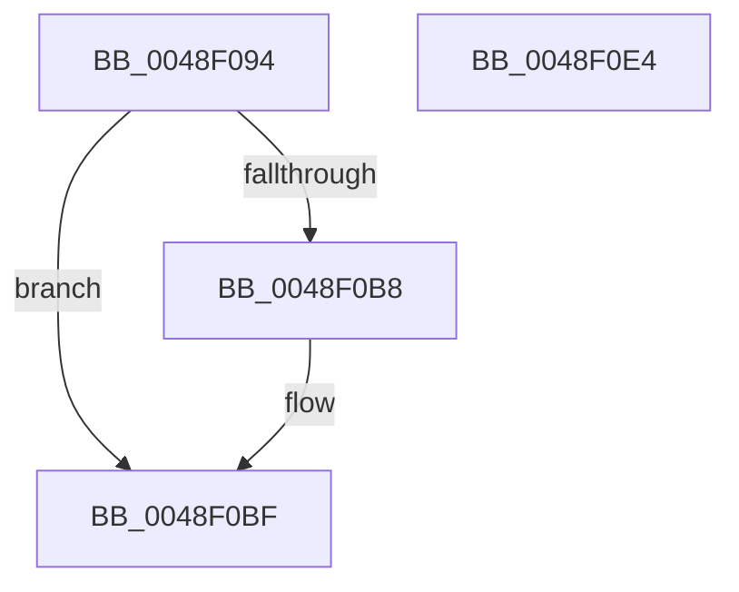

# CmpTransEnlistUowInKcb

- RVA: `0x0048F094`–`0x0048F0E5` (길이 `81` bytes)
- VA: `0x000000014048F094`
- 실행 섹션: `.text`
- PDB 이름 있음: `예`; PDB Function 태그: `아니요`
- unwind 정보 RVA: `0x0005CAAC`
- 디코드: `24`개 명령, `81/81` bytes 표시
- 미해석 바이트: `0` (있으면 어셈블리에 `.byte`로 보존)

> 이 문서는 커널 이미지의 기계어와 PDB 기호를 분석해 생성했습니다. 4번과 5번은 함수 원형과 자료형을 바이너리 사용 방식에서 추정한 C 해석이며 원본 소스 복구 결과는 아닙니다.

## 1. Dependencies

- 직접 호출 지점: **1**; 고유 호출 대상: **1**
- 직접 호출자로 확인된 함수: **9**
- RIP 상대 이미지 참조: **0**

### Outgoing calls
- `0x0048F0D0` → [CmpReferenceKeyControlBlock](../../page/85/CmpReferenceKeyControlBlock_function_0085D370.md) (function, `0x0085D370`)

### Direct callers
- [CmSetLastWriteTimeKey](../../page/84/CmSetLastWriteTimeKey_function_00843368.md) at `0x00843614`
- [CmSetValueKey](../../page/84/CmSetValueKey_function_008457C0.md) at `0x008460F8`
- [CmDeleteValueKey](../../page/84/CmDeleteValueKey_function_008476E8.md) at `0x00847E1D`
- [CmDeleteKey](../../page/84/CmDeleteKey_function_00848E5C.md) at `0x008494B8`
- [CmDeleteKey](../../page/84/CmDeleteKey_function_00848E5C.md) at `0x008494D8`
- [CmpCreateChild](../../page/94/CmpCreateChild_function_0094817C.md) at `0x00949052`
- [CmpUndoDeleteKeyForTrans](../../page/94/CmpUndoDeleteKeyForTrans_function_0094A728.md) at `0x0094A883`
- [CmpUndoDeleteKeyForTrans](../../page/94/CmpUndoDeleteKeyForTrans_function_0094A728.md) at `0x0094A939`
- [sub_00B258D8](../../page/B2/Unknown_function_00B258D8.md) at `0x00B259E9`
- [sub_00B25E36](../../page/B2/Unknown_function_00B25E36.md) at `0x00B25EA2`
- [sub_00B2D804](../../page/B2/Unknown_function_00B2D804.md) at `0x00B2D87A`

### Static image references
- 디코드된 RIP-relative 메모리 참조가 없습니다.

## 2. Other-region calls and transfers

- 다른 실행 섹션으로 향하는 call: **1**
  - `0x0048F0D0` → [CmpReferenceKeyControlBlock](../../page/85/CmpReferenceKeyControlBlock_function_0085D370.md) (`.text` → `PAGE`)
- 별도 외부 분기/꼬리 이동을 확인하지 못했습니다.

## 3. Assembly (complete function range)

```asm
0048F094  48 89 5C 24 08                  mov qword ptr [rsp + 8], rbx
0048F099  57                              push rdi
0048F09A  48 83 EC 20                     sub rsp, 0x20
0048F09E  4C 8D 82 D0 00 00 00            lea r8, [rdx + 0xd0]
0048F0A5  48 8B DA                        mov rbx, rdx
0048F0A8  49 8B 50 08                     mov rdx, qword ptr [r8 + 8]
0048F0AC  48 8D 41 20                     lea rax, [rcx + 0x20]
0048F0B0  48 8B F9                        mov rdi, rcx
0048F0B3  4C 39 02                        cmp qword ptr [rdx], r8
0048F0B6  74 07                           je 0x14048f0bf
0048F0B8  B9 03 00 00 00                  mov ecx, 3
0048F0BD  CD 29                           int 0x29
0048F0BF  4C 89 00                        mov qword ptr [rax], r8
0048F0C2  48 8B CB                        mov rcx, rbx
0048F0C5  48 89 50 08                     mov qword ptr [rax + 8], rdx
0048F0C9  48 89 02                        mov qword ptr [rdx], rax
0048F0CC  49 89 40 08                     mov qword ptr [r8 + 8], rax
0048F0D0  E8 9B E2 3C 00                  call 0x14085d370
0048F0D5  48 89 5F 30                     mov qword ptr [rdi + 0x30], rbx
0048F0D9  48 8B 5C 24 30                  mov rbx, qword ptr [rsp + 0x30]
0048F0DE  48 83 C4 20                     add rsp, 0x20
0048F0E2  5F                              pop rdi
0048F0E3  C3                              ret
0048F0E4  CC                              int3
```

## 4. C-style interpretation (structured pseudocode)

```c
__int64 __fastcall CmpTransEnlistUowInKcb(__int64 a1, __int64 a2)
{
    __int64 result;
    __int64 v_rsp;
    unsigned __int64 v_stack_p8;

    v_stack_p8 = v_rbx;
    v_rsp = (v_rsp) - (32);
    if ((*(unsigned __int64 *)(*(unsigned __int64 *)(a2 + 208 + 8))) != (a2 + 208)) {
        a1 = 3;
    }
    *(unsigned __int64 *)(a1 + 32) = a2 + 208;
    *(unsigned __int64 *)(a1 + 32 + 8) = *(unsigned __int64 *)(a2 + 208 + 8);
    *(unsigned __int64 *)(*(unsigned __int64 *)(a2 + 208 + 8)) = a1 + 32;
    *(unsigned __int64 *)(a2 + 208 + 8) = a1 + 32;
    result = CmpReferenceKeyControlBlock(a2, *(unsigned __int64 *)(a2 + 208 + 8), a2 + 208, a4);
    *(unsigned __int64 *)(a1 + 48) = a2;
    v_rsp = (v_rsp) + (32);
    return result;
}
```

## 5. (Beta) C Style

```c
int64_t CmpTransEnlistUowInKcb(void *Arg1, void *Arg2)
{
    uint8_t *arg1 = (uint8_t *)Arg1;
    uint8_t *arg2 = (uint8_t *)Arg2;

    int64_t result;
    int64_t local_rsp;
    uint64_t v_stack_p8;

    v_stack_p8 = local_rbx;
    local_rsp = (local_rsp) - (32);
    if ((*(uint64_t *)(*(uint64_t *)(arg2 + 0xD0 + 0x8))) != (Arg2 + 208)) {
        Arg1 = 3;
    }
    *(void **)(arg1 + 0x20) = Arg2 + 208;
    *(uint64_t *)(arg1 + 0x20 + 0x8) = *(uint64_t *)(arg2 + 0xD0 + 0x8);
    *(void **)(*(uint64_t *)(arg2 + 0xD0 + 0x8)) = Arg1 + 32;
    *(void **)(arg2 + 0xD0 + 0x8) = Arg1 + 32;
    result = CmpReferenceKeyControlBlock(Arg2, *(uint64_t *)(arg2 + 0xD0 + 0x8), Arg2 + 208, a4);
    *(void **)(arg1 + 0x30) = Arg2;
    local_rsp = (local_rsp) + (32);
    return result;
}
```

### 관측된 메모리 오프셋

구조체 형식이 확인되지 않은 접근은 인자 기준의 오프셋으로만 기록했습니다.

| 기준 인자 | 오프셋 표현 | 폭 (bit) | 접근 |
|---|---:|---:|---|
| `Arg1` | `+ 0x0` | `64` | `W` |
| `Arg1` | `+ 0x8` | `64` | `W` |
| `Arg1` | `+ 0x20` | `64` | `R` |
| `Arg1` | `+ 0x30` | `64` | `W` |
| `Arg2` | `+ 0x8` | `64` | `R` |
| `Arg2` | `+ 0x8` | `64` | `W` |
| `Arg2` | `+ 0xD0` | `64` | `R` |

## 6. Execution-region graph

[열기: 2D/3D 그래프와 함수 탐색 컨트롤 패널](../../../control-panel.html?section=text&rva=0x0048F094&view=graph)

- 2D 그래프는 위에서 아래로 흐르고, 3D 그래프는 빈 공간을 드래그해 회전합니다. Shift+드래그는 이동, 휠은 확대·축소, 함수 노드 선택은 대상 보고서 이동입니다.

### Static fallback


