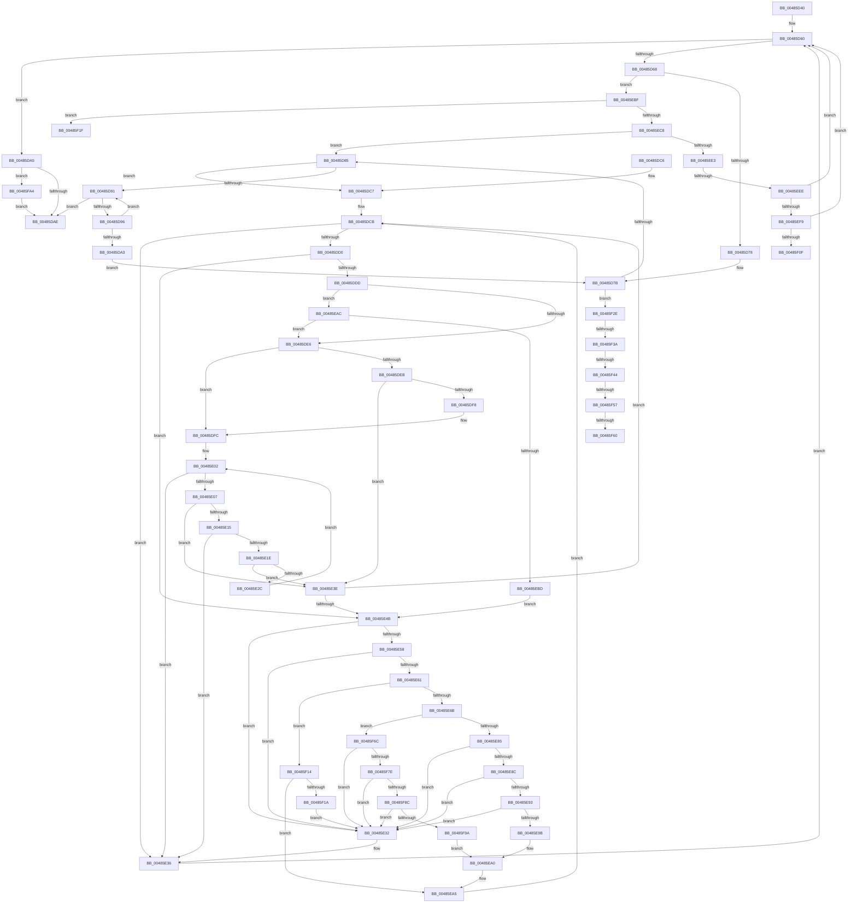

# CountUTF8ToUnicode

- RVA: `0x00485D40`–`0x00485FB8` (길이 `632` bytes)
- VA: `0x0000000140485D40`
- 실행 섹션: `.text`
- PDB 이름 있음: `예`; PDB Function 태그: `예`
- unwind 정보 RVA: `0x000AF6AC`
- 디코드: `176`개 명령, `632/632` bytes 표시
- 미해석 바이트: `0` (있으면 어셈블리에 `.byte`로 보존)

> 이 문서는 커널 이미지의 기계어와 PDB 기호를 분석해 생성했습니다. 4번과 5번은 함수 원형과 자료형을 바이너리 사용 방식에서 추정한 C 해석이며 원본 소스 복구 결과는 아닙니다.

## 1. Dependencies

- 직접 호출 지점: **0**; 고유 호출 대상: **0**
- 직접 호출자로 확인된 함수: **2**
- RIP 상대 이미지 참조: **0**

### Outgoing calls
- 직접 디코드된 call 명령이 없습니다.

### Direct callers
- [RtlUTF8StringToUnicodeString](../../page/79/RtlUTF8StringToUnicodeString_function_00794B80.md) at `0x00794BAE`
- [sub_0090E28C](../../page/90/Unknown_function_0090E28C.md) at `0x0090E29D`

### Static image references
- 디코드된 RIP-relative 메모리 참조가 없습니다.

## 2. Other-region calls and transfers

- 다른 실행 섹션으로 향하는 call: **0**
- call이 아닌 외부 분기/꼬리 이동: **8**
  - `0x00485EE8` → [sub_006F5540](../6F/Unknown_function_006F5540.md) (`tail-transfer`)
  - `0x00485F0F` → [sub_006F5540 + 0x15](../6F/Unknown_function_006F5540.md) (`tail-transfer`)
  - `0x00485F29` → [sub_006F5540 + 0x15](../6F/Unknown_function_006F5540.md) (`tail-transfer`)
  - `0x00485F34` → [sub_006F5540 + 0x15](../6F/Unknown_function_006F5540.md) (`tail-transfer`)
  - `0x00485F3E` → [sub_006F5540 + 0x30](../6F/Unknown_function_006F5540.md) (`tail-transfer`)
  - `0x00485F51` → [sub_006F5540 + 0x22](../6F/Unknown_function_006F5540.md) (`tail-transfer`)
  - `0x00485F5A` → [sub_006F5540 + 0x15](../6F/Unknown_function_006F5540.md) (`tail-transfer`)
  - `0x00485F67` → [sub_006F5540 + 0x29](../6F/Unknown_function_006F5540.md) (`tail-transfer`)

## 3. Assembly (complete function range)

```asm
00485D40  48 89 5C 24 08                  mov qword ptr [rsp + 8], rbx
00485D45  48 89 6C 24 10                  mov qword ptr [rsp + 0x10], rbp
00485D4A  48 89 7C 24 18                  mov qword ptr [rsp + 0x18], rdi
00485D4F  8B DA                           mov ebx, edx
00485D51  45 33 C9                        xor r9d, r9d
00485D54  48 03 D9                        add rbx, rcx
00485D57  45 33 DB                        xor r11d, r11d
00485D5A  83 CD FF                        or ebp, 0xffffffff
00485D5D  49 8B F8                        mov rdi, r8
00485D60  4C 8B D1                        mov r10, rcx
00485D63  48 3B CB                        cmp rcx, rbx
00485D66  73 3D                           jae 0x140485da5
00485D68  44 0F BE 01                     movsx r8d, byte ptr [rcx]
00485D6C  48 FF C1                        inc rcx
00485D6F  45 85 C9                        test r9d, r9d
00485D72  0F 85 47 01 00 00               jne 0x140485ebf
00485D78  45 8B C8                        mov r9d, r8d
00485D7B  41 83 F9 7F                     cmp r9d, 0x7f
00485D7F  0F 87 A9 01 00 00               ja 0x140485f2e
00485D85  48 8B C3                        mov rax, rbx
00485D88  48 2B C1                        sub rax, rcx
00485D8B  48 83 F8 0D                     cmp rax, 0xd
00485D8F  77 36                           ja 0x140485dc7
00485D91  48 3B CB                        cmp rcx, rbx
00485D94  73 18                           jae 0x140485dae
00485D96  44 0F BE 09                     movsx r9d, byte ptr [rcx]
00485D9A  48 FF C1                        inc rcx
00485D9D  41 83 F9 7F                     cmp r9d, 0x7f
00485DA1  76 EE                           jbe 0x140485d91
00485DA3  EB D6                           jmp 0x140485d7b
00485DA5  45 85 C9                        test r9d, r9d
00485DA8  0F 85 F6 01 00 00               jne 0x140485fa4
00485DAE  48 8B 5C 24 08                  mov rbx, qword ptr [rsp + 8]
00485DB3  8D 0C 12                        lea ecx, [rdx + rdx]
00485DB6  48 8B 6C 24 10                  mov rbp, qword ptr [rsp + 0x10]
00485DBB  41 8B C3                        mov eax, r11d
00485DBE  89 0F                           mov dword ptr [rdi], ecx
00485DC0  48 8B 7C 24 18                  mov rdi, qword ptr [rsp + 0x18]
00485DC5  C3                              ret
00485DC6  CC                              int3
00485DC7  4C 8D 53 F9                     lea r10, [rbx - 7]
00485DCB  49 3B CA                        cmp rcx, r10
00485DCE  73 66                           jae 0x140485e36
00485DD0  44 0F BE 01                     movsx r8d, byte ptr [rcx]
00485DD4  48 FF C1                        inc rcx
00485DD7  41 83 F8 7F                     cmp r8d, 0x7f
00485DDB  77 6E                           ja 0x140485e4b
00485DDD  F6 C1 01                        test cl, 1
00485DE0  0F 85 C6 00 00 00               jne 0x140485eac
00485DE6  F6 C1 02                        test cl, 2
00485DE9  74 11                           je 0x140485dfc
00485DEB  44 0F B7 01                     movzx r8d, word ptr [rcx]
00485DEF  41 F7 C0 80 80 00 00            test r8d, 0x8080
00485DF6  75 46                           jne 0x140485e3e
00485DF8  48 83 C1 02                     add rcx, 2
00485DFC  41 B9 80 80 80 80               mov r9d, 0x80808080
00485E02  49 3B CA                        cmp rcx, r10
00485E05  73 2F                           jae 0x140485e36
00485E07  44 8B 01                        mov r8d, dword ptr [rcx]
00485E0A  41 8B C0                        mov eax, r8d
00485E0D  0B 41 04                        or eax, dword ptr [rcx + 4]
00485E10  41 85 C1                        test r9d, eax
00485E13  75 29                           jne 0x140485e3e
00485E15  48 83 C1 08                     add rcx, 8
00485E19  49 3B CA                        cmp rcx, r10
00485E1C  73 18                           jae 0x140485e36
00485E1E  44 8B 01                        mov r8d, dword ptr [rcx]
00485E21  41 8B C0                        mov eax, r8d
00485E24  0B 41 04                        or eax, dword ptr [rcx + 4]
00485E27  41 85 C1                        test r9d, eax
00485E2A  75 12                           jne 0x140485e3e
00485E2C  48 83 C1 08                     add rcx, 8
00485E30  EB D0                           jmp 0x140485e02
00485E32  48 83 E9 02                     sub rcx, 2
00485E36  45 33 C9                        xor r9d, r9d
00485E39  E9 22 FF FF FF                  jmp 0x140485d60
00485E3E  45 0F B6 C0                     movzx r8d, r8b
00485E42  48 FF C1                        inc rcx
00485E45  41 83 F8 7F                     cmp r8d, 0x7f
00485E49  76 80                           jbe 0x140485dcb
00485E4B  44 0F BE 09                     movsx r9d, byte ptr [rcx]
00485E4F  48 FF C1                        inc rcx
00485E52  41 F6 C0 40                     test r8b, 0x40
00485E56  74 DA                           je 0x140485e32
00485E58  41 8B C1                        mov eax, r9d
00485E5B  24 C0                           and al, 0xc0
00485E5D  3C 80                           cmp al, 0x80
00485E5F  75 D1                           jne 0x140485e32
00485E61  41 F6 C0 20                     test r8b, 0x20
00485E65  0F 84 A9 00 00 00               je 0x140485f14
00485E6B  41 83 E1 3F                     and r9d, 0x3f
00485E6F  41 8B C0                        mov eax, r8d
00485E72  83 E0 0F                        and eax, 0xf
00485E75  C1 E0 06                        shl eax, 6
00485E78  41 0B C1                        or eax, r9d
00485E7B  41 F6 C0 10                     test r8b, 0x10
00485E7F  0F 85 E7 00 00 00               jne 0x140485f6c
00485E85  25 E0 03 00 00                  and eax, 0x3e0
00485E8A  74 A6                           je 0x140485e32
00485E8C  3D 60 03 00 00                  cmp eax, 0x360
00485E91  74 9F                           je 0x140485e32
00485E93  8A 01                           mov al, byte ptr [rcx]
00485E95  24 C0                           and al, 0xc0
00485E97  3C 80                           cmp al, 0x80
00485E99  75 97                           jne 0x140485e32
00485E9B  B8 01 00 00 00                  mov eax, 1
00485EA0  03 D5                           add edx, ebp
00485EA2  48 03 C8                        add rcx, rax
00485EA5  03 D5                           add edx, ebp
00485EA7  E9 1F FF FF FF                  jmp 0x140485dcb
00485EAC  44 0F BE 01                     movsx r8d, byte ptr [rcx]
00485EB0  48 FF C1                        inc rcx
00485EB3  41 83 F8 7F                     cmp r8d, 0x7f
00485EB7  0F 86 29 FF FF FF               jbe 0x140485de6
00485EBD  EB 8C                           jmp 0x140485e4b
00485EBF  41 8B C0                        mov eax, r8d
00485EC2  24 C0                           and al, 0xc0
00485EC4  3C 80                           cmp al, 0x80
00485EC6  75 57                           jne 0x140485f1f
00485EC8  41 8B C1                        mov eax, r9d
00485ECB  41 83 E0 3F                     and r8d, 0x3f
00485ECF  C1 E0 06                        shl eax, 6
00485ED2  45 8B C8                        mov r9d, r8d
00485ED5  44 0B C8                        or r9d, eax
00485ED8  41 0F BA E1 1D                  bt r9d, 0x1d
00485EDD  0F 82 A2 FE FF FF               jb 0x140485d85
00485EE3  41 0F BA E1 1C                  bt r9d, 0x1c
00485EE8  0F 83 52 F6 26 00               jae 0x1406f5540
00485EEE  41 0F BA E1 17                  bt r9d, 0x17
00485EF3  0F 82 67 FE FF FF               jb 0x140485d60
00485EF9  41 8B C1                        mov eax, r9d
00485EFC  25 F0 01 00 00                  and eax, 0x1f0
00485F01  83 E8 10                        sub eax, 0x10
00485F04  3D F0 00 00 00                  cmp eax, 0xf0
00485F09  0F 86 51 FE FF FF               jbe 0x140485d60
00485F0F  E9 41 F6 26 00                  jmp 0x1406f5555
00485F14  41 F6 C0 1E                     test r8b, 0x1e
00485F18  75 8B                           jne 0x140485ea5
00485F1A  E9 13 FF FF FF                  jmp 0x140485e32
00485F1F  41 C1 F9 1E                     sar r9d, 0x1e
00485F23  49 8B CA                        mov rcx, r10
00485F26  41 03 D1                        add edx, r9d
00485F29  E9 27 F6 26 00                  jmp 0x1406f5555
00485F2E  03 D5                           add edx, ebp
00485F30  41 F6 C1 40                     test r9b, 0x40
00485F34  0F 84 1B F6 26 00               je 0x1406f5555
00485F3A  41 F6 C1 20                     test r9b, 0x20
00485F3E  0F 84 2C F6 26 00               je 0x1406f5570
00485F44  41 8B C1                        mov eax, r9d
00485F47  83 E0 0F                        and eax, 0xf
00485F4A  41 F6 C1 10                     test r9b, 0x10
00485F4E  44 8B C8                        mov r9d, eax
00485F51  0F 84 0B F6 26 00               je 0x1406f5562
00485F57  83 F8 04                        cmp eax, 4
00485F5A  0F 87 F5 F5 26 00               ja 0x1406f5555
00485F60  41 81 C9 00 0C 4D 50            or r9d, 0x504d0c00
00485F67  E9 FD F5 26 00                  jmp 0x1406f5569
00485F6C  44 0F BE 01                     movsx r8d, byte ptr [rcx]
00485F70  C1 E8 04                        shr eax, 4
00485F73  FF C8                           dec eax
00485F75  83 F8 0F                        cmp eax, 0xf
00485F78  0F 87 B4 FE FF FF               ja 0x140485e32
00485F7E  41 80 E0 C0                     and r8b, 0xc0
00485F82  41 80 F8 80                     cmp r8b, 0x80
00485F86  0F 85 A6 FE FF FF               jne 0x140485e32
00485F8C  8A 41 01                        mov al, byte ptr [rcx + 1]
00485F8F  24 C0                           and al, 0xc0
00485F91  41 3A C0                        cmp al, r8b
00485F94  0F 85 98 FE FF FF               jne 0x140485e32
00485F9A  B8 02 00 00 00                  mov eax, 2
00485F9F  E9 FC FE FF FF                  jmp 0x140485ea0
00485FA4  41 C1 F9 1E                     sar r9d, 0x1e
00485FA8  FF C2                           inc edx
00485FAA  41 03 D1                        add edx, r9d
00485FAD  41 BB 07 01 00 00               mov r11d, 0x107
00485FB3  E9 F6 FD FF FF                  jmp 0x140485dae
```

## 4. C-style interpretation (structured pseudocode)

```c
__int64 __fastcall CountUTF8ToUnicode(__int64 a1, __int64 a2, __int64 a3, int a4)
{
    __int64 result;
    __int64 v_r11;
    __int64 v_rbp;
    __int64 v_rbx;
    unsigned __int64 v_stack_p10;
    unsigned __int64 v_stack_p18;
    unsigned __int64 v_stack_p8;

    v_stack_p8 = v_rbx;
    v_stack_p10 = v_rbp;
    v_stack_p18 = v_rdi;
    a4 = 0;
    v_rbx = ((unsigned int)((unsigned int)(a2))) + (a1);
    v_r11 = 0;
    v_rbp = (unsigned int)((v_rbp) | (0xFFFFFFFFULL));
loc_00485D60:
    if (a1 >= v_rbx) goto loc_00485DA5;
    a1 = (a1) + 1;
    if (0 != 0) goto loc_00485EBF;
loc_00485D7B:
    if (((unsigned int)((unsigned int)((unsigned int)((__int8)(*(unsigned __int8 *)(a1)))))) > 127) goto loc_00485F2E;
loc_00485D85:
    result = (v_rbx) - (a1);
    if (result > 13) goto loc_00485DC7;
loc_00485D91:
    if (a1 >= v_rbx) goto loc_00485DAE;
    a1 = (a1) + 1;
    if (((unsigned int)((__int8)(*(unsigned __int8 *)(a1)))) <= 127) goto loc_00485D91;
    goto loc_00485D7B;
loc_00485DA5:
    if ((unsigned int)((__int8)(*(unsigned __int8 *)(a1))) != 0) goto loc_00485FA4;
loc_00485DAE:
    *(unsigned int *)(a3) = (unsigned int)(a2 + a2 * 1);
    return 0;
loc_00485DC7:
loc_00485DCB:
    if ((a2 + a2 * 1) >= (v_stack_p8 - 7)) goto loc_00485E36;
    a1 = (a2 + a2 * 1) + 1;
    if (((unsigned int)((__int8)(*(unsigned __int8 *)(a2 + a2 * 1)))) > 127) goto loc_00485E4B;
    if ((((unsigned __int8)(a1)) & (1)) != 0) goto loc_00485EAC;
loc_00485DE6:
    if ((((unsigned __int8)(a1)) & (2)) == 0) goto loc_00485DFC;
    if ((((unsigned int)(*(unsigned __int16 *)(a1))) & (0x8080ULL)) != 0) goto loc_00485E3E;
    a1 = (a1) + (2);
loc_00485DFC:
loc_00485E02:
    if (a1 >= (v_stack_p8 - 7)) goto loc_00485E36;
    result = (unsigned int)(((unsigned int)((unsigned int)((unsigned int)(*(unsigned int *)(a1))))) | (*(unsigned int *)(a1 + 4)));
    if ((((unsigned int)((unsigned int)(0x80808080ULL))) & ((unsigned int)(result))) != 0) goto loc_00485E3E;
    a1 = (a1) + (8);
    if (a1 >= (v_stack_p8 - 7)) goto loc_00485E36;
    result = (unsigned int)(((unsigned int)((unsigned int)((unsigned int)(*(unsigned int *)(a1))))) | (*(unsigned int *)(a1 + 4)));
    if ((((unsigned int)((unsigned int)(0x80808080ULL))) & ((unsigned int)(result))) != 0) goto loc_00485E3E;
    a1 = (a1) + (8);
    goto loc_00485E02;
loc_00485E32:
    a1 = (a1) - (2);
loc_00485E36:
    a4 = 0;
    goto loc_00485D60;
loc_00485E3E:
    a1 = (a1) + 1;
    if (((unsigned int)((unsigned __int8)((unsigned int)(*(unsigned int *)(a1))))) <= 127) goto loc_00485DCB;
loc_00485E4B:
    a1 = (a1) + 1;
    if ((((unsigned __int8)((unsigned __int8)((unsigned int)(*(unsigned int *)(a1))))) & (64)) == 0) goto loc_00485E32;
    result = (unsigned __int8)(((unsigned int)((unsigned int)((__int8)(*(unsigned __int8 *)(a1))))) & (192));
    if (((unsigned __int8)(result)) != 128) goto loc_00485E32;
    if ((((unsigned __int8)((unsigned __int8)((unsigned int)(*(unsigned int *)(a1))))) & (32)) == 0) goto loc_00485F14;
    a4 = (unsigned int)(((__int8)(*(unsigned __int8 *)(a1))) & (63));
    result = (unsigned int)(((unsigned int)((unsigned int)((unsigned __int8)((unsigned int)(*(unsigned int *)(a1)))))) & (15));
    result = (unsigned int)((result) << (6));
    result = (unsigned int)((result) | (a4));
    if ((((unsigned __int8)((unsigned __int8)((unsigned int)(*(unsigned int *)(a1))))) & (16)) != 0) goto loc_00485F6C;
    result = (unsigned int)((result) & (992));
    if (condition_is_equal) goto loc_00485E32;
    if (((unsigned int)(result)) == 864) goto loc_00485E32;
    result = (unsigned __int8)((*(unsigned __int8 *)(a1)) & (192));
    if (((unsigned __int8)(result)) != 128) goto loc_00485E32;
loc_00485EA0:
    a2 = (unsigned int)((a2) + ((unsigned int)(v_stack_p10)));
    a1 = (a1) + (1);
loc_00485EA5:
    a2 = (unsigned int)((a2) + ((unsigned int)(v_stack_p10)));
    goto loc_00485DCB;
loc_00485EAC:
    a1 = (a1) + 1;
    if (((unsigned int)((__int8)(*(unsigned __int8 *)(a1)))) <= 127) goto loc_00485DE6;
    goto loc_00485E4B;
loc_00485EBF:
    result = (unsigned __int8)(((unsigned int)((unsigned int)((__int8)(*(unsigned __int8 *)(a1))))) & (192));
    if (((unsigned __int8)(result)) != 128) goto loc_00485F1F;
    a3 = (unsigned int)(((__int8)(*(unsigned __int8 *)(a1))) & (63));
    result = (unsigned int)(((unsigned int)(a4)) << (6));
    a4 = (unsigned int)(((unsigned int)((unsigned int)(a3))) | ((unsigned int)(result)));
    if (condition_is_below) goto loc_00485D85;
    if (condition_is_below) goto loc_00485D60;
    result = (unsigned int)(((unsigned int)(a4)) & (496));
    result = (unsigned int)((result) - (16));
    if (((unsigned int)(result)) <= 240) goto loc_00485D60;
loc_00485F14:
    if ((((unsigned __int8)(a3)) & (30)) != 0) goto loc_00485EA5;
    goto loc_00485E32;
loc_00485F1F:
    a4 = (unsigned int)((a4) >> (30));
    a2 = (unsigned int)((a2) + (a4));
loc_00485F2E:
    a2 = (unsigned int)((a2) + ((unsigned int)(v_stack_p10)));
    result = (unsigned int)(((unsigned int)(a4)) & (15));
    a4 = (unsigned int)(((unsigned int)((unsigned int)(result))) | (0x504D0C00ULL));
loc_00485F6C:
    result = (unsigned int)((result) >> (4));
    result = (unsigned int)((result) - 1);
    if (((unsigned int)(result)) > 15) goto loc_00485E32;
    a3 = (unsigned __int8)(((__int8)(*(unsigned __int8 *)(v_stack_p8 - 7))) & (192));
    if (((unsigned __int8)(a3)) != 128) goto loc_00485E32;
    result = (unsigned __int8)((*(unsigned __int8 *)(v_stack_p8 - 7 + 1)) & (192));
    if (((unsigned __int8)(result)) != ((unsigned __int8)(a3))) goto loc_00485E32;
    goto loc_00485EA0;
loc_00485FA4:
    a4 = (unsigned int)((a4) >> (30));
    a2 = (unsigned int)((a2) + 1);
    a2 = (unsigned int)((a2) + (a4));
    goto loc_00485DAE;
}
```

## 5. (Beta) C Style

```c
int64_t CountUTF8ToUnicode(int64_t Arg1, void *Arg2, void *Arg3, int32_t Arg4)
{
    uint8_t *arg2 = (uint8_t *)Arg2;
    uint8_t *arg3 = (uint8_t *)Arg3;

    int64_t result;
    int64_t local_r11;
    int64_t local_rbp;
    int64_t local_rbx;
    uint64_t v_stack_p10;
    uint64_t v_stack_p18;
    uint64_t v_stack_p8;

    v_stack_p8 = local_rbx;
    v_stack_p10 = local_rbp;
    v_stack_p18 = local_rdi;
    Arg4 = 0;
    local_rbx = ((uint32_t)((uint32_t)(Arg2))) + (Arg1);
    local_r11 = 0;
    local_rbp = (uint32_t)((local_rbp) | (0xFFFFFFFFULL));
loc_00485D60:
    if (Arg1 >= local_rbx) goto loc_00485DA5;
    Arg1 = (Arg1) + 1;
    if (0 != 0) goto loc_00485EBF;
loc_00485D7B:
    if (((uint32_t)((uint32_t)((uint32_t)((int8_t)(*(uint8_t *)(Arg1)))))) > 127) goto loc_00485F2E;
loc_00485D85:
    result = (local_rbx) - (Arg1);
    if (result > 13) goto loc_00485DC7;
loc_00485D91:
    if (Arg1 >= local_rbx) goto loc_00485DAE;
    Arg1 = (Arg1) + 1;
    if (((uint32_t)((int8_t)(*(uint8_t *)(Arg1)))) <= 127) goto loc_00485D91;
    goto loc_00485D7B;
loc_00485DA5:
    if ((uint32_t)((int8_t)(*(uint8_t *)(Arg1))) != 0) goto loc_00485FA4;
loc_00485DAE:
    *(uint32_t *)(arg3) = (uint32_t)(Arg2 + Arg2 * 1);
    return 0;
loc_00485DC7:
loc_00485DCB:
    if ((Arg2 + Arg2 * 1) >= (v_stack_p8 - 7)) goto loc_00485E36;
    Arg1 = (Arg2 + Arg2 * 1) + 1;
    if (((uint32_t)((int8_t)(*(uint8_t *)(arg2 + arg2 * 1)))) > 127) goto loc_00485E4B;
    if ((((uint8_t)(Arg1)) & (1)) != 0) goto loc_00485EAC;
loc_00485DE6:
    if ((((uint8_t)(Arg1)) & (2)) == 0) goto loc_00485DFC;
    if ((((uint32_t)(*(uint16_t *)(Arg1))) & (0x8080ULL)) != 0) goto loc_00485E3E;
    Arg1 = (Arg1) + (2);
loc_00485DFC:
loc_00485E02:
    if (Arg1 >= (v_stack_p8 - 7)) goto loc_00485E36;
    result = (uint32_t)(((uint32_t)((uint32_t)((uint32_t)(*(uint32_t *)(Arg1))))) | (*(uint32_t *)(Arg1 + 0x4)));
    if ((((uint32_t)((uint32_t)(0x80808080ULL))) & ((uint32_t)(result))) != 0) goto loc_00485E3E;
    Arg1 = (Arg1) + (8);
    if (Arg1 >= (v_stack_p8 - 7)) goto loc_00485E36;
    result = (uint32_t)(((uint32_t)((uint32_t)((uint32_t)(*(uint32_t *)(Arg1))))) | (*(uint32_t *)(Arg1 + 0x4)));
    if ((((uint32_t)((uint32_t)(0x80808080ULL))) & ((uint32_t)(result))) != 0) goto loc_00485E3E;
    Arg1 = (Arg1) + (8);
    goto loc_00485E02;
loc_00485E32:
    Arg1 = (Arg1) - (2);
loc_00485E36:
    Arg4 = 0;
    goto loc_00485D60;
loc_00485E3E:
    Arg1 = (Arg1) + 1;
    if (((uint32_t)((uint8_t)((uint32_t)(*(uint32_t *)(Arg1))))) <= 127) goto loc_00485DCB;
loc_00485E4B:
    Arg1 = (Arg1) + 1;
    if ((((uint8_t)((uint8_t)((uint32_t)(*(uint32_t *)(Arg1))))) & (64)) == 0) goto loc_00485E32;
    result = (uint8_t)(((uint32_t)((uint32_t)((int8_t)(*(uint8_t *)(Arg1))))) & (192));
    if (((uint8_t)(result)) != 128) goto loc_00485E32;
    if ((((uint8_t)((uint8_t)((uint32_t)(*(uint32_t *)(Arg1))))) & (32)) == 0) goto loc_00485F14;
    Arg4 = (uint32_t)(((int8_t)(*(uint8_t *)(Arg1))) & (63));
    result = (uint32_t)(((uint32_t)((uint32_t)((uint8_t)((uint32_t)(*(uint32_t *)(Arg1)))))) & (15));
    result = (uint32_t)((result) << (6));
    result = (uint32_t)((result) | (Arg4));
    if ((((uint8_t)((uint8_t)((uint32_t)(*(uint32_t *)(Arg1))))) & (16)) != 0) goto loc_00485F6C;
    result = (uint32_t)((result) & (992));
    if (condition_is_equal) goto loc_00485E32;
    if (((uint32_t)(result)) == 864) goto loc_00485E32;
    result = (uint8_t)((*(uint8_t *)(Arg1)) & (192));
    if (((uint8_t)(result)) != 128) goto loc_00485E32;
loc_00485EA0:
    Arg2 = (uint32_t)((Arg2) + ((uint32_t)(v_stack_p10)));
    Arg1 = (Arg1) + (1);
loc_00485EA5:
    Arg2 = (uint32_t)((Arg2) + ((uint32_t)(v_stack_p10)));
    goto loc_00485DCB;
loc_00485EAC:
    Arg1 = (Arg1) + 1;
    if (((uint32_t)((int8_t)(*(uint8_t *)(Arg1)))) <= 127) goto loc_00485DE6;
    goto loc_00485E4B;
loc_00485EBF:
    result = (uint8_t)(((uint32_t)((uint32_t)((int8_t)(*(uint8_t *)(Arg1))))) & (192));
    if (((uint8_t)(result)) != 128) goto loc_00485F1F;
    Arg3 = (uint32_t)(((int8_t)(*(uint8_t *)(Arg1))) & (63));
    result = (uint32_t)(((uint32_t)(Arg4)) << (6));
    Arg4 = (uint32_t)(((uint32_t)((uint32_t)(Arg3))) | ((uint32_t)(result)));
    if (condition_is_below) goto loc_00485D85;
    if (condition_is_below) goto loc_00485D60;
    result = (uint32_t)(((uint32_t)(Arg4)) & (496));
    result = (uint32_t)((result) - (16));
    if (((uint32_t)(result)) <= 240) goto loc_00485D60;
loc_00485F14:
    if ((((uint8_t)(Arg3)) & (30)) != 0) goto loc_00485EA5;
    goto loc_00485E32;
loc_00485F1F:
    Arg4 = (uint32_t)((Arg4) >> (30));
    Arg2 = (uint32_t)((Arg2) + (Arg4));
loc_00485F2E:
    Arg2 = (uint32_t)((Arg2) + ((uint32_t)(v_stack_p10)));
    result = (uint32_t)(((uint32_t)(Arg4)) & (15));
    Arg4 = (uint32_t)(((uint32_t)((uint32_t)(result))) | (0x504D0C00ULL));
loc_00485F6C:
    result = (uint32_t)((result) >> (4));
    result = (uint32_t)((result) - 1);
    if (((uint32_t)(result)) > 15) goto loc_00485E32;
    Arg3 = (uint8_t)(((int8_t)(*(uint8_t *)(v_stack_p8 - 0x7))) & (192));
    if (((uint8_t)(Arg3)) != 128) goto loc_00485E32;
    result = (uint8_t)((*(uint8_t *)(v_stack_p8 - 0x7 + 0x1)) & (192));
    if (((uint8_t)(result)) != ((uint8_t)(Arg3))) goto loc_00485E32;
    goto loc_00485EA0;
loc_00485FA4:
    Arg4 = (uint32_t)((Arg4) >> (30));
    Arg2 = (uint32_t)((Arg2) + 1);
    Arg2 = (uint32_t)((Arg2) + (Arg4));
    goto loc_00485DAE;
}
```

### 관측된 메모리 오프셋

구조체 형식이 확인되지 않은 접근은 인자 기준의 오프셋으로만 기록했습니다.

| 기준 인자 | 오프셋 표현 | 폭 (bit) | 접근 |
|---|---:|---:|---|
| `Arg2` | `- 0x7` | `64` | `R` |
| `Arg3` | `+ 0x0` | `32` | `W` |

## 6. Execution-region graph

[열기: 2D/3D 그래프와 함수 탐색 컨트롤 패널](../../../control-panel.html?section=text&rva=0x00485D40&view=graph)

- 2D 그래프는 위에서 아래로 흐르고, 3D 그래프는 빈 공간을 드래그해 회전합니다. Shift+드래그는 이동, 휠은 확대·축소, 함수 노드 선택은 대상 보고서 이동입니다.

### Static fallback


