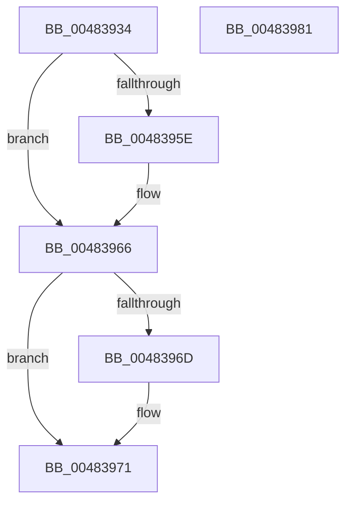

# DsaBuildDescriptorCommon

- RVA: `0x00483934`–`0x00483982` (길이 `78` bytes)
- VA: `0x0000000140483934`
- 실행 섹션: `.text`
- PDB 이름 있음: `예`; PDB Function 태그: `아니요`
- unwind 정보 RVA: `0x000DB714`
- 디코드: `24`개 명령, `78/78` bytes 표시
- 미해석 바이트: `0` (있으면 어셈블리에 `.byte`로 보존)

> 이 문서는 커널 이미지의 기계어와 PDB 기호를 분석해 생성했습니다. 4번과 5번은 함수 원형과 자료형을 바이너리 사용 방식에서 추정한 C 해석이며 원본 소스 복구 결과는 아닙니다.

## 1. Dependencies

- 직접 호출 지점: **0**; 고유 호출 대상: **0**
- 직접 호출자로 확인된 함수: **6**
- RIP 상대 이미지 참조: **0**

### Outgoing calls
- 직접 디코드된 call 명령이 없습니다.

### Direct callers
- [AccelpSiovCompressionDecompression](../66/AccelpSiovCompressionDecompression_function_00668BE0.md) at `0x00668DF3`
- [AccelpSiovIaaOperationHandler](../66/AccelpSiovIaaOperationHandler_function_00668EF0.md) at `0x00668FBA`
- [AccelpSiovIaaOperationHandler](../66/AccelpSiovIaaOperationHandler_function_00668EF0.md) at `0x006690D2`
- [IaaBuildDescriptorFixedCompress](../66/IaaBuildDescriptorFixedCompress_function_006695CC.md) at `0x0066960F`
- [IaaBuildDescriptorHuffmanCompress](../66/IaaBuildDescriptorHuffmanCompress_function_00669790.md) at `0x006697D7`
- [IaaBuildDescriptorHuffmanDecompress](../66/IaaBuildDescriptorHuffmanDecompress_function_006698BC.md) at `0x006698FF`
- [sub_006DC7EE](../6D/Unknown_function_006DC7EE.md) at `0x006DC877`
- [sub_006DC7EE](../6D/Unknown_function_006DC7EE.md) at `0x006DC8B6`
- [sub_006DC7EE](../6D/Unknown_function_006DC7EE.md) at `0x006DC8FE`
- [sub_006DC7EE](../6D/Unknown_function_006DC7EE.md) at `0x006DC961`

### Static image references
- 디코드된 RIP-relative 메모리 참조가 없습니다.

## 2. Other-region calls and transfers

- 다른 실행 섹션으로 향하는 call: **0**
- 별도 외부 분기/꼬리 이동을 확인하지 못했습니다.

## 3. Assembly (complete function range)

```asm
00483934  8B 02                           mov eax, dword ptr [rdx]
00483936  88 4A 07                        mov byte ptr [rdx + 7], cl
00483939  8B C8                           mov ecx, eax
0048393B  33 4C 24 28                     xor ecx, dword ptr [rsp + 0x28]
0048393F  4C 89 42 08                     mov qword ptr [rdx + 8], r8
00483943  81 E1 FF FF 0F 00               and ecx, 0xfffff
00483949  44 8A 42 04                     mov r8b, byte ptr [rdx + 4]
0048394D  33 C8                           xor ecx, eax
0048394F  41 80 C8 0C                     or r8b, 0xc
00483953  80 7C 24 30 00                  cmp byte ptr [rsp + 0x30], 0
00483958  44 88 42 04                     mov byte ptr [rdx + 4], r8b
0048395C  74 08                           je 0x140483966
0048395E  41 80 C8 02                     or r8b, 2
00483962  44 88 42 04                     mov byte ptr [rdx + 4], r8b
00483966  80 7C 24 38 00                  cmp byte ptr [rsp + 0x38], 0
0048396B  74 04                           je 0x140483971
0048396D  80 4A 05 01                     or byte ptr [rdx + 5], 1
00483971  41 0F B6 C1                     movzx eax, r9b
00483975  0F BA F1 1F                     btr ecx, 0x1f
00483979  C1 E0 1F                        shl eax, 0x1f
0048397C  0B C1                           or eax, ecx
0048397E  89 02                           mov dword ptr [rdx], eax
00483980  C3                              ret
00483981  CC                              int3
```

## 4. C-style interpretation (structured pseudocode)

```c
__int64 __fastcall DsaBuildDescriptorCommon(unsigned __int8 a1, __int64 a2, __int64 a3, unsigned __int8 a4, unsigned int a5, unsigned __int8 a6, unsigned __int8 a7)
{
    __int64 result;

    *(unsigned __int8 *)(a2 + 7) = a1;
    a1 = (unsigned int)(((unsigned int)((unsigned int)((unsigned int)(*(unsigned int *)(a2))))) ^ (a5));
    *(unsigned __int64 *)(a2 + 8) = a3;
    a1 = (unsigned int)((a1) & (0xFFFFFULL));
    a1 = (unsigned int)((a1) ^ ((unsigned int)((unsigned int)(*(unsigned int *)(a2)))));
    a3 = (unsigned __int8)((*(unsigned __int8 *)(a2 + 4)) | (12));
    *(unsigned __int8 *)(a2 + 4) = (unsigned __int8)(a3);
    if (a6 != 0) {
        a3 = (unsigned __int8)((a3) | (2));
        *(unsigned __int8 *)(a2 + 4) = (unsigned __int8)(a3);
    }
    if (a7 != 0) {
    }
    result = (unsigned int)((a4) << (31));
    result = (unsigned int)((result) | (a1));
    *(unsigned int *)(a2) = (unsigned int)(result);
    return result;
}
```

## 5. (Beta) C Style

```c
int64_t DsaBuildDescriptorCommon(uint8_t Arg1, void *Arg2, int64_t Arg3, uint8_t Arg4, uint32_t Arg5, uint8_t Arg6, uint8_t Arg7)
{
    uint8_t *arg2 = (uint8_t *)Arg2;

    int64_t result;

    *(uint8_t *)(arg2 + 0x7) = Arg1;
    Arg1 = (uint32_t)(((uint32_t)((uint32_t)((uint32_t)(*(uint32_t *)(arg2))))) ^ (Arg5));
    *(uint64_t *)(arg2 + 0x8) = Arg3;
    Arg1 = (uint32_t)((Arg1) & (0xFFFFFULL));
    Arg1 = (uint32_t)((Arg1) ^ ((uint32_t)((uint32_t)(*(uint32_t *)(arg2)))));
    Arg3 = (uint8_t)((*(uint8_t *)(arg2 + 0x4)) | (12));
    *(uint8_t *)(arg2 + 0x4) = (uint8_t)(Arg3);
    if (Arg6 != 0) {
        Arg3 = (uint8_t)((Arg3) | (2));
        *(uint8_t *)(arg2 + 0x4) = (uint8_t)(Arg3);
    }
    if (Arg7 != 0) {
    }
    result = (uint32_t)((Arg4) << (31));
    result = (uint32_t)((result) | (Arg1));
    *(uint32_t *)(arg2) = (uint32_t)(result);
    return result;
}
```

### 관측된 메모리 오프셋

구조체 형식이 확인되지 않은 접근은 인자 기준의 오프셋으로만 기록했습니다.

| 기준 인자 | 오프셋 표현 | 폭 (bit) | 접근 |
|---|---:|---:|---|
| `Arg2` | `+ 0x0` | `32` | `R` |
| `Arg2` | `+ 0x0` | `32` | `W` |
| `Arg2` | `+ 0x4` | `8` | `R` |
| `Arg2` | `+ 0x4` | `8` | `W` |
| `Arg2` | `+ 0x5` | `8` | `R/W` |
| `Arg2` | `+ 0x7` | `8` | `W` |
| `Arg2` | `+ 0x8` | `64` | `W` |

## 6. Execution-region graph

[열기: 2D/3D 그래프와 함수 탐색 컨트롤 패널](../../../control-panel.html?section=text&rva=0x00483934&view=graph)

- 2D 그래프는 위에서 아래로 흐르고, 3D 그래프는 빈 공간을 드래그해 회전합니다. Shift+드래그는 이동, 휠은 확대·축소, 함수 노드 선택은 대상 보고서 이동입니다.

### Static fallback


