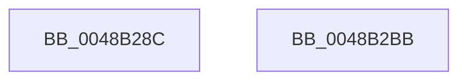

# EtwTraceSiloDcEvent

- RVA: `0x0048B28C`–`0x0048B2BC` (길이 `48` bytes)
- VA: `0x000000014048B28C`
- 실행 섹션: `.text`
- PDB 이름 있음: `예`; PDB Function 태그: `아니요`
- unwind 정보 RVA: `0x0005D2F4`
- 디코드: `14`개 명령, `48/48` bytes 표시
- 미해석 바이트: `0` (있으면 어셈블리에 `.byte`로 보존)

> 이 문서는 커널 이미지의 기계어와 PDB 기호를 분석해 생성했습니다. 4번과 5번은 함수 원형과 자료형을 바이너리 사용 방식에서 추정한 C 해석이며 원본 소스 복구 결과는 아닙니다.

## 1. Dependencies

- 직접 호출 지점: **1**; 고유 호출 대상: **1**
- 직접 호출자로 확인된 함수: **6**
- RIP 상대 이미지 참조: **0**

### Outgoing calls
- `0x0048B2B1` → [EtwpLogKernelEvent](../25/EtwpLogKernelEvent_function_0025CC00.md) (function, `0x0025CC00`)

### Direct callers
- [PsPerfLogSessionRundown](../../page/78/PsPerfLogSessionRundown_function_00788DB0.md) at `0x00788E31`
- [CmpLogHiveRundownEvent](../../page/7E/CmpLogHiveRundownEvent_function_007E63DC.md) at `0x007E64D8`
- [MmLogQueryCombineStats](../../page/90/MmLogQueryCombineStats_function_00901D04.md) at `0x00901DD2`
- [CmEtwRunDown](../../page/A8/CmEtwRunDown_function_00A85AC0.md) at `0x00A85C56`
- [CmEtwRunDown](../../page/A8/CmEtwRunDown_function_00A85AC0.md) at `0x00A85CFE`
- [MmIdentifyPhysicalMemory](../../page/AA/MmIdentifyPhysicalMemory_function_00AAD05C.md) at `0x00AAD248`
- [MmIdentifyPhysicalMemory](../../page/AA/MmIdentifyPhysicalMemory_function_00AAD05C.md) at `0x00AAD31B`
- [sub_00B4442A](../../page/B4/Unknown_function_00B4442A.md) at `0x00B444AE`

### Static image references
- 디코드된 RIP-relative 메모리 참조가 없습니다.

## 2. Other-region calls and transfers

- 다른 실행 섹션으로 향하는 call: **0**
- 별도 외부 분기/꼬리 이동을 확인하지 못했습니다.

## 3. Assembly (complete function range)

```asm
0048B28C  48 83 EC 38                     sub rsp, 0x38
0048B290  8B 44 24 68                     mov eax, dword ptr [rsp + 0x68]
0048B294  45 8B D1                        mov r10d, r9d
0048B297  89 44 24 28                     mov dword ptr [rsp + 0x28], eax
0048B29B  4D 8B D8                        mov r11, r8
0048B29E  0F B7 44 24 60                  movzx eax, word ptr [rsp + 0x60]
0048B2A3  44 8B CA                        mov r9d, edx
0048B2A6  45 8B C2                        mov r8d, r10d
0048B2A9  66 89 44 24 20                  mov word ptr [rsp + 0x20], ax
0048B2AE  49 8B D3                        mov rdx, r11
0048B2B1  E8 4A 19 DD FF                  call 0x14025cc00
0048B2B6  48 83 C4 38                     add rsp, 0x38
0048B2BA  C3                              ret
0048B2BB  CC                              int3
```

## 4. C-style interpretation (structured pseudocode)

```c
__int64 __fastcall EtwTraceSiloDcEvent(__int64 a1, int a2, __int64 a3, int a4, unsigned __int16 a5, unsigned int a6)
{
    __int64 result;
    __int64 v_rsp;
    unsigned int v_stack_m10;
    unsigned __int16 v_stack_m18;

    v_rsp = (v_rsp) - (56);
    v_stack_m10 = (unsigned int)((unsigned int)(a6));
    v_stack_m18 = a5;
    result = EtwpLogKernelEvent(a1, a3, (unsigned int)((unsigned int)((unsigned int)(a4))), (unsigned int)(a2));
    v_rsp = (v_rsp) + (56);
    return result;
}
```

## 5. (Beta) C Style

```c
int64_t EtwTraceSiloDcEvent(int64_t Arg1, int32_t Arg2, int64_t Arg3, int32_t Arg4, uint16_t Arg5, uint32_t Arg6)
{
    int64_t result;
    int64_t local_rsp;
    uint32_t v_stack_m10;
    uint16_t v_stack_m18;

    local_rsp = (local_rsp) - (56);
    v_stack_m10 = (uint32_t)((uint32_t)(Arg6));
    v_stack_m18 = Arg5;
    result = EtwpLogKernelEvent(Arg1, Arg3, (uint32_t)((uint32_t)((uint32_t)(Arg4))), (uint32_t)(Arg2));
    local_rsp = (local_rsp) + (56);
    return result;
}
```

## 6. Execution-region graph

[열기: 2D/3D 그래프와 함수 탐색 컨트롤 패널](../../../control-panel.html?section=text&rva=0x0048B28C&view=graph)

- 2D 그래프는 위에서 아래로 흐르고, 3D 그래프는 빈 공간을 드래그해 회전합니다. Shift+드래그는 이동, 휠은 확대·축소, 함수 노드 선택은 대상 보고서 이동입니다.

### Static fallback


