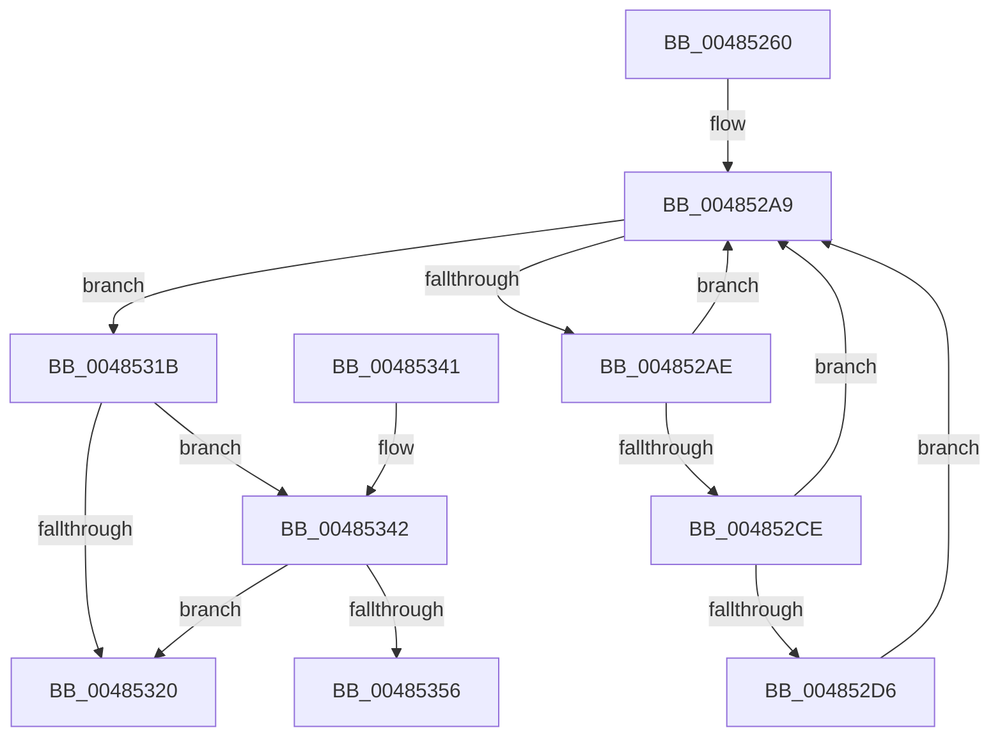

# EtwTraceSiloTimedEvent

- RVA: `0x00485260`–`0x00485361` (길이 `257` bytes)
- VA: `0x0000000140485260`
- 실행 섹션: `.text`
- PDB 이름 있음: `예`; PDB Function 태그: `예`
- unwind 정보 RVA: `0x000AF42C`
- 디코드: `65`개 명령, `257/257` bytes 표시
- 미해석 바이트: `0` (있으면 어셈블리에 `.byte`로 보존)

> 이 문서는 커널 이미지의 기계어와 PDB 기호를 분석해 생성했습니다. 4번과 5번은 함수 원형과 자료형을 바이너리 사용 방식에서 추정한 C 해석이며 원본 소스 복구 결과는 아닙니다.

## 1. Dependencies

- 직접 호출 지점: **3**; 고유 호출 대상: **3**
- 직접 호출자로 확인된 함수: **1**
- RIP 상대 이미지 참조: **2**

### Outgoing calls
- `0x00485314` → [EtwpLogKernelEvent](../25/EtwpLogKernelEvent_function_0025CC00.md) (function, `0x0025CC00`)
- `0x00485327` → [_security_check_cookie](../6A/_security_check_cookie_function_006AC640.md) (function, `0x006AC640`)
- `0x00485345` → [PsGetServerSiloGlobals](../22/PsGetServerSiloGlobals_function_002250A0.md) (function, `0x002250A0`)

### Direct callers
- [PfHardFaultLog](../38/PfHardFaultLog_function_003810C0.md) at `0x00381153`

### Static image references
- `0x00485275` → RVA `0x00E0A740` (`.data`; read)
- `0x00485283` → RVA `0x00FC6AA8` (`ALMOSTRO`; read)

## 2. Other-region calls and transfers

- 다른 실행 섹션으로 향하는 call: **0**
- call이 아닌 외부 분기/꼬리 이동: **1**
  - `0x0048535C` → [sub_006F5476 + 0x66](../6F/Unknown_function_006F5476.md) (`tail-transfer`)

## 3. Assembly (complete function range)

```asm
00485260  48 89 5C 24 18                  mov qword ptr [rsp + 0x18], rbx
00485265  48 89 74 24 20                  mov qword ptr [rsp + 0x20], rsi
0048526A  55                              push rbp
0048526B  57                              push rdi
0048526C  41 56                           push r14
0048526E  48 8B EC                        mov rbp, rsp
00485271  48 83 EC 60                     sub rsp, 0x60
00485275  48 8B 05 C4 54 98 00            mov rax, qword ptr [rip + 0x9854c4]
0048527C  48 33 C4                        xor rax, rsp
0048527F  48 89 45 F8                     mov qword ptr [rbp - 8], rax
00485283  48 8B 05 1E 18 B4 00            mov rax, qword ptr [rip + 0xb4181e]
0048528A  0F B7 F2                        movzx esi, dx
0048528D  83 65 F4 00                     and dword ptr [rbp - 0xc], 0
00485291  48 8B F9                        mov rdi, rcx
00485294  4C 8B 75 50                     mov r14, qword ptr [rbp + 0x50]
00485298  4C 89 4D E8                     mov qword ptr [rbp - 0x18], r9
0048529C  8B 98 A8 11 00 00               mov ebx, dword ptr [rax + 0x11a8]
004852A2  C7 45 F0 20 00 00 00            mov dword ptr [rbp - 0x10], 0x20
004852A9  0F BC CB                        bsf ecx, ebx
004852AC  74 6D                           je 0x14048531b
004852AE  48 8B 15 F3 17 B4 00            mov rdx, qword ptr [rip + 0xb417f3]
004852B5  8D 43 FF                        lea eax, [rbx - 1]
004852B8  23 D8                           and ebx, eax
004852BA  44 8B C1                        mov r8d, ecx
004852BD  8B C1                           mov eax, ecx
004852BF  48 C1 E0 05                     shl rax, 5
004852C3  48 05 CC 11 00 00               add rax, 0x11cc
004852C9  48 03 C2                        add rax, rdx
004852CC  74 DB                           je 0x1404852a9
004852CE  F7 00 00 20 00 00               test dword ptr [rax], 0x2000
004852D4  74 D3                           je 0x1404852a9
004852D6  0F B6 84 4A 99 11 00 00         movzx eax, byte ptr [rdx + rcx*2 + 0x1199]
004852DE  41 B9 02 00 00 00               mov r9d, 2
004852E4  83 65 E4 00                     and dword ptr [rbp - 0x1c], 0
004852E8  48 FF C8                        dec rax
004852EB  C7 45 E0 08 00 00 00            mov dword ptr [rbp - 0x20], 8
004852F2  C7 44 24 28 02 18 50 00         mov dword ptr [rsp + 0x28], 0x501802
004852FA  66 89 74 24 20                  mov word ptr [rsp + 0x20], si
004852FF  49 8D 0C C6                     lea rcx, [r14 + rax*8]
00485303  48 89 4D D8                     mov qword ptr [rbp - 0x28], rcx
00485307  48 8D 4D D8                     lea rcx, [rbp - 0x28]
0048530B  46 0F B6 84 42 98 11 00 00      movzx r8d, byte ptr [rdx + r8*2 + 0x1198]
00485314  E8 E7 78 DD FF                  call 0x14025cc00
00485319  EB 8E                           jmp 0x1404852a9
0048531B  48 85 FF                        test rdi, rdi
0048531E  75 22                           jne 0x140485342
00485320  48 8B 4D F8                     mov rcx, qword ptr [rbp - 8]
00485324  48 33 CC                        xor rcx, rsp
00485327  E8 14 73 22 00                  call 0x1406ac640
0048532C  4C 8D 5C 24 60                  lea r11, [rsp + 0x60]
00485331  49 8B 5B 30                     mov rbx, qword ptr [r11 + 0x30]
00485335  49 8B 73 38                     mov rsi, qword ptr [r11 + 0x38]
00485339  49 8B E3                        mov rsp, r11
0048533C  41 5E                           pop r14
0048533E  5F                              pop rdi
0048533F  5D                              pop rbp
00485340  C3                              ret
00485341  CC                              int3
00485342  48 8B CF                        mov rcx, rdi
00485345  E8 56 FD D9 FF                  call 0x1402250a0
0048534A  48 8B 98 40 03 00 00            mov rbx, qword ptr [rax + 0x340]
00485351  48 85 DB                        test rbx, rbx
00485354  74 CA                           je 0x140485320
00485356  8B BB A8 11 00 00               mov edi, dword ptr [rbx + 0x11a8]
0048535C  E9 7B 01 27 00                  jmp 0x1406f54dc
```

## 4. C-style interpretation (structured pseudocode)

```c
__int64 __fastcall EtwTraceSiloTimedEvent(__int64 a1, unsigned __int16 a2, __int64 a3, __int64 a4, __int64 a5, __int64 a6, __int64 a7)
{
    __int64 result;
    __int64 v_rbx;
    __int64 v_rsp;
    unsigned __int64 v_stack_m18;
    unsigned __int64 v_stack_m20;
    unsigned int v_stack_m24;
    unsigned int v_stack_m28;
    unsigned __int64 v_stack_m30;
    unsigned int v_stack_m34;
    unsigned int v_stack_m38;
    unsigned __int64 v_stack_m40;
    unsigned int v_stack_m50;
    unsigned __int16 v_stack_m58;
    unsigned __int64 v_stack_p18;
    unsigned __int64 v_stack_p20;

    v_stack_p18 = v_rbx;
    v_stack_p20 = v_rsi;
    v_rsp = (v_rsp) - (96);
    result = (*(unsigned __int64 *)(v_rip + 9983172)) ^ (v_rsp);
    v_stack_m20 = result;
    v_stack_m30 = a4;
    v_stack_m28 = 32;
loc_004852A9:
    if (condition_is_equal) goto loc_0048531B;
    v_rbx = (unsigned int)(((unsigned int)(*(unsigned int *)(*(unsigned __int64 *)(v_rip + 11802654) + 4520))) & ((unsigned int)((unsigned int)(*(unsigned int *)(*(unsigned __int64 *)(v_rip + 11802654) + 4520)) - 1)));
    result = ((unsigned int)((unsigned int)(a1))) << (5);
    result = (result) + (0x11CCULL);
    result = (result) + (*(unsigned __int64 *)(v_rip + 11802611));
    if (condition_is_equal) goto loc_004852A9;
    if (((*(unsigned int *)(result)) & (0x2000ULL)) == 0) goto loc_004852A9;
    result = (*(unsigned __int8 *)(*(unsigned __int64 *)(v_rip + 11802611) + a1 * 2 + 4505)) - 1;
    v_stack_m38 = 8;
    v_stack_m50 = 0x501802ULL;
    v_stack_m58 = a2;
    v_stack_m40 = a7 + result * 8;
    result = EtwpLogKernelEvent(v_stack_m40, *(unsigned __int64 *)(v_rip + 11802611), *(unsigned __int8 *)(*(unsigned __int64 *)(v_rip + 11802611) + (unsigned int)((unsigned int)(a1)) * 2 + 4504), 2);
    goto loc_004852A9;
loc_0048531B:
    if (a1 != 0) goto loc_00485342;
loc_00485320:
    a1 = (v_stack_m20) ^ (v_rsp);
    result = _security_check_cookie(a1, *(unsigned __int64 *)(v_rip + 11802611), *(unsigned __int8 *)(*(unsigned __int64 *)(v_rip + 11802611) + (unsigned int)((unsigned int)(a1)) * 2 + 4504), 2);
    return result;
loc_00485342:
    result = PsGetServerSiloGlobals(a1, *(unsigned __int64 *)(v_rip + 11802611), *(unsigned __int8 *)(*(unsigned __int64 *)(v_rip + 11802611) + (unsigned int)((unsigned int)(a1)) * 2 + 4504), 2);
    if (*(unsigned __int64 *)(result + 832) == 0) goto loc_00485320;
}
```

## 5. (Beta) C Style

```c
int64_t EtwTraceSiloTimedEvent(int64_t Arg1, uint16_t Arg2, int64_t Arg3, int64_t Arg4, uint64_t Arg5, uint64_t Arg6, void *Arg7)
{
    uint8_t *arg7 = (uint8_t *)Arg7;

    int64_t result;
    int64_t local_rbx;
    int64_t local_rsp;
    uint64_t v_stack_m18;
    uint64_t v_stack_m20;
    uint32_t v_stack_m24;
    uint32_t v_stack_m28;
    uint64_t v_stack_m30;
    uint32_t v_stack_m34;
    uint32_t v_stack_m38;
    uint64_t v_stack_m40;
    uint32_t v_stack_m50;
    uint16_t v_stack_m58;
    uint64_t v_stack_p18;
    uint64_t v_stack_p20;

    v_stack_p18 = local_rbx;
    v_stack_p20 = local_rsi;
    local_rsp = (local_rsp) - (96);
    result = (*(uint64_t *)(v_rip + 0x9854C4)) ^ (local_rsp);
    v_stack_m20 = result;
    v_stack_m30 = Arg4;
    v_stack_m28 = 32;
loc_004852A9:
    if (condition_is_equal) goto loc_0048531B;
    local_rbx = (uint32_t)(((uint32_t)(*(uint32_t *)(*(uint64_t *)(v_rip + 0xB4181E) + 0x11A8))) & ((uint32_t)((uint32_t)(*(uint32_t *)(*(uint64_t *)(v_rip + 0xB4181E) + 0x11A8)) - 1)));
    result = ((uint32_t)((uint32_t)(Arg1))) << (5);
    result = (result) + (0x11CCULL);
    result = (result) + (*(uint64_t *)(v_rip + 0xB417F3));
    if (condition_is_equal) goto loc_004852A9;
    if (((*(uint32_t *)(result)) & (0x2000ULL)) == 0) goto loc_004852A9;
    result = (*(uint8_t *)(*(uint64_t *)(v_rip + 0xB417F3) + Arg1 * 2 + 0x1199)) - 1;
    v_stack_m38 = 8;
    v_stack_m50 = 0x501802ULL;
    v_stack_m58 = Arg2;
    v_stack_m40 = Arg7 + result * 8;
    result = EtwpLogKernelEvent(v_stack_m40, *(uint64_t *)(v_rip + 0xB417F3), *(uint8_t *)(*(uint64_t *)(v_rip + 0xB417F3) + (uint32_t)((uint32_t)(Arg1)) * 2 + 0x1198), 2);
    goto loc_004852A9;
loc_0048531B:
    if (Arg1 != 0) goto loc_00485342;
loc_00485320:
    Arg1 = (v_stack_m20) ^ (local_rsp);
    result = _security_check_cookie(Arg1, *(uint64_t *)(v_rip + 0xB417F3), *(uint8_t *)(*(uint64_t *)(v_rip + 0xB417F3) + (uint32_t)((uint32_t)(Arg1)) * 2 + 0x1198), 2);
    return result;
loc_00485342:
    result = PsGetServerSiloGlobals(Arg1, *(uint64_t *)(v_rip + 0xB417F3), *(uint8_t *)(*(uint64_t *)(v_rip + 0xB417F3) + (uint32_t)((uint32_t)(Arg1)) * 2 + 0x1198), 2);
    if (*(uint64_t *)(result + 0x340) == 0) goto loc_00485320;
}
```

### 관측된 메모리 오프셋

구조체 형식이 확인되지 않은 접근은 인자 기준의 오프셋으로만 기록했습니다.

| 기준 인자 | 오프셋 표현 | 폭 (bit) | 접근 |
|---|---:|---:|---|
| `Arg7` | `+ 0x0 + rax*8` | `64` | `R` |

## 6. Execution-region graph

[열기: 2D/3D 그래프와 함수 탐색 컨트롤 패널](../../../control-panel.html?section=text&rva=0x00485260&view=graph)

- 2D 그래프는 위에서 아래로 흐르고, 3D 그래프는 빈 공간을 드래그해 회전합니다. Shift+드래그는 이동, 휠은 확대·축소, 함수 노드 선택은 대상 보고서 이동입니다.

### Static fallback


