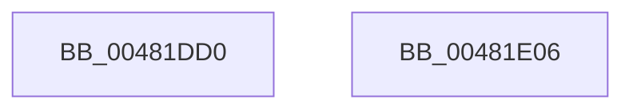

# ExDeleteLookasideListEx

- RVA: `0x00481DD0`–`0x00481E07` (길이 `55` bytes)
- VA: `0x0000000140481DD0`
- 실행 섹션: `.text`
- PDB 이름 있음: `예`; PDB Function 태그: `아니요`
- unwind 정보 RVA: `0x0005CF00`
- 디코드: `16`개 명령, `55/55` bytes 표시
- 미해석 바이트: `0` (있으면 어셈블리에 `.byte`로 보존)

> 이 문서는 커널 이미지의 기계어와 PDB 기호를 분석해 생성했습니다. 4번과 5번은 함수 원형과 자료형을 바이너리 사용 방식에서 추정한 C 해석이며 원본 소스 복구 결과는 아닙니다.

## 1. Dependencies

- 직접 호출 지점: **2**; 고유 호출 대상: **2**
- 직접 호출자로 확인된 함수: **1**
- RIP 상대 이미지 참조: **2**

### Outgoing calls
- `0x00481DF3` → [ExpRemoveGeneralLookaside](ExpRemoveGeneralLookaside_function_00481E10.md) (function, `0x00481E10`)
- `0x00481DFB` → [ExFlushLookasideListEx](ExFlushLookasideListEx_function_00481E80.md) (function, `0x00481E80`)

### Direct callers
- [DifExDeleteLookasideListExWrapper](../61/DifExDeleteLookasideListExWrapper_function_0061F5F0.md) at `0x0061F6B6`

### Static image references
- `0x00481DDE` → RVA `0x00EFABC0` (`.data`; read)
- `0x00481DE5` → RVA `0x00EFABE0` (`.data`; read)

## 2. Other-region calls and transfers

- 다른 실행 섹션으로 향하는 call: **0**
- 별도 외부 분기/꼬리 이동을 확인하지 못했습니다.

## 3. Assembly (complete function range)

```asm
00481DD0  40 53                           push rbx
00481DD2  48 83 EC 20                     sub rsp, 0x20
00481DD6  8B 41 24                        mov eax, dword ptr [rcx + 0x24]
00481DD9  48 8B D9                        mov rbx, rcx
00481DDC  A8 01                           test al, 1
00481DDE  48 8D 0D DB 8D A7 00            lea rcx, [rip + 0xa78ddb]
00481DE5  48 8D 05 F4 8D A7 00            lea rax, [rip + 0xa78df4]
00481DEC  48 8B D3                        mov rdx, rbx
00481DEF  48 0F 45 C8                     cmovne rcx, rax
00481DF3  E8 18 00 00 00                  call 0x140481e10
00481DF8  48 8B CB                        mov rcx, rbx
00481DFB  E8 80 00 00 00                  call 0x140481e80
00481E00  48 83 C4 20                     add rsp, 0x20
00481E04  5B                              pop rbx
00481E05  C3                              ret
00481E06  CC                              int3
```

## 4. C-style interpretation (structured pseudocode)

```c
__int64 __fastcall ExDeleteLookasideListEx(__int64 a1)
{
    __int64 result;
    __int64 v_rsp;

    v_rsp = (v_rsp) - (32);
    a1 = v_rip + 10980827;
    if ((((unsigned __int8)((unsigned int)(*(unsigned int *)(a1 + 36)))) & (1)) != 0) { a1 = v_rip + 10980852; }
    result = ExpRemoveGeneralLookaside(a1, a1, a3, a4);
    result = ExFlushLookasideListEx(a1, a1, a3, a4);
    v_rsp = (v_rsp) + (32);
    return result;
}
```

## 5. (Beta) C Style

```c
int64_t ExDeleteLookasideListEx(void *Arg1)
{
    uint8_t *arg1 = (uint8_t *)Arg1;

    int64_t result;
    int64_t local_rsp;

    local_rsp = (local_rsp) - (32);
    Arg1 = v_rip + 10980827;
    if ((((uint8_t)((uint32_t)(*(uint32_t *)(arg1 + 0x24)))) & (1)) != 0) { Arg1 = v_rip + 10980852; }
    result = ExpRemoveGeneralLookaside(Arg1, Arg1, a3, a4);
    result = ExFlushLookasideListEx(Arg1, Arg1, a3, a4);
    local_rsp = (local_rsp) + (32);
    return result;
}
```

### 관측된 메모리 오프셋

구조체 형식이 확인되지 않은 접근은 인자 기준의 오프셋으로만 기록했습니다.

| 기준 인자 | 오프셋 표현 | 폭 (bit) | 접근 |
|---|---:|---:|---|
| `Arg1` | `+ 0x24` | `32` | `R` |

## 6. Execution-region graph

[열기: 2D/3D 그래프와 함수 탐색 컨트롤 패널](../../../control-panel.html?section=text&rva=0x00481DD0&view=graph)

- 2D 그래프는 위에서 아래로 흐르고, 3D 그래프는 빈 공간을 드래그해 회전합니다. Shift+드래그는 이동, 휠은 확대·축소, 함수 노드 선택은 대상 보고서 이동입니다.

### Static fallback


