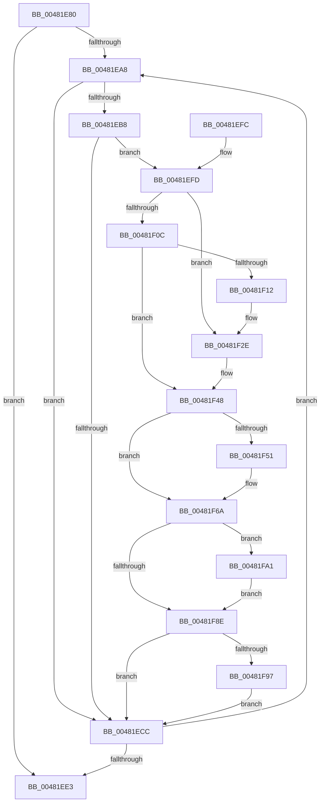

# ExFlushLookasideListEx

- RVA: `0x00481E80`–`0x00481FB3` (길이 `307` bytes)
- VA: `0x0000000140481E80`
- 실행 섹션: `.text`
- PDB 이름 있음: `예`; PDB Function 태그: `아니요`
- unwind 정보 RVA: `0x000AED94`
- 디코드: `82`개 명령, `307/307` bytes 표시
- 미해석 바이트: `0` (있으면 어셈블리에 `.byte`로 보존)

> 이 문서는 커널 이미지의 기계어와 PDB 기호를 분석해 생성했습니다. 4번과 5번은 함수 원형과 자료형을 바이너리 사용 방식에서 추정한 C 해석이며 원본 소스 복구 결과는 아닙니다.

## 1. Dependencies

- 직접 호출 지점: **6**; 고유 호출 대상: **4**
- 직접 호출자로 확인된 함수: **1**
- RIP 상대 이미지 참조: **3**

### Outgoing calls
- `0x00481E9B` → [ExpInterlockedFlushSList](../6B/ExpInterlockedFlushSList_function_006BA5F0.md) (function, `0x006BA5F0`)
- `0x00481ED6` → [guard_dispatch_icall](../6B/guard_dispatch_icall_function_006BAAD0.md) (function, `0x006BAAD0`)
- `0x00481F28` → [KeBugCheckEx](../4F/KeBugCheckEx_function_004FD660.md) (function, `0x004FD660`)
- `0x00481F42` → [KeBugCheckEx](../4F/KeBugCheckEx_function_004FD660.md) (function, `0x004FD660`)
- `0x00481F64` → [KeBugCheckEx](../4F/KeBugCheckEx_function_004FD660.md) (function, `0x004FD660`)
- `0x00481FA9` → [memset](../6C/memset_function_006C6C40.md) (function, `0x006C6C40`)

### Direct callers
- [ExDeleteLookasideListEx](ExDeleteLookasideListEx_function_00481DD0.md) at `0x00481DFB`

### Static image references
- `0x00481EAB` → RVA `0x00475D80` (`CmSiFreeMemory`; read)
- `0x00481EC3` → RVA `0x00FCEC68` (`ALMOSTRO`; read)
- `0x00481F82` → RVA `0x00FC6ED8` (`ALMOSTRO`; read)

## 2. Other-region calls and transfers

- 다른 실행 섹션으로 향하는 call: **0**
- 별도 외부 분기/꼬리 이동을 확인하지 못했습니다.

## 3. Assembly (complete function range)

```asm
00481E80  48 89 5C 24 08                  mov qword ptr [rsp + 8], rbx
00481E85  48 89 6C 24 10                  mov qword ptr [rsp + 0x10], rbp
00481E8A  48 89 74 24 18                  mov qword ptr [rsp + 0x18], rsi
00481E8F  57                              push rdi
00481E90  41 56                           push r14
00481E92  41 57                           push r15
00481E94  48 83 EC 30                     sub rsp, 0x30
00481E98  48 8B F9                        mov rdi, rcx
00481E9B  E8 50 87 23 00                  call 0x1406ba5f0
00481EA0  4C 8B F0                        mov r14, rax
00481EA3  48 85 C0                        test rax, rax
00481EA6  74 3B                           je 0x140481ee3
00481EA8  4D 8B 3E                        mov r15, qword ptr [r14]
00481EAB  48 8D 05 CE 3E FF FF            lea rax, [rip - 0xc132]
00481EB2  48 39 47 38                     cmp qword ptr [rdi + 0x38], rax
00481EB6  75 14                           jne 0x140481ecc
00481EB8  8B 5F 2C                        mov ebx, dword ptr [rdi + 0x2c]
00481EBB  4D 8D 4E 08                     lea r9, [r14 + 8]
00481EBF  48 83 EB 08                     sub rbx, 8
00481EC3  80 3D 9E CD B4 00 00            cmp byte ptr [rip + 0xb4cd9e], 0
00481ECA  75 31                           jne 0x140481efd
00481ECC  48 8B 47 38                     mov rax, qword ptr [rdi + 0x38]
00481ED0  48 8B D7                        mov rdx, rdi
00481ED3  49 8B CE                        mov rcx, r14
00481ED6  E8 F5 8B 23 00                  call 0x1406baad0
00481EDB  4D 8B F7                        mov r14, r15
00481EDE  4D 85 FF                        test r15, r15
00481EE1  75 C5                           jne 0x140481ea8
00481EE3  48 8B 5C 24 50                  mov rbx, qword ptr [rsp + 0x50]
00481EE8  48 8B 6C 24 58                  mov rbp, qword ptr [rsp + 0x58]
00481EED  48 8B 74 24 60                  mov rsi, qword ptr [rsp + 0x60]
00481EF2  48 83 C4 30                     add rsp, 0x30
00481EF6  41 5F                           pop r15
00481EF8  41 5E                           pop r14
00481EFA  5F                              pop rdi
00481EFB  C3                              ret
00481EFC  CC                              int3
00481EFD  48 B8 00 00 00 00 00 80 FF FF   movabs rax, 0xffff800000000000
00481F07  4C 3B C8                        cmp r9, rax
00481F0A  72 22                           jb 0x140481f2e
00481F0C  41 F6 C1 07                     test r9b, 7
00481F10  74 36                           je 0x140481f48
00481F12  BA 02 00 00 00                  mov edx, 2
00481F17  48 C7 44 24 20 08 00 00 00      mov qword ptr [rsp + 0x20], 8
00481F20  44 8B C2                        mov r8d, edx
00481F23  B9 F1 01 00 00                  mov ecx, 0x1f1
00481F28  E8 33 B7 07 00                  call 0x1404fd660
00481F2D  CC                              int3
00481F2E  48 83 64 24 20 00               and qword ptr [rsp + 0x20], 0
00481F34  BA 02 00 00 00                  mov edx, 2
00481F39  B9 F1 01 00 00                  mov ecx, 0x1f1
00481F3E  44 8D 42 FF                     lea r8d, [rdx - 1]
00481F42  E8 19 B7 07 00                  call 0x1404fd660
00481F47  CC                              int3
00481F48  49 8D 04 19                     lea rax, [r9 + rbx]
00481F4C  49 3B C1                        cmp rax, r9
00481F4F  73 19                           jae 0x140481f6a
00481F51  BA 02 00 00 00                  mov edx, 2
00481F56  48 89 5C 24 20                  mov qword ptr [rsp + 0x20], rbx
00481F5B  B9 F1 01 00 00                  mov ecx, 0x1f1
00481F60  44 8D 42 01                     lea r8d, [rdx + 1]
00481F64  E8 F7 B6 07 00                  call 0x1404fd660
00481F69  CC                              int3
00481F6A  48 BE 00 00 00 00 00 80 00 00   movabs rsi, 0x800000000000
00481F74  48 8B EB                        mov rbp, rbx
00481F77  49 03 F1                        add rsi, r9
00481F7A  48 C1 ED 03                     shr rbp, 3
00481F7E  48 C1 EE 03                     shr rsi, 3
00481F82  48 03 35 4F 4F B4 00            add rsi, qword ptr [rip + 0xb44f4f]
00481F89  48 85 ED                        test rbp, rbp
00481F8C  75 13                           jne 0x140481fa1
00481F8E  F6 C3 07                        test bl, 7
00481F91  0F 84 35 FF FF FF               je 0x140481ecc
00481F97  80 E3 07                        and bl, 7
00481F9A  88 1E                           mov byte ptr [rsi], bl
00481F9C  E9 2B FF FF FF                  jmp 0x140481ecc
00481FA1  4C 8B C5                        mov r8, rbp
00481FA4  33 D2                           xor edx, edx
00481FA6  48 8B CE                        mov rcx, rsi
00481FA9  E8 92 4C 24 00                  call 0x1406c6c40
00481FAE  48 03 F5                        add rsi, rbp
00481FB1  EB DB                           jmp 0x140481f8e
```

## 4. C-style interpretation (structured pseudocode)

```c
__int64 __fastcall ExFlushLookasideListEx(__int64 a1)
{
    __int64 result;
    __int64 v_rbp;
    __int64 v_rbx;
    __int64 v_rsi;
    __int64 v_rsp;
    unsigned __int64 v_stack_p10;
    unsigned __int64 v_stack_p18;
    unsigned __int64 v_stack_p20;
    unsigned __int64 v_stack_p8;

    v_stack_p8 = v_rbx;
    v_stack_p10 = v_rbp;
    v_stack_p18 = v_rsi;
    v_rsp = (v_rsp) - (48);
    result = ExpInterlockedFlushSList(a1, a2, a3, a4);
    if (result == 0) goto loc_00481EE3;
loc_00481EA8:
    if ((*(unsigned __int64 *)(a1 + 56)) != (v_rip - 49458)) goto loc_00481ECC;
    v_rbx = ((unsigned int)(*(unsigned int *)(a1 + 44))) - (8);
    if ((*(unsigned __int8 *)(v_rip + 11849118)) != 0) goto loc_00481EFD;
loc_00481ECC:
    result = guard_dispatch_icall(result, a1, a3, result + 8);
    if (*(unsigned __int64 *)(result) != 0) goto loc_00481EA8;
loc_00481EE3:
    v_rsp = (v_rsp) + (48);
    return result;
loc_00481EFD:
    if ((result + 8) < result) goto loc_00481F2E;
    if ((((unsigned __int8)(result + 8)) & (7)) == 0) goto loc_00481F48;
    v_stack_p20 = 8;
    result = KeBugCheckEx(497, 2, 2, result + 8);
loc_00481F2E:
    result = KeBugCheckEx(497, 2, 2 - 1, result + 8);
loc_00481F48:
    result = result + 8 + v_stack_p8 * 1;
    if ((result + 8 + v_stack_p8 * 1) < (result + 8)) {
        a2 = 2;
        v_stack_p20 = v_stack_p8;
        a1 = 497;
        a3 = a2 + 1;
        result = KeBugCheckEx(a1, a2, a3, result + 8);
    }
    v_rsi = (v_stack_p18) + (result + 8);
    v_rbp = (v_stack_p8) >> (3);
    v_rsi = (v_rsi) >> (3);
    v_rsi = (v_rsi) + (*(unsigned __int64 *)(v_rip + 11816783));
    if (v_rbp != 0) goto loc_00481FA1;
loc_00481F8E:
    if ((((unsigned __int8)(v_stack_p8)) & (7)) == 0) goto loc_00481ECC;
    v_rbx = (unsigned __int8)((v_stack_p8) & (7));
    *(unsigned __int8 *)(v_rsi) = (unsigned __int8)(v_rbx);
    goto loc_00481ECC;
loc_00481FA1:
    a2 = 0;
    result = memset(v_rsi, a2, v_rbp, result + 8);
    v_rsi = (v_rsi) + (v_rbp);
    goto loc_00481F8E;
}
```

## 5. (Beta) C Style

```c
int64_t ExFlushLookasideListEx(void *Arg1)
{
    uint8_t *arg1 = (uint8_t *)Arg1;

    int64_t result;
    int64_t local_rbp;
    int64_t local_rbx;
    int64_t local_rsi;
    int64_t local_rsp;
    uint64_t v_stack_p10;
    uint64_t v_stack_p18;
    uint64_t v_stack_p20;
    uint64_t v_stack_p8;

    v_stack_p8 = local_rbx;
    v_stack_p10 = local_rbp;
    v_stack_p18 = local_rsi;
    local_rsp = (local_rsp) - (48);
    result = ExpInterlockedFlushSList(Arg1, a2, a3, a4);
    if (result == 0) goto loc_00481EE3;
loc_00481EA8:
    if ((*(uint64_t *)(arg1 + 0x38)) != (v_rip - 49458)) goto loc_00481ECC;
    local_rbx = ((uint32_t)(*(uint32_t *)(arg1 + 0x2C))) - (8);
    if ((*(uint8_t *)(v_rip + 0xB4CD9E)) != 0) goto loc_00481EFD;
loc_00481ECC:
    result = guard_dispatch_icall(result, Arg1, a3, result + 8);
    if (*(uint64_t *)(result) != 0) goto loc_00481EA8;
loc_00481EE3:
    local_rsp = (local_rsp) + (48);
    return result;
loc_00481EFD:
    if ((result + 8) < result) goto loc_00481F2E;
    if ((((uint8_t)(result + 8)) & (7)) == 0) goto loc_00481F48;
    v_stack_p20 = 8;
    result = KeBugCheckEx(497, 2, 2, result + 8);
loc_00481F2E:
    result = KeBugCheckEx(497, 2, 2 - 1, result + 8);
loc_00481F48:
    result = result + 8 + v_stack_p8 * 1;
    if ((result + 8 + v_stack_p8 * 1) < (result + 8)) {
        a2 = 2;
        v_stack_p20 = v_stack_p8;
        Arg1 = 497;
        a3 = a2 + 1;
        result = KeBugCheckEx(Arg1, a2, a3, result + 8);
    }
    local_rsi = (v_stack_p18) + (result + 8);
    local_rbp = (v_stack_p8) >> (3);
    local_rsi = (local_rsi) >> (3);
    local_rsi = (local_rsi) + (*(uint64_t *)(v_rip + 0xB44F4F));
    if (local_rbp != 0) goto loc_00481FA1;
loc_00481F8E:
    if ((((uint8_t)(v_stack_p8)) & (7)) == 0) goto loc_00481ECC;
    local_rbx = (uint8_t)((v_stack_p8) & (7));
    *(uint8_t *)(local_rsi) = (uint8_t)(local_rbx);
    goto loc_00481ECC;
loc_00481FA1:
    a2 = 0;
    result = memset(local_rsi, a2, local_rbp, result + 8);
    local_rsi = (local_rsi) + (local_rbp);
    goto loc_00481F8E;
}
```

### 관측된 메모리 오프셋

구조체 형식이 확인되지 않은 접근은 인자 기준의 오프셋으로만 기록했습니다.

| 기준 인자 | 오프셋 표현 | 폭 (bit) | 접근 |
|---|---:|---:|---|
| `Arg1` | `+ 0x2C` | `32` | `R` |
| `Arg1` | `+ 0x38` | `64` | `R` |

## 6. Execution-region graph

[열기: 2D/3D 그래프와 함수 탐색 컨트롤 패널](../../../control-panel.html?section=text&rva=0x00481E80&view=graph)

- 2D 그래프는 위에서 아래로 흐르고, 3D 그래프는 빈 공간을 드래그해 회전합니다. Shift+드래그는 이동, 휠은 확대·축소, 함수 노드 선택은 대상 보고서 이동입니다.

### Static fallback


