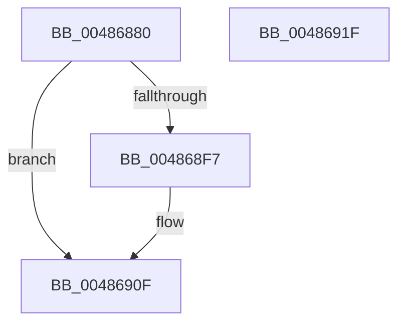

# ExpDeleteWorkerFactory

- RVA: `0x00486880`–`0x00486920` (길이 `160` bytes)
- VA: `0x0000000140486880`
- 실행 섹션: `.text`
- PDB 이름 있음: `예`; PDB Function 태그: `아니요`
- unwind 정보 RVA: `0x000718AC`
- 디코드: `43`개 명령, `160/160` bytes 표시
- 미해석 바이트: `0` (있으면 어셈블리에 `.byte`로 보존)

> 이 문서는 커널 이미지의 기계어와 PDB 기호를 분석해 생성했습니다. 4번과 5번은 함수 원형과 자료형을 바이너리 사용 방식에서 추정한 C 해석이며 원본 소스 복구 결과는 아닙니다.

## 1. Dependencies

- 직접 호출 지점: **7**; 고유 호출 대상: **6**
- 직접 호출자로 확인된 함수: **0**
- RIP 상대 이미지 참조: **0**

### Outgoing calls
- `0x004868A9` → [KeAcquireInStackQueuedSpinLock](../27/KeAcquireInStackQueuedSpinLock_function_002757A0.md) (function, `0x002757A0`)
- `0x004868C7` → [KeReleaseInStackQueuedSpinLock](../34/KeReleaseInStackQueuedSpinLock_function_00342CE0.md) (function, `0x00342CE0`)
- `0x004868D5` → [ObfDereferenceObjectWithTag](../2F/ObfDereferenceObjectWithTag_function_002F78E0.md) (function, `0x002F78E0`)
- `0x004868E0` → [ObCloseHandle](../../page/8A/ObCloseHandle_function_008A1870.md) (function, `0x008A1870`)
- `0x004868ED` → [ObfDereferenceObjectWithTag](../2F/ObfDereferenceObjectWithTag_function_002F78E0.md) (function, `0x002F78E0`)
- `0x004868FF` → [IoFreeMiniCompletionPacket](../../page/9A/IoFreeMiniCompletionPacket_function_009A82B0.md) (function, `0x009A82B0`)
- `0x0048690A` → [ExFreePoolWithTag](../../poolcode/B8/ExFreePoolWithTag_function_00B82870.md) (function, `0x00B82870`)

### Direct callers
- 이 함수 시작 RVA로 연결되는 직접 call은 확인되지 않았습니다. 간접 호출은 완전히 역산할 수 없습니다.

### Static image references
- 디코드된 RIP-relative 메모리 참조가 없습니다.

## 2. Other-region calls and transfers

- 다른 실행 섹션으로 향하는 call: **3**
  - `0x004868E0` → [ObCloseHandle](../../page/8A/ObCloseHandle_function_008A1870.md) (`.text` → `PAGE`)
  - `0x004868FF` → [IoFreeMiniCompletionPacket](../../page/9A/IoFreeMiniCompletionPacket_function_009A82B0.md) (`.text` → `PAGE`)
  - `0x0048690A` → [ExFreePoolWithTag](../../poolcode/B8/ExFreePoolWithTag_function_00B82870.md) (`.text` → `POOLCODE`)
- 별도 외부 분기/꼬리 이동을 확인하지 못했습니다.

## 3. Assembly (complete function range)

```asm
00486880  4C 8B DC                        mov r11, rsp
00486883  49 89 5B 08                     mov qword ptr [r11 + 8], rbx
00486887  49 89 73 10                     mov qword ptr [r11 + 0x10], rsi
0048688B  57                              push rdi
0048688C  48 83 EC 40                     sub rsp, 0x40
00486890  0F 57 C0                        xorps xmm0, xmm0
00486893  49 8D 53 D8                     lea rdx, [r11 - 0x28]
00486897  48 8B F1                        mov rsi, rcx
0048689A  33 C0                           xor eax, eax
0048689C  48 8B 49 10                     mov rcx, qword ptr [rcx + 0x10]
004868A0  0F 11 44 24 20                  movups xmmword ptr [rsp + 0x20], xmm0
004868A5  49 89 43 E8                     mov qword ptr [r11 - 0x18], rax
004868A9  E8 F2 EE DE FF                  call 0x1402757a0
004868AE  48 8B 46 10                     mov rax, qword ptr [rsi + 0x10]
004868B2  48 8D 4C 24 20                  lea rcx, [rsp + 0x20]
004868B7  C6 40 22 01                     mov byte ptr [rax + 0x22], 1
004868BB  48 8B 46 10                     mov rax, qword ptr [rsi + 0x10]
004868BF  48 8B 58 08                     mov rbx, qword ptr [rax + 8]
004868C3  40 8A 78 20                     mov dil, byte ptr [rax + 0x20]
004868C7  E8 14 C4 EB FF                  call 0x140342ce0
004868CC  48 8B 4E 30                     mov rcx, qword ptr [rsi + 0x30]
004868D0  BA 45 78 57 66                  mov edx, 0x66577845
004868D5  E8 06 10 E7 FF                  call 0x1402f78e0
004868DA  48 8B 4E 28                     mov rcx, qword ptr [rsi + 0x28]
004868DE  33 D2                           xor edx, edx
004868E0  E8 8B AF 41 00                  call 0x1408a1870
004868E5  BA 44 66 6C 74                  mov edx, 0x746c6644
004868EA  48 8B CB                        mov rcx, rbx
004868ED  E8 EE 0F E7 FF                  call 0x1402f78e0
004868F2  40 84 FF                        test dil, dil
004868F5  75 18                           jne 0x14048690f
004868F7  48 8B 4E 10                     mov rcx, qword ptr [rsi + 0x10]
004868FB  48 8B 49 10                     mov rcx, qword ptr [rcx + 0x10]
004868FF  E8 AC 19 52 00                  call 0x1409a82b0
00486904  48 8B 4E 10                     mov rcx, qword ptr [rsi + 0x10]
00486908  33 D2                           xor edx, edx
0048690A  E8 61 BF 6F 00                  call 0x140b82870
0048690F  48 8B 5C 24 50                  mov rbx, qword ptr [rsp + 0x50]
00486914  48 8B 74 24 58                  mov rsi, qword ptr [rsp + 0x58]
00486919  48 83 C4 40                     add rsp, 0x40
0048691D  5F                              pop rdi
0048691E  C3                              ret
0048691F  CC                              int3
```

## 4. C-style interpretation (structured pseudocode)

```c
__int64 __fastcall ExpDeleteWorkerFactory(__int64 a1)
{
    __int64 result;
    __int64 v_rsp;
    unsigned __int64 v_stack_m28;
    unsigned __int64 v_stack_p10;
    unsigned __int64 v_stack_p8;

    *(unsigned __int64 *)(v_rsp + 8) = v_rbx;
    *(unsigned __int64 *)(v_rsp + 16) = v_rsi;
    v_rsp = (v_rsp) - (64);
    result = 0;
    v_stack_m28 = v_xmm0;
    *(unsigned __int64 *)(v_rsp - 24) = 0;
    result = KeAcquireInStackQueuedSpinLock(*(unsigned __int64 *)(a1 + 16), v_rsp - 40, a3, a4);
    *(unsigned __int8 *)(*(unsigned __int64 *)(a1 + 16) + 34) = 1;
    result = KeReleaseInStackQueuedSpinLock(v_stack_m28, v_rsp - 40, a3, a4);
    result = ObfDereferenceObjectWithTag(*(unsigned __int64 *)(a1 + 48), (unsigned int)(0x66577845ULL), a3, a4);
    a2 = 0;
    result = ObCloseHandle(*(unsigned __int64 *)(a1 + 40), a2, a3, a4);
    result = ObfDereferenceObjectWithTag(*(unsigned __int64 *)(*(unsigned __int64 *)(a1 + 16) + 8), (unsigned int)(0x746C6644ULL), a3, a4);
    if ((unsigned __int8)(*(unsigned __int8 *)(*(unsigned __int64 *)(a1 + 16) + 32)) == 0) {
        a1 = *(unsigned __int64 *)(a1 + 16);
        a1 = *(unsigned __int64 *)(a1 + 16);
        result = IoFreeMiniCompletionPacket(a1, (unsigned int)(0x746C6644ULL), a3, a4);
        a1 = *(unsigned __int64 *)(a1 + 16);
        a2 = 0;
        result = ExFreePoolWithTag(a1, a2, a3, a4);
    }
    v_rsp = (v_rsp) + (64);
    return result;
}
```

## 5. (Beta) C Style

```c
int64_t ExpDeleteWorkerFactory(void *Arg1)
{
    uint8_t *arg1 = (uint8_t *)Arg1;

    int64_t result;
    int64_t local_rsp;
    uint64_t v_stack_m28;
    uint64_t v_stack_p10;
    uint64_t v_stack_p8;

    *(uint64_t *)(local_rsp + 0x8) = local_rbx;
    *(uint64_t *)(local_rsp + 0x10) = local_rsi;
    local_rsp = (local_rsp) - (64);
    result = 0;
    v_stack_m28 = v_xmm0;
    *(uint64_t *)(local_rsp - 0x18) = 0;
    result = KeAcquireInStackQueuedSpinLock(*(uint64_t *)(arg1 + 0x10), local_rsp - 40, a3, a4);
    *(uint8_t *)(*(uint64_t *)(arg1 + 0x10) + 0x22) = 1;
    result = KeReleaseInStackQueuedSpinLock(v_stack_m28, local_rsp - 40, a3, a4);
    result = ObfDereferenceObjectWithTag(*(uint64_t *)(arg1 + 0x30), (uint32_t)(0x66577845ULL), a3, a4);
    a2 = 0;
    result = ObCloseHandle(*(uint64_t *)(arg1 + 0x28), a2, a3, a4);
    result = ObfDereferenceObjectWithTag(*(uint64_t *)(*(uint64_t *)(arg1 + 0x10) + 0x8), (uint32_t)(0x746C6644ULL), a3, a4);
    if ((uint8_t)(*(uint8_t *)(*(uint64_t *)(arg1 + 0x10) + 0x20)) == 0) {
        Arg1 = *(uint64_t *)(arg1 + 0x10);
        Arg1 = *(uint64_t *)(arg1 + 0x10);
        result = IoFreeMiniCompletionPacket(Arg1, (uint32_t)(0x746C6644ULL), a3, a4);
        Arg1 = *(uint64_t *)(arg1 + 0x10);
        a2 = 0;
        result = ExFreePoolWithTag(Arg1, a2, a3, a4);
    }
    local_rsp = (local_rsp) + (64);
    return result;
}
```

### 관측된 메모리 오프셋

구조체 형식이 확인되지 않은 접근은 인자 기준의 오프셋으로만 기록했습니다.

| 기준 인자 | 오프셋 표현 | 폭 (bit) | 접근 |
|---|---:|---:|---|
| `Arg1` | `+ 0x10` | `64` | `R` |
| `Arg1` | `+ 0x28` | `64` | `R` |
| `Arg1` | `+ 0x30` | `64` | `R` |

## 6. Execution-region graph

[열기: 2D/3D 그래프와 함수 탐색 컨트롤 패널](../../../control-panel.html?section=text&rva=0x00486880&view=graph)

- 2D 그래프는 위에서 아래로 흐르고, 3D 그래프는 빈 공간을 드래그해 회전합니다. Shift+드래그는 이동, 휠은 확대·축소, 함수 노드 선택은 대상 보고서 이동입니다.

### Static fallback


