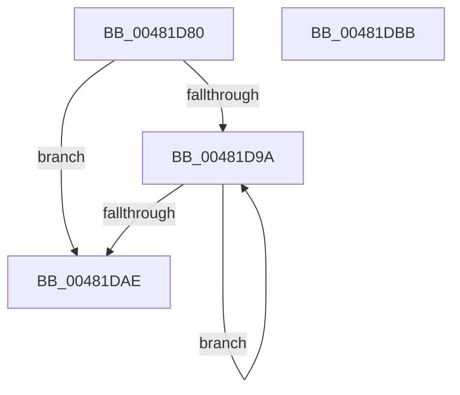

# ExpFlushGeneralLookaside

- RVA: `0x00481D80`–`0x00481DBC` (길이 `60` bytes)
- VA: `0x0000000140481D80`
- 실행 섹션: `.text`
- PDB 이름 있음: `예`; PDB Function 태그: `아니요`
- unwind 정보 RVA: `0x0005CAAC`
- 디코드: `20`개 명령, `60/60` bytes 표시
- 미해석 바이트: `0` (있으면 어셈블리에 `.byte`로 보존)

> 이 문서는 커널 이미지의 기계어와 PDB 기호를 분석해 생성했습니다. 4번과 5번은 함수 원형과 자료형을 바이너리 사용 방식에서 추정한 C 해석이며 원본 소스 복구 결과는 아닙니다.

## 1. Dependencies

- 직접 호출 지점: **2**; 고유 호출 대상: **2**
- 직접 호출자로 확인된 함수: **2**
- RIP 상대 이미지 참조: **0**

### Outgoing calls
- `0x00481D8D` → [ExpInterlockedFlushSList](../6B/ExpInterlockedFlushSList_function_006BA5F0.md) (function, `0x006BA5F0`)
- `0x00481DA1` → [guard_dispatch_icall](../6B/guard_dispatch_icall_function_006BAAD0.md) (function, `0x006BAAD0`)

### Direct callers
- [ExDeletePagedLookasideList](ExDeletePagedLookasideList_function_00481D20.md) at `0x00481D3B`
- [ExDeleteNPagedLookasideList](ExDeleteNPagedLookasideList_function_00481D50.md) at `0x00481D6B`

### Static image references
- 디코드된 RIP-relative 메모리 참조가 없습니다.

## 2. Other-region calls and transfers

- 다른 실행 섹션으로 향하는 call: **0**
- 별도 외부 분기/꼬리 이동을 확인하지 못했습니다.

## 3. Assembly (complete function range)

```asm
00481D80  48 89 5C 24 08                  mov qword ptr [rsp + 8], rbx
00481D85  57                              push rdi
00481D86  48 83 EC 20                     sub rsp, 0x20
00481D8A  48 8B F9                        mov rdi, rcx
00481D8D  E8 5E 88 23 00                  call 0x1406ba5f0
00481D92  48 8B C8                        mov rcx, rax
00481D95  48 85 C0                        test rax, rax
00481D98  74 14                           je 0x140481dae
00481D9A  48 8B 47 38                     mov rax, qword ptr [rdi + 0x38]
00481D9E  48 8B 19                        mov rbx, qword ptr [rcx]
00481DA1  E8 2A 8D 23 00                  call 0x1406baad0
00481DA6  48 8B CB                        mov rcx, rbx
00481DA9  48 85 DB                        test rbx, rbx
00481DAC  75 EC                           jne 0x140481d9a
00481DAE  48 8B 5C 24 30                  mov rbx, qword ptr [rsp + 0x30]
00481DB3  33 C0                           xor eax, eax
00481DB5  48 83 C4 20                     add rsp, 0x20
00481DB9  5F                              pop rdi
00481DBA  C3                              ret
00481DBB  CC                              int3
```

## 4. C-style interpretation (structured pseudocode)

```c
__int64 __fastcall ExpFlushGeneralLookaside(__int64 a1)
{
    __int64 result;
    __int64 v_rsp;
    unsigned __int64 v_stack_p8;

    v_stack_p8 = v_rbx;
    v_rsp = (v_rsp) - (32);
    result = ExpInterlockedFlushSList(a1, a2, a3, a4);
    if (result == 0) goto loc_00481DAE;
loc_00481D9A:
    result = guard_dispatch_icall(result, a2, a3, a4);
    if (*(unsigned __int64 *)(result) != 0) goto loc_00481D9A;
loc_00481DAE:
    result = 0;
    v_rsp = (v_rsp) + (32);
    return result;
}
```

## 5. (Beta) C Style

```c
int64_t ExpFlushGeneralLookaside(void *Arg1)
{
    uint8_t *arg1 = (uint8_t *)Arg1;

    int64_t result;
    int64_t local_rsp;
    uint64_t v_stack_p8;

    v_stack_p8 = local_rbx;
    local_rsp = (local_rsp) - (32);
    result = ExpInterlockedFlushSList(Arg1, a2, a3, a4);
    if (result == 0) goto loc_00481DAE;
loc_00481D9A:
    result = guard_dispatch_icall(result, a2, a3, a4);
    if (*(uint64_t *)(result) != 0) goto loc_00481D9A;
loc_00481DAE:
    result = 0;
    local_rsp = (local_rsp) + (32);
    return result;
}
```

### 관측된 메모리 오프셋

구조체 형식이 확인되지 않은 접근은 인자 기준의 오프셋으로만 기록했습니다.

| 기준 인자 | 오프셋 표현 | 폭 (bit) | 접근 |
|---|---:|---:|---|
| `Arg1` | `+ 0x38` | `64` | `R` |

## 6. Execution-region graph

[열기: 2D/3D 그래프와 함수 탐색 컨트롤 패널](../../../control-panel.html?section=text&rva=0x00481D80&view=graph)

- 2D 그래프는 위에서 아래로 흐르고, 3D 그래프는 빈 공간을 드래그해 회전합니다. Shift+드래그는 이동, 휠은 확대·축소, 함수 노드 선택은 대상 보고서 이동입니다.

### Static fallback


