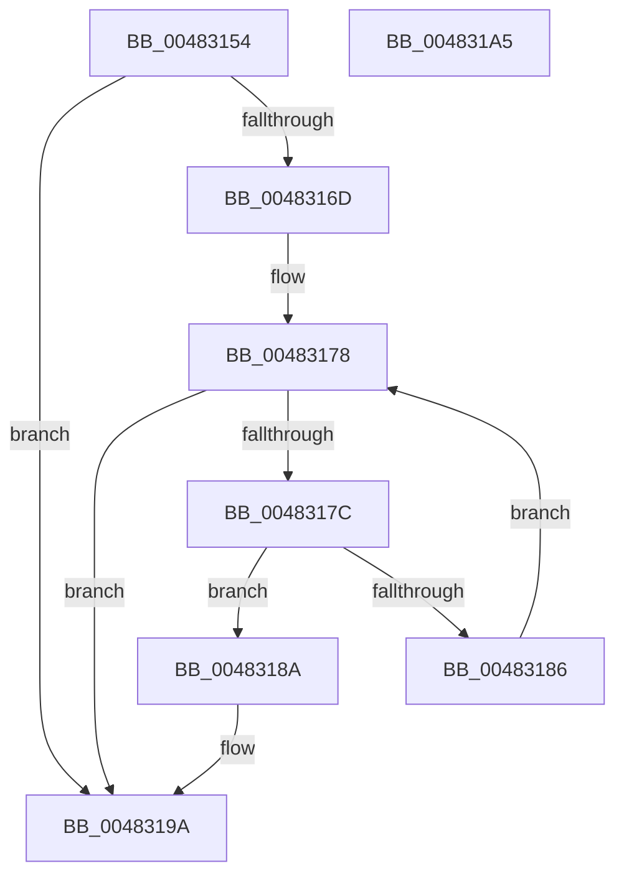

# ExpRemoveCurrentThreadFromThreadHistory

- RVA: `0x00483154`–`0x004831A6` (길이 `82` bytes)
- VA: `0x0000000140483154`
- 실행 섹션: `.text`
- PDB 이름 있음: `예`; PDB Function 태그: `아니요`
- unwind 정보 RVA: `0x0005CAAC`
- 디코드: `25`개 명령, `82/82` bytes 표시
- 미해석 바이트: `0` (있으면 어셈블리에 `.byte`로 보존)

> 이 문서는 커널 이미지의 기계어와 PDB 기호를 분석해 생성했습니다. 4번과 5번은 함수 원형과 자료형을 바이너리 사용 방식에서 추정한 C 해석이며 원본 소스 복구 결과는 아닙니다.

## 1. Dependencies

- 직접 호출 지점: **1**; 고유 호출 대상: **1**
- 직접 호출자로 확인된 함수: **2**
- RIP 상대 이미지 참조: **0**

### Outgoing calls
- `0x0048318F` → [ObfDereferenceObjectWithTag](../2F/ObfDereferenceObjectWithTag_function_002F78E0.md) (function, `0x002F78E0`)

### Direct callers
- [NtWaitForWorkViaWorkerFactory](../39/NtWaitForWorkViaWorkerFactory_function_00394270.md) at `0x00394D8E`
- [sub_006E25FA](../6E/Unknown_function_006E25FA.md) at `0x006E266B`

### Static image references
- 디코드된 RIP-relative 메모리 참조가 없습니다.

## 2. Other-region calls and transfers

- 다른 실행 섹션으로 향하는 call: **0**
- 별도 외부 분기/꼬리 이동을 확인하지 못했습니다.

## 3. Assembly (complete function range)

```asm
00483154  48 89 5C 24 08                  mov qword ptr [rsp + 8], rbx
00483159  57                              push rdi
0048315A  48 83 EC 20                     sub rsp, 0x20
0048315E  8B 81 98 01 00 00               mov eax, dword ptr [rcx + 0x198]
00483164  48 8B D9                        mov rbx, rcx
00483167  24 07                           and al, 7
00483169  3C 04                           cmp al, 4
0048316B  74 2D                           je 0x14048319a
0048316D  65 48 8B 0C 25 88 01 00 00      mov rcx, qword ptr gs:[0x188]
00483176  32 C0                           xor al, al
00483178  3C 04                           cmp al, 4
0048317A  73 1E                           jae 0x14048319a
0048317C  0F B6 F8                        movzx edi, al
0048317F  48 39 4C FB 48                  cmp qword ptr [rbx + rdi*8 + 0x48], rcx
00483184  74 04                           je 0x14048318a
00483186  FE C0                           inc al
00483188  EB EE                           jmp 0x140483178
0048318A  BA 44 66 6C 74                  mov edx, 0x746c6644
0048318F  E8 4C 47 E7 FF                  call 0x1402f78e0
00483194  48 83 64 FB 48 00               and qword ptr [rbx + rdi*8 + 0x48], 0
0048319A  48 8B 5C 24 30                  mov rbx, qword ptr [rsp + 0x30]
0048319F  48 83 C4 20                     add rsp, 0x20
004831A3  5F                              pop rdi
004831A4  C3                              ret
004831A5  CC                              int3
```

## 4. C-style interpretation (structured pseudocode)

```c
__int64 __fastcall ExpRemoveCurrentThreadFromThreadHistory(__int64 a1)
{
    __int64 result;
    __int64 v_rsp;
    unsigned __int64 v_stack_p8;

    v_stack_p8 = v_rbx;
    v_rsp = (v_rsp) - (32);
    result = (unsigned __int8)(((unsigned int)(*(unsigned int *)(a1 + 408))) & (7));
    if (((unsigned __int8)(result)) == 4) goto loc_0048319A;
    result = 0;
loc_00483178:
    if (0 >= 4) goto loc_0048319A;
    if ((*(unsigned __int64 *)(a1 + 0 * 8 + 72)) == (*(unsigned __int64 *)(gs_base + (0 + 392)))) goto loc_0048318A;
    result = (unsigned __int8)((result) + 1);
    goto loc_00483178;
loc_0048318A:
    result = ObfDereferenceObjectWithTag(*(unsigned __int64 *)(gs_base + (0 + 392)), (unsigned int)(0x746C6644ULL), a3, a4);
loc_0048319A:
    v_rsp = (v_rsp) + (32);
    return result;
}
```

## 5. (Beta) C Style

```c
int64_t ExpRemoveCurrentThreadFromThreadHistory(void *Arg1)
{
    uint8_t *arg1 = (uint8_t *)Arg1;

    int64_t result;
    int64_t local_rsp;
    uint64_t v_stack_p8;

    v_stack_p8 = local_rbx;
    local_rsp = (local_rsp) - (32);
    result = (uint8_t)(((uint32_t)(*(uint32_t *)(arg1 + 0x198))) & (7));
    if (((uint8_t)(result)) == 4) goto loc_0048319A;
    result = 0;
loc_00483178:
    if (0 >= 4) goto loc_0048319A;
    if ((*(uint64_t *)(arg1 + 0x0 * 8 + 0x48)) == (*(uint64_t *)(gs_base + (0 + 0x188)))) goto loc_0048318A;
    result = (uint8_t)((result) + 1);
    goto loc_00483178;
loc_0048318A:
    result = ObfDereferenceObjectWithTag(*(uint64_t *)(gs_base + (0 + 0x188)), (uint32_t)(0x746C6644ULL), a3, a4);
loc_0048319A:
    local_rsp = (local_rsp) + (32);
    return result;
}
```

### 관측된 메모리 오프셋

구조체 형식이 확인되지 않은 접근은 인자 기준의 오프셋으로만 기록했습니다.

| 기준 인자 | 오프셋 표현 | 폭 (bit) | 접근 |
|---|---:|---:|---|
| `Arg1` | `+ 0x48 + rdi*8` | `64` | `R` |
| `Arg1` | `+ 0x48 + rdi*8` | `64` | `R/W` |
| `Arg1` | `+ 0x198` | `32` | `R` |

## 6. Execution-region graph

[열기: 2D/3D 그래프와 함수 탐색 컨트롤 패널](../../../control-panel.html?section=text&rva=0x00483154&view=graph)

- 2D 그래프는 위에서 아래로 흐르고, 3D 그래프는 빈 공간을 드래그해 회전합니다. Shift+드래그는 이동, 휠은 확대·축소, 함수 노드 선택은 대상 보고서 이동입니다.

### Static fallback


