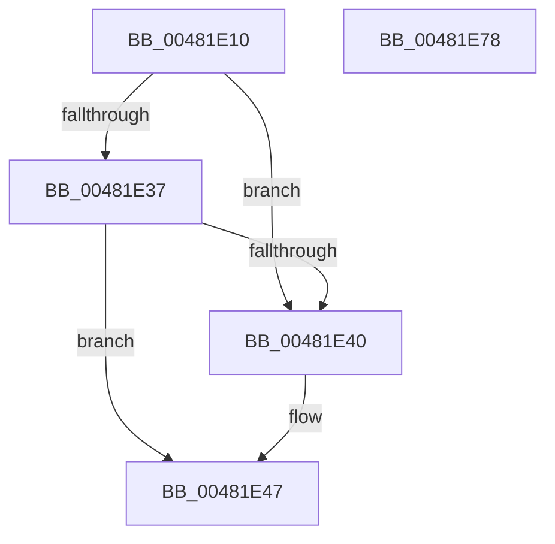

# ExpRemoveGeneralLookaside

- RVA: `0x00481E10`–`0x00481E79` (길이 `105` bytes)
- VA: `0x0000000140481E10`
- 실행 섹션: `.text`
- PDB 이름 있음: `예`; PDB Function 태그: `아니요`
- unwind 정보 RVA: `0x00060BC4`
- 디코드: `31`개 명령, `105/105` bytes 표시
- 미해석 바이트: `0` (있으면 어셈블리에 `.byte`로 보존)

> 이 문서는 커널 이미지의 기계어와 PDB 기호를 분석해 생성했습니다. 4번과 5번은 함수 원형과 자료형을 바이너리 사용 방식에서 추정한 C 해석이며 원본 소스 복구 결과는 아닙니다.

## 1. Dependencies

- 직접 호출 지점: **2**; 고유 호출 대상: **2**
- 직접 호출자로 확인된 함수: **3**
- RIP 상대 이미지 참조: **1**

### Outgoing calls
- `0x00481E25` → [KeAcquireSpinLockRaiseToDpc](../20/KeAcquireSpinLockRaiseToDpc_function_00208470.md) (function, `0x00208470`)
- `0x00481E53` → [KeReleaseSpinLock](../39/KeReleaseSpinLock_function_00392BA0.md) (function, `0x00392BA0`)

### Direct callers
- [ExDeletePagedLookasideList](ExDeletePagedLookasideList_function_00481D20.md) at `0x00481D33`
- [ExDeleteNPagedLookasideList](ExDeleteNPagedLookasideList_function_00481D50.md) at `0x00481D63`
- [ExDeleteLookasideListEx](ExDeleteLookasideListEx_function_00481DD0.md) at `0x00481DF3`

### Static image references
- `0x00481E63` → RVA `0x00FC6C08` (`ALMOSTRO`; read)

## 2. Other-region calls and transfers

- 다른 실행 섹션으로 향하는 call: **0**
- 별도 외부 분기/꼬리 이동을 확인하지 못했습니다.

## 3. Assembly (complete function range)

```asm
00481E10  48 89 5C 24 08                  mov qword ptr [rsp + 8], rbx
00481E15  48 89 74 24 10                  mov qword ptr [rsp + 0x10], rsi
00481E1A  57                              push rdi
00481E1B  48 83 EC 20                     sub rsp, 0x20
00481E1F  48 8B FA                        mov rdi, rdx
00481E22  48 8B F1                        mov rsi, rcx
00481E25  E8 46 66 D8 FF                  call 0x140208470
00481E2A  48 8D 5F 40                     lea rbx, [rdi + 0x40]
00481E2E  4C 8B 03                        mov r8, qword ptr [rbx]
00481E31  49 39 58 08                     cmp qword ptr [r8 + 8], rbx
00481E35  75 09                           jne 0x140481e40
00481E37  48 8B 53 08                     mov rdx, qword ptr [rbx + 8]
00481E3B  48 39 1A                        cmp qword ptr [rdx], rbx
00481E3E  74 07                           je 0x140481e47
00481E40  B9 03 00 00 00                  mov ecx, 3
00481E45  CD 29                           int 0x29
00481E47  4C 89 02                        mov qword ptr [rdx], r8
00481E4A  48 8B CE                        mov rcx, rsi
00481E4D  49 89 50 08                     mov qword ptr [r8 + 8], rdx
00481E51  8A D0                           mov dl, al
00481E53  E8 48 0D F1 FF                  call 0x140392ba0
00481E58  48 8B 74 24 38                  mov rsi, qword ptr [rsp + 0x38]
00481E5D  33 C0                           xor eax, eax
00481E5F  66 89 47 10                     mov word ptr [rdi + 0x10], ax
00481E63  48 8B 05 9E 4D B4 00            mov rax, qword ptr [rip + 0xb44d9e]
00481E6A  48 89 03                        mov qword ptr [rbx], rax
00481E6D  48 8B 5C 24 30                  mov rbx, qword ptr [rsp + 0x30]
00481E72  48 83 C4 20                     add rsp, 0x20
00481E76  5F                              pop rdi
00481E77  C3                              ret
00481E78  CC                              int3
```

## 4. C-style interpretation (structured pseudocode)

```c
__int64 __fastcall ExpRemoveGeneralLookaside(__int64 a1, __int64 a2)
{
    __int64 result;
    __int64 v_rsp;
    unsigned __int64 v_stack_p10;
    unsigned __int64 v_stack_p8;

    v_stack_p8 = v_rbx;
    v_stack_p10 = v_rsi;
    v_rsp = (v_rsp) - (32);
    result = KeAcquireSpinLockRaiseToDpc(a1, a2, a3, a4);
    if ((*(unsigned __int64 *)(*(unsigned __int64 *)(a2 + 64) + 8)) != (a2 + 64)) goto loc_00481E40;
    if ((*(unsigned __int64 *)(*(unsigned __int64 *)(a2 + 64 + 8))) != (a2 + 64)) {
        a1 = 3;
    }
    *(unsigned __int64 *)(*(unsigned __int64 *)(a2 + 64 + 8)) = *(unsigned __int64 *)(a2 + 64);
    *(unsigned __int64 *)(*(unsigned __int64 *)(a2 + 64) + 8) = *(unsigned __int64 *)(a2 + 64 + 8);
    result = KeReleaseSpinLock(a1, (unsigned __int8)(result), *(unsigned __int64 *)(a2 + 64), a4);
    result = 0;
    *(unsigned __int16 *)(a2 + 16) = 0;
    *(unsigned __int64 *)(a2 + 64) = *(unsigned __int64 *)(v_rip + 11816350);
    v_rsp = (v_rsp) + (32);
    return *(unsigned __int64 *)(v_rip + 11816350);
}
```

## 5. (Beta) C Style

```c
int64_t ExpRemoveGeneralLookaside(int64_t Arg1, void *Arg2)
{
    uint8_t *arg2 = (uint8_t *)Arg2;

    int64_t result;
    int64_t local_rsp;
    uint64_t v_stack_p10;
    uint64_t v_stack_p8;

    v_stack_p8 = local_rbx;
    v_stack_p10 = local_rsi;
    local_rsp = (local_rsp) - (32);
    result = KeAcquireSpinLockRaiseToDpc(Arg1, Arg2, a3, a4);
    if ((*(uint64_t *)(*(uint64_t *)(arg2 + 0x40) + 0x8)) != (Arg2 + 64)) goto loc_00481E40;
    if ((*(uint64_t *)(*(uint64_t *)(arg2 + 0x40 + 0x8))) != (Arg2 + 64)) {
        Arg1 = 3;
    }
    *(uint64_t *)(*(uint64_t *)(arg2 + 0x40 + 0x8)) = *(uint64_t *)(arg2 + 0x40);
    *(uint64_t *)(*(uint64_t *)(arg2 + 0x40) + 0x8) = *(uint64_t *)(arg2 + 0x40 + 0x8);
    result = KeReleaseSpinLock(Arg1, (uint8_t)(result), *(uint64_t *)(arg2 + 0x40), a4);
    result = 0;
    *(uint16_t *)(arg2 + 0x10) = 0;
    *(uint64_t *)(arg2 + 0x40) = *(uint64_t *)(v_rip + 0xB44D9E);
    local_rsp = (local_rsp) + (32);
    return *(uint64_t *)(v_rip + 0xB44D9E);
}
```

### 관측된 메모리 오프셋

구조체 형식이 확인되지 않은 접근은 인자 기준의 오프셋으로만 기록했습니다.

| 기준 인자 | 오프셋 표현 | 폭 (bit) | 접근 |
|---|---:|---:|---|
| `Arg2` | `+ 0x0` | `64` | `R` |
| `Arg2` | `+ 0x0` | `64` | `W` |
| `Arg2` | `+ 0x8` | `64` | `R` |
| `Arg2` | `+ 0x10` | `16` | `W` |
| `Arg2` | `+ 0x40` | `64` | `R` |

## 6. Execution-region graph

[열기: 2D/3D 그래프와 함수 탐색 컨트롤 패널](../../../control-panel.html?section=text&rva=0x00481E10&view=graph)

- 2D 그래프는 위에서 아래로 흐르고, 3D 그래프는 빈 공간을 드래그해 회전합니다. Shift+드래그는 이동, 휠은 확대·축소, 함수 노드 선택은 대상 보고서 이동입니다.

### Static fallback


