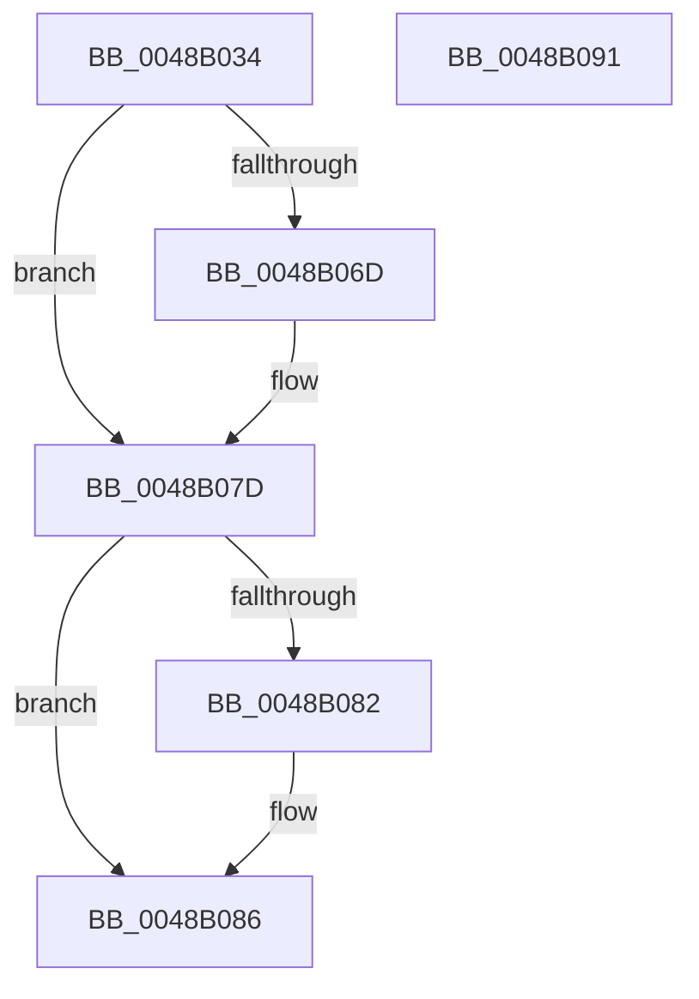

# FsRtlAcquirePushLockShared

- RVA: `0x0048B034`–`0x0048B092` (길이 `94` bytes)
- VA: `0x000000014048B034`
- 실행 섹션: `.text`
- PDB 이름 있음: `예`; PDB Function 태그: `아니요`
- unwind 정보 RVA: `0x0005CAAC`
- 디코드: `28`개 명령, `94/94` bytes 표시
- 미해석 바이트: `0` (있으면 어셈블리에 `.byte`로 보존)

> 이 문서는 커널 이미지의 기계어와 PDB 기호를 분석해 생성했습니다. 4번과 5번은 함수 원형과 자료형을 바이너리 사용 방식에서 추정한 C 해석이며 원본 소스 복구 결과는 아닙니다.

## 1. Dependencies

- 직접 호출 지점: **2**; 고유 호출 대상: **2**
- 직접 호출자로 확인된 함수: **11**
- RIP 상대 이미지 참조: **0**

### Outgoing calls
- `0x0048B057` → [KeAbPreAcquire](../21/KeAbPreAcquire_function_00210230.md) (function, `0x00210230`)
- `0x0048B078` → [ExfAcquirePushLockSharedEx](../21/ExfAcquirePushLockSharedEx_function_0021044C.md) (function, `0x0021044C`)

### Direct callers
- [FsRtlLookupPerStreamContextInternal](../26/FsRtlLookupPerStreamContextInternal_function_00265020.md) at `0x002650FA`
- [VmPinMemoryRange](../../page/7A/VmPinMemoryRange_function_007AD450.md) at `0x007AD50F`
- [VmUnpinMemoryRange](../../page/7A/VmUnpinMemoryRange_function_007AD730.md) at `0x007AD7A8`
- [PfSnGetPrefetchInstructions](../../page/8A/PfSnGetPrefetchInstructions_function_008AEBE4.md) at `0x008AEC59`
- [PfSnBeginAppLaunch](../../page/95/PfSnBeginAppLaunch_function_0095EC44.md) at `0x0095EE34`
- [PfSnIsHostingApplication](../../page/95/PfSnIsHostingApplication_function_0095FF34.md) at `0x0095FF69`
- [PfCheckDeprioritizeImage](../../page/9E/PfCheckDeprioritizeImage_function_009E97A8.md) at `0x009E97C5`
- [PfpRpCHashDeleteEntries](../../page/A3/PfpRpCHashDeleteEntries_function_00A322A8.md) at `0x00A3231B`
- [sub_00B206FE](../../page/B2/Unknown_function_00B206FE.md) at `0x00B2077D`
- [sub_00B3C840](../../page/B3/Unknown_function_00B3C840.md) at `0x00B3C856`
- [sub_00B484E6](../../page/B4/Unknown_function_00B484E6.md) at `0x00B4852C`

### Static image references
- 디코드된 RIP-relative 메모리 참조가 없습니다.

## 2. Other-region calls and transfers

- 다른 실행 섹션으로 향하는 call: **0**
- 별도 외부 분기/꼬리 이동을 확인하지 못했습니다.

## 3. Assembly (complete function range)

```asm
0048B034  48 89 5C 24 08                  mov qword ptr [rsp + 8], rbx
0048B039  57                              push rdi
0048B03A  48 83 EC 20                     sub rsp, 0x20
0048B03E  65 48 8B 04 25 88 01 00 00      mov rax, qword ptr gs:[0x188]
0048B047  45 33 C0                        xor r8d, r8d
0048B04A  33 D2                           xor edx, edx
0048B04C  48 8B F9                        mov rdi, rcx
0048B04F  66 FF 88 E4 01 00 00            dec word ptr [rax + 0x1e4]
0048B056  90                              nop
0048B057  E8 D4 51 D8 FF                  call 0x140210230
0048B05C  48 8B D8                        mov rbx, rax
0048B05F  B9 11 00 00 00                  mov ecx, 0x11
0048B064  33 C0                           xor eax, eax
0048B066  F0 48 0F B1 0F                  lock cmpxchg qword ptr [rdi], rcx
0048B06B  74 10                           je 0x14048b07d
0048B06D  4C 8B CF                        mov r9, rdi
0048B070  4C 8B C3                        mov r8, rbx
0048B073  33 D2                           xor edx, edx
0048B075  48 8B CF                        mov rcx, rdi
0048B078  E8 CF 53 D8 FF                  call 0x14021044c
0048B07D  48 85 DB                        test rbx, rbx
0048B080  74 04                           je 0x14048b086
0048B082  C6 43 0A 01                     mov byte ptr [rbx + 0xa], 1
0048B086  48 8B 5C 24 30                  mov rbx, qword ptr [rsp + 0x30]
0048B08B  48 83 C4 20                     add rsp, 0x20
0048B08F  5F                              pop rdi
0048B090  C3                              ret
0048B091  CC                              int3
```

## 4. C-style interpretation (structured pseudocode)

```c
__int64 __fastcall FsRtlAcquirePushLockShared(__int64 a1, int a2, int a3)
{
    __int64 result;
    __int64 v_rsp;
    unsigned __int64 v_stack_p8;

    v_stack_p8 = v_rbx;
    v_rsp = (v_rsp) - (32);
    a3 = 0;
    a2 = 0;
    result = KeAbPreAcquire(a1, a2, a3, a4);
    result = 0;
    if (!(condition_is_equal)) {
        a4 = a1;
        a3 = 0;
        a2 = 0;
        a1 = a1;
        result = ExfAcquirePushLockSharedEx(a1, a2, a3, a4);
    }
    if (result != 0) {
        *(unsigned __int8 *)(result + 10) = 1;
    }
    v_rsp = (v_rsp) + (32);
    return result;
}
```

## 5. (Beta) C Style

```c
int64_t FsRtlAcquirePushLockShared(void *Arg1, int32_t Arg2, int32_t Arg3)
{
    uint8_t *arg1 = (uint8_t *)Arg1;

    int64_t result;
    int64_t local_rsp;
    uint64_t v_stack_p8;

    v_stack_p8 = local_rbx;
    local_rsp = (local_rsp) - (32);
    Arg3 = 0;
    Arg2 = 0;
    result = KeAbPreAcquire(Arg1, Arg2, Arg3, a4);
    result = 0;
    if (!(condition_is_equal)) {
        a4 = Arg1;
        Arg3 = 0;
        Arg2 = 0;
        Arg1 = Arg1;
        result = ExfAcquirePushLockSharedEx(Arg1, Arg2, Arg3, a4);
    }
    if (result != 0) {
        *(uint8_t *)(result + 0xA) = 1;
    }
    local_rsp = (local_rsp) + (32);
    return result;
}
```

### 관측된 메모리 오프셋

구조체 형식이 확인되지 않은 접근은 인자 기준의 오프셋으로만 기록했습니다.

| 기준 인자 | 오프셋 표현 | 폭 (bit) | 접근 |
|---|---:|---:|---|
| `Arg1` | `+ 0x0` | `64` | `R` |

## 6. Execution-region graph

[열기: 2D/3D 그래프와 함수 탐색 컨트롤 패널](../../../control-panel.html?section=text&rva=0x0048B034&view=graph)

- 2D 그래프는 위에서 아래로 흐르고, 3D 그래프는 빈 공간을 드래그해 회전합니다. Shift+드래그는 이동, 휠은 확대·축소, 함수 노드 선택은 대상 보고서 이동입니다.

### Static fallback


