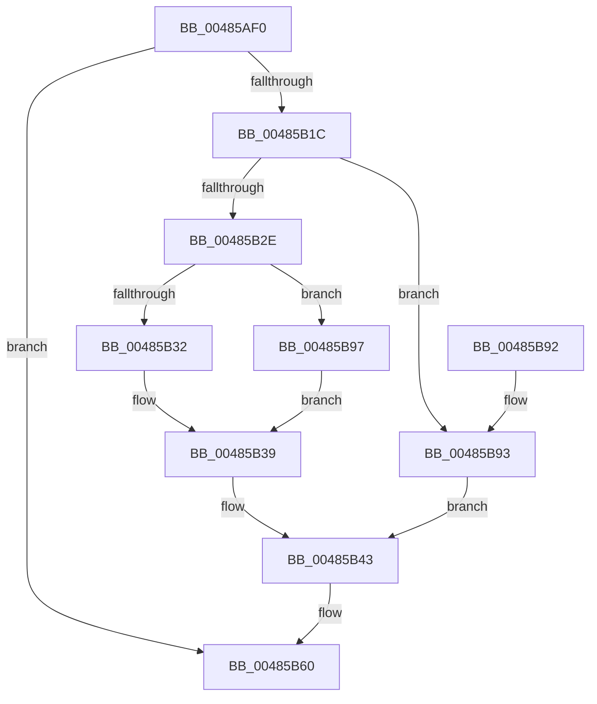

# FsRtlLookupLastBaseMcbEntryAndIndex

- RVA: `0x00485AF0`–`0x00485B9C` (길이 `172` bytes)
- VA: `0x0000000140485AF0`
- 실행 섹션: `.text`
- PDB 이름 있음: `예`; PDB Function 태그: `아니요`
- unwind 정보 RVA: `0x000AF678`
- 디코드: `58`개 명령, `172/172` bytes 표시
- 미해석 바이트: `0` (있으면 어셈블리에 `.byte`로 보존)

> 이 문서는 커널 이미지의 기계어와 PDB 기호를 분석해 생성했습니다. 4번과 5번은 함수 원형과 자료형을 바이너리 사용 방식에서 추정한 C 해석이며 원본 소스 복구 결과는 아닙니다.

## 1. Dependencies

- 직접 호출 지점: **0**; 고유 호출 대상: **0**
- 직접 호출자로 확인된 함수: **1**
- RIP 상대 이미지 참조: **0**

### Outgoing calls
- 직접 디코드된 call 명령이 없습니다.

### Direct callers
- [FsRtlLookupLastLargeMcbEntryAndIndex](FsRtlLookupLastLargeMcbEntryAndIndex_function_00485A80.md) at `0x00485ABB`

### Static image references
- 디코드된 RIP-relative 메모리 참조가 없습니다.

## 2. Other-region calls and transfers

- 다른 실행 섹션으로 향하는 call: **0**
- 별도 외부 분기/꼬리 이동을 확인하지 못했습니다.

## 3. Assembly (complete function range)

```asm
00485AF0  48 8B C4                        mov rax, rsp
00485AF3  48 89 58 08                     mov qword ptr [rax + 8], rbx
00485AF7  48 89 68 10                     mov qword ptr [rax + 0x10], rbp
00485AFB  48 89 70 18                     mov qword ptr [rax + 0x18], rsi
00485AFF  48 89 78 20                     mov qword ptr [rax + 0x20], rdi
00485B03  45 33 D2                        xor r10d, r10d
00485B06  48 8B D9                        mov rbx, rcx
00485B09  8B 49 04                        mov ecx, dword ptr [rcx + 4]
00485B0C  83 CD FF                        or ebp, 0xffffffff
00485B0F  49 8B F1                        mov rsi, r9
00485B12  4C 8B DA                        mov r11, rdx
00485B15  41 8A C2                        mov al, r10b
00485B18  85 C9                           test ecx, ecx
00485B1A  74 44                           je 0x140485b60
00485B1C  4C 8B 4B 10                     mov r9, qword ptr [rbx + 0x10]
00485B20  8D 41 FF                        lea eax, [rcx - 1]
00485B23  8B F8                           mov edi, eax
00485B25  41 8B 54 C1 04                  mov edx, dword ptr [r9 + rax*8 + 4]
00485B2A  3B D5                           cmp edx, ebp
00485B2C  74 65                           je 0x140485b93
00485B2E  85 C0                           test eax, eax
00485B30  74 65                           je 0x140485b97
00485B32  8D 41 FE                        lea eax, [rcx - 2]
00485B35  41 8B 04 C1                     mov eax, dword ptr [r9 + rax*8]
00485B39  2B D0                           sub edx, eax
00485B3B  41 8B 04 F9                     mov eax, dword ptr [r9 + rdi*8]
00485B3F  FF C8                           dec eax
00485B41  03 C2                           add eax, edx
00485B43  41 89 00                        mov dword ptr [r8], eax
00485B46  8B 4B 04                        mov ecx, dword ptr [rbx + 4]
00485B49  48 8B 43 10                     mov rax, qword ptr [rbx + 0x10]
00485B4D  FF C9                           dec ecx
00485B4F  8B 14 C8                        mov edx, dword ptr [rax + rcx*8]
00485B52  FF CA                           dec edx
00485B54  41 89 13                        mov dword ptr [r11], edx
00485B57  8B 43 04                        mov eax, dword ptr [rbx + 4]
00485B5A  FF C8                           dec eax
00485B5C  89 06                           mov dword ptr [rsi], eax
00485B5E  B0 01                           mov al, 1
00485B60  41 39 2B                        cmp dword ptr [r11], ebp
00485B63  41 8B CA                        mov ecx, r10d
00485B66  48 8B 5C 24 08                  mov rbx, qword ptr [rsp + 8]
00485B6B  48 8B 74 24 18                  mov rsi, qword ptr [rsp + 0x18]
00485B70  0F 95 C1                        setne cl
00485B73  48 8B 7C 24 20                  mov rdi, qword ptr [rsp + 0x20]
00485B78  FF C9                           dec ecx
00485B7A  41 89 4B 04                     mov dword ptr [r11 + 4], ecx
00485B7E  41 39 28                        cmp dword ptr [r8], ebp
00485B81  48 8B 6C 24 10                  mov rbp, qword ptr [rsp + 0x10]
00485B86  41 0F 95 C2                     setne r10b
00485B8A  41 FF CA                        dec r10d
00485B8D  45 89 50 04                     mov dword ptr [r8 + 4], r10d
00485B91  C3                              ret
00485B92  CC                              int3
00485B93  8B C5                           mov eax, ebp
00485B95  EB AC                           jmp 0x140485b43
00485B97  41 8B C2                        mov eax, r10d
00485B9A  EB 9D                           jmp 0x140485b39
```

## 4. C-style interpretation (structured pseudocode)

```c
__int64 __fastcall FsRtlLookupLastBaseMcbEntryAndIndex(__int64 a1, __int64 a2, __int64 a3, __int64 a4)
{
    __int64 result;
    __int64 v_r10;
    __int64 v_rbp;
    unsigned __int64 v_stack_p10;
    unsigned __int64 v_stack_p18;
    unsigned __int64 v_stack_p20;
    unsigned __int64 v_stack_p8;

    *(unsigned __int64 *)(v_rsp + 8) = v_rbx;
    *(unsigned __int64 *)(v_rsp + 16) = v_rbp;
    *(unsigned __int64 *)(v_rsp + 24) = v_rsi;
    *(unsigned __int64 *)(v_rsp + 32) = v_rdi;
    v_r10 = 0;
    v_rbp = (unsigned int)((v_rbp) | (0xFFFFFFFFULL));
    if ((unsigned int)((unsigned int)(*(unsigned int *)(a1 + 4))) == 0) goto loc_00485B60;
    if (((unsigned int)((unsigned int)(*(unsigned int *)(*(unsigned __int64 *)(a1 + 16) + (unsigned int)(*(unsigned int *)(a1 + 4)) - 1 * 8 + 4)))) == ((unsigned int)(v_rbp))) goto loc_00485B93;
    if ((unsigned int)((unsigned int)(*(unsigned int *)(a1 + 4)) - 1) == 0) goto loc_00485B97;
loc_00485B39:
    a2 = (unsigned int)(((unsigned int)(*(unsigned int *)(*(unsigned __int64 *)(a1 + 16) + (unsigned int)(*(unsigned int *)(a1 + 4)) - 1 * 8 + 4))) - ((unsigned int)((unsigned int)(*(unsigned int *)(*(unsigned __int64 *)(a1 + 16) + (unsigned int)(*(unsigned int *)(a1 + 4)) - 2 * 8)))));
    result = (unsigned int)(((unsigned int)(*(unsigned int *)(*(unsigned __int64 *)(a1 + 16) + (unsigned int)((unsigned int)((unsigned int)(*(unsigned int *)(a1 + 4)) - 1)) * 8))) - 1);
    result = (unsigned int)((result) + ((unsigned int)(a2)));
loc_00485B43:
    *(unsigned int *)(a3) = (unsigned int)(result);
    a1 = (unsigned int)(((unsigned int)(*(unsigned int *)(a1 + 4))) - 1);
    a2 = (unsigned int)(((unsigned int)(*(unsigned int *)(*(unsigned __int64 *)(a1 + 16) + a1 * 8))) - 1);
    *(unsigned int *)(a2) = (unsigned int)(a2);
    result = (unsigned int)(((unsigned int)(*(unsigned int *)(a1 + 4))) - 1);
    *(unsigned int *)(a4) = (unsigned int)(result);
loc_00485B60:
    a1 = ((*(unsigned int *)(a2)) != ((unsigned int)(v_rbp))) ? 1 : 0;
    a1 = (unsigned int)((a1) - 1);
    *(unsigned int *)(a2 + 4) = (unsigned int)(a1);
    v_r10 = ((*(unsigned int *)(a3)) != ((unsigned int)(v_rbp))) ? 1 : 0;
    v_r10 = (unsigned int)((v_r10) - 1);
    *(unsigned int *)(a3 + 4) = (unsigned int)(v_r10);
    return 1;
loc_00485B93:
    goto loc_00485B43;
loc_00485B97:
    goto loc_00485B39;
}
```

## 5. (Beta) C Style

```c
int64_t FsRtlLookupLastBaseMcbEntryAndIndex(void *Arg1, void *Arg2, void *Arg3, void *Arg4)
{
    uint8_t *arg1 = (uint8_t *)Arg1;
    uint8_t *arg2 = (uint8_t *)Arg2;
    uint8_t *arg3 = (uint8_t *)Arg3;
    uint8_t *arg4 = (uint8_t *)Arg4;

    int64_t result;
    int64_t local_r10;
    int64_t local_rbp;
    uint64_t v_stack_p10;
    uint64_t v_stack_p18;
    uint64_t v_stack_p20;
    uint64_t v_stack_p8;

    *(uint64_t *)(local_rsp + 0x8) = local_rbx;
    *(uint64_t *)(local_rsp + 0x10) = local_rbp;
    *(uint64_t *)(local_rsp + 0x18) = local_rsi;
    *(uint64_t *)(local_rsp + 0x20) = local_rdi;
    local_r10 = 0;
    local_rbp = (uint32_t)((local_rbp) | (0xFFFFFFFFULL));
    if ((uint32_t)((uint32_t)(*(uint32_t *)(arg1 + 0x4))) == 0) goto loc_00485B60;
    if (((uint32_t)((uint32_t)(*(uint32_t *)(*(uint64_t *)(arg1 + 0x10) + (uint32_t)(*(uint32_t *)(arg1 + 0x4)) - 0x1 * 8 + 0x4)))) == ((uint32_t)(local_rbp))) goto loc_00485B93;
    if ((uint32_t)((uint32_t)(*(uint32_t *)(arg1 + 0x4)) - 1) == 0) goto loc_00485B97;
loc_00485B39:
    Arg2 = (uint32_t)(((uint32_t)(*(uint32_t *)(*(uint64_t *)(arg1 + 0x10) + (uint32_t)(*(uint32_t *)(arg1 + 0x4)) - 0x1 * 8 + 0x4))) - ((uint32_t)((uint32_t)(*(uint32_t *)(*(uint64_t *)(arg1 + 0x10) + (uint32_t)(*(uint32_t *)(arg1 + 0x4)) - 0x2 * 8)))));
    result = (uint32_t)(((uint32_t)(*(uint32_t *)(*(uint64_t *)(arg1 + 0x10) + (uint32_t)((uint32_t)((uint32_t)(*(uint32_t *)(arg1 + 0x4)) - 0x1)) * 8))) - 1);
    result = (uint32_t)((result) + ((uint32_t)(Arg2)));
loc_00485B43:
    *(uint32_t *)(arg3) = (uint32_t)(result);
    Arg1 = (uint32_t)(((uint32_t)(*(uint32_t *)(arg1 + 0x4))) - 1);
    Arg2 = (uint32_t)(((uint32_t)(*(uint32_t *)(*(uint64_t *)(arg1 + 0x10) + arg1 * 8))) - 1);
    *(uint32_t *)(arg2) = (uint32_t)(Arg2);
    result = (uint32_t)(((uint32_t)(*(uint32_t *)(arg1 + 0x4))) - 1);
    *(uint32_t *)(arg4) = (uint32_t)(result);
loc_00485B60:
    Arg1 = ((*(uint32_t *)(arg2)) != ((uint32_t)(local_rbp))) ? 1 : 0;
    Arg1 = (uint32_t)((Arg1) - 1);
    *(uint32_t *)(arg2 + 0x4) = (uint32_t)(Arg1);
    local_r10 = ((*(uint32_t *)(arg3)) != ((uint32_t)(local_rbp))) ? 1 : 0;
    local_r10 = (uint32_t)((local_r10) - 1);
    *(uint32_t *)(arg3 + 0x4) = (uint32_t)(local_r10);
    return 1;
loc_00485B93:
    goto loc_00485B43;
loc_00485B97:
    goto loc_00485B39;
}
```

### 관측된 메모리 오프셋

구조체 형식이 확인되지 않은 접근은 인자 기준의 오프셋으로만 기록했습니다.

| 기준 인자 | 오프셋 표현 | 폭 (bit) | 접근 |
|---|---:|---:|---|
| `Arg1` | `+ 0x4` | `32` | `R` |
| `Arg1` | `+ 0x10` | `64` | `R` |
| `Arg2` | `+ 0x0` | `32` | `R` |
| `Arg2` | `+ 0x0` | `32` | `W` |
| `Arg2` | `+ 0x4` | `32` | `W` |
| `Arg3` | `+ 0x0` | `32` | `R` |
| `Arg3` | `+ 0x0` | `32` | `W` |
| `Arg3` | `+ 0x4` | `32` | `W` |
| `Arg4` | `+ 0x0` | `32` | `W` |

## 6. Execution-region graph

[열기: 2D/3D 그래프와 함수 탐색 컨트롤 패널](../../../control-panel.html?section=text&rva=0x00485AF0&view=graph)

- 2D 그래프는 위에서 아래로 흐르고, 3D 그래프는 빈 공간을 드래그해 회전합니다. Shift+드래그는 이동, 휠은 확대·축소, 함수 노드 선택은 대상 보고서 이동입니다.

### Static fallback


